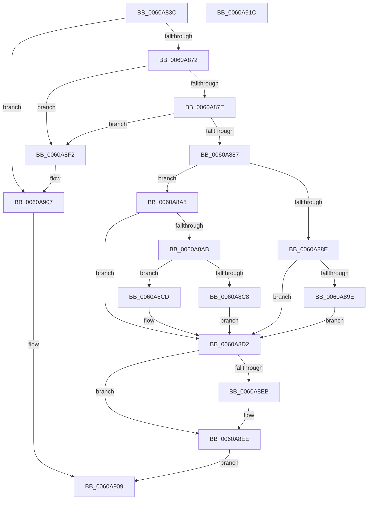

# SepConstructAntiTamperBaselinePolicy

- RVA: `0x0060A83C`–`0x0060A91D` (길이 `225` bytes)
- VA: `0x000000014060A83C`
- 실행 섹션: `.text`
- PDB 이름 있음: `예`; PDB Function 태그: `예`
- unwind 정보 RVA: `0x00061768`
- 디코드: `67`개 명령, `225/225` bytes 표시
- 미해석 바이트: `0` (있으면 어셈블리에 `.byte`로 보존)

> 이 문서는 커널 이미지의 기계어와 PDB 기호를 분석해 생성했습니다. 4번과 5번은 함수 원형과 자료형을 바이너리 사용 방식에서 추정한 C 해석이며 원본 소스 복구 결과는 아닙니다.

## 1. Dependencies

- 직접 호출 지점: **5**; 고유 호출 대상: **4**
- 직접 호출자로 확인된 함수: **1**
- RIP 상대 이미지 참조: **0**

### Outgoing calls
- `0x0060A861` → [PsReferencePrimaryToken](../../page/9A/PsReferencePrimaryToken_function_009A2CB0.md) (function, `0x009A2CB0`)
- `0x0060A893` → [SepDuplicateAntiTamperPolicy](SepDuplicateAntiTamperPolicy_function_0060AD44.md) (function, `0x0060AD44`)
- `0x0060A8BB` → [ExAllocatePool2](../../poolcode/B8/ExAllocatePool2_function_00B820F0.md) (function, `0x00B820F0`)
- `0x0060A8E2` → [ObFastDereferenceObject](../3E/ObFastDereferenceObject_function_003ED5F0.md) (function, `0x003ED5F0`)
- `0x0060A902` → [ObFastDereferenceObject](../3E/ObFastDereferenceObject_function_003ED5F0.md) (function, `0x003ED5F0`)

### Direct callers
- [SeConstructAntiTamperPolicy](SeConstructAntiTamperPolicy_function_0060A094.md) at `0x0060A0DB`
- [SeConstructAntiTamperPolicy](SeConstructAntiTamperPolicy_function_0060A094.md) at `0x0060A0FD`

### Static image references
- 디코드된 RIP-relative 메모리 참조가 없습니다.

## 2. Other-region calls and transfers

- 다른 실행 섹션으로 향하는 call: **2**
  - `0x0060A861` → [PsReferencePrimaryToken](../../page/9A/PsReferencePrimaryToken_function_009A2CB0.md) (`.text` → `PAGE`)
  - `0x0060A8BB` → [ExAllocatePool2](../../poolcode/B8/ExAllocatePool2_function_00B820F0.md) (`.text` → `POOLCODE`)
- 별도 외부 분기/꼬리 이동을 확인하지 못했습니다.

## 3. Assembly (complete function range)

```asm
0060A83C  48 89 5C 24 08                  mov qword ptr [rsp + 8], rbx
0060A841  48 89 6C 24 18                  mov qword ptr [rsp + 0x18], rbp
0060A846  56                              push rsi
0060A847  57                              push rdi
0060A848  41 56                           push r14
0060A84A  48 83 EC 20                     sub rsp, 0x20
0060A84E  48 83 22 00                     and qword ptr [rdx], 0
0060A852  33 DB                           xor ebx, ebx
0060A854  48 89 5C 24 48                  mov qword ptr [rsp + 0x48], rbx
0060A859  4C 8B F2                        mov r14, rdx
0060A85C  48 8B E9                        mov rbp, rcx
0060A85F  33 FF                           xor edi, edi
0060A861  E8 4A 84 39 00                  call 0x1409a2cb0
0060A866  48 8B F0                        mov rsi, rax
0060A869  48 85 C0                        test rax, rax
0060A86C  0F 84 95 00 00 00               je 0x14060a907
0060A872  48 8B 88 B8 05 00 00            mov rcx, qword ptr [rax + 0x5b8]
0060A879  48 85 C9                        test rcx, rcx
0060A87C  74 74                           je 0x14060a8f2
0060A87E  48 8B 49 30                     mov rcx, qword ptr [rcx + 0x30]
0060A882  48 85 C9                        test rcx, rcx
0060A885  74 6B                           je 0x14060a8f2
0060A887  8B 41 24                        mov eax, dword ptr [rcx + 0x24]
0060A88A  A8 04                           test al, 4
0060A88C  74 17                           je 0x14060a8a5
0060A88E  48 8D 54 24 48                  lea rdx, [rsp + 0x48]
0060A893  E8 AC 04 00 00                  call 0x14060ad44
0060A898  8B F8                           mov edi, eax
0060A89A  85 C0                           test eax, eax
0060A89C  78 34                           js 0x14060a8d2
0060A89E  48 8B 5C 24 48                  mov rbx, qword ptr [rsp + 0x48]
0060A8A3  EB 2D                           jmp 0x14060a8d2
0060A8A5  8B 01                           mov eax, dword ptr [rcx]
0060A8A7  A8 01                           test al, 1
0060A8A9  74 27                           je 0x14060a8d2
0060A8AB  BA 40 00 00 00                  mov edx, 0x40
0060A8B0  B9 00 01 00 00                  mov ecx, 0x100
0060A8B5  41 B8 53 65 41 50               mov r8d, 0x50416553
0060A8BB  E8 30 78 57 00                  call 0x140b820f0
0060A8C0  48 8B D8                        mov rbx, rax
0060A8C3  48 85 C0                        test rax, rax
0060A8C6  74 05                           je 0x14060a8cd
0060A8C8  83 08 01                        or dword ptr [rax], 1
0060A8CB  EB 05                           jmp 0x14060a8d2
0060A8CD  BF 9A 00 00 C0                  mov edi, 0xc000009a
0060A8D2  48 8D 8D 48 02 00 00            lea rcx, [rbp + 0x248]
0060A8D9  41 B8 44 66 6C 74               mov r8d, 0x746c6644
0060A8DF  48 8B D6                        mov rdx, rsi
0060A8E2  E8 09 2D DE FF                  call 0x1403ed5f0
0060A8E7  85 FF                           test edi, edi
0060A8E9  78 03                           js 0x14060a8ee
0060A8EB  49 89 1E                        mov qword ptr [r14], rbx
0060A8EE  8B C7                           mov eax, edi
0060A8F0  EB 17                           jmp 0x14060a909
0060A8F2  48 8D 8D 48 02 00 00            lea rcx, [rbp + 0x248]
0060A8F9  41 B8 44 66 6C 74               mov r8d, 0x746c6644
0060A8FF  48 8B D6                        mov rdx, rsi
0060A902  E8 E9 2C DE FF                  call 0x1403ed5f0
0060A907  33 C0                           xor eax, eax
0060A909  48 8B 5C 24 40                  mov rbx, qword ptr [rsp + 0x40]
0060A90E  48 8B 6C 24 50                  mov rbp, qword ptr [rsp + 0x50]
0060A913  48 83 C4 20                     add rsp, 0x20
0060A917  41 5E                           pop r14
0060A919  5F                              pop rdi
0060A91A  5E                              pop rsi
0060A91B  C3                              ret
0060A91C  CC                              int3
```

## 4. C-style interpretation (structured pseudocode)

```c
__int64 __fastcall SepConstructAntiTamperBaselinePolicy(__int64 a1, __int64 a2)
{
    __int64 result;
    __int64 v_rbx;
    __int64 v_rdi;
    __int64 v_rsp;
    unsigned __int64 v_stack_p10;
    unsigned __int64 v_stack_p18;
    unsigned __int64 v_stack_p8;

    v_stack_p8 = v_rbx;
    v_stack_p18 = v_rbp;
    v_rsp = (v_rsp) - (32);
    v_rbx = 0;
    v_stack_p10 = 0;
    v_rdi = 0;
    result = PsReferencePrimaryToken(a1, a2, a3, a4);
    if (result == 0) goto loc_0060A907;
    if (*(unsigned __int64 *)(result + 1464) == 0) goto loc_0060A8F2;
    if (*(unsigned __int64 *)(*(unsigned __int64 *)(result + 1464) + 48) == 0) goto loc_0060A8F2;
    if ((((unsigned __int8)((unsigned int)(*(unsigned int *)(*(unsigned __int64 *)(*(unsigned __int64 *)(result + 1464) + 48) + 36)))) & (4)) == 0) goto loc_0060A8A5;
    result = SepDuplicateAntiTamperPolicy(*(unsigned __int64 *)(*(unsigned __int64 *)(result + 1464) + 48), v_stack_p10, a3, a4);
    if (sign_flag) goto loc_0060A8D2;
    goto loc_0060A8D2;
loc_0060A8A5:
    if ((((unsigned __int8)((unsigned int)(*(unsigned int *)(*(unsigned __int64 *)(*(unsigned __int64 *)(result + 1464) + 48))))) & (1)) == 0) goto loc_0060A8D2;
    result = ExAllocatePool2(256, 64, (unsigned int)(0x50416553ULL), a4);
    if (result == 0) goto loc_0060A8CD;
    goto loc_0060A8D2;
loc_0060A8CD:
loc_0060A8D2:
    result = ObFastDereferenceObject(a1 + 584, result, (unsigned int)(0x746C6644ULL), a4);
    if (!(sign_flag)) {
        *(unsigned __int64 *)(a2) = result;
    }
    goto loc_0060A909;
loc_0060A8F2:
    result = ObFastDereferenceObject(a1 + 584, result, (unsigned int)(0x746C6644ULL), a4);
loc_0060A907:
    result = 0;
loc_0060A909:
    v_rsp = (v_rsp) + (32);
    return result;
}
```

## 5. (Beta) C Style

```c
int64_t SepConstructAntiTamperBaselinePolicy(void *Arg1, void *Arg2)
{
    uint8_t *arg1 = (uint8_t *)Arg1;
    uint8_t *arg2 = (uint8_t *)Arg2;

    int64_t result;
    int64_t local_rbx;
    int64_t local_rdi;
    int64_t local_rsp;
    uint64_t v_stack_p10;
    uint64_t v_stack_p18;
    uint64_t v_stack_p8;

    v_stack_p8 = local_rbx;
    v_stack_p18 = local_rbp;
    local_rsp = (local_rsp) - (32);
    local_rbx = 0;
    v_stack_p10 = 0;
    local_rdi = 0;
    result = PsReferencePrimaryToken(Arg1, Arg2, a3, a4);
    if (result == 0) goto loc_0060A907;
    if (*(uint64_t *)(result + 0x5B8) == 0) goto loc_0060A8F2;
    if (*(uint64_t *)(*(uint64_t *)(result + 0x5B8) + 0x30) == 0) goto loc_0060A8F2;
    if ((((uint8_t)((uint32_t)(*(uint32_t *)(*(uint64_t *)(*(uint64_t *)(result + 0x5B8) + 0x30) + 0x24)))) & (4)) == 0) goto loc_0060A8A5;
    result = SepDuplicateAntiTamperPolicy(*(uint64_t *)(*(uint64_t *)(result + 0x5B8) + 0x30), v_stack_p10, a3, a4);
    if (sign_flag) goto loc_0060A8D2;
    goto loc_0060A8D2;
loc_0060A8A5:
    if ((((uint8_t)((uint32_t)(*(uint32_t *)(*(uint64_t *)(*(uint64_t *)(result + 0x5B8) + 0x30))))) & (1)) == 0) goto loc_0060A8D2;
    result = ExAllocatePool2(256, 64, (uint32_t)(0x50416553ULL), a4);
    if (result == 0) goto loc_0060A8CD;
    goto loc_0060A8D2;
loc_0060A8CD:
loc_0060A8D2:
    result = ObFastDereferenceObject(Arg1 + 584, result, (uint32_t)(0x746C6644ULL), a4);
    if (!(sign_flag)) {
        *(uint64_t *)(arg2) = result;
    }
    goto loc_0060A909;
loc_0060A8F2:
    result = ObFastDereferenceObject(Arg1 + 584, result, (uint32_t)(0x746C6644ULL), a4);
loc_0060A907:
    result = 0;
loc_0060A909:
    local_rsp = (local_rsp) + (32);
    return result;
}
```

### 관측된 메모리 오프셋

구조체 형식이 확인되지 않은 접근은 인자 기준의 오프셋으로만 기록했습니다.

| 기준 인자 | 오프셋 표현 | 폭 (bit) | 접근 |
|---|---:|---:|---|
| `Arg1` | `+ 0x248` | `64` | `R` |
| `Arg2` | `+ 0x0` | `64` | `R/W` |
| `Arg2` | `+ 0x0` | `64` | `W` |

## 6. Execution-region graph

[열기: 2D/3D 그래프와 함수 탐색 컨트롤 패널](../../../control-panel.html?section=text&rva=0x0060A83C&view=graph)

- 2D 그래프는 위에서 아래로 흐르고, 3D 그래프는 빈 공간을 드래그해 회전합니다. Shift+드래그는 이동, 휠은 확대·축소, 함수 노드 선택은 대상 보고서 이동입니다.

### Static fallback


