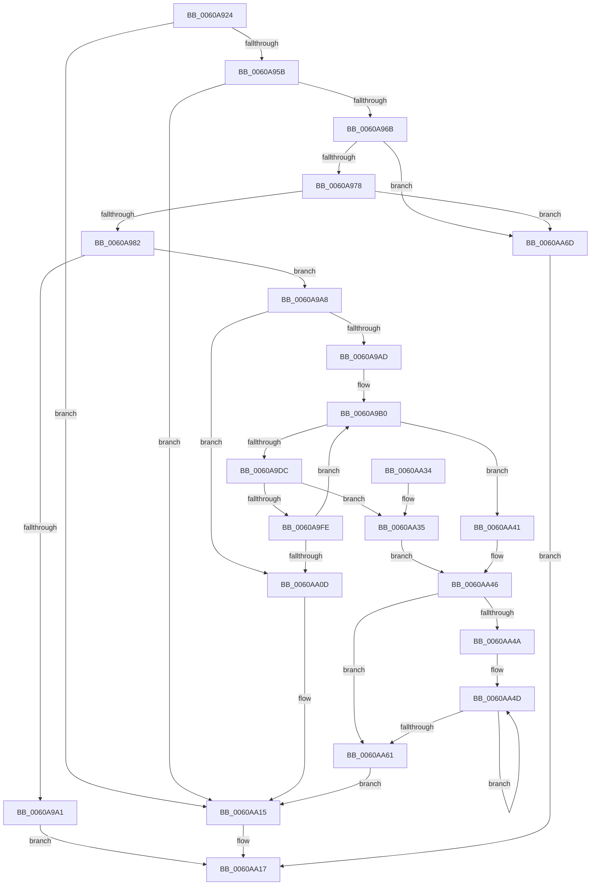

# SepCopyAntiTamperDebugPolicy

- RVA: `0x0060A924`–`0x0060AA74` (길이 `336` bytes)
- VA: `0x000000014060A924`
- 실행 섹션: `.text`
- PDB 이름 있음: `예`; PDB Function 태그: `아니요`
- unwind 정보 RVA: `0x000D1650`
- 디코드: `100`개 명령, `336/336` bytes 표시
- 미해석 바이트: `0` (있으면 어셈블리에 `.byte`로 보존)

> 이 문서는 커널 이미지의 기계어와 PDB 기호를 분석해 생성했습니다. 4번과 5번은 함수 원형과 자료형을 바이너리 사용 방식에서 추정한 C 해석이며 원본 소스 복구 결과는 아닙니다.

## 1. Dependencies

- 직접 호출 지점: **6**; 고유 호출 대상: **3**
- 직접 호출자로 확인된 함수: **1**
- RIP 상대 이미지 참조: **0**

### Outgoing calls
- `0x0060A994` → [ExAllocatePool2](../../poolcode/B8/ExAllocatePool2_function_00B820F0.md) (function, `0x00B820F0`)
- `0x0060A9CF` → [ExAllocatePool2](../../poolcode/B8/ExAllocatePool2_function_00B820F0.md) (function, `0x00B820F0`)
- `0x0060A9F3` → [RtlCopySid](../../page/9A/RtlCopySid_function_009A9A50.md) (function, `0x009A9A50`)
- `0x0060AA3A` → [ExFreePoolWithTag](../../poolcode/B8/ExFreePoolWithTag_function_00B82870.md) (function, `0x00B82870`)
- `0x0060AA52` → [ExFreePoolWithTag](../../poolcode/B8/ExFreePoolWithTag_function_00B82870.md) (function, `0x00B82870`)
- `0x0060AA66` → [ExFreePoolWithTag](../../poolcode/B8/ExFreePoolWithTag_function_00B82870.md) (function, `0x00B82870`)

### Direct callers
- [SepDuplicateAntiTamperPolicy](SepDuplicateAntiTamperPolicy_function_0060AD44.md) at `0x0060AD91`

### Static image references
- 디코드된 RIP-relative 메모리 참조가 없습니다.

## 2. Other-region calls and transfers

- 다른 실행 섹션으로 향하는 call: **6**
  - `0x0060A994` → [ExAllocatePool2](../../poolcode/B8/ExAllocatePool2_function_00B820F0.md) (`.text` → `POOLCODE`)
  - `0x0060A9CF` → [ExAllocatePool2](../../poolcode/B8/ExAllocatePool2_function_00B820F0.md) (`.text` → `POOLCODE`)
  - `0x0060A9F3` → [RtlCopySid](../../page/9A/RtlCopySid_function_009A9A50.md) (`.text` → `PAGE`)
  - `0x0060AA3A` → [ExFreePoolWithTag](../../poolcode/B8/ExFreePoolWithTag_function_00B82870.md) (`.text` → `POOLCODE`)
  - `0x0060AA52` → [ExFreePoolWithTag](../../poolcode/B8/ExFreePoolWithTag_function_00B82870.md) (`.text` → `POOLCODE`)
  - `0x0060AA66` → [ExFreePoolWithTag](../../poolcode/B8/ExFreePoolWithTag_function_00B82870.md) (`.text` → `POOLCODE`)
- 별도 외부 분기/꼬리 이동을 확인하지 못했습니다.

## 3. Assembly (complete function range)

```asm
0060A924  48 89 5C 24 08                  mov qword ptr [rsp + 8], rbx
0060A929  48 89 6C 24 10                  mov qword ptr [rsp + 0x10], rbp
0060A92E  48 89 74 24 18                  mov qword ptr [rsp + 0x18], rsi
0060A933  57                              push rdi
0060A934  41 54                           push r12
0060A936  41 55                           push r13
0060A938  41 56                           push r14
0060A93A  41 57                           push r15
0060A93C  48 83 EC 20                     sub rsp, 0x20
0060A940  8B 01                           mov eax, dword ptr [rcx]
0060A942  33 ED                           xor ebp, ebp
0060A944  89 02                           mov dword ptr [rdx], eax
0060A946  33 DB                           xor ebx, ebx
0060A948  8B 01                           mov eax, dword ptr [rcx]
0060A94A  4C 8B FA                        mov r15, rdx
0060A94D  83 E0 03                        and eax, 3
0060A950  48 8B F9                        mov rdi, rcx
0060A953  3C 03                           cmp al, 3
0060A955  0F 85 BA 00 00 00               jne 0x14060aa15
0060A95B  8A 41 08                        mov al, byte ptr [rcx + 8]
0060A95E  88 42 08                        mov byte ptr [rdx + 8], al
0060A961  8B 01                           mov eax, dword ptr [rcx]
0060A963  A8 04                           test al, 4
0060A965  0F 84 AA 00 00 00               je 0x14060aa15
0060A96B  44 8B 71 0C                     mov r14d, dword ptr [rcx + 0xc]
0060A96F  45 85 F6                        test r14d, r14d
0060A972  0F 84 F5 00 00 00               je 0x14060aa6d
0060A978  48 39 59 10                     cmp qword ptr [rcx + 0x10], rbx
0060A97C  0F 84 EB 00 00 00               je 0x14060aa6d
0060A982  41 8B D6                        mov edx, r14d
0060A985  B9 00 01 00 00                  mov ecx, 0x100
0060A98A  48 C1 E2 03                     shl rdx, 3
0060A98E  41 B8 53 65 73 61               mov r8d, 0x61736553
0060A994  E8 57 77 57 00                  call 0x140b820f0
0060A999  48 8B F0                        mov rsi, rax
0060A99C  48 85 C0                        test rax, rax
0060A99F  75 07                           jne 0x14060a9a8
0060A9A1  B8 17 00 00 C0                  mov eax, 0xc0000017
0060A9A6  EB 6F                           jmp 0x14060aa17
0060A9A8  45 85 F6                        test r14d, r14d
0060A9AB  74 60                           je 0x14060aa0d
0060A9AD  45 33 E4                        xor r12d, r12d
0060A9B0  48 8B 47 10                     mov rax, qword ptr [rdi + 0x10]
0060A9B4  41 B8 53 65 53 69               mov r8d, 0x69536553
0060A9BA  4A 8B 0C 20                     mov rcx, qword ptr [rax + r12]
0060A9BE  0F B6 51 01                     movzx edx, byte ptr [rcx + 1]
0060A9C2  B9 00 01 00 00                  mov ecx, 0x100
0060A9C7  48 8D 14 95 08 00 00 00         lea rdx, [rdx*4 + 8]
0060A9CF  E8 1C 77 57 00                  call 0x140b820f0
0060A9D4  4C 8B E8                        mov r13, rax
0060A9D7  48 85 C0                        test rax, rax
0060A9DA  74 65                           je 0x14060aa41
0060A9DC  48 8B 47 10                     mov rax, qword ptr [rdi + 0x10]
0060A9E0  49 8B D5                        mov rdx, r13
0060A9E3  4D 8B 04 04                     mov r8, qword ptr [r12 + rax]
0060A9E7  41 0F B6 40 01                  movzx eax, byte ptr [r8 + 1]
0060A9EC  8D 0C 85 08 00 00 00            lea ecx, [rax*4 + 8]
0060A9F3  E8 58 F0 39 00                  call 0x1409a9a50
0060A9F8  8B D8                           mov ebx, eax
0060A9FA  85 C0                           test eax, eax
0060A9FC  78 37                           js 0x14060aa35
0060A9FE  4D 89 2C 34                     mov qword ptr [r12 + rsi], r13
0060AA02  FF C5                           inc ebp
0060AA04  49 83 C4 08                     add r12, 8
0060AA08  41 3B EE                        cmp ebp, r14d
0060AA0B  72 A3                           jb 0x14060a9b0
0060AA0D  45 89 77 0C                     mov dword ptr [r15 + 0xc], r14d
0060AA11  49 89 77 10                     mov qword ptr [r15 + 0x10], rsi
0060AA15  8B C3                           mov eax, ebx
0060AA17  48 8B 5C 24 50                  mov rbx, qword ptr [rsp + 0x50]
0060AA1C  48 8B 6C 24 58                  mov rbp, qword ptr [rsp + 0x58]
0060AA21  48 8B 74 24 60                  mov rsi, qword ptr [rsp + 0x60]
0060AA26  48 83 C4 20                     add rsp, 0x20
0060AA2A  41 5F                           pop r15
0060AA2C  41 5E                           pop r14
0060AA2E  41 5D                           pop r13
0060AA30  41 5C                           pop r12
0060AA32  5F                              pop rdi
0060AA33  C3                              ret
0060AA34  CC                              int3
0060AA35  33 D2                           xor edx, edx
0060AA37  49 8B CD                        mov rcx, r13
0060AA3A  E8 31 7E 57 00                  call 0x140b82870
0060AA3F  EB 05                           jmp 0x14060aa46
0060AA41  BB 17 00 00 C0                  mov ebx, 0xc0000017
0060AA46  85 ED                           test ebp, ebp
0060AA48  74 17                           je 0x14060aa61
0060AA4A  48 8B FE                        mov rdi, rsi
0060AA4D  48 8B 0F                        mov rcx, qword ptr [rdi]
0060AA50  33 D2                           xor edx, edx
0060AA52  E8 19 7E 57 00                  call 0x140b82870
0060AA57  48 8D 7F 08                     lea rdi, [rdi + 8]
0060AA5B  48 83 ED 01                     sub rbp, 1
0060AA5F  75 EC                           jne 0x14060aa4d
0060AA61  33 D2                           xor edx, edx
0060AA63  48 8B CE                        mov rcx, rsi
0060AA66  E8 05 7E 57 00                  call 0x140b82870
0060AA6B  EB A8                           jmp 0x14060aa15
0060AA6D  B8 0D 00 00 C0                  mov eax, 0xc000000d
0060AA72  EB A3                           jmp 0x14060aa17
```

## 4. C-style interpretation (structured pseudocode)

```c
__int64 __fastcall SepCopyAntiTamperDebugPolicy(__int64 a1, __int64 a2)
{
    __int64 result;
    __int64 v_r12;
    __int64 v_rbp;
    __int64 v_rbx;
    __int64 v_rsp;
    unsigned __int64 v_stack_p10;
    unsigned __int64 v_stack_p18;
    unsigned __int64 v_stack_p8;

    v_stack_p8 = v_rbx;
    v_stack_p10 = v_rbp;
    v_stack_p18 = v_rsi;
    v_rsp = (v_rsp) - (32);
    v_rbp = 0;
    *(unsigned int *)(a2) = (unsigned int)((unsigned int)(*(unsigned int *)(a1)));
    v_rbx = 0;
    result = (unsigned int)(((unsigned int)(*(unsigned int *)(a1))) & (3));
    if (((unsigned __int8)(result)) != 3) goto loc_0060AA15;
    *(unsigned __int8 *)(a2 + 8) = (unsigned __int8)(*(unsigned __int8 *)(a1 + 8));
    if ((((unsigned __int8)((unsigned int)(*(unsigned int *)(a1)))) & (4)) == 0) goto loc_0060AA15;
    if ((unsigned int)((unsigned int)(*(unsigned int *)(a1 + 12))) == 0) goto loc_0060AA6D;
    if ((*(unsigned __int64 *)(a1 + 16)) == 0) goto loc_0060AA6D;
    a2 = ((unsigned int)((unsigned int)((unsigned int)(*(unsigned int *)(a1 + 12))))) << (3);
    result = ExAllocatePool2(256, a2, (unsigned int)(0x61736553ULL), a4);
    if (result != 0) goto loc_0060A9A8;
    goto loc_0060AA17;
loc_0060A9A8:
    if ((unsigned int)((unsigned int)(*(unsigned int *)(a1 + 12))) == 0) goto loc_0060AA0D;
    v_r12 = 0;
loc_0060A9B0:
    result = ExAllocatePool2(256, *(unsigned __int8 *)(*(unsigned __int64 *)(*(unsigned __int64 *)(a1 + 16) + v_r12 * 1) + 1) * 4 + 8, (unsigned int)(0x69536553ULL), a4);
    if (result == 0) goto loc_0060AA41;
    result = RtlCopySid(*(unsigned __int8 *)(*(unsigned __int64 *)(v_r12 + *(unsigned __int64 *)(a1 + 16) * 1) + 1) * 4 + 8, result, *(unsigned __int64 *)(v_r12 + *(unsigned __int64 *)(a1 + 16) * 1), a4);
    if (sign_flag) goto loc_0060AA35;
    *(unsigned __int64 *)(v_r12 + result * 1) = result;
    v_rbp = (unsigned int)((v_rbp) + 1);
    v_r12 = (v_r12) + (8);
    if (((unsigned int)(v_rbp)) < ((unsigned int)((unsigned int)(*(unsigned int *)(a1 + 12))))) goto loc_0060A9B0;
loc_0060AA0D:
    *(unsigned int *)(a2 + 12) = (unsigned int)((unsigned int)(*(unsigned int *)(a1 + 12)));
    *(unsigned __int64 *)(a2 + 16) = result;
loc_0060AA15:
loc_0060AA17:
    v_rsp = (v_rsp) + (32);
    return (unsigned int)((unsigned int)((unsigned int)((unsigned int)(result))));
loc_0060AA35:
    a2 = 0;
    result = ExFreePoolWithTag(result, a2, *(unsigned __int64 *)(v_r12 + *(unsigned __int64 *)(a1 + 16) * 1), a4);
    goto loc_0060AA46;
loc_0060AA41:
loc_0060AA46:
    if ((unsigned int)(v_stack_p10) == 0) goto loc_0060AA61;
loc_0060AA4D:
    a2 = 0;
    result = ExFreePoolWithTag(*(unsigned __int64 *)(v_stack_p18), a2, *(unsigned __int64 *)(v_r12 + *(unsigned __int64 *)(a1 + 16) * 1), a4);
    v_rbp = (v_stack_p10) - (1);
    if (condition_is_not_equal) goto loc_0060AA4D;
loc_0060AA61:
    a2 = 0;
    result = ExFreePoolWithTag(v_stack_p18, a2, *(unsigned __int64 *)(v_r12 + *(unsigned __int64 *)(a1 + 16) * 1), a4);
    goto loc_0060AA15;
loc_0060AA6D:
    goto loc_0060AA17;
}
```

## 5. (Beta) C Style

```c
int64_t SepCopyAntiTamperDebugPolicy(void *Arg1, void *Arg2)
{
    uint8_t *arg1 = (uint8_t *)Arg1;
    uint8_t *arg2 = (uint8_t *)Arg2;

    int64_t result;
    int64_t local_r12;
    int64_t local_rbp;
    int64_t local_rbx;
    int64_t local_rsp;
    uint64_t v_stack_p10;
    uint64_t v_stack_p18;
    uint64_t v_stack_p8;

    v_stack_p8 = local_rbx;
    v_stack_p10 = local_rbp;
    v_stack_p18 = local_rsi;
    local_rsp = (local_rsp) - (32);
    local_rbp = 0;
    *(uint32_t *)(arg2) = (uint32_t)((uint32_t)(*(uint32_t *)(arg1)));
    local_rbx = 0;
    result = (uint32_t)(((uint32_t)(*(uint32_t *)(arg1))) & (3));
    if (((uint8_t)(result)) != 3) goto loc_0060AA15;
    *(uint8_t *)(arg2 + 0x8) = (uint8_t)(*(uint8_t *)(arg1 + 0x8));
    if ((((uint8_t)((uint32_t)(*(uint32_t *)(arg1)))) & (4)) == 0) goto loc_0060AA15;
    if ((uint32_t)((uint32_t)(*(uint32_t *)(arg1 + 0xC))) == 0) goto loc_0060AA6D;
    if ((*(uint64_t *)(arg1 + 0x10)) == 0) goto loc_0060AA6D;
    Arg2 = ((uint32_t)((uint32_t)((uint32_t)(*(uint32_t *)(arg1 + 0xC))))) << (3);
    result = ExAllocatePool2(256, Arg2, (uint32_t)(0x61736553ULL), a4);
    if (result != 0) goto loc_0060A9A8;
    goto loc_0060AA17;
loc_0060A9A8:
    if ((uint32_t)((uint32_t)(*(uint32_t *)(arg1 + 0xC))) == 0) goto loc_0060AA0D;
    local_r12 = 0;
loc_0060A9B0:
    result = ExAllocatePool2(256, *(uint8_t *)(*(uint64_t *)(*(uint64_t *)(arg1 + 0x10) + local_r12 * 1) + 0x1) * 4 + 8, (uint32_t)(0x69536553ULL), a4);
    if (result == 0) goto loc_0060AA41;
    result = RtlCopySid(*(uint8_t *)(*(uint64_t *)(local_r12 + *(uint64_t *)(arg1 + 0x10) * 1) + 0x1) * 4 + 8, result, *(uint64_t *)(local_r12 + *(uint64_t *)(arg1 + 0x10) * 1), a4);
    if (sign_flag) goto loc_0060AA35;
    *(uint64_t *)(local_r12 + result * 1) = result;
    local_rbp = (uint32_t)((local_rbp) + 1);
    local_r12 = (local_r12) + (8);
    if (((uint32_t)(local_rbp)) < ((uint32_t)((uint32_t)(*(uint32_t *)(arg1 + 0xC))))) goto loc_0060A9B0;
loc_0060AA0D:
    *(uint32_t *)(arg2 + 0xC) = (uint32_t)((uint32_t)(*(uint32_t *)(arg1 + 0xC)));
    *(uint64_t *)(arg2 + 0x10) = result;
loc_0060AA15:
loc_0060AA17:
    local_rsp = (local_rsp) + (32);
    return (uint32_t)((uint32_t)((uint32_t)((uint32_t)(result))));
loc_0060AA35:
    Arg2 = 0;
    result = ExFreePoolWithTag(result, Arg2, *(uint64_t *)(local_r12 + *(uint64_t *)(arg1 + 0x10) * 1), a4);
    goto loc_0060AA46;
loc_0060AA41:
loc_0060AA46:
    if ((uint32_t)(v_stack_p10) == 0) goto loc_0060AA61;
loc_0060AA4D:
    Arg2 = 0;
    result = ExFreePoolWithTag(*(uint64_t *)(v_stack_p18), Arg2, *(uint64_t *)(local_r12 + *(uint64_t *)(arg1 + 0x10) * 1), a4);
    local_rbp = (v_stack_p10) - (1);
    if (condition_is_not_equal) goto loc_0060AA4D;
loc_0060AA61:
    Arg2 = 0;
    result = ExFreePoolWithTag(v_stack_p18, Arg2, *(uint64_t *)(local_r12 + *(uint64_t *)(arg1 + 0x10) * 1), a4);
    goto loc_0060AA15;
loc_0060AA6D:
    goto loc_0060AA17;
}
```

### 관측된 메모리 오프셋

구조체 형식이 확인되지 않은 접근은 인자 기준의 오프셋으로만 기록했습니다.

| 기준 인자 | 오프셋 표현 | 폭 (bit) | 접근 |
|---|---:|---:|---|
| `Arg1` | `+ 0x0` | `32` | `R` |
| `Arg1` | `+ 0x8` | `8` | `R` |
| `Arg1` | `+ 0xC` | `32` | `R` |
| `Arg1` | `+ 0x10` | `64` | `R` |
| `Arg2` | `+ 0x0` | `32` | `W` |
| `Arg2` | `+ 0x8` | `8` | `W` |
| `Arg2` | `+ 0xC` | `32` | `W` |
| `Arg2` | `+ 0x10` | `64` | `W` |

## 6. Execution-region graph

[열기: 2D/3D 그래프와 함수 탐색 컨트롤 패널](../../../control-panel.html?section=text&rva=0x0060A924&view=graph)

- 2D 그래프는 위에서 아래로 흐르고, 3D 그래프는 빈 공간을 드래그해 회전합니다. Shift+드래그는 이동, 휠은 확대·축소, 함수 노드 선택은 대상 보고서 이동입니다.

### Static fallback


