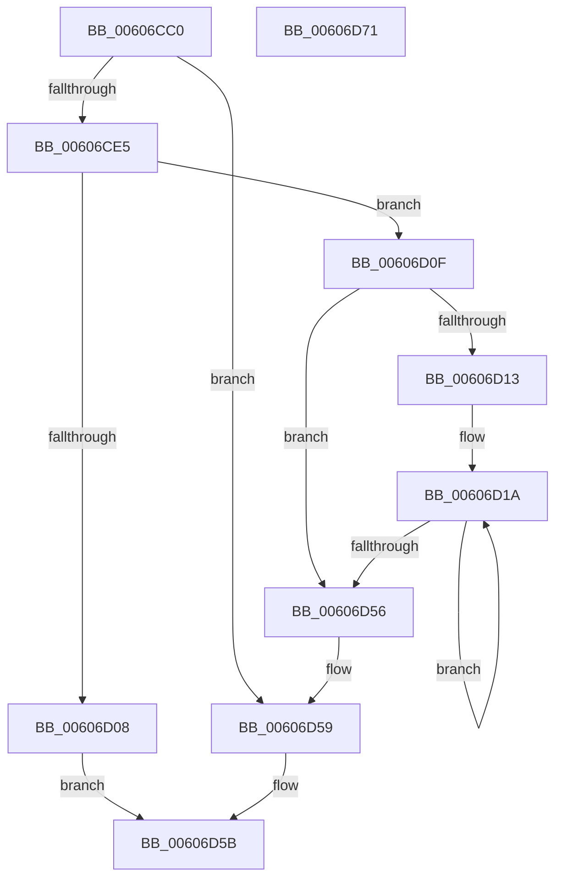

# SepCopyObjectTypeList

- RVA: `0x00606CC0`–`0x00606D72` (길이 `178` bytes)
- VA: `0x0000000140606CC0`
- 실행 섹션: `.text`
- PDB 이름 있음: `예`; PDB Function 태그: `아니요`
- unwind 정보 RVA: `0x0006F978`
- 디코드: `50`개 명령, `178/178` bytes 표시
- 미해석 바이트: `0` (있으면 어셈블리에 `.byte`로 보존)

> 이 문서는 커널 이미지의 기계어와 PDB 기호를 분석해 생성했습니다. 4번과 5번은 함수 원형과 자료형을 바이너리 사용 방식에서 추정한 C 해석이며 원본 소스 복구 결과는 아닙니다.

## 1. Dependencies

- 직접 호출 지점: **1**; 고유 호출 대상: **1**
- 직접 호출자로 확인된 함수: **2**
- RIP 상대 이미지 참조: **0**

### Outgoing calls
- `0x00606CFB` → [ExAllocatePool2](../../poolcode/B8/ExAllocatePool2_function_00B820F0.md) (function, `0x00B820F0`)

### Direct callers
- [SeAccessCheckByType](../44/SeAccessCheckByType_function_00440BC8.md) at `0x00441D61`
- [SepAccessCheckAndAuditAlarm](../../page/A1/SepAccessCheckAndAuditAlarm_function_00A1AF4C.md) at `0x00A1BFDC`
- [SepAccessCheckAndAuditAlarm](../../page/A1/SepAccessCheckAndAuditAlarm_function_00A1AF4C.md) at `0x00A1C890`

### Static image references
- 디코드된 RIP-relative 메모리 참조가 없습니다.

## 2. Other-region calls and transfers

- 다른 실행 섹션으로 향하는 call: **1**
  - `0x00606CFB` → [ExAllocatePool2](../../poolcode/B8/ExAllocatePool2_function_00B820F0.md) (`.text` → `POOLCODE`)
- 별도 외부 분기/꼬리 이동을 확인하지 못했습니다.

## 3. Assembly (complete function range)

```asm
00606CC0  48 89 5C 24 08                  mov qword ptr [rsp + 8], rbx
00606CC5  48 89 74 24 10                  mov qword ptr [rsp + 0x10], rsi
00606CCA  48 89 7C 24 18                  mov qword ptr [rsp + 0x18], rdi
00606CCF  41 56                           push r14
00606CD1  48 83 EC 20                     sub rsp, 0x20
00606CD5  49 83 20 00                     and qword ptr [r8], 0
00606CD9  49 8B F0                        mov rsi, r8
00606CDC  8B DA                           mov ebx, edx
00606CDE  48 8B F9                        mov rdi, rcx
00606CE1  85 D2                           test edx, edx
00606CE3  74 74                           je 0x140606d59
00606CE5  48 8D 14 5B                     lea rdx, [rbx + rbx*2]
00606CE9  B9 00 01 00 00                  mov ecx, 0x100
00606CEE  48 C1 E2 04                     shl rdx, 4
00606CF2  41 B8 53 65 4F 74               mov r8d, 0x744f6553
00606CF8  44 8B F3                        mov r14d, ebx
00606CFB  E8 F0 B3 57 00                  call 0x140b820f0
00606D00  48 8B D0                        mov rdx, rax
00606D03  48 85 C0                        test rax, rax
00606D06  75 07                           jne 0x140606d0f
00606D08  B8 9A 00 00 C0                  mov eax, 0xc000009a
00606D0D  EB 4C                           jmp 0x140606d5b
00606D0F  85 DB                           test ebx, ebx
00606D11  74 43                           je 0x140606d56
00606D13  48 8D 48 02                     lea rcx, [rax + 2]
00606D17  48 2B FA                        sub rdi, rdx
00606D1A  0F B7 44 0F FE                  movzx eax, word ptr [rdi + rcx - 2]
00606D1F  66 89 41 FE                     mov word ptr [rcx - 2], ax
00606D23  0F B7 04 0F                     movzx eax, word ptr [rdi + rcx]
00606D27  66 89 01                        mov word ptr [rcx], ax
00606D2A  8B 44 0F 12                     mov eax, dword ptr [rdi + rcx + 0x12]
00606D2E  89 41 12                        mov dword ptr [rcx + 0x12], eax
00606D31  0F 10 44 0F 02                  movups xmm0, xmmword ptr [rdi + rcx + 2]
00606D36  83 61 16 00                     and dword ptr [rcx + 0x16], 0
00606D3A  83 61 1A 00                     and dword ptr [rcx + 0x1a], 0
00606D3E  83 61 1E 00                     and dword ptr [rcx + 0x1e], 0
00606D42  48 83 61 26 00                  and qword ptr [rcx + 0x26], 0
00606D47  F3 0F 7F 41 02                  movdqu xmmword ptr [rcx + 2], xmm0
00606D4C  48 8D 49 30                     lea rcx, [rcx + 0x30]
00606D50  49 83 EE 01                     sub r14, 1
00606D54  75 C4                           jne 0x140606d1a
00606D56  48 89 16                        mov qword ptr [rsi], rdx
00606D59  33 C0                           xor eax, eax
00606D5B  48 8B 5C 24 30                  mov rbx, qword ptr [rsp + 0x30]
00606D60  48 8B 74 24 38                  mov rsi, qword ptr [rsp + 0x38]
00606D65  48 8B 7C 24 40                  mov rdi, qword ptr [rsp + 0x40]
00606D6A  48 83 C4 20                     add rsp, 0x20
00606D6E  41 5E                           pop r14
00606D70  C3                              ret
00606D71  CC                              int3
```

## 4. C-style interpretation (structured pseudocode)

```c
__int64 __fastcall SepCopyObjectTypeList(__int64 a1, int a2, __int64 a3)
{
    __int64 result;
    __int64 v_r14;
    __int64 v_rdi;
    __int64 v_rsp;
    unsigned __int64 v_stack_p10;
    unsigned __int64 v_stack_p18;
    unsigned __int64 v_stack_p8;

    v_stack_p8 = v_rbx;
    v_stack_p10 = v_rsi;
    v_stack_p18 = v_rdi;
    v_rsp = (v_rsp) - (32);
    if (a2 == 0) goto loc_00606D59;
    a2 = ((unsigned int)(a2) + (unsigned int)(a2) * 2) << (4);
    result = ExAllocatePool2(256, a2, (unsigned int)(0x744F6553ULL), a4);
    if (result != 0) goto loc_00606D0F;
    goto loc_00606D5B;
loc_00606D0F:
    if ((unsigned int)((unsigned int)(a2)) == 0) goto loc_00606D56;
    v_rdi = (a1) - (result);
loc_00606D1A:
    *(unsigned __int16 *)((unsigned int)(0xC000009AULL) + 2 - 2) = (unsigned __int16)(*(unsigned __int16 *)(v_rdi + (unsigned int)(0xC000009AULL) + 2 * 1 - 2));
    *(unsigned __int16 *)((unsigned int)(0xC000009AULL) + 2) = (unsigned __int16)(*(unsigned __int16 *)(v_rdi + (unsigned int)(0xC000009AULL) + 2 * 1));
    *(unsigned int *)((unsigned int)(0xC000009AULL) + 2 + 18) = (unsigned int)((unsigned int)(*(unsigned int *)(v_rdi + (unsigned int)(0xC000009AULL) + 2 * 1 + 18)));
    *(unsigned __int64 *)((unsigned int)(0xC000009AULL) + 2 + 2) = v_xmm0;
    v_r14 = ((unsigned int)((unsigned int)((unsigned int)(a2)))) - (1);
    if (condition_is_not_equal) goto loc_00606D1A;
loc_00606D56:
    *(unsigned __int64 *)(a3) = result;
loc_00606D59:
    result = 0;
loc_00606D5B:
    v_rsp = (v_rsp) + (32);
    return result;
}
```

## 5. (Beta) C Style

```c
int64_t SepCopyObjectTypeList(void *Arg1, void *Arg2, void *Arg3)
{
    uint8_t *arg1 = (uint8_t *)Arg1;
    uint8_t *arg2 = (uint8_t *)Arg2;
    uint8_t *arg3 = (uint8_t *)Arg3;

    int64_t result;
    int64_t local_r14;
    int64_t local_rdi;
    int64_t local_rsp;
    uint64_t v_stack_p10;
    uint64_t v_stack_p18;
    uint64_t v_stack_p8;

    v_stack_p8 = local_rbx;
    v_stack_p10 = local_rsi;
    v_stack_p18 = local_rdi;
    local_rsp = (local_rsp) - (32);
    if (Arg2 == NULL) goto loc_00606D59;
    Arg2 = ((uint32_t)(Arg2) + (uint32_t)(Arg2) * 2) << (4);
    result = ExAllocatePool2(256, Arg2, (uint32_t)(0x744F6553ULL), a4);
    if (result != 0) goto loc_00606D0F;
    goto loc_00606D5B;
loc_00606D0F:
    if ((uint32_t)((uint32_t)(Arg2)) == 0) goto loc_00606D56;
    local_rdi = (Arg1) - (result);
loc_00606D1A:
    *(uint16_t *)((uint32_t)(0xC000009AULL) + 0x2 - 0x2) = (uint16_t)(*(uint16_t *)(local_rdi + (uint32_t)(0xC000009AULL) + 0x2 * 1 - 0x2));
    *(uint16_t *)((uint32_t)(0xC000009AULL) + 0x2) = (uint16_t)(*(uint16_t *)(local_rdi + (uint32_t)(0xC000009AULL) + 0x2 * 1));
    *(uint32_t *)((uint32_t)(0xC000009AULL) + 0x2 + 0x12) = (uint32_t)((uint32_t)(*(uint32_t *)(local_rdi + (uint32_t)(0xC000009AULL) + 0x2 * 1 + 0x12)));
    *(uint64_t *)((uint32_t)(0xC000009AULL) + 0x2 + 0x2) = v_xmm0;
    local_r14 = ((uint32_t)((uint32_t)((uint32_t)(Arg2)))) - (1);
    if (condition_is_not_equal) goto loc_00606D1A;
loc_00606D56:
    *(uint64_t *)(arg3) = result;
loc_00606D59:
    result = 0;
loc_00606D5B:
    local_rsp = (local_rsp) + (32);
    return result;
}
```

### 관측된 메모리 오프셋

구조체 형식이 확인되지 않은 접근은 인자 기준의 오프셋으로만 기록했습니다.

| 기준 인자 | 오프셋 표현 | 폭 (bit) | 접근 |
|---|---:|---:|---|
| `Arg1` | `- 0x2 + rcx*1` | `16` | `R` |
| `Arg1` | `+ 0x0 + rcx*1` | `16` | `R` |
| `Arg1` | `+ 0x2 + rcx*1` | `128` | `R` |
| `Arg1` | `+ 0x12 + rcx*1` | `32` | `R` |
| `Arg2` | `+ 0x0 + rbx*2` | `64` | `R` |
| `Arg3` | `+ 0x0` | `64` | `R/W` |
| `Arg3` | `+ 0x0` | `64` | `W` |

## 6. Execution-region graph

[열기: 2D/3D 그래프와 함수 탐색 컨트롤 패널](../../../control-panel.html?section=text&rva=0x00606CC0&view=graph)

- 2D 그래프는 위에서 아래로 흐르고, 3D 그래프는 빈 공간을 드래그해 회전합니다. Shift+드래그는 이동, 휠은 확대·축소, 함수 노드 선택은 대상 보고서 이동입니다.

### Static fallback


