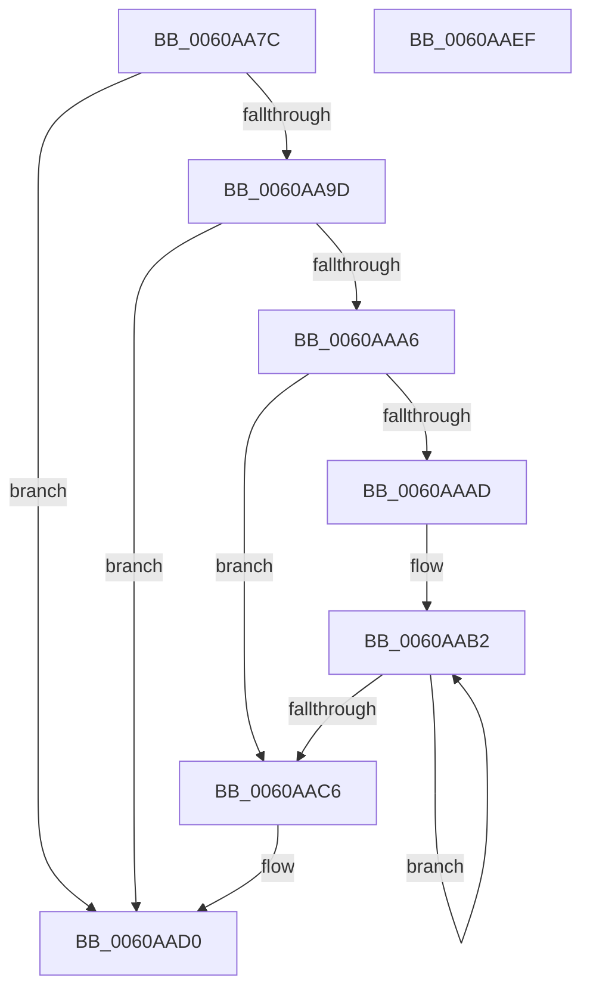

# SepDeleteAntiTamperPolicy

- RVA: `0x0060AA7C`–`0x0060AAF0` (길이 `116` bytes)
- VA: `0x000000014060AA7C`
- 실행 섹션: `.text`
- PDB 이름 있음: `예`; PDB Function 태그: `아니요`
- unwind 정보 RVA: `0x0005C954`
- 디코드: `37`개 명령, `116/116` bytes 표시
- 미해석 바이트: `0` (있으면 어셈블리에 `.byte`로 보존)

> 이 문서는 커널 이미지의 기계어와 PDB 기호를 분석해 생성했습니다. 4번과 5번은 함수 원형과 자료형을 바이너리 사용 방식에서 추정한 C 해석이며 원본 소스 복구 결과는 아닙니다.

## 1. Dependencies

- 직접 호출 지점: **3**; 고유 호출 대상: **1**
- 직접 호출자로 확인된 함수: **4**
- RIP 상대 이미지 참조: **0**

### Outgoing calls
- `0x0060AAB7` → [ExFreePoolWithTag](../../poolcode/B8/ExFreePoolWithTag_function_00B82870.md) (function, `0x00B82870`)
- `0x0060AACB` → [ExFreePoolWithTag](../../poolcode/B8/ExFreePoolWithTag_function_00B82870.md) (function, `0x00B82870`)
- `0x0060AAD5` → [ExFreePoolWithTag](../../poolcode/B8/ExFreePoolWithTag_function_00B82870.md) (function, `0x00B82870`)

### Direct callers
- [SeFreeAntiTamperPolicy](SeFreeAntiTamperPolicy_function_006095A0.md) at `0x006095A4`
- [SepDuplicateAntiTamperPolicy](SepDuplicateAntiTamperPolicy_function_0060AD44.md) at `0x0060ADBD`
- [SepGetAntiTamperEntry](SepGetAntiTamperEntry_function_0060AEE4.md) at `0x0060B09A`
- [SepGetAntiTamperEntry](SepGetAntiTamperEntry_function_0060AEE4.md) at `0x0060B0DF`
- [SepDereferenceAntiTamperEntry](../../page/7A/SepDereferenceAntiTamperEntry_function_007A2E50.md) at `0x007A3033`

### Static image references
- 디코드된 RIP-relative 메모리 참조가 없습니다.

## 2. Other-region calls and transfers

- 다른 실행 섹션으로 향하는 call: **3**
  - `0x0060AAB7` → [ExFreePoolWithTag](../../poolcode/B8/ExFreePoolWithTag_function_00B82870.md) (`.text` → `POOLCODE`)
  - `0x0060AACB` → [ExFreePoolWithTag](../../poolcode/B8/ExFreePoolWithTag_function_00B82870.md) (`.text` → `POOLCODE`)
  - `0x0060AAD5` → [ExFreePoolWithTag](../../poolcode/B8/ExFreePoolWithTag_function_00B82870.md) (`.text` → `POOLCODE`)
- 별도 외부 분기/꼬리 이동을 확인하지 못했습니다.

## 3. Assembly (complete function range)

```asm
0060AA7C  48 89 5C 24 08                  mov qword ptr [rsp + 8], rbx
0060AA81  48 89 6C 24 10                  mov qword ptr [rsp + 0x10], rbp
0060AA86  48 89 74 24 18                  mov qword ptr [rsp + 0x18], rsi
0060AA8B  57                              push rdi
0060AA8C  48 83 EC 20                     sub rsp, 0x20
0060AA90  8B 41 08                        mov eax, dword ptr [rcx + 8]
0060AA93  48 8B D9                        mov rbx, rcx
0060AA96  83 E0 06                        and eax, 6
0060AA99  3C 06                           cmp al, 6
0060AA9B  75 33                           jne 0x14060aad0
0060AA9D  48 8B 79 18                     mov rdi, qword ptr [rcx + 0x18]
0060AAA1  48 85 FF                        test rdi, rdi
0060AAA4  74 2A                           je 0x14060aad0
0060AAA6  8B 41 14                        mov eax, dword ptr [rcx + 0x14]
0060AAA9  85 C0                           test eax, eax
0060AAAB  74 19                           je 0x14060aac6
0060AAAD  48 8B F7                        mov rsi, rdi
0060AAB0  8B E8                           mov ebp, eax
0060AAB2  48 8B 0E                        mov rcx, qword ptr [rsi]
0060AAB5  33 D2                           xor edx, edx
0060AAB7  E8 B4 7D 57 00                  call 0x140b82870
0060AABC  48 8D 76 08                     lea rsi, [rsi + 8]
0060AAC0  48 83 ED 01                     sub rbp, 1
0060AAC4  75 EC                           jne 0x14060aab2
0060AAC6  33 D2                           xor edx, edx
0060AAC8  48 8B CF                        mov rcx, rdi
0060AACB  E8 A0 7D 57 00                  call 0x140b82870
0060AAD0  33 D2                           xor edx, edx
0060AAD2  48 8B CB                        mov rcx, rbx
0060AAD5  E8 96 7D 57 00                  call 0x140b82870
0060AADA  48 8B 5C 24 30                  mov rbx, qword ptr [rsp + 0x30]
0060AADF  48 8B 6C 24 38                  mov rbp, qword ptr [rsp + 0x38]
0060AAE4  48 8B 74 24 40                  mov rsi, qword ptr [rsp + 0x40]
0060AAE9  48 83 C4 20                     add rsp, 0x20
0060AAED  5F                              pop rdi
0060AAEE  C3                              ret
0060AAEF  CC                              int3
```

## 4. C-style interpretation (structured pseudocode)

```c
__int64 __fastcall SepDeleteAntiTamperPolicy(__int64 a1, int a2)
{
    __int64 result;
    __int64 v_rbp;
    __int64 v_rsp;
    unsigned __int64 v_stack_p10;
    unsigned __int64 v_stack_p18;
    unsigned __int64 v_stack_p8;

    v_stack_p8 = v_rbx;
    v_stack_p10 = v_rbp;
    v_stack_p18 = v_rsi;
    v_rsp = (v_rsp) - (32);
    result = (unsigned int)(((unsigned int)(*(unsigned int *)(a1 + 8))) & (6));
    if (((unsigned __int8)(result)) != 6) goto loc_0060AAD0;
    if (*(unsigned __int64 *)(a1 + 24) == 0) goto loc_0060AAD0;
    if ((unsigned int)((unsigned int)(*(unsigned int *)(a1 + 20))) == 0) goto loc_0060AAC6;
loc_0060AAB2:
    a2 = 0;
    result = ExFreePoolWithTag(*(unsigned __int64 *)(*(unsigned __int64 *)(a1 + 24)), a2, a3, a4);
    v_rbp = ((unsigned int)((unsigned int)((unsigned int)(*(unsigned int *)(a1 + 20))))) - (1);
    if (condition_is_not_equal) goto loc_0060AAB2;
loc_0060AAC6:
    a2 = 0;
    result = ExFreePoolWithTag(*(unsigned __int64 *)(a1 + 24), a2, a3, a4);
loc_0060AAD0:
    a2 = 0;
    result = ExFreePoolWithTag(a1, a2, a3, a4);
    v_rsp = (v_rsp) + (32);
    return result;
}
```

## 5. (Beta) C Style

```c
int64_t SepDeleteAntiTamperPolicy(void *Arg1, int32_t Arg2)
{
    uint8_t *arg1 = (uint8_t *)Arg1;

    int64_t result;
    int64_t local_rbp;
    int64_t local_rsp;
    uint64_t v_stack_p10;
    uint64_t v_stack_p18;
    uint64_t v_stack_p8;

    v_stack_p8 = local_rbx;
    v_stack_p10 = local_rbp;
    v_stack_p18 = local_rsi;
    local_rsp = (local_rsp) - (32);
    result = (uint32_t)(((uint32_t)(*(uint32_t *)(arg1 + 0x8))) & (6));
    if (((uint8_t)(result)) != 6) goto loc_0060AAD0;
    if (*(uint64_t *)(arg1 + 0x18) == 0) goto loc_0060AAD0;
    if ((uint32_t)((uint32_t)(*(uint32_t *)(arg1 + 0x14))) == 0) goto loc_0060AAC6;
loc_0060AAB2:
    Arg2 = 0;
    result = ExFreePoolWithTag(*(uint64_t *)(*(uint64_t *)(arg1 + 0x18)), Arg2, a3, a4);
    local_rbp = ((uint32_t)((uint32_t)((uint32_t)(*(uint32_t *)(arg1 + 0x14))))) - (1);
    if (condition_is_not_equal) goto loc_0060AAB2;
loc_0060AAC6:
    Arg2 = 0;
    result = ExFreePoolWithTag(*(uint64_t *)(arg1 + 0x18), Arg2, a3, a4);
loc_0060AAD0:
    Arg2 = 0;
    result = ExFreePoolWithTag(Arg1, Arg2, a3, a4);
    local_rsp = (local_rsp) + (32);
    return result;
}
```

### 관측된 메모리 오프셋

구조체 형식이 확인되지 않은 접근은 인자 기준의 오프셋으로만 기록했습니다.

| 기준 인자 | 오프셋 표현 | 폭 (bit) | 접근 |
|---|---:|---:|---|
| `Arg1` | `+ 0x8` | `32` | `R` |
| `Arg1` | `+ 0x14` | `32` | `R` |
| `Arg1` | `+ 0x18` | `64` | `R` |

## 6. Execution-region graph

[열기: 2D/3D 그래프와 함수 탐색 컨트롤 패널](../../../control-panel.html?section=text&rva=0x0060AA7C&view=graph)

- 2D 그래프는 위에서 아래로 흐르고, 3D 그래프는 빈 공간을 드래그해 회전합니다. Shift+드래그는 이동, 휠은 확대·축소, 함수 노드 선택은 대상 보고서 이동입니다.

### Static fallback


