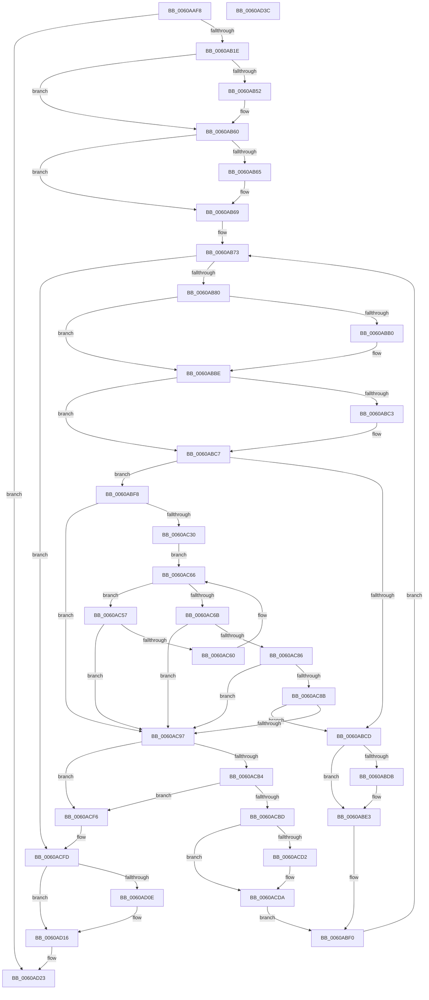

# SepDeleteSessionAntiTamperEntries

- RVA: `0x0060AAF8`–`0x0060AD3D` (길이 `581` bytes)
- VA: `0x000000014060AAF8`
- 실행 섹션: `.text`
- PDB 이름 있음: `예`; PDB Function 태그: `아니요`
- unwind 정보 RVA: `0x0006B074`
- 디코드: `162`개 명령, `581/581` bytes 표시
- 미해석 바이트: `0` (있으면 어셈블리에 `.byte`로 보존)

> 이 문서는 커널 이미지의 기계어와 PDB 기호를 분석해 생성했습니다. 4번과 5번은 함수 원형과 자료형을 바이너리 사용 방식에서 추정한 C 해석이며 원본 소스 복구 결과는 아닙니다.

## 1. Dependencies

- 직접 호출 지점: **16**; 고유 호출 대상: **7**
- 직접 호출자로 확인된 함수: **2**
- RIP 상대 이미지 참조: **3**

### Outgoing calls
- `0x0060AB42` → [KeAbPreAcquire](../21/KeAbPreAcquire_function_00210230.md) (function, `0x00210230`)
- `0x0060AB5B` → [ExfAcquirePushLockExclusiveEx](../20/ExfAcquirePushLockExclusiveEx_function_0020FC90.md) (function, `0x0020FC90`)
- `0x0060ABA0` → [KeAbPreAcquire](../21/KeAbPreAcquire_function_00210230.md) (function, `0x00210230`)
- `0x0060ABB9` → [ExfAcquirePushLockExclusiveEx](../20/ExfAcquirePushLockExclusiveEx_function_0020FC90.md) (function, `0x0020FC90`)
- `0x0060ABDE` → [ExfTryToWakePushLock](../26/ExfTryToWakePushLock_function_00265DD0.md) (function, `0x00265DD0`)
- `0x0060ABE6` → [KeAbPostRelease](../2E/KeAbPostRelease_function_002E1600.md) (function, `0x002E1600`)
- `0x0060ABEB` → [KeLeaveCriticalRegion](../25/KeLeaveCriticalRegion_function_0025D8B0.md) (function, `0x0025D8B0`)
- `0x0060AC9B` → [RtlDeleteHashTable](../48/RtlDeleteHashTable_function_0048C570.md) (function, `0x0048C570`)
- `0x0060ACA6` → [ExFreePoolWithTag](../../poolcode/B8/ExFreePoolWithTag_function_00B82870.md) (function, `0x00B82870`)
- `0x0060ACD5` → [ExfTryToWakePushLock](../26/ExfTryToWakePushLock_function_00265DD0.md) (function, `0x00265DD0`)
- `0x0060ACDD` → [KeAbPostRelease](../2E/KeAbPostRelease_function_002E1600.md) (function, `0x002E1600`)
- `0x0060ACE2` → [KeLeaveCriticalRegion](../25/KeLeaveCriticalRegion_function_0025D8B0.md) (function, `0x0025D8B0`)
- `0x0060ACEC` → [ExFreePoolWithTag](../../poolcode/B8/ExFreePoolWithTag_function_00B82870.md) (function, `0x00B82870`)
- `0x0060AD11` → [ExfTryToWakePushLock](../26/ExfTryToWakePushLock_function_00265DD0.md) (function, `0x00265DD0`)
- `0x0060AD19` → [KeAbPostRelease](../2E/KeAbPostRelease_function_002E1600.md) (function, `0x002E1600`)
- `0x0060AD1E` → [KeLeaveCriticalRegion](../25/KeLeaveCriticalRegion_function_0025D8B0.md) (function, `0x0025D8B0`)

### Direct callers
- [SepDeleteLogonSessionTrack](../../page/AA/SepDeleteLogonSessionTrack_function_00AA04E0.md) at `0x00AA0696`
- [SepDeReferenceLogonSession](../../page/AF/SepDeReferenceLogonSession_function_00AF25EC.md) at `0x00AF2832`

### Static image references
- `0x0060AB10` → RVA `0x00F04D08` (`.data`; read)
- `0x0060AB27` → RVA `0x00F04D10` (`.data`; read)
- `0x0060ACFD` → RVA `0x00F04D10` (`.data`; read/write)

## 2. Other-region calls and transfers

- 다른 실행 섹션으로 향하는 call: **2**
  - `0x0060ACA6` → [ExFreePoolWithTag](../../poolcode/B8/ExFreePoolWithTag_function_00B82870.md) (`.text` → `POOLCODE`)
  - `0x0060ACEC` → [ExFreePoolWithTag](../../poolcode/B8/ExFreePoolWithTag_function_00B82870.md) (`.text` → `POOLCODE`)
- 별도 외부 분기/꼬리 이동을 확인하지 못했습니다.

## 3. Assembly (complete function range)

```asm
0060AAF8  48 89 5C 24 10                  mov qword ptr [rsp + 0x10], rbx
0060AAFD  48 89 6C 24 18                  mov qword ptr [rsp + 0x18], rbp
0060AB02  48 89 74 24 20                  mov qword ptr [rsp + 0x20], rsi
0060AB07  57                              push rdi
0060AB08  41 56                           push r14
0060AB0A  41 57                           push r15
0060AB0C  48 83 EC 20                     sub rsp, 0x20
0060AB10  48 83 3D F0 A1 8F 00 00         cmp qword ptr [rip + 0x8fa1f0], 0
0060AB18  0F 84 05 02 00 00               je 0x14060ad23
0060AB1E  65 48 8B 04 25 88 01 00 00      mov rax, qword ptr gs:[0x188]
0060AB27  4C 8D 3D E2 A1 8F 00            lea r15, [rip + 0x8fa1e2]
0060AB2E  48 83 CB FF                     or rbx, 0xffffffffffffffff
0060AB32  45 33 C0                        xor r8d, r8d
0060AB35  33 D2                           xor edx, edx
0060AB37  49 8B CF                        mov rcx, r15
0060AB3A  66 01 98 E4 01 00 00            add word ptr [rax + 0x1e4], bx
0060AB41  90                              nop
0060AB42  E8 E9 56 C0 FF                  call 0x140210230
0060AB47  F0 49 0F BA 2F 00               lock bts qword ptr [r15], 0
0060AB4D  48 8B F8                        mov rdi, rax
0060AB50  73 0E                           jae 0x14060ab60
0060AB52  4D 8B C7                        mov r8, r15
0060AB55  48 8B D0                        mov rdx, rax
0060AB58  49 8B CF                        mov rcx, r15
0060AB5B  E8 30 51 C0 FF                  call 0x14020fc90
0060AB60  48 85 FF                        test rdi, rdi
0060AB63  74 04                           je 0x14060ab69
0060AB65  C6 47 0A 01                     mov byte ptr [rdi + 0xa], 1
0060AB69  48 8B 05 98 A1 8F 00            mov rax, qword ptr [rip + 0x8fa198]
0060AB70  48 8B 30                        mov rsi, qword ptr [rax]
0060AB73  48 3B 35 8E A1 8F 00            cmp rsi, qword ptr [rip + 0x8fa18e]
0060AB7A  0F 84 7D 01 00 00               je 0x14060acfd
0060AB80  65 48 8B 04 25 88 01 00 00      mov rax, qword ptr gs:[0x188]
0060AB89  48 8D 7E 18                     lea rdi, [rsi + 0x18]
0060AB8D  4C 8B 36                        mov r14, qword ptr [rsi]
0060AB90  45 33 C0                        xor r8d, r8d
0060AB93  33 D2                           xor edx, edx
0060AB95  48 8B CF                        mov rcx, rdi
0060AB98  66 01 98 E4 01 00 00            add word ptr [rax + 0x1e4], bx
0060AB9F  90                              nop
0060ABA0  E8 8B 56 C0 FF                  call 0x140210230
0060ABA5  F0 48 0F BA 2F 00               lock bts qword ptr [rdi], 0
0060ABAB  48 8B E8                        mov rbp, rax
0060ABAE  73 0E                           jae 0x14060abbe
0060ABB0  4C 8B C7                        mov r8, rdi
0060ABB3  48 8B D0                        mov rdx, rax
0060ABB6  48 8B CF                        mov rcx, rdi
0060ABB9  E8 D2 50 C0 FF                  call 0x14020fc90
0060ABBE  48 85 ED                        test rbp, rbp
0060ABC1  74 04                           je 0x14060abc7
0060ABC3  C6 45 0A 01                     mov byte ptr [rbp + 0xa], 1
0060ABC7  80 7F 20 00                     cmp byte ptr [rdi + 0x20], 0
0060ABCB  75 2B                           jne 0x14060abf8
0060ABCD  48 8B C3                        mov rax, rbx
0060ABD0  F0 48 0F C1 07                  lock xadd qword ptr [rdi], rax
0060ABD5  24 06                           and al, 6
0060ABD7  3C 02                           cmp al, 2
0060ABD9  75 08                           jne 0x14060abe3
0060ABDB  48 8B CF                        mov rcx, rdi
0060ABDE  E8 ED B1 C5 FF                  call 0x140265dd0
0060ABE3  48 8B CF                        mov rcx, rdi
0060ABE6  E8 15 6A CD FF                  call 0x1402e1600
0060ABEB  E8 C0 2C C5 FF                  call 0x14025d8b0
0060ABF0  49 8B F6                        mov rsi, r14
0060ABF3  E9 7B FF FF FF                  jmp 0x14060ab73
0060ABF8  44 8B 47 08                     mov r8d, dword ptr [rdi + 8]
0060ABFC  4C 8B 4F 10                     mov r9, qword ptr [rdi + 0x10]
0060AC00  49 8B C9                        mov rcx, r9
0060AC03  83 E1 04                        and ecx, 4
0060AC06  8B C1                           mov eax, ecx
0060AC08  41 8D 68 FF                     lea ebp, [r8 - 1]
0060AC0C  48 F7 D8                        neg rax
0060AC0F  45 1B D2                        sbb r10d, r10d
0060AC12  41 83 E2 20                     and r10d, 0x20
0060AC16  48 F7 D9                        neg rcx
0060AC19  48 1B C0                        sbb rax, rax
0060AC1C  83 64 24 40 00                  and dword ptr [rsp + 0x40], 0
0060AC21  83 E0 04                        and eax, 4
0060AC24  41 03 EA                        add ebp, r10d
0060AC27  4C 2B C8                        sub r9, rax
0060AC2A  41 83 F8 01                     cmp r8d, 1
0060AC2E  72 67                           jb 0x14060ac97
0060AC30  8B C5                           mov eax, ebp
0060AC32  41 8B CA                        mov ecx, r10d
0060AC35  48 C1 E8 06                     shr rax, 6
0060AC39  41 B8 01 00 00 00               mov r8d, 1
0060AC3F  49 D3 E0                        shl r8, cl
0060AC42  49 8B D1                        mov rdx, r9
0060AC45  49 FF C8                        dec r8
0060AC48  4D 8D 1C C1                     lea r11, [r9 + rax*8]
0060AC4C  49 8B 01                        mov rax, qword ptr [r9]
0060AC4F  48 F7 D0                        not rax
0060AC52  4C 0B C0                        or r8, rax
0060AC55  EB 0F                           jmp 0x14060ac66
0060AC57  48 83 C2 08                     add rdx, 8
0060AC5B  49 3B D3                        cmp rdx, r11
0060AC5E  77 37                           ja 0x14060ac97
0060AC60  4C 8B 02                        mov r8, qword ptr [rdx]
0060AC63  49 F7 D0                        not r8
0060AC66  4C 3B C3                        cmp r8, rbx
0060AC69  74 EC                           je 0x14060ac57
0060AC6B  49 2B D1                        sub rdx, r9
0060AC6E  49 F7 D0                        not r8
0060AC71  49 0F BC C0                     bsf rax, r8
0060AC75  48 C1 FA 03                     sar rdx, 3
0060AC79  C1 E2 06                        shl edx, 6
0060AC7C  03 D0                           add edx, eax
0060AC7E  89 44 24 40                     mov dword ptr [rsp + 0x40], eax
0060AC82  3B D5                           cmp edx, ebp
0060AC84  77 11                           ja 0x14060ac97
0060AC86  83 FA FF                        cmp edx, -1
0060AC89  74 0C                           je 0x14060ac97
0060AC8B  41 2B D2                        sub edx, r10d
0060AC8E  83 FA FF                        cmp edx, -1
0060AC91  0F 85 36 FF FF FF               jne 0x14060abcd
0060AC97  48 8B 4F 18                     mov rcx, qword ptr [rdi + 0x18]
0060AC9B  E8 D0 18 E8 FF                  call 0x14048c570
0060ACA0  48 8B 4F 10                     mov rcx, qword ptr [rdi + 0x10]
0060ACA4  33 D2                           xor edx, edx
0060ACA6  E8 C5 7B 57 00                  call 0x140b82870
0060ACAB  48 8B 0E                        mov rcx, qword ptr [rsi]
0060ACAE  48 39 71 08                     cmp qword ptr [rcx + 8], rsi
0060ACB2  75 42                           jne 0x14060acf6
0060ACB4  48 8B 46 08                     mov rax, qword ptr [rsi + 8]
0060ACB8  48 39 30                        cmp qword ptr [rax], rsi
0060ACBB  75 39                           jne 0x14060acf6
0060ACBD  48 89 08                        mov qword ptr [rax], rcx
0060ACC0  48 89 41 08                     mov qword ptr [rcx + 8], rax
0060ACC4  48 8B C3                        mov rax, rbx
0060ACC7  F0 48 0F C1 07                  lock xadd qword ptr [rdi], rax
0060ACCC  24 06                           and al, 6
0060ACCE  3C 02                           cmp al, 2
0060ACD0  75 08                           jne 0x14060acda
0060ACD2  48 8B CF                        mov rcx, rdi
0060ACD5  E8 F6 B0 C5 FF                  call 0x140265dd0
0060ACDA  48 8B CF                        mov rcx, rdi
0060ACDD  E8 1E 69 CD FF                  call 0x1402e1600
0060ACE2  E8 C9 2B C5 FF                  call 0x14025d8b0
0060ACE7  33 D2                           xor edx, edx
0060ACE9  48 8B CE                        mov rcx, rsi
0060ACEC  E8 7F 7B 57 00                  call 0x140b82870
0060ACF1  E9 FA FE FF FF                  jmp 0x14060abf0
0060ACF6  B9 03 00 00 00                  mov ecx, 3
0060ACFB  CD 29                           int 0x29
0060ACFD  F0 48 0F C1 1D 0A A0 8F 00      lock xadd qword ptr [rip + 0x8fa00a], rbx
0060AD06  80 E3 06                        and bl, 6
0060AD09  80 FB 02                        cmp bl, 2
0060AD0C  75 08                           jne 0x14060ad16
0060AD0E  49 8B CF                        mov rcx, r15
0060AD11  E8 BA B0 C5 FF                  call 0x140265dd0
0060AD16  49 8B CF                        mov rcx, r15
0060AD19  E8 E2 68 CD FF                  call 0x1402e1600
0060AD1E  E8 8D 2B C5 FF                  call 0x14025d8b0
0060AD23  48 8B 5C 24 48                  mov rbx, qword ptr [rsp + 0x48]
0060AD28  48 8B 6C 24 50                  mov rbp, qword ptr [rsp + 0x50]
0060AD2D  48 8B 74 24 58                  mov rsi, qword ptr [rsp + 0x58]
0060AD32  48 83 C4 20                     add rsp, 0x20
0060AD36  41 5F                           pop r15
0060AD38  41 5E                           pop r14
0060AD3A  5F                              pop rdi
0060AD3B  C3                              ret
0060AD3C  CC                              int3
```

## 4. C-style interpretation (structured pseudocode)

```c
__int64 __fastcall SepDeleteSessionAntiTamperEntries(__int64 a1, int a2, int a3)
{
    __int64 result;
    __int64 v_r10;
    __int64 v_rbp;
    __int64 v_rbx;
    __int64 v_rsp;
    unsigned __int64 v_stack_p10;
    unsigned __int64 v_stack_p18;
    unsigned __int64 v_stack_p20;
    unsigned int v_stack_p8;

    v_stack_p10 = v_rbx;
    v_stack_p18 = v_rbp;
    v_stack_p20 = v_rsi;
    v_rsp = (v_rsp) - (32);
    if ((*(unsigned __int64 *)(v_rip + 9413104)) == 0) goto loc_0060AD23;
    v_rbx = (v_rbx) | (-1);
    a3 = 0;
    a2 = 0;
    result = KeAbPreAcquire(v_rip + 9413090, a2, a3, a4);
    if (!(condition_is_above_or_equal)) {
        a3 = v_rip + 9413090;
        a2 = result;
        a1 = v_rip + 9413090;
        result = ExfAcquirePushLockExclusiveEx(a1, a2, a3, a4);
    }
    if (result != 0) {
        *(unsigned __int8 *)(result + 10) = 1;
    }
loc_0060AB73:
    if ((*(unsigned __int64 *)(*(unsigned __int64 *)(v_rip + 9413016))) == (*(unsigned __int64 *)(v_rip + 9413006))) goto loc_0060ACFD;
    a3 = 0;
    a2 = 0;
    result = KeAbPreAcquire(*(unsigned __int64 *)(*(unsigned __int64 *)(v_rip + 9413016)) + 24, a2, a3, a4);
    if (!(condition_is_above_or_equal)) {
        a3 = *(unsigned __int64 *)(*(unsigned __int64 *)(v_rip + 9413016)) + 24;
        a2 = result;
        a1 = *(unsigned __int64 *)(*(unsigned __int64 *)(v_rip + 9413016)) + 24;
        result = ExfAcquirePushLockExclusiveEx(a1, a2, a3, a4);
    }
    if (result != 0) {
        *(unsigned __int8 *)(result + 10) = 1;
    }
    if ((*(unsigned __int8 *)(*(unsigned __int64 *)(*(unsigned __int64 *)(v_rip + 9413016)) + 24 + 32)) != 0) goto loc_0060ABF8;
loc_0060ABCD:
    result = (unsigned __int8)((v_rbx) & (6));
    if (((unsigned __int8)(result)) == 2) {
        a1 = *(unsigned __int64 *)(*(unsigned __int64 *)(v_rip + 9413016)) + 24;
        result = ExfTryToWakePushLock(a1, a2, a3, a4);
    }
    result = KeAbPostRelease(*(unsigned __int64 *)(*(unsigned __int64 *)(v_rip + 9413016)) + 24, a2, a3, a4);
    result = KeLeaveCriticalRegion(*(unsigned __int64 *)(*(unsigned __int64 *)(v_rip + 9413016)) + 24, a2, a3, a4);
loc_0060ABF0:
    goto loc_0060AB73;
loc_0060ABF8:
    a1 = (unsigned int)((*(unsigned __int64 *)(*(unsigned __int64 *)(*(unsigned __int64 *)(v_rip + 9413016)) + 24 + 16)) & (4));
    result = -((unsigned int)((unsigned int)(a1)));
    v_r10 = (unsigned int)((v_r10) & (32));
    a1 = -(a1);
    result = (unsigned int)((result) & (4));
    v_rbp = (unsigned int)(((unsigned int)(*(unsigned int *)(*(unsigned __int64 *)(*(unsigned __int64 *)(v_rip + 9413016)) + 24 + 8)) - 1) + ((unsigned int)(v_r10)));
    a4 = (*(unsigned __int64 *)(*(unsigned __int64 *)(*(unsigned __int64 *)(v_rip + 9413016)) + 24 + 16)) - (result);
    if (((unsigned int)((unsigned int)(*(unsigned int *)(*(unsigned __int64 *)(*(unsigned __int64 *)(v_rip + 9413016)) + 24 + 8)))) < 1) goto loc_0060AC97;
    result = ((unsigned int)((unsigned int)(v_rbp))) >> (6);
    a3 = (1) << ((unsigned __int8)((unsigned int)((unsigned int)(v_r10))));
    a3 = (a3) - 1;
    result = ~(*(unsigned __int64 *)(a4));
    a3 = (a3) | (result);
    goto loc_0060AC66;
loc_0060AC57:
    a2 = (a4) + (8);
    if (a2 > (a4 + result * 8)) goto loc_0060AC97;
    a3 = ~(*(unsigned __int64 *)(a2));
loc_0060AC66:
    if (a3 == v_rbx) goto loc_0060AC57;
    a2 = (a2) - (a4);
    a3 = ~(a3);
    a2 = (a2) >> (3);
    a2 = (unsigned int)((a2) << (6));
    a2 = (unsigned int)((a2) + ((unsigned int)(result)));
    v_stack_p8 = (unsigned int)(result);
    if (a2 > ((unsigned int)(v_rbp))) goto loc_0060AC97;
    if (a2 == -1) goto loc_0060AC97;
    a2 = (unsigned int)((a2) - ((unsigned int)(v_r10)));
    if (a2 != -1) goto loc_0060ABCD;
loc_0060AC97:
    result = RtlDeleteHashTable(*(unsigned __int64 *)(*(unsigned __int64 *)(*(unsigned __int64 *)(v_rip + 9413016)) + 24 + 24), a2, a3, a4);
    a2 = 0;
    result = ExFreePoolWithTag(*(unsigned __int64 *)(*(unsigned __int64 *)(*(unsigned __int64 *)(v_rip + 9413016)) + 24 + 16), a2, a3, a4);
    if ((*(unsigned __int64 *)(*(unsigned __int64 *)(*(unsigned __int64 *)(*(unsigned __int64 *)(*(unsigned __int64 *)(v_rip + 9413016)))) + 8)) != (*(unsigned __int64 *)(*(unsigned __int64 *)(*(unsigned __int64 *)(v_rip + 9413016))))) goto loc_0060ACF6;
    if ((*(unsigned __int64 *)(*(unsigned __int64 *)(*(unsigned __int64 *)(*(unsigned __int64 *)(*(unsigned __int64 *)(v_rip + 9413016))) + 8))) != (*(unsigned __int64 *)(*(unsigned __int64 *)(*(unsigned __int64 *)(v_rip + 9413016))))) goto loc_0060ACF6;
    *(unsigned __int64 *)(*(unsigned __int64 *)(*(unsigned __int64 *)(*(unsigned __int64 *)(*(unsigned __int64 *)(v_rip + 9413016))) + 8)) = *(unsigned __int64 *)(*(unsigned __int64 *)(*(unsigned __int64 *)(*(unsigned __int64 *)(v_rip + 9413016))));
    *(unsigned __int64 *)(*(unsigned __int64 *)(*(unsigned __int64 *)(*(unsigned __int64 *)(*(unsigned __int64 *)(v_rip + 9413016)))) + 8) = *(unsigned __int64 *)(*(unsigned __int64 *)(*(unsigned __int64 *)(*(unsigned __int64 *)(v_rip + 9413016))) + 8);
    result = (unsigned __int8)((v_rbx) & (6));
    if (((unsigned __int8)(result)) == 2) {
        a1 = *(unsigned __int64 *)(*(unsigned __int64 *)(v_rip + 9413016)) + 24;
        result = ExfTryToWakePushLock(a1, a2, a3, a4);
    }
    result = KeAbPostRelease(*(unsigned __int64 *)(*(unsigned __int64 *)(v_rip + 9413016)) + 24, a2, a3, a4);
    result = KeLeaveCriticalRegion(*(unsigned __int64 *)(*(unsigned __int64 *)(v_rip + 9413016)) + 24, a2, a3, a4);
    a2 = 0;
    result = ExFreePoolWithTag(*(unsigned __int64 *)(*(unsigned __int64 *)(*(unsigned __int64 *)(v_rip + 9413016))), a2, a3, a4);
    goto loc_0060ABF0;
loc_0060ACF6:
loc_0060ACFD:
    v_rbx = (unsigned __int8)((v_rbx) & (6));
    if (((unsigned __int8)(v_rbx)) == 2) {
        a1 = v_rip + 9413090;
        result = ExfTryToWakePushLock(a1, a2, a3, a4);
    }
    result = KeAbPostRelease(v_rip + 9413090, a2, a3, a4);
    result = KeLeaveCriticalRegion(v_rip + 9413090, a2, a3, a4);
loc_0060AD23:
    v_rsp = (v_rsp) + (32);
    return result;
}
```

## 5. (Beta) C Style

```c
int64_t SepDeleteSessionAntiTamperEntries(int64_t Arg1, int32_t Arg2, int32_t Arg3)
{
    int64_t result;
    int64_t local_r10;
    int64_t local_rbp;
    int64_t local_rbx;
    int64_t local_rsp;
    uint64_t v_stack_p10;
    uint64_t v_stack_p18;
    uint64_t v_stack_p20;
    uint32_t v_stack_p8;

    v_stack_p10 = local_rbx;
    v_stack_p18 = local_rbp;
    v_stack_p20 = local_rsi;
    local_rsp = (local_rsp) - (32);
    if ((*(uint64_t *)(v_rip + 0x8FA1F0)) == 0) goto loc_0060AD23;
    local_rbx = (local_rbx) | (-1);
    Arg3 = 0;
    Arg2 = 0;
    result = KeAbPreAcquire(v_rip + 9413090, Arg2, Arg3, a4);
    if (!(condition_is_above_or_equal)) {
        Arg3 = v_rip + 9413090;
        Arg2 = result;
        Arg1 = v_rip + 9413090;
        result = ExfAcquirePushLockExclusiveEx(Arg1, Arg2, Arg3, a4);
    }
    if (result != 0) {
        *(uint8_t *)(result + 0xA) = 1;
    }
loc_0060AB73:
    if ((*(uint64_t *)(*(uint64_t *)(v_rip + 0x8FA198))) == (*(uint64_t *)(v_rip + 0x8FA18E))) goto loc_0060ACFD;
    Arg3 = 0;
    Arg2 = 0;
    result = KeAbPreAcquire(*(uint64_t *)(*(uint64_t *)(v_rip + 0x8FA198)) + 24, Arg2, Arg3, a4);
    if (!(condition_is_above_or_equal)) {
        Arg3 = *(uint64_t *)(*(uint64_t *)(v_rip + 0x8FA198)) + 24;
        Arg2 = result;
        Arg1 = *(uint64_t *)(*(uint64_t *)(v_rip + 0x8FA198)) + 24;
        result = ExfAcquirePushLockExclusiveEx(Arg1, Arg2, Arg3, a4);
    }
    if (result != 0) {
        *(uint8_t *)(result + 0xA) = 1;
    }
    if ((*(uint8_t *)(*(uint64_t *)(*(uint64_t *)(v_rip + 0x8FA198)) + 0x18 + 0x20)) != 0) goto loc_0060ABF8;
loc_0060ABCD:
    result = (uint8_t)((local_rbx) & (6));
    if (((uint8_t)(result)) == 2) {
        Arg1 = *(uint64_t *)(*(uint64_t *)(v_rip + 0x8FA198)) + 24;
        result = ExfTryToWakePushLock(Arg1, Arg2, Arg3, a4);
    }
    result = KeAbPostRelease(*(uint64_t *)(*(uint64_t *)(v_rip + 0x8FA198)) + 24, Arg2, Arg3, a4);
    result = KeLeaveCriticalRegion(*(uint64_t *)(*(uint64_t *)(v_rip + 0x8FA198)) + 24, Arg2, Arg3, a4);
loc_0060ABF0:
    goto loc_0060AB73;
loc_0060ABF8:
    Arg1 = (uint32_t)((*(uint64_t *)(*(uint64_t *)(*(uint64_t *)(v_rip + 0x8FA198)) + 0x18 + 0x10)) & (4));
    result = -((uint32_t)((uint32_t)(Arg1)));
    local_r10 = (uint32_t)((local_r10) & (32));
    Arg1 = -(Arg1);
    result = (uint32_t)((result) & (4));
    local_rbp = (uint32_t)(((uint32_t)(*(uint32_t *)(*(uint64_t *)(*(uint64_t *)(v_rip + 0x8FA198)) + 0x18 + 0x8)) - 1) + ((uint32_t)(local_r10)));
    a4 = (*(uint64_t *)(*(uint64_t *)(*(uint64_t *)(v_rip + 0x8FA198)) + 0x18 + 0x10)) - (result);
    if (((uint32_t)((uint32_t)(*(uint32_t *)(*(uint64_t *)(*(uint64_t *)(v_rip + 0x8FA198)) + 0x18 + 0x8)))) < 1) goto loc_0060AC97;
    result = ((uint32_t)((uint32_t)(local_rbp))) >> (6);
    Arg3 = (1) << ((uint8_t)((uint32_t)((uint32_t)(local_r10))));
    Arg3 = (Arg3) - 1;
    result = ~(*(uint64_t *)(a4));
    Arg3 = (Arg3) | (result);
    goto loc_0060AC66;
loc_0060AC57:
    Arg2 = (a4) + (8);
    if (Arg2 > (a4 + result * 8)) goto loc_0060AC97;
    Arg3 = ~(*(uint64_t *)(Arg2));
loc_0060AC66:
    if (Arg3 == local_rbx) goto loc_0060AC57;
    Arg2 = (Arg2) - (a4);
    Arg3 = ~(Arg3);
    Arg2 = (Arg2) >> (3);
    Arg2 = (uint32_t)((Arg2) << (6));
    Arg2 = (uint32_t)((Arg2) + ((uint32_t)(result)));
    v_stack_p8 = (uint32_t)(result);
    if (Arg2 > ((uint32_t)(local_rbp))) goto loc_0060AC97;
    if (Arg2 == -1) goto loc_0060AC97;
    Arg2 = (uint32_t)((Arg2) - ((uint32_t)(local_r10)));
    if (Arg2 != -1) goto loc_0060ABCD;
loc_0060AC97:
    result = RtlDeleteHashTable(*(uint64_t *)(*(uint64_t *)(*(uint64_t *)(v_rip + 0x8FA198)) + 0x18 + 0x18), Arg2, Arg3, a4);
    Arg2 = 0;
    result = ExFreePoolWithTag(*(uint64_t *)(*(uint64_t *)(*(uint64_t *)(v_rip + 0x8FA198)) + 0x18 + 0x10), Arg2, Arg3, a4);
    if ((*(uint64_t *)(*(uint64_t *)(*(uint64_t *)(*(uint64_t *)(*(uint64_t *)(v_rip + 0x8FA198)))) + 0x8)) != (*(uint64_t *)(*(uint64_t *)(*(uint64_t *)(v_rip + 0x8FA198))))) goto loc_0060ACF6;
    if ((*(uint64_t *)(*(uint64_t *)(*(uint64_t *)(*(uint64_t *)(*(uint64_t *)(v_rip + 0x8FA198))) + 0x8))) != (*(uint64_t *)(*(uint64_t *)(*(uint64_t *)(v_rip + 0x8FA198))))) goto loc_0060ACF6;
    *(uint64_t *)(*(uint64_t *)(*(uint64_t *)(*(uint64_t *)(*(uint64_t *)(v_rip + 0x8FA198))) + 0x8)) = *(uint64_t *)(*(uint64_t *)(*(uint64_t *)(*(uint64_t *)(v_rip + 0x8FA198))));
    *(uint64_t *)(*(uint64_t *)(*(uint64_t *)(*(uint64_t *)(*(uint64_t *)(v_rip + 0x8FA198)))) + 0x8) = *(uint64_t *)(*(uint64_t *)(*(uint64_t *)(*(uint64_t *)(v_rip + 0x8FA198))) + 0x8);
    result = (uint8_t)((local_rbx) & (6));
    if (((uint8_t)(result)) == 2) {
        Arg1 = *(uint64_t *)(*(uint64_t *)(v_rip + 0x8FA198)) + 24;
        result = ExfTryToWakePushLock(Arg1, Arg2, Arg3, a4);
    }
    result = KeAbPostRelease(*(uint64_t *)(*(uint64_t *)(v_rip + 0x8FA198)) + 24, Arg2, Arg3, a4);
    result = KeLeaveCriticalRegion(*(uint64_t *)(*(uint64_t *)(v_rip + 0x8FA198)) + 24, Arg2, Arg3, a4);
    Arg2 = 0;
    result = ExFreePoolWithTag(*(uint64_t *)(*(uint64_t *)(*(uint64_t *)(v_rip + 0x8FA198))), Arg2, Arg3, a4);
    goto loc_0060ABF0;
loc_0060ACF6:
loc_0060ACFD:
    local_rbx = (uint8_t)((local_rbx) & (6));
    if (((uint8_t)(local_rbx)) == 2) {
        Arg1 = v_rip + 9413090;
        result = ExfTryToWakePushLock(Arg1, Arg2, Arg3, a4);
    }
    result = KeAbPostRelease(v_rip + 9413090, Arg2, Arg3, a4);
    result = KeLeaveCriticalRegion(v_rip + 9413090, Arg2, Arg3, a4);
loc_0060AD23:
    local_rsp = (local_rsp) + (32);
    return result;
}
```

## 6. Execution-region graph

[열기: 2D/3D 그래프와 함수 탐색 컨트롤 패널](../../../control-panel.html?section=text&rva=0x0060AAF8&view=graph)

- 2D 그래프는 위에서 아래로 흐르고, 3D 그래프는 빈 공간을 드래그해 회전합니다. Shift+드래그는 이동, 휠은 확대·축소, 함수 노드 선택은 대상 보고서 이동입니다.

### Static fallback


