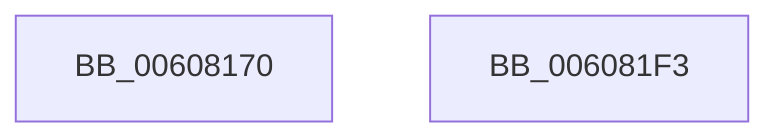

# SepDesktopAppModifyTokenBreakaway

- RVA: `0x00608170`–`0x006081F4` (길이 `132` bytes)
- VA: `0x0000000140608170`
- 실행 섹션: `.text`
- PDB 이름 있음: `예`; PDB Function 태그: `아니요`
- unwind 정보 RVA: `0x0008A308`
- 디코드: `34`개 명령, `132/132` bytes 표시
- 미해석 바이트: `0` (있으면 어셈블리에 `.byte`로 보존)

> 이 문서는 커널 이미지의 기계어와 PDB 기호를 분석해 생성했습니다. 4번과 5번은 함수 원형과 자료형을 바이너리 사용 방식에서 추정한 C 해석이며 원본 소스 복구 결과는 아닙니다.

## 1. Dependencies

- 직접 호출 지점: **1**; 고유 호출 대상: **1**
- 직접 호출자로 확인된 함수: **1**
- RIP 상대 이미지 참조: **1**

### Outgoing calls
- `0x006081E8` → [AuthzBasepSetSecurityAttributesToken](../3A/AuthzBasepSetSecurityAttributesToken_function_003A8D1C.md) (function, `0x003A8D1C`)

### Direct callers
- [SepDesktopAppxSubProcessToken](../45/SepDesktopAppxSubProcessToken_function_0045BD90.md) at `0x0045BEFE`
- [SepDesktopAppxSubProcessToken](../45/SepDesktopAppxSubProcessToken_function_0045BD90.md) at `0x0045BF42`

### Static image references
- `0x00608183` → RVA `0x006CD250` (` ?? ::FNODOBFM::`string'`; read)

## 2. Other-region calls and transfers

- 다른 실행 섹션으로 향하는 call: **0**
- 별도 외부 분기/꼬리 이동을 확인하지 못했습니다.

## 3. Assembly (complete function range)

```asm
00608170  40 55                           push rbp
00608172  48 8B EC                        mov rbp, rsp
00608175  48 83 EC 60                     sub rsp, 0x60
00608179  45 8A C8                        mov r9b, r8b
0060817C  48 89 55 F0                     mov qword ptr [rbp - 0x10], rdx
00608180  44 8B 02                        mov r8d, dword ptr [rdx]
00608183  48 8D 05 C6 50 0C 00            lea rax, [rip + 0xc50c6]
0060818A  41 BA 01 00 00 00               mov r10d, 1
00608190  48 89 45 D8                     mov qword ptr [rbp - 0x28], rax
00608194  41 8B C0                        mov eax, r8d
00608197  C7 45 D0 12 00 14 00            mov dword ptr [rbp - 0x30], 0x140012
0060819E  83 E0 DF                        and eax, 0xffffffdf
006081A1  C7 45 20 04 00 00 00            mov dword ptr [rbp + 0x20], 4
006081A8  41 83 C8 20                     or r8d, 0x20
006081AC  44 89 55 C0                     mov dword ptr [rbp - 0x40], r10d
006081B0  45 3A CA                        cmp r9b, r10b
006081B3  44 89 55 C4                     mov dword ptr [rbp - 0x3c], r10d
006081B7  0F 57 C0                        xorps xmm0, xmm0
006081BA  44 0F 45 C0                     cmovne r8d, eax
006081BE  41 8D 42 01                     lea eax, [r10 + 1]
006081C2  44 89 02                        mov dword ptr [rdx], r8d
006081C5  4C 8D 45 C0                     lea r8, [rbp - 0x40]
006081C9  48 8B 89 08 03 00 00            mov rcx, qword ptr [rcx + 0x308]
006081D0  48 8D 55 20                     lea rdx, [rbp + 0x20]
006081D4  0F 11 45 E0                     movups xmmword ptr [rbp - 0x20], xmm0
006081D8  66 89 45 E0                     mov word ptr [rbp - 0x20], ax
006081DC  48 8D 45 D0                     lea rax, [rbp - 0x30]
006081E0  48 89 45 C8                     mov qword ptr [rbp - 0x38], rax
006081E4  44 89 55 E8                     mov dword ptr [rbp - 0x18], r10d
006081E8  E8 2F 0B DA FF                  call 0x1403a8d1c
006081ED  48 83 C4 60                     add rsp, 0x60
006081F1  5D                              pop rbp
006081F2  C3                              ret
006081F3  CC                              int3
```

## 4. C-style interpretation (structured pseudocode)

```c
__int64 __fastcall SepDesktopAppModifyTokenBreakaway(__int64 a1, __int64 a2, unsigned __int8 a3)
{
    __int64 result;
    __int64 v_rsp;
    unsigned __int64 v_stack_m18;
    unsigned int v_stack_m20;
    unsigned __int64 v_stack_m28;
    unsigned __int64 v_stack_m30;
    unsigned int v_stack_m38;
    unsigned __int64 v_stack_m40;
    unsigned int v_stack_m44;
    unsigned int v_stack_m48;
    unsigned int v_stack_p18;

    v_rsp = (v_rsp) - (96);
    v_stack_m18 = a2;
    v_stack_m30 = v_rip + 807110;
    v_stack_m38 = 0x140012ULL;
    result = (unsigned int)(((unsigned int)((unsigned int)((unsigned int)(*(unsigned int *)(a2))))) & (0xFFFFFFDFULL));
    v_stack_p18 = 4;
    a3 = (unsigned int)(((unsigned int)(*(unsigned int *)(a2))) | (32));
    v_stack_m48 = 1;
    v_stack_m44 = 1;
    if (a3 != 1) { a3 = (unsigned int)(result); }
    *(unsigned int *)(a2) = a3;
    v_stack_m28 = v_xmm0;
    v_stack_m28 = (unsigned __int16)(1 + 1);
    v_stack_m40 = v_stack_m38;
    v_stack_m20 = 1;
    result = AuthzBasepSetSecurityAttributesToken(*(unsigned __int64 *)(a1 + 776), v_stack_p18, v_stack_m48, a3);
    v_rsp = (v_rsp) + (96);
    return result;
}
```

## 5. (Beta) C Style

```c
int64_t SepDesktopAppModifyTokenBreakaway(void *Arg1, void *Arg2, uint8_t Arg3)
{
    uint8_t *arg1 = (uint8_t *)Arg1;
    uint8_t *arg2 = (uint8_t *)Arg2;

    int64_t result;
    int64_t local_rsp;
    uint64_t v_stack_m18;
    uint32_t v_stack_m20;
    uint64_t v_stack_m28;
    uint64_t v_stack_m30;
    uint32_t v_stack_m38;
    uint64_t v_stack_m40;
    uint32_t v_stack_m44;
    uint32_t v_stack_m48;
    uint32_t v_stack_p18;

    local_rsp = (local_rsp) - (96);
    v_stack_m18 = Arg2;
    v_stack_m30 = v_rip + 807110;
    v_stack_m38 = 0x140012ULL;
    result = (uint32_t)(((uint32_t)((uint32_t)((uint32_t)(*(uint32_t *)(arg2))))) & (0xFFFFFFDFULL));
    v_stack_p18 = 4;
    Arg3 = (uint32_t)(((uint32_t)(*(uint32_t *)(arg2))) | (32));
    v_stack_m48 = 1;
    v_stack_m44 = 1;
    if (Arg3 != 1) { Arg3 = (uint32_t)(result); }
    *(uint32_t *)(arg2) = Arg3;
    v_stack_m28 = v_xmm0;
    v_stack_m28 = (uint16_t)(1 + 1);
    v_stack_m40 = v_stack_m38;
    v_stack_m20 = 1;
    result = AuthzBasepSetSecurityAttributesToken(*(uint64_t *)(arg1 + 0x308), v_stack_p18, v_stack_m48, Arg3);
    local_rsp = (local_rsp) + (96);
    return result;
}
```

### 관측된 메모리 오프셋

구조체 형식이 확인되지 않은 접근은 인자 기준의 오프셋으로만 기록했습니다.

| 기준 인자 | 오프셋 표현 | 폭 (bit) | 접근 |
|---|---:|---:|---|
| `Arg1` | `+ 0x308` | `64` | `R` |
| `Arg2` | `+ 0x0` | `32` | `R` |
| `Arg2` | `+ 0x0` | `32` | `W` |

## 6. Execution-region graph

[열기: 2D/3D 그래프와 함수 탐색 컨트롤 패널](../../../control-panel.html?section=text&rva=0x00608170&view=graph)

- 2D 그래프는 위에서 아래로 흐르고, 3D 그래프는 빈 공간을 드래그해 회전합니다. Shift+드래그는 이동, 휠은 확대·축소, 함수 노드 선택은 대상 보고서 이동입니다.

### Static fallback


