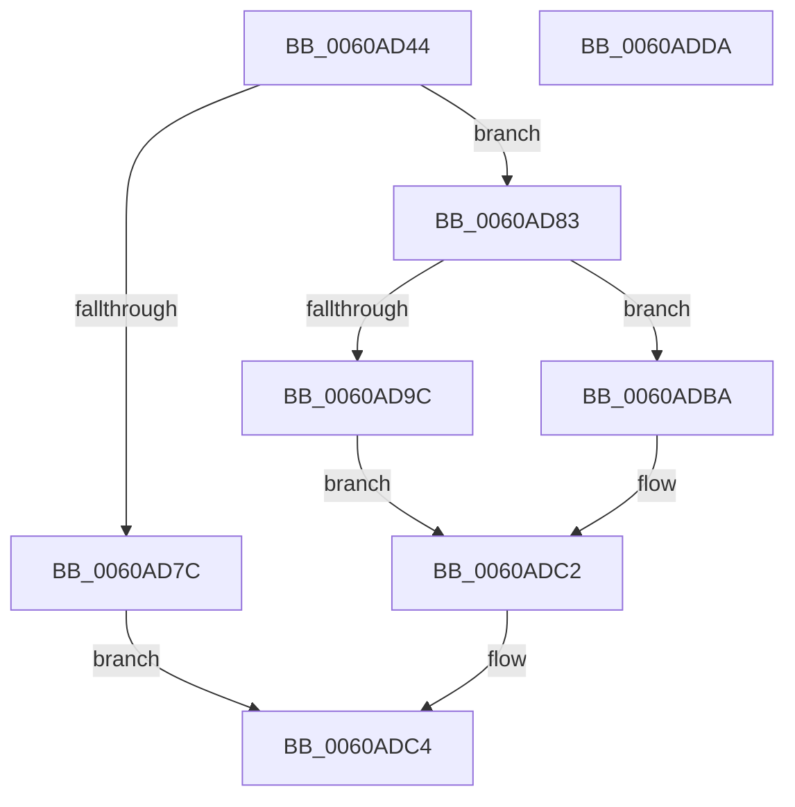

# SepDuplicateAntiTamperPolicy

- RVA: `0x0060AD44`–`0x0060ADDB` (길이 `151` bytes)
- VA: `0x000000014060AD44`
- 실행 섹션: `.text`
- PDB 이름 있음: `예`; PDB Function 태그: `아니요`
- unwind 정보 RVA: `0x0006F978`
- 디코드: `43`개 명령, `151/151` bytes 표시
- 미해석 바이트: `0` (있으면 어셈블리에 `.byte`로 보존)

> 이 문서는 커널 이미지의 기계어와 PDB 기호를 분석해 생성했습니다. 4번과 5번은 함수 원형과 자료형을 바이너리 사용 방식에서 추정한 C 해석이며 원본 소스 복구 결과는 아닙니다.

## 1. Dependencies

- 직접 호출 지점: **3**; 고유 호출 대상: **3**
- 직접 호출자로 확인된 함수: **2**
- RIP 상대 이미지 참조: **0**

### Outgoing calls
- `0x0060AD6F` → [ExAllocatePool2](../../poolcode/B8/ExAllocatePool2_function_00B820F0.md) (function, `0x00B820F0`)
- `0x0060AD91` → [SepCopyAntiTamperDebugPolicy](SepCopyAntiTamperDebugPolicy_function_0060A924.md) (function, `0x0060A924`)
- `0x0060ADBD` → [SepDeleteAntiTamperPolicy](SepDeleteAntiTamperPolicy_function_0060AA7C.md) (function, `0x0060AA7C`)

### Direct callers
- [SepConstructAntiTamperBaselinePolicy](SepConstructAntiTamperBaselinePolicy_function_0060A83C.md) at `0x0060A893`
- [SepGetAntiTamperEntry](SepGetAntiTamperEntry_function_0060AEE4.md) at `0x0060AF78`

### Static image references
- 디코드된 RIP-relative 메모리 참조가 없습니다.

## 2. Other-region calls and transfers

- 다른 실행 섹션으로 향하는 call: **1**
  - `0x0060AD6F` → [ExAllocatePool2](../../poolcode/B8/ExAllocatePool2_function_00B820F0.md) (`.text` → `POOLCODE`)
- 별도 외부 분기/꼬리 이동을 확인하지 못했습니다.

## 3. Assembly (complete function range)

```asm
0060AD44  48 89 5C 24 08                  mov qword ptr [rsp + 8], rbx
0060AD49  48 89 74 24 10                  mov qword ptr [rsp + 0x10], rsi
0060AD4E  48 89 7C 24 18                  mov qword ptr [rsp + 0x18], rdi
0060AD53  41 56                           push r14
0060AD55  48 83 EC 20                     sub rsp, 0x20
0060AD59  4C 8B F2                        mov r14, rdx
0060AD5C  48 8B F9                        mov rdi, rcx
0060AD5F  BA 40 00 00 00                  mov edx, 0x40
0060AD64  B9 00 01 00 00                  mov ecx, 0x100
0060AD69  41 B8 53 65 41 50               mov r8d, 0x50416553
0060AD6F  E8 7C 73 57 00                  call 0x140b820f0
0060AD74  48 8B D8                        mov rbx, rax
0060AD77  48 85 C0                        test rax, rax
0060AD7A  75 07                           jne 0x14060ad83
0060AD7C  B8 17 00 00 C0                  mov eax, 0xc0000017
0060AD81  EB 41                           jmp 0x14060adc4
0060AD83  48 8B 07                        mov rax, qword ptr [rdi]
0060AD86  48 8D 53 08                     lea rdx, [rbx + 8]
0060AD8A  48 8D 4F 08                     lea rcx, [rdi + 8]
0060AD8E  48 89 03                        mov qword ptr [rbx], rax
0060AD91  E8 8E FB FF FF                  call 0x14060a924
0060AD96  8B F0                           mov esi, eax
0060AD98  85 C0                           test eax, eax
0060AD9A  78 1E                           js 0x14060adba
0060AD9C  8B 47 20                        mov eax, dword ptr [rdi + 0x20]
0060AD9F  33 F6                           xor esi, esi
0060ADA1  89 43 20                        mov dword ptr [rbx + 0x20], eax
0060ADA4  0F 10 47 24                     movups xmm0, xmmword ptr [rdi + 0x24]
0060ADA8  49 89 1E                        mov qword ptr [r14], rbx
0060ADAB  F3 0F 7F 43 24                  movdqu xmmword ptr [rbx + 0x24], xmm0
0060ADB0  48 8B 47 34                     mov rax, qword ptr [rdi + 0x34]
0060ADB4  48 89 43 34                     mov qword ptr [rbx + 0x34], rax
0060ADB8  EB 08                           jmp 0x14060adc2
0060ADBA  48 8B CB                        mov rcx, rbx
0060ADBD  E8 BA FC FF FF                  call 0x14060aa7c
0060ADC2  8B C6                           mov eax, esi
0060ADC4  48 8B 5C 24 30                  mov rbx, qword ptr [rsp + 0x30]
0060ADC9  48 8B 74 24 38                  mov rsi, qword ptr [rsp + 0x38]
0060ADCE  48 8B 7C 24 40                  mov rdi, qword ptr [rsp + 0x40]
0060ADD3  48 83 C4 20                     add rsp, 0x20
0060ADD7  41 5E                           pop r14
0060ADD9  C3                              ret
0060ADDA  CC                              int3
```

## 4. C-style interpretation (structured pseudocode)

```c
__int64 __fastcall SepDuplicateAntiTamperPolicy(__int64 a1, __int64 a2)
{
    __int64 result;
    __int64 v_rsi;
    __int64 v_rsp;
    unsigned __int64 v_stack_p10;
    unsigned __int64 v_stack_p18;
    unsigned __int64 v_stack_p8;

    v_stack_p8 = v_rbx;
    v_stack_p10 = v_rsi;
    v_stack_p18 = v_rdi;
    v_rsp = (v_rsp) - (32);
    result = ExAllocatePool2(256, 64, (unsigned int)(0x50416553ULL), a4);
    if (result != 0) goto loc_0060AD83;
    goto loc_0060ADC4;
loc_0060AD83:
    *(unsigned __int64 *)(result) = *(unsigned __int64 *)(a1);
    result = SepCopyAntiTamperDebugPolicy(a1 + 8, result + 8, (unsigned int)(0x50416553ULL), a4);
    if (sign_flag) goto loc_0060ADBA;
    v_rsi = 0;
    *(unsigned int *)(result + 32) = (unsigned int)((unsigned int)(*(unsigned int *)(a1 + 32)));
    *(unsigned __int64 *)(a2) = result;
    *(unsigned __int64 *)(result + 36) = v_xmm0;
    *(unsigned __int64 *)(result + 52) = *(unsigned __int64 *)(a1 + 52);
    goto loc_0060ADC2;
loc_0060ADBA:
    result = SepDeleteAntiTamperPolicy(result, result + 8, (unsigned int)(0x50416553ULL), a4);
loc_0060ADC2:
loc_0060ADC4:
    v_rsp = (v_rsp) + (32);
    return 0;
}
```

## 5. (Beta) C Style

```c
int64_t SepDuplicateAntiTamperPolicy(void *Arg1, void *Arg2)
{
    uint8_t *arg1 = (uint8_t *)Arg1;
    uint8_t *arg2 = (uint8_t *)Arg2;

    int64_t result;
    int64_t local_rsi;
    int64_t local_rsp;
    uint64_t v_stack_p10;
    uint64_t v_stack_p18;
    uint64_t v_stack_p8;

    v_stack_p8 = local_rbx;
    v_stack_p10 = local_rsi;
    v_stack_p18 = local_rdi;
    local_rsp = (local_rsp) - (32);
    result = ExAllocatePool2(256, 64, (uint32_t)(0x50416553ULL), a4);
    if (result != 0) goto loc_0060AD83;
    goto loc_0060ADC4;
loc_0060AD83:
    *(uint64_t *)(result) = *(uint64_t *)(arg1);
    result = SepCopyAntiTamperDebugPolicy(Arg1 + 8, result + 8, (uint32_t)(0x50416553ULL), a4);
    if (sign_flag) goto loc_0060ADBA;
    local_rsi = 0;
    *(uint32_t *)(result + 0x20) = (uint32_t)((uint32_t)(*(uint32_t *)(arg1 + 0x20)));
    *(uint64_t *)(arg2) = result;
    *(uint64_t *)(result + 0x24) = v_xmm0;
    *(uint64_t *)(result + 0x34) = *(uint64_t *)(arg1 + 0x34);
    goto loc_0060ADC2;
loc_0060ADBA:
    result = SepDeleteAntiTamperPolicy(result, result + 8, (uint32_t)(0x50416553ULL), a4);
loc_0060ADC2:
loc_0060ADC4:
    local_rsp = (local_rsp) + (32);
    return 0;
}
```

### 관측된 메모리 오프셋

구조체 형식이 확인되지 않은 접근은 인자 기준의 오프셋으로만 기록했습니다.

| 기준 인자 | 오프셋 표현 | 폭 (bit) | 접근 |
|---|---:|---:|---|
| `Arg1` | `+ 0x0` | `64` | `R` |
| `Arg1` | `+ 0x8` | `64` | `R` |
| `Arg1` | `+ 0x20` | `32` | `R` |
| `Arg1` | `+ 0x24` | `128` | `R` |
| `Arg1` | `+ 0x34` | `64` | `R` |
| `Arg2` | `+ 0x0` | `64` | `W` |

## 6. Execution-region graph

[열기: 2D/3D 그래프와 함수 탐색 컨트롤 패널](../../../control-panel.html?section=text&rva=0x0060AD44&view=graph)

- 2D 그래프는 위에서 아래로 흐르고, 3D 그래프는 빈 공간을 드래그해 회전합니다. Shift+드래그는 이동, 휠은 확대·축소, 함수 노드 선택은 대상 보고서 이동입니다.

### Static fallback


