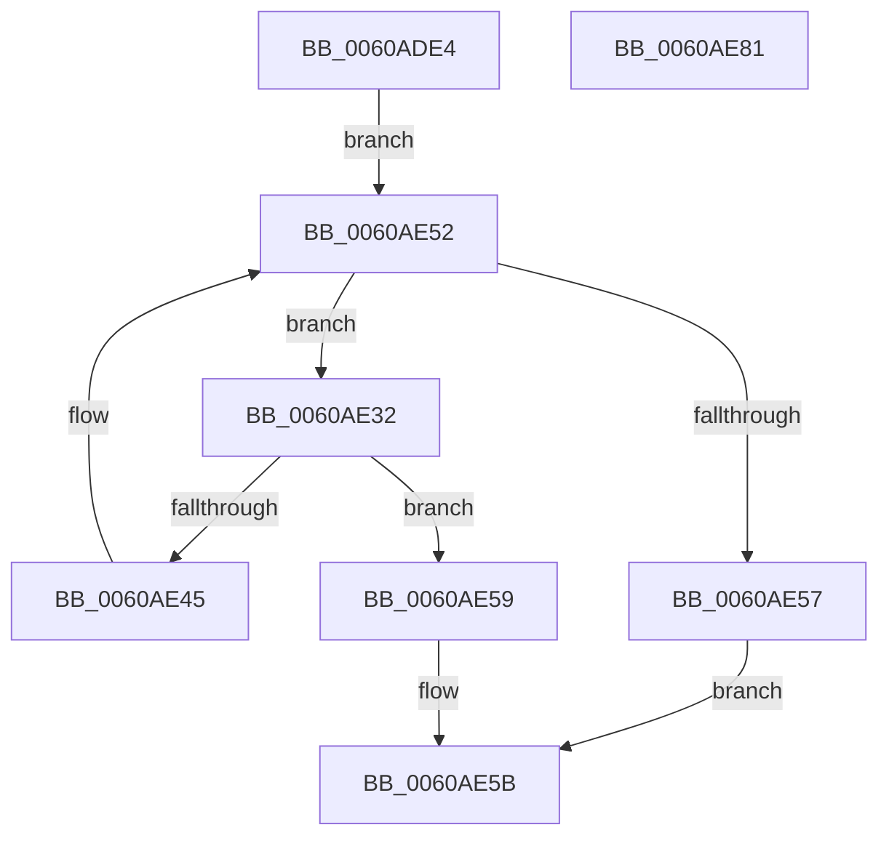

# SepFindMatchingAntiTamperEntry

- RVA: `0x0060ADE4`–`0x0060AE82` (길이 `158` bytes)
- VA: `0x000000014060ADE4`
- 실행 섹션: `.text`
- PDB 이름 있음: `예`; PDB Function 태그: `아니요`
- unwind 정보 RVA: `0x00060130`
- 디코드: `48`개 명령, `158/158` bytes 표시
- 미해석 바이트: `0` (있으면 어셈블리에 `.byte`로 보존)

> 이 문서는 커널 이미지의 기계어와 PDB 기호를 분석해 생성했습니다. 4번과 5번은 함수 원형과 자료형을 바이너리 사용 방식에서 추정한 C 해석이며 원본 소스 복구 결과는 아닙니다.

## 1. Dependencies

- 직접 호출 지점: **4**; 고유 호출 대상: **4**
- 직접 호출자로 확인된 함수: **1**
- RIP 상대 이미지 참조: **0**

### Outgoing calls
- `0x0060AE1B` → [SepComputeSidSignature](../../page/A9/SepComputeSidSignature_function_00A9097C.md) (function, `0x00A9097C`)
- `0x0060AE2B` → [RtlLookupEntryHashTable](../3F/RtlLookupEntryHashTable_function_003FAE50.md) (function, `0x003FAE50`)
- `0x0060AE3C` → [RtlEqualSid](../40/RtlEqualSid_function_00400AD0.md) (function, `0x00400AD0`)
- `0x0060AE4D` → [RtlGetNextEntryHashTable](../44/RtlGetNextEntryHashTable_function_00446C20.md) (function, `0x00446C20`)

### Direct callers
- [SepGetAntiTamperEntry](SepGetAntiTamperEntry_function_0060AEE4.md) at `0x0060AF1D`

### Static image references
- 디코드된 RIP-relative 메모리 참조가 없습니다.

## 2. Other-region calls and transfers

- 다른 실행 섹션으로 향하는 call: **1**
  - `0x0060AE1B` → [SepComputeSidSignature](../../page/A9/SepComputeSidSignature_function_00A9097C.md) (`.text` → `PAGE`)
- 별도 외부 분기/꼬리 이동을 확인하지 못했습니다.

## 3. Assembly (complete function range)

```asm
0060ADE4  4C 8B DC                        mov r11, rsp
0060ADE7  49 89 5B 08                     mov qword ptr [r11 + 8], rbx
0060ADEB  49 89 6B 10                     mov qword ptr [r11 + 0x10], rbp
0060ADEF  49 89 73 18                     mov qword ptr [r11 + 0x18], rsi
0060ADF3  49 89 7B 20                     mov qword ptr [r11 + 0x20], rdi
0060ADF7  41 56                           push r14
0060ADF9  48 83 EC 40                     sub rsp, 0x40
0060ADFD  33 C0                           xor eax, eax
0060ADFF  0F 57 C0                        xorps xmm0, xmm0
0060AE02  48 8B E9                        mov rbp, rcx
0060AE05  33 DB                           xor ebx, ebx
0060AE07  0F 11 44 24 20                  movups xmmword ptr [rsp + 0x20], xmm0
0060AE0C  48 8B CA                        mov rcx, rdx
0060AE0F  49 89 43 E8                     mov qword ptr [r11 - 0x18], rax
0060AE13  49 8B F0                        mov rsi, r8
0060AE16  4C 8B F2                        mov r14, rdx
0060AE19  8B FB                           mov edi, ebx
0060AE1B  E8 5C 5B 48 00                  call 0x140a9097c
0060AE20  48 8B D0                        mov rdx, rax
0060AE23  4C 8D 44 24 20                  lea r8, [rsp + 0x20]
0060AE28  48 8B CD                        mov rcx, rbp
0060AE2B  E8 20 00 DF FF                  call 0x1403fae50
0060AE30  EB 20                           jmp 0x14060ae52
0060AE32  48 8B 50 20                     mov rdx, qword ptr [rax + 0x20]
0060AE36  49 8B CE                        mov rcx, r14
0060AE39  48 8B F8                        mov rdi, rax
0060AE3C  E8 8F 5C DF FF                  call 0x140400ad0
0060AE41  84 C0                           test al, al
0060AE43  75 14                           jne 0x14060ae59
0060AE45  48 8D 54 24 20                  lea rdx, [rsp + 0x20]
0060AE4A  48 8B CD                        mov rcx, rbp
0060AE4D  E8 CE BD E3 FF                  call 0x140446c20
0060AE52  48 85 C0                        test rax, rax
0060AE55  75 DB                           jne 0x14060ae32
0060AE57  EB 02                           jmp 0x14060ae5b
0060AE59  B3 01                           mov bl, 1
0060AE5B  F6 DB                           neg bl
0060AE5D  48 1B C0                        sbb rax, rax
0060AE60  48 23 C7                        and rax, rdi
0060AE63  48 89 06                        mov qword ptr [rsi], rax
0060AE66  48 8B 5C 24 50                  mov rbx, qword ptr [rsp + 0x50]
0060AE6B  48 8B 6C 24 58                  mov rbp, qword ptr [rsp + 0x58]
0060AE70  48 8B 74 24 60                  mov rsi, qword ptr [rsp + 0x60]
0060AE75  48 8B 7C 24 68                  mov rdi, qword ptr [rsp + 0x68]
0060AE7A  48 83 C4 40                     add rsp, 0x40
0060AE7E  41 5E                           pop r14
0060AE80  C3                              ret
0060AE81  CC                              int3
```

## 4. C-style interpretation (structured pseudocode)

```c
__int64 __fastcall SepFindMatchingAntiTamperEntry(__int64 a1, __int64 a2, __int64 a3)
{
    __int64 result;
    __int64 v_rbx;
    __int64 v_rsp;
    unsigned __int64 v_stack_m28;
    unsigned __int64 v_stack_p10;
    unsigned __int64 v_stack_p18;
    unsigned __int64 v_stack_p20;
    unsigned __int64 v_stack_p8;

    *(unsigned __int64 *)(v_rsp + 8) = v_rbx;
    *(unsigned __int64 *)(v_rsp + 16) = v_rbp;
    *(unsigned __int64 *)(v_rsp + 24) = v_rsi;
    *(unsigned __int64 *)(v_rsp + 32) = v_rdi;
    v_rsp = (v_rsp) - (64);
    result = 0;
    v_rbx = 0;
    v_stack_m28 = v_xmm0;
    *(unsigned __int64 *)(v_rsp - 24) = 0;
    result = SepComputeSidSignature(a2, a2, a3, a4);
    result = RtlLookupEntryHashTable(a1, result, v_stack_m28, a4);
    goto loc_0060AE52;
loc_0060AE32:
    result = RtlEqualSid(a2, *(unsigned __int64 *)(result + 32), v_stack_m28, a4);
    if ((unsigned __int8)(result) != 0) goto loc_0060AE59;
    result = RtlGetNextEntryHashTable(a1, v_stack_m28, v_stack_m28, a4);
loc_0060AE52:
    if (result != 0) goto loc_0060AE32;
    goto loc_0060AE5B;
loc_0060AE59:
loc_0060AE5B:
    v_rbx = (unsigned __int8)(-(1));
    result = (result) & (result);
    *(unsigned __int64 *)(a3) = result;
    v_rsp = (v_rsp) + (64);
    return result;
}
```

## 5. (Beta) C Style

```c
int64_t SepFindMatchingAntiTamperEntry(int64_t Arg1, int64_t Arg2, void *Arg3)
{
    uint8_t *arg3 = (uint8_t *)Arg3;

    int64_t result;
    int64_t local_rbx;
    int64_t local_rsp;
    uint64_t v_stack_m28;
    uint64_t v_stack_p10;
    uint64_t v_stack_p18;
    uint64_t v_stack_p20;
    uint64_t v_stack_p8;

    *(uint64_t *)(local_rsp + 0x8) = local_rbx;
    *(uint64_t *)(local_rsp + 0x10) = local_rbp;
    *(uint64_t *)(local_rsp + 0x18) = local_rsi;
    *(uint64_t *)(local_rsp + 0x20) = local_rdi;
    local_rsp = (local_rsp) - (64);
    result = 0;
    local_rbx = 0;
    v_stack_m28 = v_xmm0;
    *(uint64_t *)(local_rsp - 0x18) = 0;
    result = SepComputeSidSignature(Arg2, Arg2, Arg3, a4);
    result = RtlLookupEntryHashTable(Arg1, result, v_stack_m28, a4);
    goto loc_0060AE52;
loc_0060AE32:
    result = RtlEqualSid(Arg2, *(uint64_t *)(result + 0x20), v_stack_m28, a4);
    if ((uint8_t)(result) != 0) goto loc_0060AE59;
    result = RtlGetNextEntryHashTable(Arg1, v_stack_m28, v_stack_m28, a4);
loc_0060AE52:
    if (result != 0) goto loc_0060AE32;
    goto loc_0060AE5B;
loc_0060AE59:
loc_0060AE5B:
    local_rbx = (uint8_t)(-(1));
    result = (result) & (result);
    *(uint64_t *)(arg3) = result;
    local_rsp = (local_rsp) + (64);
    return result;
}
```

### 관측된 메모리 오프셋

구조체 형식이 확인되지 않은 접근은 인자 기준의 오프셋으로만 기록했습니다.

| 기준 인자 | 오프셋 표현 | 폭 (bit) | 접근 |
|---|---:|---:|---|
| `Arg3` | `+ 0x0` | `64` | `W` |

## 6. Execution-region graph

[열기: 2D/3D 그래프와 함수 탐색 컨트롤 패널](../../../control-panel.html?section=text&rva=0x0060ADE4&view=graph)

- 2D 그래프는 위에서 아래로 흐르고, 3D 그래프는 빈 공간을 드래그해 회전합니다. Shift+드래그는 이동, 휠은 확대·축소, 함수 노드 선택은 대상 보고서 이동입니다.

### Static fallback


