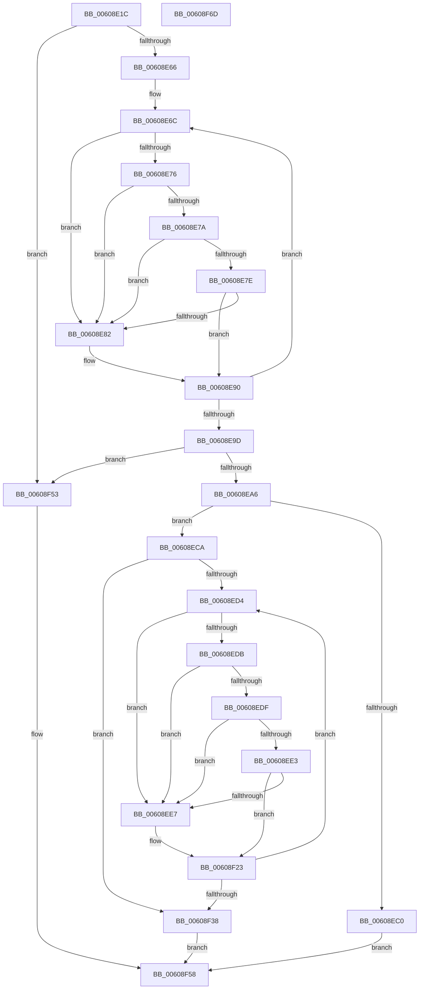

# SepFlattenAcl

- RVA: `0x00608E1C`–`0x00608F6E` (길이 `338` bytes)
- VA: `0x0000000140608E1C`
- 실행 섹션: `.text`
- PDB 이름 있음: `예`; PDB Function 태그: `아니요`
- unwind 정보 RVA: `0x000D1090`
- 디코드: `107`개 명령, `338/338` bytes 표시
- 미해석 바이트: `0` (있으면 어셈블리에 `.byte`로 보존)

> 이 문서는 커널 이미지의 기계어와 PDB 기호를 분석해 생성했습니다. 4번과 5번은 함수 원형과 자료형을 바이너리 사용 방식에서 추정한 C 해석이며 원본 소스 복구 결과는 아닙니다.

## 1. Dependencies

- 직접 호출 지점: **2**; 고유 호출 대상: **2**
- 직접 호출자로 확인된 함수: **1**
- RIP 상대 이미지 참조: **0**

### Outgoing calls
- `0x00608EB3` → [ExAllocatePool2](../../poolcode/B8/ExAllocatePool2_function_00B820F0.md) (function, `0x00B820F0`)
- `0x00608F11` → [memcpy](../6C/memcpy_function_006C6840.md) (function, `0x006C6840`)

### Direct callers
- [sub_006F033D](../6F/Unknown_function_006F033D.md) at `0x006F0944`
- [sub_006F033D](../6F/Unknown_function_006F033D.md) at `0x006F09C8`

### Static image references
- 디코드된 RIP-relative 메모리 참조가 없습니다.

## 2. Other-region calls and transfers

- 다른 실행 섹션으로 향하는 call: **1**
  - `0x00608EB3` → [ExAllocatePool2](../../poolcode/B8/ExAllocatePool2_function_00B820F0.md) (`.text` → `POOLCODE`)
- 별도 외부 분기/꼬리 이동을 확인하지 못했습니다.

## 3. Assembly (complete function range)

```asm
00608E1C  48 8B C4                        mov rax, rsp
00608E1F  48 89 58 08                     mov qword ptr [rax + 8], rbx
00608E23  4C 89 48 20                     mov qword ptr [rax + 0x20], r9
00608E27  4C 89 40 18                     mov qword ptr [rax + 0x18], r8
00608E2B  48 89 50 10                     mov qword ptr [rax + 0x10], rdx
00608E2F  55                              push rbp
00608E30  56                              push rsi
00608E31  57                              push rdi
00608E32  41 54                           push r12
00608E34  41 55                           push r13
00608E36  41 56                           push r14
00608E38  41 57                           push r15
00608E3A  48 83 EC 20                     sub rsp, 0x20
00608E3E  0F B7 41 04                     movzx eax, word ptr [rcx + 4]
00608E42  4C 8D 71 08                     lea r14, [rcx + 8]
00608E46  45 33 FF                        xor r15d, r15d
00608E49  4C 8B E9                        mov r13, rcx
00608E4C  4C 89 3A                        mov qword ptr [rdx], r15
00608E4F  41 0F B7 EF                     movzx ebp, r15w
00608E53  45 89 38                        mov dword ptr [r8], r15d
00608E56  4D 8B D6                        mov r10, r14
00608E59  41 8B FF                        mov edi, r15d
00608E5C  66 44 3B F8                     cmp r15w, ax
00608E60  0F 83 ED 00 00 00               jae 0x140608f53
00608E66  8B C8                           mov ecx, eax
00608E68  41 8D 57 01                     lea edx, [r15 + 1]
00608E6C  41 8A 02                        mov al, byte ptr [r10]
00608E6F  83 C7 0C                        add edi, 0xc
00608E72  3C 03                           cmp al, 3
00608E74  76 0C                           jbe 0x140608e82
00608E76  3C 11                           cmp al, 0x11
00608E78  74 08                           je 0x140608e82
00608E7A  3C 14                           cmp al, 0x14
00608E7C  74 04                           je 0x140608e82
00608E7E  3C 15                           cmp al, 0x15
00608E80  75 0E                           jne 0x140608e90
00608E82  41 0F B6 42 09                  movzx eax, byte ptr [r10 + 9]
00608E87  8D 3C 87                        lea edi, [rdi + rax*4]
00608E8A  83 C7 08                        add edi, 8
00608E8D  66 03 EA                        add bp, dx
00608E90  41 0F B7 42 02                  movzx eax, word ptr [r10 + 2]
00608E95  4C 03 D0                        add r10, rax
00608E98  48 2B CA                        sub rcx, rdx
00608E9B  75 CF                           jne 0x140608e6c
00608E9D  66 85 ED                        test bp, bp
00608EA0  0F 84 AD 00 00 00               je 0x140608f53
00608EA6  8B D7                           mov edx, edi
00608EA8  B9 00 01 00 00                  mov ecx, 0x100
00608EAD  41 B8 53 65 4C 61               mov r8d, 0x614c6553
00608EB3  E8 38 92 57 00                  call 0x140b820f0
00608EB8  4C 8B E0                        mov r12, rax
00608EBB  48 85 C0                        test rax, rax
00608EBE  75 0A                           jne 0x140608eca
00608EC0  B8 17 00 00 C0                  mov eax, 0xc0000017
00608EC5  E9 8E 00 00 00                  jmp 0x140608f58
00608ECA  49 8B F4                        mov rsi, r12
00608ECD  66 45 3B 7D 04                  cmp r15w, word ptr [r13 + 4]
00608ED2  73 64                           jae 0x140608f38
00608ED4  41 8A 06                        mov al, byte ptr [r14]
00608ED7  3C 03                           cmp al, 3
00608ED9  76 0C                           jbe 0x140608ee7
00608EDB  3C 11                           cmp al, 0x11
00608EDD  74 08                           je 0x140608ee7
00608EDF  3C 14                           cmp al, 0x14
00608EE1  74 04                           je 0x140608ee7
00608EE3  3C 15                           cmp al, 0x15
00608EE5  75 3C                           jne 0x140608f23
00608EE7  41 0F B6 46 01                  movzx eax, byte ptr [r14 + 1]
00608EEC  49 8D 56 08                     lea rdx, [r14 + 8]
00608EF0  41 8B 4E 04                     mov ecx, dword ptr [r14 + 4]
00608EF4  89 46 04                        mov dword ptr [rsi + 4], eax
00608EF7  41 0F B6 06                     movzx eax, byte ptr [r14]
00608EFB  89 4E 08                        mov dword ptr [rsi + 8], ecx
00608EFE  48 8D 4E 0C                     lea rcx, [rsi + 0xc]
00608F02  89 06                           mov dword ptr [rsi], eax
00608F04  45 0F B6 46 09                  movzx r8d, byte ptr [r14 + 9]
00608F09  4E 8D 04 85 08 00 00 00         lea r8, [r8*4 + 8]
00608F11  E8 2A D9 0B 00                  call 0x1406c6840
00608F16  41 0F B6 46 09                  movzx eax, byte ptr [r14 + 9]
00608F1B  48 8D 34 86                     lea rsi, [rsi + rax*4]
00608F1F  48 83 C6 14                     add rsi, 0x14
00608F23  41 0F B7 46 02                  movzx eax, word ptr [r14 + 2]
00608F28  41 FF C7                        inc r15d
00608F2B  4C 03 F0                        add r14, rax
00608F2E  41 0F B7 45 04                  movzx eax, word ptr [r13 + 4]
00608F33  44 3B F8                        cmp r15d, eax
00608F36  72 9C                           jb 0x140608ed4
00608F38  48 8B 44 24 68                  mov rax, qword ptr [rsp + 0x68]
00608F3D  4C 89 20                        mov qword ptr [rax], r12
00608F40  48 8B 44 24 70                  mov rax, qword ptr [rsp + 0x70]
00608F45  89 38                           mov dword ptr [rax], edi
00608F47  48 8B 44 24 78                  mov rax, qword ptr [rsp + 0x78]
00608F4C  66 89 28                        mov word ptr [rax], bp
00608F4F  33 C0                           xor eax, eax
00608F51  EB 05                           jmp 0x140608f58
00608F53  B8 25 02 00 C0                  mov eax, 0xc0000225
00608F58  48 8B 5C 24 60                  mov rbx, qword ptr [rsp + 0x60]
00608F5D  48 83 C4 20                     add rsp, 0x20
00608F61  41 5F                           pop r15
00608F63  41 5E                           pop r14
00608F65  41 5D                           pop r13
00608F67  41 5C                           pop r12
00608F69  5F                              pop rdi
00608F6A  5E                              pop rsi
00608F6B  5D                              pop rbp
00608F6C  C3                              ret
00608F6D  CC                              int3
```

## 4. C-style interpretation (structured pseudocode)

```c
__int64 __fastcall SepFlattenAcl(__int64 a1, __int64 a2, __int64 a3, __int64 a4)
{
    __int64 result;
    __int64 v_r10;
    __int64 v_r14;
    __int64 v_r15;
    __int64 v_rbp;
    __int64 v_rdi;
    __int64 v_rsi;
    __int64 v_rsp;
    unsigned __int64 v_stack_p10;
    unsigned __int64 v_stack_p18;
    unsigned __int64 v_stack_p20;
    unsigned __int64 v_stack_p8;

    *(unsigned __int64 *)(v_rsp + 8) = v_rbx;
    *(unsigned __int64 *)(v_rsp + 32) = a4;
    *(unsigned __int64 *)(v_rsp + 24) = a3;
    *(unsigned __int64 *)(v_rsp + 16) = a2;
    v_rsp = (v_rsp) - (32);
    v_r15 = 0;
    *(unsigned __int64 *)(a2) = 0;
    *(unsigned int *)(a3) = 0;
    if (0 >= ((unsigned __int16)(*(unsigned __int16 *)(a1 + 4)))) goto loc_00608F53;
loc_00608E6C:
    v_rdi = (unsigned int)((0) + (12));
    if (((unsigned __int8)(*(unsigned __int8 *)(a1 + 8))) <= 3) goto loc_00608E82;
    if (((unsigned __int8)(*(unsigned __int8 *)(a1 + 8))) == 17) goto loc_00608E82;
    if (((unsigned __int8)(*(unsigned __int8 *)(a1 + 8))) == 20) goto loc_00608E82;
    result = *(unsigned __int8 *)(a1 + 8);
    v_rbp = 0;
    if (((unsigned __int8)(*(unsigned __int8 *)(a1 + 8))) == 21) {
        result = *(unsigned __int8 *)(a1 + 8 + 9);
        v_rdi = v_rdi + result * 4;
        v_rdi = (unsigned int)((v_rdi) + (8));
        v_rbp = (unsigned __int16)((0) + ((unsigned __int16)(v_r15 + 1)));
    }
    v_r10 = (a1 + 8) + (*(unsigned __int16 *)(a1 + 8 + 2));
    a1 = ((unsigned int)((unsigned int)(*(unsigned __int16 *)(a1 + 4)))) - (v_r15 + 1);
    if (condition_is_not_equal) goto loc_00608E6C;
    if ((unsigned __int16)(v_rbp) == 0) goto loc_00608F53;
    result = ExAllocatePool2(256, (unsigned int)((unsigned int)(v_rdi)), (unsigned int)(0x614C6553ULL), a4);
    if (result != 0) goto loc_00608ECA;
    goto loc_00608F58;
loc_00608ECA:
    if (0 >= (*(unsigned __int16 *)(a1 + 4))) goto loc_00608F38;
loc_00608ED4:
    if (((unsigned __int8)(*(unsigned __int8 *)(a1 + 8))) <= 3) goto loc_00608EE7;
    if (((unsigned __int8)(*(unsigned __int8 *)(a1 + 8))) == 17) goto loc_00608EE7;
    if (((unsigned __int8)(*(unsigned __int8 *)(a1 + 8))) == 20) goto loc_00608EE7;
    result = *(unsigned __int8 *)(a1 + 8);
    v_rsi = result;
    if (((unsigned __int8)(*(unsigned __int8 *)(a1 + 8))) == 21) {
        result = *(unsigned __int8 *)(a1 + 8 + 1);
        a2 = a1 + 8 + 8;
        a1 = *(unsigned int *)(a1 + 8 + 4);
        *(unsigned int *)(result + 4) = (unsigned int)(result);
        result = *(unsigned __int8 *)(a1 + 8);
        *(unsigned int *)(result + 8) = (unsigned int)(a1);
        a1 = result + 12;
        *(unsigned int *)(result) = (unsigned int)(result);
        a3 = *(unsigned __int8 *)(a1 + 8 + 9);
        a3 = a3 * 4 + 8;
        result = memcpy(a1, a2, a3, a4);
        result = *(unsigned __int8 *)(a1 + 8 + 9);
        v_rsi = result + result * 4;
        v_rsi = (v_rsi) + (20);
    }
    v_r15 = (unsigned int)((v_r15) + 1);
    v_r14 = (a1 + 8) + (*(unsigned __int16 *)(a1 + 8 + 2));
    if (((unsigned int)(v_r15)) < ((unsigned int)(*(unsigned __int16 *)(a1 + 4)))) goto loc_00608ED4;
loc_00608F38:
    *(unsigned __int64 *)(v_stack_p10) = result;
    *(unsigned int *)(v_stack_p18) = (unsigned int)(v_rdi);
    *(unsigned __int16 *)(v_stack_p20) = (unsigned __int16)(v_rbp);
    result = 0;
    goto loc_00608F58;
loc_00608F53:
loc_00608F58:
    v_rsp = (v_rsp) + (32);
    return (unsigned int)(0xC0000225ULL);
}
```

## 5. (Beta) C Style

```c
int64_t SepFlattenAcl(void *Arg1, void *Arg2, void *Arg3, int64_t Arg4)
{
    uint8_t *arg1 = (uint8_t *)Arg1;
    uint8_t *arg2 = (uint8_t *)Arg2;
    uint8_t *arg3 = (uint8_t *)Arg3;

    int64_t result;
    int64_t local_r10;
    int64_t local_r14;
    int64_t local_r15;
    int64_t local_rbp;
    int64_t local_rdi;
    int64_t local_rsi;
    int64_t local_rsp;
    uint64_t v_stack_p10;
    uint64_t v_stack_p18;
    uint64_t v_stack_p20;
    uint64_t v_stack_p8;

    *(uint64_t *)(local_rsp + 0x8) = local_rbx;
    *(uint64_t *)(local_rsp + 0x20) = Arg4;
    *(void **)(local_rsp + 0x18) = Arg3;
    *(void **)(local_rsp + 0x10) = Arg2;
    local_rsp = (local_rsp) - (32);
    local_r15 = 0;
    *(uint64_t *)(arg2) = 0;
    *(uint32_t *)(arg3) = 0;
    if (0 >= ((uint16_t)(*(uint16_t *)(arg1 + 0x4)))) goto loc_00608F53;
loc_00608E6C:
    local_rdi = (uint32_t)((0) + (12));
    if (((uint8_t)(*(uint8_t *)(arg1 + 0x8))) <= 3) goto loc_00608E82;
    if (((uint8_t)(*(uint8_t *)(arg1 + 0x8))) == 17) goto loc_00608E82;
    if (((uint8_t)(*(uint8_t *)(arg1 + 0x8))) == 20) goto loc_00608E82;
    result = *(uint8_t *)(arg1 + 0x8);
    local_rbp = 0;
    if (((uint8_t)(*(uint8_t *)(arg1 + 0x8))) == 21) {
        result = *(uint8_t *)(arg1 + 0x8 + 0x9);
        local_rdi = local_rdi + result * 4;
        local_rdi = (uint32_t)((local_rdi) + (8));
        local_rbp = (uint16_t)((0) + ((uint16_t)(local_r15 + 1)));
    }
    local_r10 = (Arg1 + 8) + (*(uint16_t *)(arg1 + 0x8 + 0x2));
    Arg1 = ((uint32_t)((uint32_t)(*(uint16_t *)(arg1 + 0x4)))) - (local_r15 + 1);
    if (condition_is_not_equal) goto loc_00608E6C;
    if ((uint16_t)(local_rbp) == 0) goto loc_00608F53;
    result = ExAllocatePool2(256, (uint32_t)((uint32_t)(local_rdi)), (uint32_t)(0x614C6553ULL), Arg4);
    if (result != 0) goto loc_00608ECA;
    goto loc_00608F58;
loc_00608ECA:
    if (0 >= (*(uint16_t *)(arg1 + 0x4))) goto loc_00608F38;
loc_00608ED4:
    if (((uint8_t)(*(uint8_t *)(arg1 + 0x8))) <= 3) goto loc_00608EE7;
    if (((uint8_t)(*(uint8_t *)(arg1 + 0x8))) == 17) goto loc_00608EE7;
    if (((uint8_t)(*(uint8_t *)(arg1 + 0x8))) == 20) goto loc_00608EE7;
    result = *(uint8_t *)(arg1 + 0x8);
    local_rsi = result;
    if (((uint8_t)(*(uint8_t *)(arg1 + 0x8))) == 21) {
        result = *(uint8_t *)(arg1 + 0x8 + 0x1);
        Arg2 = Arg1 + 8 + 8;
        Arg1 = *(uint32_t *)(arg1 + 0x8 + 0x4);
        *(uint32_t *)(result + 0x4) = (uint32_t)(result);
        result = *(uint8_t *)(arg1 + 0x8);
        *(uint32_t *)(result + 0x8) = (uint32_t)(Arg1);
        Arg1 = result + 12;
        *(uint32_t *)(result) = (uint32_t)(result);
        Arg3 = *(uint8_t *)(arg1 + 0x8 + 0x9);
        Arg3 = Arg3 * 4 + 8;
        result = memcpy(Arg1, Arg2, Arg3, Arg4);
        result = *(uint8_t *)(arg1 + 0x8 + 0x9);
        local_rsi = result + result * 4;
        local_rsi = (local_rsi) + (20);
    }
    local_r15 = (uint32_t)((local_r15) + 1);
    local_r14 = (Arg1 + 8) + (*(uint16_t *)(arg1 + 0x8 + 0x2));
    if (((uint32_t)(local_r15)) < ((uint32_t)(*(uint16_t *)(arg1 + 0x4)))) goto loc_00608ED4;
loc_00608F38:
    *(uint64_t *)(v_stack_p10) = result;
    *(uint32_t *)(v_stack_p18) = (uint32_t)(local_rdi);
    *(uint16_t *)(v_stack_p20) = (uint16_t)(local_rbp);
    result = 0;
    goto loc_00608F58;
loc_00608F53:
loc_00608F58:
    local_rsp = (local_rsp) + (32);
    return (uint32_t)(0xC0000225ULL);
}
```

### 관측된 메모리 오프셋

구조체 형식이 확인되지 않은 접근은 인자 기준의 오프셋으로만 기록했습니다.

| 기준 인자 | 오프셋 표현 | 폭 (bit) | 접근 |
|---|---:|---:|---|
| `Arg1` | `+ 0x0` | `8` | `R` |
| `Arg1` | `+ 0x1` | `8` | `R` |
| `Arg1` | `+ 0x2` | `16` | `R` |
| `Arg1` | `+ 0x4` | `16` | `R` |
| `Arg1` | `+ 0x4` | `32` | `R` |
| `Arg1` | `+ 0x8` | `64` | `R` |
| `Arg1` | `+ 0x9` | `8` | `R` |
| `Arg2` | `+ 0x0` | `64` | `W` |
| `Arg3` | `+ 0x0` | `32` | `W` |

## 6. Execution-region graph

[열기: 2D/3D 그래프와 함수 탐색 컨트롤 패널](../../../control-panel.html?section=text&rva=0x00608E1C&view=graph)

- 2D 그래프는 위에서 아래로 흐르고, 3D 그래프는 빈 공간을 드래그해 회전합니다. Shift+드래그는 이동, 휠은 확대·축소, 함수 노드 선택은 대상 보고서 이동입니다.

### Static fallback


