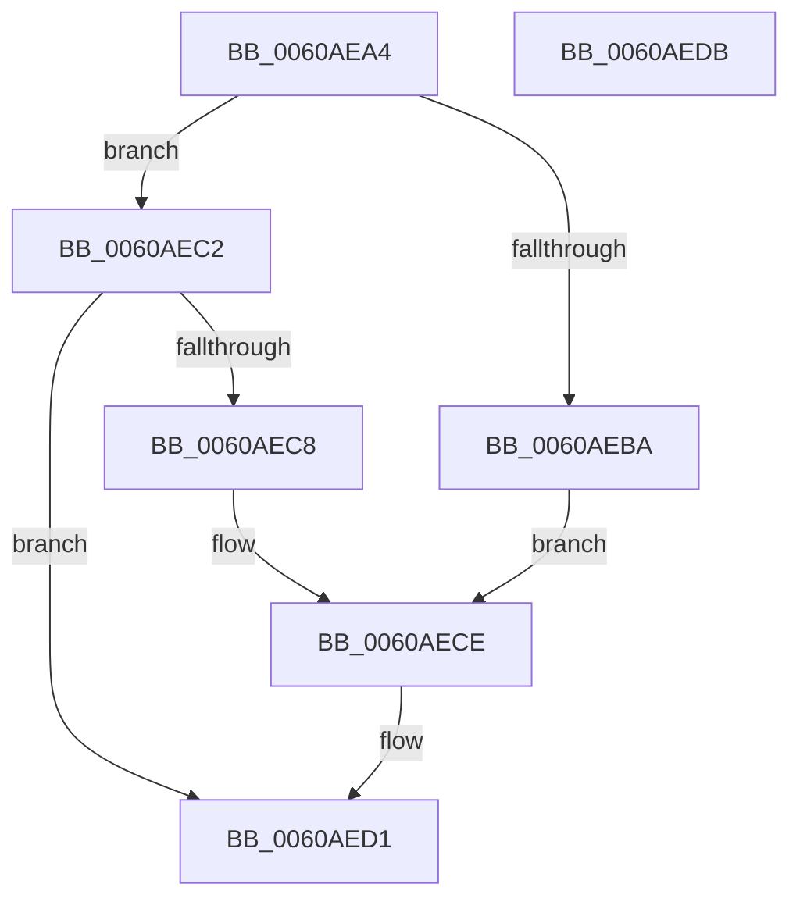

# SepFoldAntiTamperRelaxationIfeo

- RVA: `0x0060AEA4`–`0x0060AEDC` (길이 `56` bytes)
- VA: `0x000000014060AEA4`
- 실행 섹션: `.text`
- PDB 이름 있음: `예`; PDB Function 태그: `예`
- unwind 정보 RVA: `0x0005C788`
- 디코드: `19`개 명령, `56/56` bytes 표시
- 미해석 바이트: `0` (있으면 어셈블리에 `.byte`로 보존)

> 이 문서는 커널 이미지의 기계어와 PDB 기호를 분석해 생성했습니다. 4번과 5번은 함수 원형과 자료형을 바이너리 사용 방식에서 추정한 C 해석이며 원본 소스 복구 결과는 아닙니다.

## 1. Dependencies

- 직접 호출 지점: **1**; 고유 호출 대상: **1**
- 직접 호출자로 확인된 함수: **1**
- RIP 상대 이미지 참조: **0**

### Outgoing calls
- `0x0060AED1` → [SepFoldAntiTamperRelaxation](SepFoldAntiTamperRelaxation_function_0060AE88.md) (function, `0x0060AE88`)

### Direct callers
- [SeConstructAntiTamperPolicy](SeConstructAntiTamperPolicy_function_0060A094.md) at `0x0060A1B9`
- [SeConstructAntiTamperPolicy](SeConstructAntiTamperPolicy_function_0060A094.md) at `0x0060A284`
- [SeConstructAntiTamperPolicy](SeConstructAntiTamperPolicy_function_0060A094.md) at `0x0060A32A`
- [SeConstructAntiTamperPolicy](SeConstructAntiTamperPolicy_function_0060A094.md) at `0x0060A3CC`
- [SeConstructAntiTamperPolicy](SeConstructAntiTamperPolicy_function_0060A094.md) at `0x0060A46C`
- [SeConstructAntiTamperPolicy](SeConstructAntiTamperPolicy_function_0060A094.md) at `0x0060A536`
- [SeConstructAntiTamperPolicy](SeConstructAntiTamperPolicy_function_0060A094.md) at `0x0060A5D6`

### Static image references
- 디코드된 RIP-relative 메모리 참조가 없습니다.

## 2. Other-region calls and transfers

- 다른 실행 섹션으로 향하는 call: **0**
- 별도 외부 분기/꼬리 이동을 확인하지 못했습니다.

## 3. Assembly (complete function range)

```asm
0060AEA4  48 83 EC 28                     sub rsp, 0x28
0060AEA8  45 8A D0                        mov r10b, r8b
0060AEAB  41 8A C1                        mov al, r9b
0060AEAE  45 32 C9                        xor r9b, r9b
0060AEB1  45 8A C1                        mov r8b, r9b
0060AEB4  41 80 FA 01                     cmp r10b, 1
0060AEB8  75 08                           jne 0x14060aec2
0060AEBA  84 C0                           test al, al
0060AEBC  41 0F 94 C1                     sete r9b
0060AEC0  EB 0C                           jmp 0x14060aece
0060AEC2  41 80 FA 02                     cmp r10b, 2
0060AEC6  75 09                           jne 0x14060aed1
0060AEC8  84 C0                           test al, al
0060AECA  41 0F 95 C1                     setne r9b
0060AECE  41 B0 01                        mov r8b, 1
0060AED1  E8 B2 FF FF FF                  call 0x14060ae88
0060AED6  48 83 C4 28                     add rsp, 0x28
0060AEDA  C3                              ret
0060AEDB  CC                              int3
```

## 4. C-style interpretation (structured pseudocode)

```c
__int64 __fastcall SepFoldAntiTamperRelaxationIfeo(__int64 a1, __int64 a2, unsigned __int8 a3, unsigned __int8 a4)
{
    __int64 result;
    __int64 v_rsp;

    v_rsp = (v_rsp) - (40);
    a4 = 0;
    if (a3 != 1) goto loc_0060AEC2;
    a4 = (0 == 0) ? 1 : 0;
    goto loc_0060AECE;
loc_0060AEC2:
    if (a3 != 2) goto loc_0060AED1;
    a4 = (a4 != 0) ? 1 : 0;
loc_0060AECE:
loc_0060AED1:
    result = SepFoldAntiTamperRelaxation(a1, a2, 1, a4);
    v_rsp = (v_rsp) + (40);
    return result;
}
```

## 5. (Beta) C Style

```c
int64_t SepFoldAntiTamperRelaxationIfeo(int64_t Arg1, int64_t Arg2, uint8_t Arg3, uint8_t Arg4)
{
    int64_t result;
    int64_t local_rsp;

    local_rsp = (local_rsp) - (40);
    Arg4 = 0;
    if (Arg3 != 1) goto loc_0060AEC2;
    Arg4 = (0 == 0) ? 1 : 0;
    goto loc_0060AECE;
loc_0060AEC2:
    if (Arg3 != 2) goto loc_0060AED1;
    Arg4 = (Arg4 != 0) ? 1 : 0;
loc_0060AECE:
loc_0060AED1:
    result = SepFoldAntiTamperRelaxation(Arg1, Arg2, 1, Arg4);
    local_rsp = (local_rsp) + (40);
    return result;
}
```

## 6. Execution-region graph

[열기: 2D/3D 그래프와 함수 탐색 컨트롤 패널](../../../control-panel.html?section=text&rva=0x0060AEA4&view=graph)

- 2D 그래프는 위에서 아래로 흐르고, 3D 그래프는 빈 공간을 드래그해 회전합니다. Shift+드래그는 이동, 휠은 확대·축소, 함수 노드 선택은 대상 보고서 이동입니다.

### Static fallback


