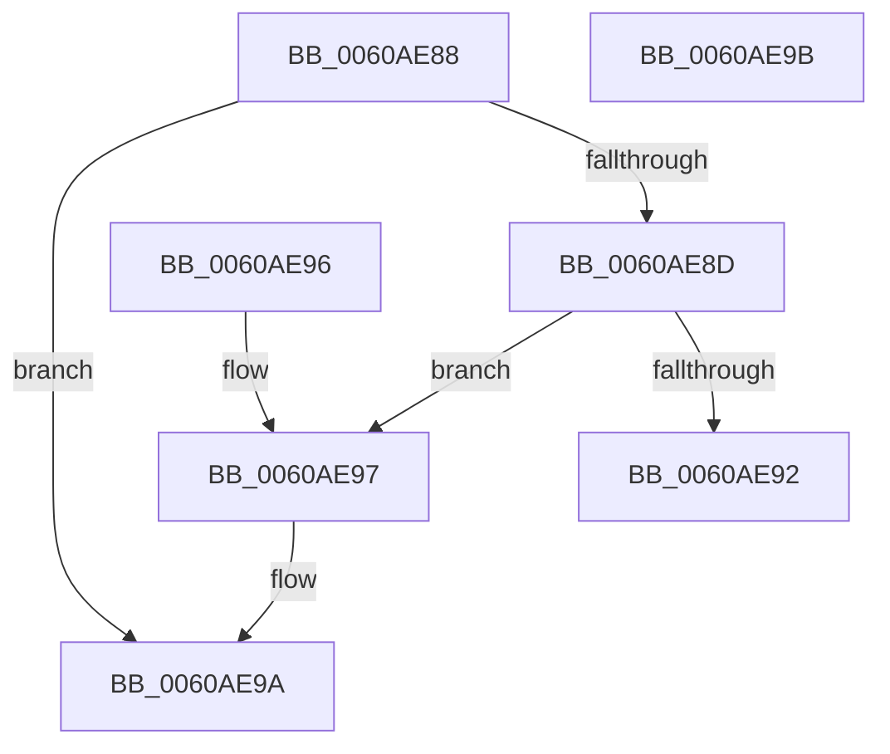

# SepFoldAntiTamperRelaxation

- RVA: `0x0060AE88`–`0x0060AE9C` (길이 `20` bytes)
- VA: `0x000000014060AE88`
- 실행 섹션: `.text`
- PDB 이름 있음: `예`; PDB Function 태그: `예`
- unwind 정보 RVA: `0x000DB714`
- 디코드: `10`개 명령, `20/20` bytes 표시
- 미해석 바이트: `0` (있으면 어셈블리에 `.byte`로 보존)

> 이 문서는 커널 이미지의 기계어와 PDB 기호를 분석해 생성했습니다. 4번과 5번은 함수 원형과 자료형을 바이너리 사용 방식에서 추정한 C 해석이며 원본 소스 복구 결과는 아닙니다.

## 1. Dependencies

- 직접 호출 지점: **0**; 고유 호출 대상: **0**
- 직접 호출자로 확인된 함수: **2**
- RIP 상대 이미지 참조: **0**

### Outgoing calls
- 직접 디코드된 call 명령이 없습니다.

### Direct callers
- [SeConstructAntiTamperPolicy](SeConstructAntiTamperPolicy_function_0060A094.md) at `0x0060A19A`
- [SeConstructAntiTamperPolicy](SeConstructAntiTamperPolicy_function_0060A094.md) at `0x0060A1DF`
- [SeConstructAntiTamperPolicy](SeConstructAntiTamperPolicy_function_0060A094.md) at `0x0060A1F2`
- [SeConstructAntiTamperPolicy](SeConstructAntiTamperPolicy_function_0060A094.md) at `0x0060A265`
- [SeConstructAntiTamperPolicy](SeConstructAntiTamperPolicy_function_0060A094.md) at `0x0060A2A9`
- [SeConstructAntiTamperPolicy](SeConstructAntiTamperPolicy_function_0060A094.md) at `0x0060A2BC`
- [SeConstructAntiTamperPolicy](SeConstructAntiTamperPolicy_function_0060A094.md) at `0x0060A30A`
- [SeConstructAntiTamperPolicy](SeConstructAntiTamperPolicy_function_0060A094.md) at `0x0060A350`
- [SeConstructAntiTamperPolicy](SeConstructAntiTamperPolicy_function_0060A094.md) at `0x0060A363`
- [SeConstructAntiTamperPolicy](SeConstructAntiTamperPolicy_function_0060A094.md) at `0x0060A3AC`
- [SeConstructAntiTamperPolicy](SeConstructAntiTamperPolicy_function_0060A094.md) at `0x0060A3F2`
- [SeConstructAntiTamperPolicy](SeConstructAntiTamperPolicy_function_0060A094.md) at `0x0060A405`
- [SeConstructAntiTamperPolicy](SeConstructAntiTamperPolicy_function_0060A094.md) at `0x0060A44C`
- [SeConstructAntiTamperPolicy](SeConstructAntiTamperPolicy_function_0060A094.md) at `0x0060A492`
- [SeConstructAntiTamperPolicy](SeConstructAntiTamperPolicy_function_0060A094.md) at `0x0060A4A5`
- [SeConstructAntiTamperPolicy](SeConstructAntiTamperPolicy_function_0060A094.md) at `0x0060A516`
- [SeConstructAntiTamperPolicy](SeConstructAntiTamperPolicy_function_0060A094.md) at `0x0060A55B`
- [SeConstructAntiTamperPolicy](SeConstructAntiTamperPolicy_function_0060A094.md) at `0x0060A56E`
- [SeConstructAntiTamperPolicy](SeConstructAntiTamperPolicy_function_0060A094.md) at `0x0060A5B6`
- [SeConstructAntiTamperPolicy](SeConstructAntiTamperPolicy_function_0060A094.md) at `0x0060A5FC`
- [SeConstructAntiTamperPolicy](SeConstructAntiTamperPolicy_function_0060A094.md) at `0x0060A60F`
- [SeConstructAntiTamperPolicy](SeConstructAntiTamperPolicy_function_0060A094.md) at `0x0060A654`
- [SeConstructAntiTamperPolicy](SeConstructAntiTamperPolicy_function_0060A094.md) at `0x0060A667`
- [SeConstructAntiTamperPolicy](SeConstructAntiTamperPolicy_function_0060A094.md) at `0x0060A6AD`
- [SeConstructAntiTamperPolicy](SeConstructAntiTamperPolicy_function_0060A094.md) at `0x0060A6C0`
- [SepFoldAntiTamperRelaxationIfeo](SepFoldAntiTamperRelaxationIfeo_function_0060AEA4.md) at `0x0060AED1`

### Static image references
- 디코드된 RIP-relative 메모리 참조가 없습니다.

## 2. Other-region calls and transfers

- 다른 실행 섹션으로 향하는 call: **0**
- 별도 외부 분기/꼬리 이동을 확인하지 못했습니다.

## 3. Assembly (complete function range)

```asm
0060AE88  45 84 C0                        test r8b, r8b
0060AE8B  74 0D                           je 0x14060ae9a
0060AE8D  45 84 C9                        test r9b, r9b
0060AE90  74 05                           je 0x14060ae97
0060AE92  C6 01 01                        mov byte ptr [rcx], 1
0060AE95  C3                              ret
0060AE96  CC                              int3
0060AE97  C6 02 01                        mov byte ptr [rdx], 1
0060AE9A  C3                              ret
0060AE9B  CC                              int3
```

## 4. C-style interpretation (structured pseudocode)

```c
void __fastcall SepFoldAntiTamperRelaxation(__int64 a1, __int64 a2, unsigned __int8 a3, unsigned __int8 a4)
{
    if (a3 == 0) goto loc_0060AE9A;
    if (a4 == 0) goto loc_0060AE97;
    *(unsigned __int8 *)(a1) = 1;
    return;
loc_0060AE97:
    *(unsigned __int8 *)(a2) = 1;
loc_0060AE9A:
    return;
}
```

## 5. (Beta) C Style

```c
void SepFoldAntiTamperRelaxation(void *Arg1, void *Arg2, uint8_t Arg3, uint8_t Arg4)
{
    uint8_t *arg1 = (uint8_t *)Arg1;
    uint8_t *arg2 = (uint8_t *)Arg2;

    if (Arg3 == 0) goto loc_0060AE9A;
    if (Arg4 == 0) goto loc_0060AE97;
    *(uint8_t *)(arg1) = 1;
    return;
loc_0060AE97:
    *(uint8_t *)(arg2) = 1;
loc_0060AE9A:
    return;
}
```

### 관측된 메모리 오프셋

구조체 형식이 확인되지 않은 접근은 인자 기준의 오프셋으로만 기록했습니다.

| 기준 인자 | 오프셋 표현 | 폭 (bit) | 접근 |
|---|---:|---:|---|
| `Arg1` | `+ 0x0` | `8` | `W` |
| `Arg2` | `+ 0x0` | `8` | `W` |

## 6. Execution-region graph

[열기: 2D/3D 그래프와 함수 탐색 컨트롤 패널](../../../control-panel.html?section=text&rva=0x0060AE88&view=graph)

- 2D 그래프는 위에서 아래로 흐르고, 3D 그래프는 빈 공간을 드래그해 회전합니다. Shift+드래그는 이동, 휠은 확대·축소, 함수 노드 선택은 대상 보고서 이동입니다.

### Static fallback


