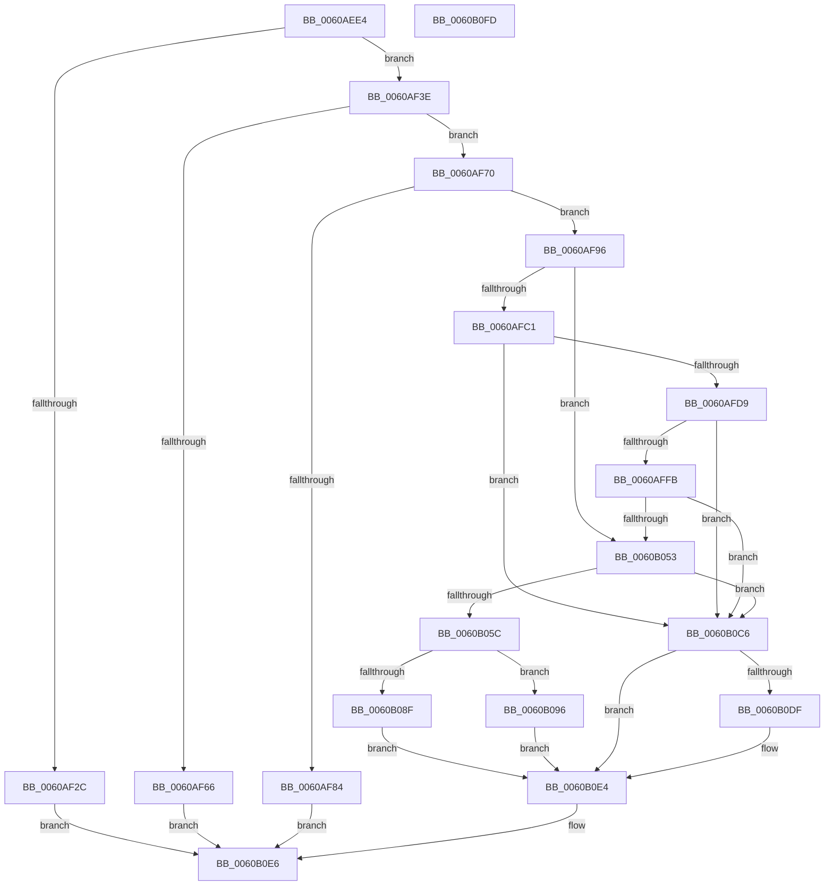

# SepGetAntiTamperEntry

- RVA: `0x0060AEE4`–`0x0060B0FE` (길이 `538` bytes)
- VA: `0x000000014060AEE4`
- 실행 섹션: `.text`
- PDB 이름 있음: `예`; PDB Function 태그: `아니요`
- unwind 정보 RVA: `0x000D02B8`
- 디코드: `154`개 명령, `538/538` bytes 표시
- 미해석 바이트: `0` (있으면 어셈블리에 `.byte`로 보존)

> 이 문서는 커널 이미지의 기계어와 PDB 기호를 분석해 생성했습니다. 4번과 5번은 함수 원형과 자료형을 바이너리 사용 방식에서 추정한 C 해석이며 원본 소스 복구 결과는 아닙니다.

## 1. Dependencies

- 직접 호출 지점: **19**; 고유 호출 대상: **13**
- 직접 호출자로 확인된 함수: **1**
- RIP 상대 이미지 참조: **0**

### Outgoing calls
- `0x0060AF1D` → [SepFindMatchingAntiTamperEntry](SepFindMatchingAntiTamperEntry_function_0060ADE4.md) (function, `0x0060ADE4`)
- `0x0060AF2F` → [SepReferenceAntiTamperEntry](../../page/7A/SepReferenceAntiTamperEntry_function_007A369C.md) (function, `0x007A369C`)
- `0x0060AF59` → [ExAllocatePool2](../../poolcode/B8/ExAllocatePool2_function_00B820F0.md) (function, `0x00B820F0`)
- `0x0060AF78` → [SepDuplicateAntiTamperPolicy](SepDuplicateAntiTamperPolicy_function_0060AD44.md) (function, `0x0060AD44`)
- `0x0060AF89` → [ExFreePoolWithTag](../../poolcode/B8/ExFreePoolWithTag_function_00B82870.md) (function, `0x00B82870`)
- `0x0060AFA4` → [RtlCopySid](../../page/9A/RtlCopySid_function_009A9A50.md) (function, `0x009A9A50`)
- `0x0060AFB3` → [RtlFindClearBitsAndSet](../3E/RtlFindClearBitsAndSet_function_003E0CD0.md) (function, `0x003E0CD0`)
- `0x0060AFC4` → [RtlNumberOfSetBits](../43/RtlNumberOfSetBits_function_00433F70.md) (function, `0x00433F70`)
- `0x0060AFEA` → [ExAllocatePool2](../../poolcode/B8/ExAllocatePool2_function_00B820F0.md) (function, `0x00B820F0`)
- `0x0060B001` → [ExFreePoolWithTag](../../poolcode/B8/ExFreePoolWithTag_function_00B82870.md) (function, `0x00B82870`)
- `0x0060B02B` → [memset](../6C/memset_function_006C6C40.md) (function, `0x006C6C40`)
- `0x0060B03A` → [RtlSetBits](../3E/RtlSetBits_function_003E1610.md) (function, `0x003E1610`)
- `0x0060B049` → [RtlFindClearBitsAndSet](../3E/RtlFindClearBitsAndSet_function_003E0CD0.md) (function, `0x003E0CD0`)
- `0x0060B075` → [SepComputeSidSignature](../../page/A9/SepComputeSidSignature_function_00A9097C.md) (function, `0x00A9097C`)
- `0x0060B086` → [RtlInsertEntryHashTable](../43/RtlInsertEntryHashTable_function_00437660.md) (function, `0x00437660`)
- `0x0060B09A` → [SepDeleteAntiTamperPolicy](SepDeleteAntiTamperPolicy_function_0060AA7C.md) (function, `0x0060AA7C`)
- `0x0060B0A4` → [ExFreePoolWithTag](../../poolcode/B8/ExFreePoolWithTag_function_00B82870.md) (function, `0x00B82870`)
- `0x0060B0CB` → [ExFreePoolWithTag](../../poolcode/B8/ExFreePoolWithTag_function_00B82870.md) (function, `0x00B82870`)
- `0x0060B0DF` → [SepDeleteAntiTamperPolicy](SepDeleteAntiTamperPolicy_function_0060AA7C.md) (function, `0x0060AA7C`)

### Direct callers
- [SepSetTokenAntiTamperEntry](SepSetTokenAntiTamperEntry_function_0060B28C.md) at `0x0060B4E1`

### Static image references
- 디코드된 RIP-relative 메모리 참조가 없습니다.

## 2. Other-region calls and transfers

- 다른 실행 섹션으로 향하는 call: **9**
  - `0x0060AF2F` → [SepReferenceAntiTamperEntry](../../page/7A/SepReferenceAntiTamperEntry_function_007A369C.md) (`.text` → `PAGE`)
  - `0x0060AF59` → [ExAllocatePool2](../../poolcode/B8/ExAllocatePool2_function_00B820F0.md) (`.text` → `POOLCODE`)
  - `0x0060AF89` → [ExFreePoolWithTag](../../poolcode/B8/ExFreePoolWithTag_function_00B82870.md) (`.text` → `POOLCODE`)
  - `0x0060AFA4` → [RtlCopySid](../../page/9A/RtlCopySid_function_009A9A50.md) (`.text` → `PAGE`)
  - `0x0060AFEA` → [ExAllocatePool2](../../poolcode/B8/ExAllocatePool2_function_00B820F0.md) (`.text` → `POOLCODE`)
  - `0x0060B001` → [ExFreePoolWithTag](../../poolcode/B8/ExFreePoolWithTag_function_00B82870.md) (`.text` → `POOLCODE`)
  - `0x0060B075` → [SepComputeSidSignature](../../page/A9/SepComputeSidSignature_function_00A9097C.md) (`.text` → `PAGE`)
  - `0x0060B0A4` → [ExFreePoolWithTag](../../poolcode/B8/ExFreePoolWithTag_function_00B82870.md) (`.text` → `POOLCODE`)
  - `0x0060B0CB` → [ExFreePoolWithTag](../../poolcode/B8/ExFreePoolWithTag_function_00B82870.md) (`.text` → `POOLCODE`)
- 별도 외부 분기/꼬리 이동을 확인하지 못했습니다.

## 3. Assembly (complete function range)

```asm
0060AEE4  48 8B C4                        mov rax, rsp
0060AEE7  48 89 58 10                     mov qword ptr [rax + 0x10], rbx
0060AEEB  48 89 68 18                     mov qword ptr [rax + 0x18], rbp
0060AEEF  56                              push rsi
0060AEF0  57                              push rdi
0060AEF1  41 54                           push r12
0060AEF3  41 56                           push r14
0060AEF5  41 57                           push r15
0060AEF7  48 83 EC 30                     sub rsp, 0x30
0060AEFB  4C 8B 61 18                     mov r12, qword ptr [rcx + 0x18]
0060AEFF  48 8D 71 08                     lea rsi, [rcx + 8]
0060AF03  48 83 60 C8 00                  and qword ptr [rax - 0x38], 0
0060AF08  4D 8B F0                        mov r14, r8
0060AF0B  48 83 60 08 00                  and qword ptr [rax + 8], 0
0060AF10  4C 8D 40 C8                     lea r8, [rax - 0x38]
0060AF14  49 8B CC                        mov rcx, r12
0060AF17  4D 8B F9                        mov r15, r9
0060AF1A  48 8B EA                        mov rbp, rdx
0060AF1D  E8 C2 FE FF FF                  call 0x14060ade4
0060AF22  4C 8B 54 24 20                  mov r10, qword ptr [rsp + 0x20]
0060AF27  4D 85 D2                        test r10, r10
0060AF2A  74 12                           je 0x14060af3e
0060AF2C  49 8B CA                        mov rcx, r10
0060AF2F  E8 68 87 19 00                  call 0x1407a369c
0060AF34  33 C0                           xor eax, eax
0060AF36  4D 89 17                        mov qword ptr [r15], r10
0060AF39  E9 A8 01 00 00                  jmp 0x14060b0e6
0060AF3E  0F B6 45 01                     movzx eax, byte ptr [rbp + 1]
0060AF42  B9 00 01 00 00                  mov ecx, 0x100
0060AF47  41 B8 53 65 41 45               mov r8d, 0x45416553
0060AF4D  8D 3C 85 4B 00 00 00            lea edi, [rax*4 + 0x4b]
0060AF54  83 E7 FC                        and edi, 0xfffffffc
0060AF57  8B D7                           mov edx, edi
0060AF59  E8 92 71 57 00                  call 0x140b820f0
0060AF5E  48 8B D8                        mov rbx, rax
0060AF61  48 85 C0                        test rax, rax
0060AF64  75 0A                           jne 0x14060af70
0060AF66  B8 9A 00 00 C0                  mov eax, 0xc000009a
0060AF6B  E9 76 01 00 00                  jmp 0x14060b0e6
0060AF70  48 8D 54 24 60                  lea rdx, [rsp + 0x60]
0060AF75  49 8B CE                        mov rcx, r14
0060AF78  E8 C7 FD FF FF                  call 0x14060ad44
0060AF7D  44 8B F0                        mov r14d, eax
0060AF80  85 C0                           test eax, eax
0060AF82  79 12                           jns 0x14060af96
0060AF84  33 D2                           xor edx, edx
0060AF86  48 8B CB                        mov rcx, rbx
0060AF89  E8 E2 78 57 00                  call 0x140b82870
0060AF8E  41 8B C6                        mov eax, r14d
0060AF91  E9 50 01 00 00                  jmp 0x14060b0e6
0060AF96  48 8D 53 40                     lea rdx, [rbx + 0x40]
0060AF9A  4C 8B C5                        mov r8, rbp
0060AF9D  8D 4F C0                        lea ecx, [rdi - 0x40]
0060AFA0  48 89 53 20                     mov qword ptr [rbx + 0x20], rdx
0060AFA4  E8 A7 EA 39 00                  call 0x1409a9a50
0060AFA9  45 33 C0                        xor r8d, r8d
0060AFAC  48 8B CE                        mov rcx, rsi
0060AFAF  41 8D 50 01                     lea edx, [r8 + 1]
0060AFB3  E8 18 5D DD FF                  call 0x1403e0cd0
0060AFB8  83 F8 FF                        cmp eax, -1
0060AFBB  0F 85 92 00 00 00               jne 0x14060b053
0060AFC1  48 8B CE                        mov rcx, rsi
0060AFC4  E8 A7 8F E2 FF                  call 0x140433f70
0060AFC9  8B F8                           mov edi, eax
0060AFCB  03 FF                           add edi, edi
0060AFCD  81 FF 00 00 10 00               cmp edi, 0x100000
0060AFD3  0F 87 ED 00 00 00               ja 0x14060b0c6
0060AFD9  8B D7                           mov edx, edi
0060AFDB  B9 00 01 00 00                  mov ecx, 0x100
0060AFE0  48 C1 EA 03                     shr rdx, 3
0060AFE4  41 B8 53 65 4C 73               mov r8d, 0x734c6553
0060AFEA  E8 01 71 57 00                  call 0x140b820f0
0060AFEF  4C 8B F0                        mov r14, rax
0060AFF2  48 85 C0                        test rax, rax
0060AFF5  0F 84 CB 00 00 00               je 0x14060b0c6
0060AFFB  48 8B 4E 08                     mov rcx, qword ptr [rsi + 8]
0060AFFF  33 D2                           xor edx, edx
0060B001  E8 6A 78 57 00                  call 0x140b82870
0060B006  BA 00 00 00 00                  mov edx, 0
0060B00B  89 3E                           mov dword ptr [rsi], edi
0060B00D  44 8B C7                        mov r8d, edi
0060B010  4C 89 76 08                     mov qword ptr [rsi + 8], r14
0060B014  40 F6 C7 1F                     test dil, 0x1f
0060B018  49 8B CE                        mov rcx, r14
0060B01B  0F 95 C2                        setne dl
0060B01E  41 C1 E8 05                     shr r8d, 5
0060B022  44 03 C2                        add r8d, edx
0060B025  33 D2                           xor edx, edx
0060B027  41 C1 E0 02                     shl r8d, 2
0060B02B  E8 10 BC 0B 00                  call 0x1406c6c40
0060B030  D1 EF                           shr edi, 1
0060B032  33 D2                           xor edx, edx
0060B034  44 8B C7                        mov r8d, edi
0060B037  48 8B CE                        mov rcx, rsi
0060B03A  E8 D1 65 DD FF                  call 0x1403e1610
0060B03F  45 33 C0                        xor r8d, r8d
0060B042  48 8B CE                        mov rcx, rsi
0060B045  41 8D 50 01                     lea edx, [r8 + 1]
0060B049  E8 82 5C DD FF                  call 0x1403e0cd0
0060B04E  83 F8 FF                        cmp eax, -1
0060B051  74 73                           je 0x14060b0c6
0060B053  8B F8                           mov edi, eax
0060B055  3D 00 00 10 00                  cmp eax, 0x100000
0060B05A  73 6A                           jae 0x14060b0c6
0060B05C  FF C0                           inc eax
0060B05E  48 C7 43 18 01 00 00 00         mov qword ptr [rbx + 0x18], 1
0060B066  89 43 28                        mov dword ptr [rbx + 0x28], eax
0060B069  48 8B CD                        mov rcx, rbp
0060B06C  48 8B 44 24 60                  mov rax, qword ptr [rsp + 0x60]
0060B071  48 89 43 30                     mov qword ptr [rbx + 0x30], rax
0060B075  E8 02 59 48 00                  call 0x140a9097c
0060B07A  4C 8B C0                        mov r8, rax
0060B07D  48 8B D3                        mov rdx, rbx
0060B080  45 33 C9                        xor r9d, r9d
0060B083  49 8B CC                        mov rcx, r12
0060B086  E8 D5 C5 E2 FF                  call 0x140437660
0060B08B  84 C0                           test al, al
0060B08D  74 07                           je 0x14060b096
0060B08F  33 FF                           xor edi, edi
0060B091  49 89 1F                        mov qword ptr [r15], rbx
0060B094  EB 4E                           jmp 0x14060b0e4
0060B096  48 8B 4B 30                     mov rcx, qword ptr [rbx + 0x30]
0060B09A  E8 DD F9 FF FF                  call 0x14060aa7c
0060B09F  33 D2                           xor edx, edx
0060B0A1  48 8B CB                        mov rcx, rbx
0060B0A4  E8 C7 77 57 00                  call 0x140b82870
0060B0A9  48 8B CF                        mov rcx, rdi
0060B0AC  83 E7 07                        and edi, 7
0060B0AF  48 C1 E9 03                     shr rcx, 3
0060B0B3  48 03 4E 08                     add rcx, qword ptr [rsi + 8]
0060B0B7  0F BE 01                        movsx eax, byte ptr [rcx]
0060B0BA  0F B3 F8                        btr eax, edi
0060B0BD  BF 9A 00 00 C0                  mov edi, 0xc000009a
0060B0C2  88 01                           mov byte ptr [rcx], al
0060B0C4  EB 1E                           jmp 0x14060b0e4
0060B0C6  33 D2                           xor edx, edx
0060B0C8  48 8B CB                        mov rcx, rbx
0060B0CB  E8 A0 77 57 00                  call 0x140b82870
0060B0D0  48 8B 4C 24 60                  mov rcx, qword ptr [rsp + 0x60]
0060B0D5  BF 9A 00 00 C0                  mov edi, 0xc000009a
0060B0DA  48 85 C9                        test rcx, rcx
0060B0DD  74 05                           je 0x14060b0e4
0060B0DF  E8 98 F9 FF FF                  call 0x14060aa7c
0060B0E4  8B C7                           mov eax, edi
0060B0E6  48 8B 5C 24 68                  mov rbx, qword ptr [rsp + 0x68]
0060B0EB  48 8B 6C 24 70                  mov rbp, qword ptr [rsp + 0x70]
0060B0F0  48 83 C4 30                     add rsp, 0x30
0060B0F4  41 5F                           pop r15
0060B0F6  41 5E                           pop r14
0060B0F8  41 5C                           pop r12
0060B0FA  5F                              pop rdi
0060B0FB  5E                              pop rsi
0060B0FC  C3                              ret
0060B0FD  CC                              int3
```

## 4. C-style interpretation (structured pseudocode)

```c
__int64 __fastcall SepGetAntiTamperEntry(__int64 a1, __int64 a2, __int64 a3, __int64 a4)
{
    __int64 result;
    __int64 v_rdi;
    __int64 v_rsp;
    unsigned __int64 v_stack_m38;
    unsigned __int64 v_stack_p10;
    unsigned __int64 v_stack_p18;
    unsigned __int64 v_stack_p8;

    *(unsigned __int64 *)(v_rsp + 16) = v_rbx;
    *(unsigned __int64 *)(v_rsp + 24) = v_rbp;
    v_rsp = (v_rsp) - (48);
    result = SepFindMatchingAntiTamperEntry(*(unsigned __int64 *)(a1 + 24), a2, v_rsp - 56, a4);
    if (v_stack_m38 == 0) goto loc_0060AF3E;
    result = SepReferenceAntiTamperEntry(v_stack_m38, a2, v_rsp - 56, a4);
    result = 0;
    *(unsigned __int64 *)(a4) = v_stack_m38;
    goto loc_0060B0E6;
loc_0060AF3E:
    v_rdi = (unsigned int)((*(unsigned __int8 *)(a2 + 1) * 4 + 75) & (0xFFFFFFFCULL));
    result = ExAllocatePool2(256, (unsigned int)((unsigned int)(v_rdi)), (unsigned int)(0x45416553ULL), a4);
    if (result != 0) goto loc_0060AF70;
    goto loc_0060B0E6;
loc_0060AF70:
    result = SepDuplicateAntiTamperPolicy(a3, v_stack_p8, (unsigned int)(0x45416553ULL), a4);
    if (!sign_flag) goto loc_0060AF96;
    a2 = 0;
    result = ExFreePoolWithTag(result, a2, (unsigned int)(0x45416553ULL), a4);
    goto loc_0060B0E6;
loc_0060AF96:
    *(unsigned __int64 *)(result + 32) = result + 64;
    result = RtlCopySid(v_rdi - 64, result + 64, 0, a4);
    a3 = 0;
    result = RtlFindClearBitsAndSet(a1 + 8, a3 + 1, a3, a4);
    if (((unsigned int)(result)) != -1) goto loc_0060B053;
    result = RtlNumberOfSetBits(a1 + 8, a3 + 1, a3, a4);
    v_rdi = (unsigned int)(((unsigned int)((unsigned int)(result))) + ((unsigned int)((unsigned int)((unsigned int)(result)))));
    if (((unsigned int)(v_rdi)) > 0x100000ULL) goto loc_0060B0C6;
    a2 = ((unsigned int)((unsigned int)(v_rdi))) >> (3);
    result = ExAllocatePool2(256, a2, (unsigned int)(0x734C6553ULL), a4);
    if (result == 0) goto loc_0060B0C6;
    a2 = 0;
    result = ExFreePoolWithTag(*(unsigned __int64 *)(a1 + 8 + 8), a2, (unsigned int)(0x734C6553ULL), a4);
    *(unsigned int *)(a1 + 8) = (unsigned int)(v_rdi);
    *(unsigned __int64 *)(a1 + 8 + 8) = result;
    a2 = ((((unsigned __int8)(v_rdi)) & (31)) != 0) ? 1 : 0;
    a3 = (unsigned int)(((unsigned int)((unsigned int)(v_rdi))) >> (5));
    a3 = (unsigned int)((a3) + ((unsigned int)(a2)));
    a2 = 0;
    a3 = (unsigned int)((a3) << (2));
    result = memset(result, a2, a3, a4);
    v_rdi = (unsigned int)((v_rdi) >> (1));
    a2 = 0;
    result = RtlSetBits(a1 + 8, a2, (unsigned int)((unsigned int)(v_rdi)), a4);
    a3 = 0;
    result = RtlFindClearBitsAndSet(a1 + 8, a3 + 1, a3, a4);
    if (((unsigned int)(result)) == -1) goto loc_0060B0C6;
loc_0060B053:
    if (((unsigned int)(result)) >= 0x100000ULL) goto loc_0060B0C6;
    result = (unsigned int)((result) + 1);
    *(unsigned __int64 *)(result + 24) = 1;
    *(unsigned int *)(result + 40) = (unsigned int)(result);
    *(unsigned __int64 *)(result + 48) = v_stack_p8;
    result = SepComputeSidSignature(0, a3 + 1, a3, a4);
    a4 = 0;
    result = RtlInsertEntryHashTable(*(unsigned __int64 *)(a1 + 24), result, result, a4);
    if ((unsigned __int8)(result) == 0) goto loc_0060B096;
    v_rdi = 0;
    *(unsigned __int64 *)(a4) = result;
    goto loc_0060B0E4;
loc_0060B096:
    result = SepDeleteAntiTamperPolicy(*(unsigned __int64 *)(result + 48), result, result, a4);
    a2 = 0;
    result = ExFreePoolWithTag(result, a2, result, a4);
    v_rdi = (unsigned int)((v_rdi) & (7));
    a1 = (0) >> (3);
    a1 = (a1) + (*(unsigned __int64 *)(a1 + 8 + 8));
    *(unsigned __int8 *)(a1) = (unsigned __int8)((__int8)(*(unsigned __int8 *)(a1)));
    goto loc_0060B0E4;
loc_0060B0C6:
    a2 = 0;
    result = ExFreePoolWithTag(result, a2, result, a4);
    if (v_stack_p8 != 0) {
        result = SepDeleteAntiTamperPolicy(v_stack_p8, a2, result, a4);
    }
loc_0060B0E6:
    v_rsp = (v_rsp) + (48);
    return (unsigned int)((unsigned int)((unsigned int)(0xC000009AULL)));
}
```

## 5. (Beta) C Style

```c
int64_t SepGetAntiTamperEntry(void *Arg1, void *Arg2, int64_t Arg3, void *Arg4)
{
    uint8_t *arg1 = (uint8_t *)Arg1;
    uint8_t *arg2 = (uint8_t *)Arg2;
    uint8_t *arg4 = (uint8_t *)Arg4;

    int64_t result;
    int64_t local_rdi;
    int64_t local_rsp;
    uint64_t v_stack_m38;
    uint64_t v_stack_p10;
    uint64_t v_stack_p18;
    uint64_t v_stack_p8;

    *(uint64_t *)(local_rsp + 0x10) = local_rbx;
    *(uint64_t *)(local_rsp + 0x18) = local_rbp;
    local_rsp = (local_rsp) - (48);
    result = SepFindMatchingAntiTamperEntry(*(uint64_t *)(arg1 + 0x18), Arg2, local_rsp - 56, Arg4);
    if (v_stack_m38 == 0) goto loc_0060AF3E;
    result = SepReferenceAntiTamperEntry(v_stack_m38, Arg2, local_rsp - 56, Arg4);
    result = 0;
    *(uint64_t *)(arg4) = v_stack_m38;
    goto loc_0060B0E6;
loc_0060AF3E:
    local_rdi = (uint32_t)((*(uint8_t *)(arg2 + 0x1) * 4 + 75) & (0xFFFFFFFCULL));
    result = ExAllocatePool2(256, (uint32_t)((uint32_t)(local_rdi)), (uint32_t)(0x45416553ULL), Arg4);
    if (result != 0) goto loc_0060AF70;
    goto loc_0060B0E6;
loc_0060AF70:
    result = SepDuplicateAntiTamperPolicy(Arg3, v_stack_p8, (uint32_t)(0x45416553ULL), Arg4);
    if (!sign_flag) goto loc_0060AF96;
    Arg2 = 0;
    result = ExFreePoolWithTag(result, Arg2, (uint32_t)(0x45416553ULL), Arg4);
    goto loc_0060B0E6;
loc_0060AF96:
    *(uint64_t *)(result + 0x20) = result + 64;
    result = RtlCopySid(local_rdi - 64, result + 64, 0, Arg4);
    Arg3 = 0;
    result = RtlFindClearBitsAndSet(Arg1 + 8, Arg3 + 1, Arg3, Arg4);
    if (((uint32_t)(result)) != -1) goto loc_0060B053;
    result = RtlNumberOfSetBits(Arg1 + 8, Arg3 + 1, Arg3, Arg4);
    local_rdi = (uint32_t)(((uint32_t)((uint32_t)(result))) + ((uint32_t)((uint32_t)((uint32_t)(result)))));
    if (((uint32_t)(local_rdi)) > 0x100000ULL) goto loc_0060B0C6;
    Arg2 = ((uint32_t)((uint32_t)(local_rdi))) >> (3);
    result = ExAllocatePool2(256, Arg2, (uint32_t)(0x734C6553ULL), Arg4);
    if (result == 0) goto loc_0060B0C6;
    Arg2 = 0;
    result = ExFreePoolWithTag(*(uint64_t *)(arg1 + 0x8 + 0x8), Arg2, (uint32_t)(0x734C6553ULL), Arg4);
    *(uint32_t *)(arg1 + 0x8) = (uint32_t)(local_rdi);
    *(uint64_t *)(arg1 + 0x8 + 0x8) = result;
    Arg2 = ((((uint8_t)(local_rdi)) & (31)) != 0) ? 1 : 0;
    Arg3 = (uint32_t)(((uint32_t)((uint32_t)(local_rdi))) >> (5));
    Arg3 = (uint32_t)((Arg3) + ((uint32_t)(Arg2)));
    Arg2 = 0;
    Arg3 = (uint32_t)((Arg3) << (2));
    result = memset(result, Arg2, Arg3, Arg4);
    local_rdi = (uint32_t)((local_rdi) >> (1));
    Arg2 = 0;
    result = RtlSetBits(Arg1 + 8, Arg2, (uint32_t)((uint32_t)(local_rdi)), Arg4);
    Arg3 = 0;
    result = RtlFindClearBitsAndSet(Arg1 + 8, Arg3 + 1, Arg3, Arg4);
    if (((uint32_t)(result)) == -1) goto loc_0060B0C6;
loc_0060B053:
    if (((uint32_t)(result)) >= 0x100000ULL) goto loc_0060B0C6;
    result = (uint32_t)((result) + 1);
    *(uint64_t *)(result + 0x18) = 1;
    *(uint32_t *)(result + 0x28) = (uint32_t)(result);
    *(uint64_t *)(result + 0x30) = v_stack_p8;
    result = SepComputeSidSignature(0, Arg3 + 1, Arg3, Arg4);
    Arg4 = 0;
    result = RtlInsertEntryHashTable(*(uint64_t *)(arg1 + 0x18), result, result, Arg4);
    if ((uint8_t)(result) == 0) goto loc_0060B096;
    local_rdi = 0;
    *(uint64_t *)(arg4) = result;
    goto loc_0060B0E4;
loc_0060B096:
    result = SepDeleteAntiTamperPolicy(*(uint64_t *)(result + 0x30), result, result, Arg4);
    Arg2 = 0;
    result = ExFreePoolWithTag(result, Arg2, result, Arg4);
    local_rdi = (uint32_t)((local_rdi) & (7));
    Arg1 = (0) >> (3);
    Arg1 = (Arg1) + (*(uint64_t *)(arg1 + 0x8 + 0x8));
    *(uint8_t *)(arg1) = (uint8_t)((int8_t)(*(uint8_t *)(arg1)));
    goto loc_0060B0E4;
loc_0060B0C6:
    Arg2 = 0;
    result = ExFreePoolWithTag(result, Arg2, result, Arg4);
    if (v_stack_p8 != 0) {
        result = SepDeleteAntiTamperPolicy(v_stack_p8, Arg2, result, Arg4);
    }
loc_0060B0E6:
    local_rsp = (local_rsp) + (48);
    return (uint32_t)((uint32_t)((uint32_t)(0xC000009AULL)));
}
```

### 관측된 메모리 오프셋

구조체 형식이 확인되지 않은 접근은 인자 기준의 오프셋으로만 기록했습니다.

| 기준 인자 | 오프셋 표현 | 폭 (bit) | 접근 |
|---|---:|---:|---|
| `Arg1` | `+ 0x0` | `32` | `W` |
| `Arg1` | `+ 0x8` | `64` | `R` |
| `Arg1` | `+ 0x8` | `64` | `W` |
| `Arg1` | `+ 0x18` | `64` | `R` |
| `Arg2` | `+ 0x1` | `8` | `R` |
| `Arg4` | `+ 0x0` | `64` | `W` |

## 6. Execution-region graph

[열기: 2D/3D 그래프와 함수 탐색 컨트롤 패널](../../../control-panel.html?section=text&rva=0x0060AEE4&view=graph)

- 2D 그래프는 위에서 아래로 흐르고, 3D 그래프는 빈 공간을 드래그해 회전합니다. Shift+드래그는 이동, 휠은 확대·축소, 함수 노드 선택은 대상 보고서 이동입니다.

### Static fallback


