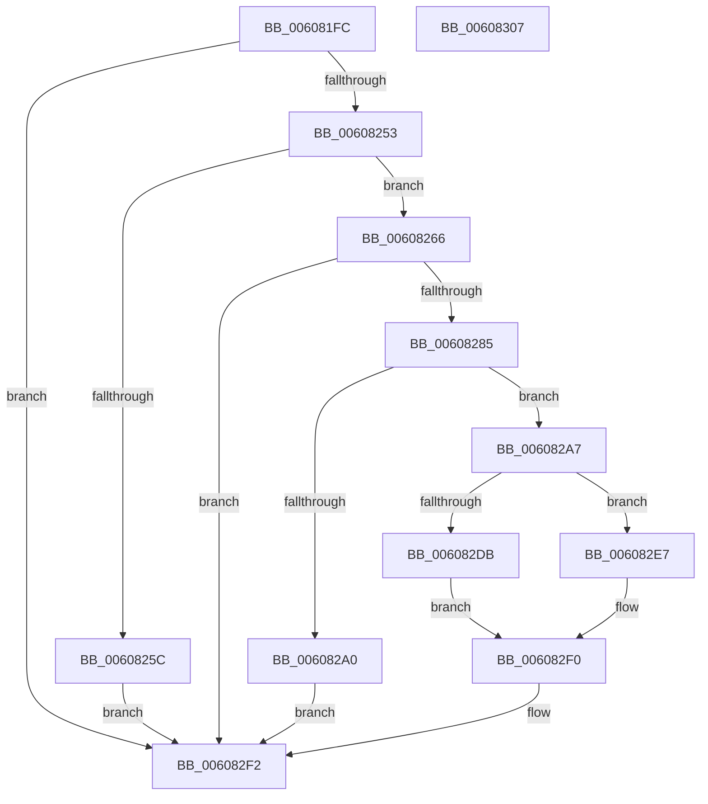

# SepGetImageEa

- RVA: `0x006081FC`–`0x00608308` (길이 `268` bytes)
- VA: `0x00000001406081FC`
- 실행 섹션: `.text`
- PDB 이름 있음: `예`; PDB Function 태그: `아니요`
- unwind 정보 RVA: `0x000D0F90`
- 디코드: `75`개 명령, `268/268` bytes 표시
- 미해석 바이트: `0` (있으면 어셈블리에 `.byte`로 보존)

> 이 문서는 커널 이미지의 기계어와 PDB 기호를 분석해 생성했습니다. 4번과 5번은 함수 원형과 자료형을 바이너리 사용 방식에서 추정한 C 해석이며 원본 소스 복구 결과는 아닙니다.

## 1. Dependencies

- 직접 호출 지점: **5**; 고유 호출 대상: **5**
- 직접 호출자로 확인된 함수: **1**
- RIP 상대 이미지 참조: **0**

### Outgoing calls
- `0x00608246` → [ZwQueryVolumeInformationFile](../6A/ZwQueryVolumeInformationFile_function_006AD9F0.md) (function, `0x006AD9F0`)
- `0x0060827C` → [ZwQueryInformationFile](../6A/ZwQueryInformationFile_function_006AD2F0.md) (function, `0x006AD2F0`)
- `0x00608293` → [ExAllocatePool2](../../poolcode/B8/ExAllocatePool2_function_00B820F0.md) (function, `0x00B820F0`)
- `0x006082D0` → [ZwQueryEaFile](../6A/ZwQueryEaFile_function_006AFAF0.md) (function, `0x006AFAF0`)
- `0x006082E0` → [ExFreePoolWithTag](../../poolcode/B8/ExFreePoolWithTag_function_00B82870.md) (function, `0x00B82870`)

### Direct callers
- [SepAppIdentityFromImageHash](SepAppIdentityFromImageHash_function_00607AA4.md) at `0x00607B38`

### Static image references
- 디코드된 RIP-relative 메모리 참조가 없습니다.

## 2. Other-region calls and transfers

- 다른 실행 섹션으로 향하는 call: **2**
  - `0x00608293` → [ExAllocatePool2](../../poolcode/B8/ExAllocatePool2_function_00B820F0.md) (`.text` → `POOLCODE`)
  - `0x006082E0` → [ExFreePoolWithTag](../../poolcode/B8/ExFreePoolWithTag_function_00B82870.md) (`.text` → `POOLCODE`)
- 별도 외부 분기/꼬리 이동을 확인하지 못했습니다.

## 3. Assembly (complete function range)

```asm
006081FC  48 89 5C 24 08                  mov qword ptr [rsp + 8], rbx
00608201  48 89 74 24 20                  mov qword ptr [rsp + 0x20], rsi
00608206  55                              push rbp
00608207  57                              push rdi
00608208  41 56                           push r14
0060820A  48 8B EC                        mov rbp, rsp
0060820D  48 83 EC 60                     sub rsp, 0x60
00608211  83 22 00                        and dword ptr [rdx], 0
00608214  BB 04 00 00 00                  mov ebx, 4
00608219  49 83 20 00                     and qword ptr [r8], 0
0060821D  49 8B F0                        mov rsi, r8
00608220  48 83 65 30 00                  and qword ptr [rbp + 0x30], 0
00608225  4C 8D 45 30                     lea r8, [rbp + 0x30]
00608229  83 65 28 00                     and dword ptr [rbp + 0x28], 0
0060822D  4C 8B F2                        mov r14, rdx
00608230  0F 57 C0                        xorps xmm0, xmm0
00608233  89 5C 24 20                     mov dword ptr [rsp + 0x20], ebx
00608237  44 8D 4B 04                     lea r9d, [rbx + 4]
0060823B  48 8B F9                        mov rdi, rcx
0060823E  48 8D 55 F0                     lea rdx, [rbp - 0x10]
00608242  0F 11 45 F0                     movups xmmword ptr [rbp - 0x10], xmm0
00608246  E8 A5 57 0A 00                  call 0x1406ad9f0
0060824B  85 C0                           test eax, eax
0060824D  0F 88 9F 00 00 00               js 0x1406082f2
00608253  F7 45 34 11 00 08 00            test dword ptr [rbp + 0x34], 0x80011
0060825A  74 0A                           je 0x140608266
0060825C  B8 25 02 00 C0                  mov eax, 0xc0000225
00608261  E9 8C 00 00 00                  jmp 0x1406082f2
00608266  44 8B CB                        mov r9d, ebx
00608269  C7 44 24 20 07 00 00 00         mov dword ptr [rsp + 0x20], 7
00608271  4C 8D 45 28                     lea r8, [rbp + 0x28]
00608275  48 8B CF                        mov rcx, rdi
00608278  48 8D 55 F0                     lea rdx, [rbp - 0x10]
0060827C  E8 6F 50 0A 00                  call 0x1406ad2f0
00608281  85 C0                           test eax, eax
00608283  78 6D                           js 0x1406082f2
00608285  8B 55 28                        mov edx, dword ptr [rbp + 0x28]
00608288  B9 00 01 00 00                  mov ecx, 0x100
0060828D  41 B8 53 65 45 61               mov r8d, 0x61456553
00608293  E8 58 9E 57 00                  call 0x140b820f0
00608298  48 8B D8                        mov rbx, rax
0060829B  48 85 C0                        test rax, rax
0060829E  75 07                           jne 0x1406082a7
006082A0  B8 17 00 00 C0                  mov eax, 0xc0000017
006082A5  EB 4B                           jmp 0x1406082f2
006082A7  44 8B 4D 28                     mov r9d, dword ptr [rbp + 0x28]
006082AB  48 8D 55 F0                     lea rdx, [rbp - 0x10]
006082AF  C6 44 24 40 01                  mov byte ptr [rsp + 0x40], 1
006082B4  4C 8B C3                        mov r8, rbx
006082B7  48 83 64 24 38 00               and qword ptr [rsp + 0x38], 0
006082BD  48 8B CF                        mov rcx, rdi
006082C0  83 64 24 30 00                  and dword ptr [rsp + 0x30], 0
006082C5  48 83 64 24 28 00               and qword ptr [rsp + 0x28], 0
006082CB  C6 44 24 20 00                  mov byte ptr [rsp + 0x20], 0
006082D0  E8 1B 78 0A 00                  call 0x1406afaf0
006082D5  8B F8                           mov edi, eax
006082D7  85 C0                           test eax, eax
006082D9  79 0C                           jns 0x1406082e7
006082DB  33 D2                           xor edx, edx
006082DD  48 8B CB                        mov rcx, rbx
006082E0  E8 8B A5 57 00                  call 0x140b82870
006082E5  EB 09                           jmp 0x1406082f0
006082E7  8B 45 28                        mov eax, dword ptr [rbp + 0x28]
006082EA  41 89 06                        mov dword ptr [r14], eax
006082ED  48 89 1E                        mov qword ptr [rsi], rbx
006082F0  8B C7                           mov eax, edi
006082F2  4C 8D 5C 24 60                  lea r11, [rsp + 0x60]
006082F7  49 8B 5B 20                     mov rbx, qword ptr [r11 + 0x20]
006082FB  49 8B 73 38                     mov rsi, qword ptr [r11 + 0x38]
006082FF  49 8B E3                        mov rsp, r11
00608302  41 5E                           pop r14
00608304  5F                              pop rdi
00608305  5D                              pop rbp
00608306  C3                              ret
00608307  CC                              int3
```

## 4. C-style interpretation (structured pseudocode)

```c
__int64 __fastcall SepGetImageEa(__int64 a1, __int64 a2, __int64 a3)
{
    __int64 result;
    __int64 v_rsp;
    unsigned __int64 v_stack_m18;
    unsigned __int64 v_stack_m28;
    unsigned __int8 v_stack_m38;
    unsigned __int64 v_stack_m40;
    unsigned int v_stack_m48;
    unsigned __int64 v_stack_m50;
    unsigned int v_stack_m58;
    unsigned int v_stack_p10;
    unsigned __int64 v_stack_p18;
    unsigned int v_stack_p1C;
    unsigned __int64 v_stack_p20;
    unsigned __int64 v_stack_p8;

    v_stack_p8 = v_rbx;
    v_stack_p20 = v_rsi;
    v_rsp = (v_rsp) - (96);
    v_stack_m58 = 4;
    v_stack_m28 = v_xmm0;
    result = ZwQueryVolumeInformationFile(a1, v_stack_m28, v_stack_p18, 4 + 4);
    if (sign_flag) goto loc_006082F2;
    if (((v_stack_p1C) & (0x80011ULL)) == 0) goto loc_00608266;
    goto loc_006082F2;
loc_00608266:
    v_stack_m58 = 7;
    result = ZwQueryInformationFile(a1, v_stack_m28, v_stack_p10, 4);
    if (sign_flag) goto loc_006082F2;
    result = ExAllocatePool2(256, (unsigned int)(v_stack_p10), (unsigned int)(0x61456553ULL), 4);
    if (result != 0) goto loc_006082A7;
    goto loc_006082F2;
loc_006082A7:
    v_stack_m38 = 1;
    v_stack_m58 = 0;
    result = ZwQueryEaFile(a1, v_stack_m28, result, (unsigned int)(v_stack_p10));
    if (!sign_flag) goto loc_006082E7;
    a2 = 0;
    result = ExFreePoolWithTag(result, a2, result, (unsigned int)(v_stack_p10));
    goto loc_006082F0;
loc_006082E7:
    *(unsigned int *)(a2) = (unsigned int)((unsigned int)(v_stack_p10));
    *(unsigned __int64 *)(a3) = result;
loc_006082F0:
loc_006082F2:
    return (unsigned int)((unsigned int)((unsigned int)((unsigned int)(result))));
}
```

## 5. (Beta) C Style

```c
int64_t SepGetImageEa(int64_t Arg1, void *Arg2, void *Arg3)
{
    uint8_t *arg2 = (uint8_t *)Arg2;
    uint8_t *arg3 = (uint8_t *)Arg3;

    int64_t result;
    int64_t local_rsp;
    uint64_t v_stack_m18;
    uint64_t v_stack_m28;
    uint8_t v_stack_m38;
    uint64_t v_stack_m40;
    uint32_t v_stack_m48;
    uint64_t v_stack_m50;
    uint32_t v_stack_m58;
    uint32_t v_stack_p10;
    uint64_t v_stack_p18;
    uint32_t v_stack_p1C;
    uint64_t v_stack_p20;
    uint64_t v_stack_p8;

    v_stack_p8 = local_rbx;
    v_stack_p20 = local_rsi;
    local_rsp = (local_rsp) - (96);
    v_stack_m58 = 4;
    v_stack_m28 = v_xmm0;
    result = ZwQueryVolumeInformationFile(Arg1, v_stack_m28, v_stack_p18, 4 + 4);
    if (sign_flag) goto loc_006082F2;
    if (((v_stack_p1C) & (0x80011ULL)) == 0) goto loc_00608266;
    goto loc_006082F2;
loc_00608266:
    v_stack_m58 = 7;
    result = ZwQueryInformationFile(Arg1, v_stack_m28, v_stack_p10, 4);
    if (sign_flag) goto loc_006082F2;
    result = ExAllocatePool2(256, (uint32_t)(v_stack_p10), (uint32_t)(0x61456553ULL), 4);
    if (result != 0) goto loc_006082A7;
    goto loc_006082F2;
loc_006082A7:
    v_stack_m38 = 1;
    v_stack_m58 = 0;
    result = ZwQueryEaFile(Arg1, v_stack_m28, result, (uint32_t)(v_stack_p10));
    if (!sign_flag) goto loc_006082E7;
    Arg2 = 0;
    result = ExFreePoolWithTag(result, Arg2, result, (uint32_t)(v_stack_p10));
    goto loc_006082F0;
loc_006082E7:
    *(uint32_t *)(arg2) = (uint32_t)((uint32_t)(v_stack_p10));
    *(uint64_t *)(arg3) = result;
loc_006082F0:
loc_006082F2:
    return (uint32_t)((uint32_t)((uint32_t)((uint32_t)(result))));
}
```

### 관측된 메모리 오프셋

구조체 형식이 확인되지 않은 접근은 인자 기준의 오프셋으로만 기록했습니다.

| 기준 인자 | 오프셋 표현 | 폭 (bit) | 접근 |
|---|---:|---:|---|
| `Arg2` | `+ 0x0` | `32` | `R/W` |
| `Arg2` | `+ 0x0` | `32` | `W` |
| `Arg3` | `+ 0x0` | `64` | `R/W` |
| `Arg3` | `+ 0x0` | `64` | `W` |

## 6. Execution-region graph

[열기: 2D/3D 그래프와 함수 탐색 컨트롤 패널](../../../control-panel.html?section=text&rva=0x006081FC&view=graph)

- 2D 그래프는 위에서 아래로 흐르고, 3D 그래프는 빈 공간을 드래그해 회전합니다. Shift+드래그는 이동, 휠은 확대·축소, 함수 노드 선택은 대상 보고서 이동입니다.

### Static fallback


