# SepGetLearningModeObjectInformation

- RVA: `0x00608F74`–`0x00609304` (길이 `912` bytes)
- VA: `0x0000000140608F74`
- 실행 섹션: `.text`
- PDB 이름 있음: `예`; PDB Function 태그: `아니요`
- unwind 정보 RVA: `0x000D1028`
- 디코드: `231`개 명령, `912/912` bytes 표시
- 미해석 바이트: `0` (있으면 어셈블리에 `.byte`로 보존)

> 이 문서는 커널 이미지의 기계어와 PDB 기호를 분석해 생성했습니다. 4번과 5번은 함수 원형과 자료형을 바이너리 사용 방식에서 추정한 C 해석이며 원본 소스 복구 결과는 아닙니다.

## 1. Dependencies

- 직접 호출 지점: **20**; 고유 호출 대상: **6**
- 직접 호출자로 확인된 함수: **1**
- RIP 상대 이미지 참조: **0**

### Outgoing calls
- `0x00608F9C` → [SepGetCurrentLogLevel](../41/SepGetCurrentLogLevel_function_004109C0.md) (function, `0x004109C0`)
- `0x00609022` → [ExRaiseDatatypeMisalignment](../../page/89/ExRaiseDatatypeMisalignment_function_00899FD0.md) (function, `0x00899FD0`)
- `0x00609086` → [ExRaiseDatatypeMisalignment](../../page/89/ExRaiseDatatypeMisalignment_function_00899FD0.md) (function, `0x00899FD0`)
- `0x006090B1` → [ExRaiseDatatypeMisalignment](../../page/89/ExRaiseDatatypeMisalignment_function_00899FD0.md) (function, `0x00899FD0`)
- `0x006090FD` → [ExRaiseDatatypeMisalignment](../../page/89/ExRaiseDatatypeMisalignment_function_00899FD0.md) (function, `0x00899FD0`)
- `0x0060912F` → [ExRaiseDatatypeMisalignment](../../page/89/ExRaiseDatatypeMisalignment_function_00899FD0.md) (function, `0x00899FD0`)
- `0x00609162` → [ExAllocatePool2](../../poolcode/B8/ExAllocatePool2_function_00B820F0.md) (function, `0x00B820F0`)
- `0x0060919A` → [ExAllocatePool2](../../poolcode/B8/ExAllocatePool2_function_00B820F0.md) (function, `0x00B820F0`)
- `0x006091C6` → [ExAllocatePool2](../../poolcode/B8/ExAllocatePool2_function_00B820F0.md) (function, `0x00B820F0`)
- `0x006091EC` → [ExAllocatePool2](../../poolcode/B8/ExAllocatePool2_function_00B820F0.md) (function, `0x00B820F0`)
- `0x0060921D` → [ExAllocatePool2](../../poolcode/B8/ExAllocatePool2_function_00B820F0.md) (function, `0x00B820F0`)
- `0x00609240` → [memcpy](../6C/memcpy_function_006C6840.md) (function, `0x006C6840`)
- `0x0060924B` → [RtlInitUnicodeString](../42/RtlInitUnicodeString_function_0042A780.md) (function, `0x0042A780`)
- `0x0060925B` → [memcpy](../6C/memcpy_function_006C6840.md) (function, `0x006C6840`)
- `0x00609266` → [RtlInitUnicodeString](../42/RtlInitUnicodeString_function_0042A780.md) (function, `0x0042A780`)
- `0x006092AF` → [ExFreePoolWithTag](../../poolcode/B8/ExFreePoolWithTag_function_00B82870.md) (function, `0x00B82870`)
- `0x006092BE` → [ExFreePoolWithTag](../../poolcode/B8/ExFreePoolWithTag_function_00B82870.md) (function, `0x00B82870`)
- `0x006092CD` → [ExFreePoolWithTag](../../poolcode/B8/ExFreePoolWithTag_function_00B82870.md) (function, `0x00B82870`)
- `0x006092DC` → [ExFreePoolWithTag](../../poolcode/B8/ExFreePoolWithTag_function_00B82870.md) (function, `0x00B82870`)
- `0x006092E6` → [ExFreePoolWithTag](../../poolcode/B8/ExFreePoolWithTag_function_00B82870.md) (function, `0x00B82870`)

### Direct callers
- [sub_006F033D](../6F/Unknown_function_006F033D.md) at `0x006F0366`

### Static image references
- 디코드된 RIP-relative 메모리 참조가 없습니다.

## 2. Other-region calls and transfers

- 다른 실행 섹션으로 향하는 call: **15**
  - `0x00609022` → [ExRaiseDatatypeMisalignment](../../page/89/ExRaiseDatatypeMisalignment_function_00899FD0.md) (`.text` → `PAGE`)
  - `0x00609086` → [ExRaiseDatatypeMisalignment](../../page/89/ExRaiseDatatypeMisalignment_function_00899FD0.md) (`.text` → `PAGE`)
  - `0x006090B1` → [ExRaiseDatatypeMisalignment](../../page/89/ExRaiseDatatypeMisalignment_function_00899FD0.md) (`.text` → `PAGE`)
  - `0x006090FD` → [ExRaiseDatatypeMisalignment](../../page/89/ExRaiseDatatypeMisalignment_function_00899FD0.md) (`.text` → `PAGE`)
  - `0x0060912F` → [ExRaiseDatatypeMisalignment](../../page/89/ExRaiseDatatypeMisalignment_function_00899FD0.md) (`.text` → `PAGE`)
  - `0x00609162` → [ExAllocatePool2](../../poolcode/B8/ExAllocatePool2_function_00B820F0.md) (`.text` → `POOLCODE`)
  - `0x0060919A` → [ExAllocatePool2](../../poolcode/B8/ExAllocatePool2_function_00B820F0.md) (`.text` → `POOLCODE`)
  - `0x006091C6` → [ExAllocatePool2](../../poolcode/B8/ExAllocatePool2_function_00B820F0.md) (`.text` → `POOLCODE`)
  - `0x006091EC` → [ExAllocatePool2](../../poolcode/B8/ExAllocatePool2_function_00B820F0.md) (`.text` → `POOLCODE`)
  - `0x0060921D` → [ExAllocatePool2](../../poolcode/B8/ExAllocatePool2_function_00B820F0.md) (`.text` → `POOLCODE`)
  - `0x006092AF` → [ExFreePoolWithTag](../../poolcode/B8/ExFreePoolWithTag_function_00B82870.md) (`.text` → `POOLCODE`)
  - `0x006092BE` → [ExFreePoolWithTag](../../poolcode/B8/ExFreePoolWithTag_function_00B82870.md) (`.text` → `POOLCODE`)
  - `0x006092CD` → [ExFreePoolWithTag](../../poolcode/B8/ExFreePoolWithTag_function_00B82870.md) (`.text` → `POOLCODE`)
  - `0x006092DC` → [ExFreePoolWithTag](../../poolcode/B8/ExFreePoolWithTag_function_00B82870.md) (`.text` → `POOLCODE`)
  - `0x006092E6` → [ExFreePoolWithTag](../../poolcode/B8/ExFreePoolWithTag_function_00B82870.md) (`.text` → `POOLCODE`)
- 별도 외부 분기/꼬리 이동을 확인하지 못했습니다.

## 3. Assembly (complete function range)

```asm
00608F74  48 89 4C 24 08                  mov qword ptr [rsp + 8], rcx
00608F79  53                              push rbx
00608F7A  56                              push rsi
00608F7B  57                              push rdi
00608F7C  41 54                           push r12
00608F7E  41 55                           push r13
00608F80  41 56                           push r14
00608F82  41 57                           push r15
00608F84  48 83 EC 50                     sub rsp, 0x50
00608F88  33 DB                           xor ebx, ebx
00608F8A  44 8B FB                        mov r15d, ebx
00608F8D  44 8B E3                        mov r12d, ebx
00608F90  44 8B EB                        mov r13d, ebx
00608F93  65 48 8B 14 25 88 01 00 00      mov rdx, qword ptr gs:[0x188]
00608F9C  E8 1F 7A E0 FF                  call 0x1404109c0
00608FA1  44 8B C0                        mov r8d, eax
00608FA4  88 19                           mov byte ptr [rcx], bl
00608FA6  48 8B 82 38 06 00 00            mov rax, qword ptr [rdx + 0x638]
00608FAD  48 85 C0                        test rax, rax
00608FB0  74 0A                           je 0x140608fbc
00608FB2  44 39 40 08                     cmp dword ptr [rax + 8], r8d
00608FB6  0F 84 37 03 00 00               je 0x1406092f3
00608FBC  65 48 8B 04 25 88 01 00 00      mov rax, qword ptr gs:[0x188]
00608FC5  41 B2 01                        mov r10b, 1
00608FC8  44 38 90 32 02 00 00            cmp byte ptr [rax + 0x232], r10b
00608FCF  0F 85 1C 03 00 00               jne 0x1406092f1
00608FD5  65 48 8B 0C 25 88 01 00 00      mov rcx, qword ptr gs:[0x188]
00608FDE  F7 41 74 00 04 00 00            test dword ptr [rcx + 0x74], 0x400
00608FE5  75 12                           jne 0x140608ff9
00608FE7  44 38 91 4A 02 00 00            cmp byte ptr [rcx + 0x24a], r10b
00608FEE  74 09                           je 0x140608ff9
00608FF0  48 8B 81 F0 00 00 00            mov rax, qword ptr [rcx + 0xf0]
00608FF7  EB 03                           jmp 0x140608ffc
00608FF9  48 8B C3                        mov rax, rbx
00608FFC  48 85 C0                        test rax, rax
00608FFF  0F 84 EE 02 00 00               je 0x1406092f3
00609005  48 8B 40 28                     mov rax, qword ptr [rax + 0x28]
00609009  48 89 84 24 A0 00 00 00         mov qword ptr [rsp + 0xa0], rax
00609011  48 85 C0                        test rax, rax
00609014  0F 84 D9 02 00 00               je 0x1406092f3
0060901A  41 B1 07                        mov r9b, 7
0060901D  41 84 C1                        test r9b, al
00609020  74 05                           je 0x140609027
00609022  E8 A9 0F 29 00                  call 0x140899fd0
00609027  48 8D 48 18                     lea rcx, [rax + 0x18]
0060902B  49 B8 00 00 FF FF FF 7F 00 00   movabs r8, 0x7fffffff0000
00609035  49 3B C8                        cmp rcx, r8
00609038  77 05                           ja 0x14060903f
0060903A  48 3B C8                        cmp rcx, rax
0060903D  73 0B                           jae 0x14060904a
0060903F  41 8A 00                        mov al, byte ptr [r8]
00609042  48 8B 84 24 A0 00 00 00         mov rax, qword ptr [rsp + 0xa0]
0060904A  81 38 0B 55 CE AC               cmp dword ptr [rax], 0xacce550b
00609050  74 07                           je 0x140609059
00609052  33 C0                           xor eax, eax
00609054  E9 9A 02 00 00                  jmp 0x1406092f3
00609059  48 8B 40 08                     mov rax, qword ptr [rax + 8]
0060905D  48 89 84 24 98 00 00 00         mov qword ptr [rsp + 0x98], rax
00609065  48 8B 84 24 A0 00 00 00         mov rax, qword ptr [rsp + 0xa0]
0060906D  48 8B 48 10                     mov rcx, qword ptr [rax + 0x10]
00609071  48 89 8C 24 A0 00 00 00         mov qword ptr [rsp + 0xa0], rcx
00609079  48 8B 84 24 98 00 00 00         mov rax, qword ptr [rsp + 0x98]
00609081  41 84 C1                        test r9b, al
00609084  74 05                           je 0x14060908b
00609086  E8 45 0F 29 00                  call 0x140899fd0
0060908B  48 8D 50 10                     lea rdx, [rax + 0x10]
0060908F  49 3B D0                        cmp rdx, r8
00609092  77 05                           ja 0x140609099
00609094  48 3B D0                        cmp rdx, rax
00609097  73 13                           jae 0x1406090ac
00609099  41 8A 00                        mov al, byte ptr [r8]
0060909C  48 8B 8C 24 A0 00 00 00         mov rcx, qword ptr [rsp + 0xa0]
006090A4  48 8B 84 24 98 00 00 00         mov rax, qword ptr [rsp + 0x98]
006090AC  41 84 C9                        test r9b, cl
006090AF  74 05                           je 0x1406090b6
006090B1  E8 1A 0F 29 00                  call 0x140899fd0
006090B6  48 8D 51 10                     lea rdx, [rcx + 0x10]
006090BA  49 3B D0                        cmp rdx, r8
006090BD  77 05                           ja 0x1406090c4
006090BF  48 3B D1                        cmp rdx, rcx
006090C2  73 13                           jae 0x1406090d7
006090C4  41 8A 00                        mov al, byte ptr [r8]
006090C7  48 8B 8C 24 A0 00 00 00         mov rcx, qword ptr [rsp + 0xa0]
006090CF  48 8B 84 24 98 00 00 00         mov rax, qword ptr [rsp + 0x98]
006090D7  0F 10 08                        movups xmm1, xmmword ptr [rax]
006090DA  0F 11 4C 24 30                  movups xmmword ptr [rsp + 0x30], xmm1
006090DF  0F 10 01                        movups xmm0, xmmword ptr [rcx]
006090E2  F3 0F 7F 44 24 40               movdqu xmmword ptr [rsp + 0x40], xmm0
006090E8  66 48 0F 7E C8                  movq rax, xmm1
006090ED  48 C1 E8 10                     shr rax, 0x10
006090F1  66 85 C0                        test ax, ax
006090F4  74 26                           je 0x14060911c
006090F6  44 84 54 24 38                  test byte ptr [rsp + 0x38], r10b
006090FB  74 05                           je 0x140609102
006090FD  E8 CE 0E 29 00                  call 0x140899fd0
00609102  0F B7 54 24 32                  movzx edx, word ptr [rsp + 0x32]
00609107  48 8B 4C 24 38                  mov rcx, qword ptr [rsp + 0x38]
0060910C  48 03 D1                        add rdx, rcx
0060910F  49 3B D0                        cmp rdx, r8
00609112  77 05                           ja 0x140609119
00609114  48 3B D1                        cmp rdx, rcx
00609117  73 03                           jae 0x14060911c
00609119  41 8A 00                        mov al, byte ptr [r8]
0060911C  44 0F B7 74 24 42               movzx r14d, word ptr [rsp + 0x42]
00609122  66 45 85 F6                     test r14w, r14w
00609126  74 28                           je 0x140609150
00609128  44 84 54 24 48                  test byte ptr [rsp + 0x48], r10b
0060912D  74 05                           je 0x140609134
0060912F  E8 9C 0E 29 00                  call 0x140899fd0
00609134  48 8B 4C 24 48                  mov rcx, qword ptr [rsp + 0x48]
00609139  4A 8D 14 31                     lea rdx, [rcx + r14]
0060913D  49 3B D0                        cmp rdx, r8
00609140  77 05                           ja 0x140609147
00609142  48 3B D1                        cmp rdx, rcx
00609145  73 09                           jae 0x140609150
00609147  41 8A 00                        mov al, byte ptr [r8]
0060914A  44 0F B7 74 24 42               movzx r14d, word ptr [rsp + 0x42]
00609150  BA 38 00 00 00                  mov edx, 0x38
00609155  BE 00 01 00 00                  mov esi, 0x100
0060915A  41 B8 53 65 4F 49               mov r8d, 0x494f6553
00609160  8B CE                           mov ecx, esi
00609162  E8 89 8F 57 00                  call 0x140b820f0
00609167  48 8B F8                        mov rdi, rax
0060916A  48 89 84 24 98 00 00 00         mov qword ptr [rsp + 0x98], rax
00609172  48 85 C0                        test rax, rax
00609175  0F 84 76 01 00 00               je 0x1406092f1
0060917B  0F 57 C0                        xorps xmm0, xmm0
0060917E  33 C0                           xor eax, eax
00609180  0F 11 07                        movups xmmword ptr [rdi], xmm0
00609183  0F 11 47 10                     movups xmmword ptr [rdi + 0x10], xmm0
00609187  0F 11 47 20                     movups xmmword ptr [rdi + 0x20], xmm0
0060918B  48 89 47 30                     mov qword ptr [rdi + 0x30], rax
0060918F  8D 50 10                        lea edx, [rax + 0x10]
00609192  41 B8 53 65 4F 54               mov r8d, 0x544f6553
00609198  8B CE                           mov ecx, esi
0060919A  E8 51 8F 57 00                  call 0x140b820f0
0060919F  48 8B F0                        mov rsi, rax
006091A2  48 89 44 24 20                  mov qword ptr [rsp + 0x20], rax
006091A7  48 85 C0                        test rax, rax
006091AA  0F 84 F5 00 00 00               je 0x1406092a5
006091B0  0F 57 C0                        xorps xmm0, xmm0
006091B3  0F 11 00                        movups xmmword ptr [rax], xmm0
006091B6  0F B7 54 24 32                  movzx edx, word ptr [rsp + 0x32]
006091BB  B9 00 01 00 00                  mov ecx, 0x100
006091C0  41 B8 53 65 4F 54               mov r8d, 0x544f6553
006091C6  E8 25 8F 57 00                  call 0x140b820f0
006091CB  4C 8B E8                        mov r13, rax
006091CE  48 89 44 24 28                  mov qword ptr [rsp + 0x28], rax
006091D3  48 85 C0                        test rax, rax
006091D6  0F 84 C9 00 00 00               je 0x1406092a5
006091DC  BA 10 00 00 00                  mov edx, 0x10
006091E1  B9 00 01 00 00                  mov ecx, 0x100
006091E6  41 B8 53 65 4F 4E               mov r8d, 0x4e4f6553
006091EC  E8 FF 8E 57 00                  call 0x140b820f0
006091F1  4C 8B F8                        mov r15, rax
006091F4  48 89 84 24 A0 00 00 00         mov qword ptr [rsp + 0xa0], rax
006091FC  48 85 C0                        test rax, rax
006091FF  0F 84 A0 00 00 00               je 0x1406092a5
00609205  0F 57 C0                        xorps xmm0, xmm0
00609208  0F 11 00                        movups xmmword ptr [rax], xmm0
0060920B  45 0F B7 F6                     movzx r14d, r14w
0060920F  41 B8 53 65 4F 4E               mov r8d, 0x4e4f6553
00609215  41 8B D6                        mov edx, r14d
00609218  B9 00 01 00 00                  mov ecx, 0x100
0060921D  E8 CE 8E 57 00                  call 0x140b820f0
00609222  4C 8B E0                        mov r12, rax
00609225  48 89 84 24 A8 00 00 00         mov qword ptr [rsp + 0xa8], rax
0060922D  48 85 C0                        test rax, rax
00609230  74 73                           je 0x1406092a5
00609232  44 0F B7 44 24 32               movzx r8d, word ptr [rsp + 0x32]
00609238  48 8B 54 24 38                  mov rdx, qword ptr [rsp + 0x38]
0060923D  49 8B CD                        mov rcx, r13
00609240  E8 FB D5 0B 00                  call 0x1406c6840
00609245  49 8B D5                        mov rdx, r13
00609248  48 8B CE                        mov rcx, rsi
0060924B  E8 30 15 E2 FF                  call 0x14042a780
00609250  45 8B C6                        mov r8d, r14d
00609253  48 8B 54 24 48                  mov rdx, qword ptr [rsp + 0x48]
00609258  49 8B CC                        mov rcx, r12
0060925B  E8 E0 D5 0B 00                  call 0x1406c6840
00609260  49 8B D4                        mov rdx, r12
00609263  49 8B CF                        mov rcx, r15
00609266  E8 15 15 E2 FF                  call 0x14042a780
0060926B  48 89 77 10                     mov qword ptr [rdi + 0x10], rsi
0060926F  4C 89 7F 18                     mov qword ptr [rdi + 0x18], r15
00609273  48 8B 84 24 90 00 00 00         mov rax, qword ptr [rsp + 0x90]
0060927B  C6 00 01                        mov byte ptr [rax], 1
0060927E  48 8B C7                        mov rax, rdi
00609281  EB 70                           jmp 0x1406092f3
00609283  48 8B BC 24 98 00 00 00         mov rdi, qword ptr [rsp + 0x98]
0060928B  4C 8B BC 24 A0 00 00 00         mov r15, qword ptr [rsp + 0xa0]
00609293  4C 8B A4 24 A8 00 00 00         mov r12, qword ptr [rsp + 0xa8]
0060929B  48 8B 74 24 20                  mov rsi, qword ptr [rsp + 0x20]
006092A0  4C 8B 6C 24 28                  mov r13, qword ptr [rsp + 0x28]
006092A5  48 85 F6                        test rsi, rsi
006092A8  74 0A                           je 0x1406092b4
006092AA  33 D2                           xor edx, edx
006092AC  48 8B CE                        mov rcx, rsi
006092AF  E8 BC 95 57 00                  call 0x140b82870
006092B4  4D 85 ED                        test r13, r13
006092B7  74 0A                           je 0x1406092c3
006092B9  33 D2                           xor edx, edx
006092BB  49 8B CD                        mov rcx, r13
006092BE  E8 AD 95 57 00                  call 0x140b82870
006092C3  4D 85 FF                        test r15, r15
006092C6  74 0A                           je 0x1406092d2
006092C8  33 D2                           xor edx, edx
006092CA  49 8B CF                        mov rcx, r15
006092CD  E8 9E 95 57 00                  call 0x140b82870
006092D2  4D 85 E4                        test r12, r12
006092D5  74 0A                           je 0x1406092e1
006092D7  33 D2                           xor edx, edx
006092D9  49 8B CC                        mov rcx, r12
006092DC  E8 8F 95 57 00                  call 0x140b82870
006092E1  33 D2                           xor edx, edx
006092E3  48 8B CF                        mov rcx, rdi
006092E6  E8 85 95 57 00                  call 0x140b82870
006092EB  EB 04                           jmp 0x1406092f1
006092ED  33 C0                           xor eax, eax
006092EF  EB 02                           jmp 0x1406092f3
006092F1  33 C0                           xor eax, eax
006092F3  48 83 C4 50                     add rsp, 0x50
006092F7  41 5F                           pop r15
006092F9  41 5E                           pop r14
006092FB  41 5D                           pop r13
006092FD  41 5C                           pop r12
006092FF  5F                              pop rdi
00609300  5E                              pop rsi
00609301  5B                              pop rbx
00609302  C3                              ret
00609303  CC                              int3
```

## 4. C-style interpretation (structured pseudocode)

```c
__int64 __fastcall SepGetLearningModeObjectInformation(__int64 a1)
{
    __int64 result;
    __int64 v_r14;
    __int64 v_rbx;
    __int64 v_rsp;
    unsigned __int8 v_stack_m40;
    unsigned __int16 v_stack_m46;
    unsigned __int64 v_stack_m48;
    unsigned __int8 v_stack_m50;
    unsigned __int16 v_stack_m56;
    unsigned __int64 v_stack_m58;
    unsigned __int64 v_stack_m60;
    unsigned __int64 v_stack_m68;
    unsigned __int64 v_stack_p10;
    unsigned __int64 v_stack_p18;
    unsigned __int64 v_stack_p20;
    unsigned __int64 v_stack_p8;

    v_stack_p8 = a1;
    v_rsp = (v_rsp) - (80);
    v_rbx = 0;
    result = SepGetCurrentLogLevel(a1, *(unsigned __int64 *)(gs_base + (0 + 392)), a3, a4);
    *(unsigned __int8 *)(a1) = 0;
    if (*(unsigned __int64 *)(*(unsigned __int64 *)(gs_base + (0 + 392)) + 1592) == 0) goto loc_00608FBC;
    if ((*(unsigned int *)(*(unsigned __int64 *)(*(unsigned __int64 *)(gs_base + (0 + 392)) + 1592) + 8)) == ((unsigned int)((unsigned int)((unsigned int)(result))))) goto loc_006092F3;
loc_00608FBC:
    if ((*(unsigned __int8 *)(*(unsigned __int64 *)(gs_base + (0 + 392)) + 562)) != 1) goto loc_006092F1;
    if (((*(unsigned int *)(*(unsigned __int64 *)(gs_base + (0 + 392)) + 116)) & (0x400ULL)) != 0) goto loc_00608FF9;
    if ((*(unsigned __int8 *)(*(unsigned __int64 *)(gs_base + (0 + 392)) + 586)) == 1) goto loc_00608FF9;
    goto loc_00608FFC;
loc_00608FF9:
loc_00608FFC:
    if (0 == 0) goto loc_006092F3;
    v_stack_p18 = *(unsigned __int64 *)(0 + 40);
    if (*(unsigned __int64 *)(0 + 40) == 0) goto loc_006092F3;
    result = *(unsigned __int64 *)(0 + 40);
    if (((7) & ((unsigned __int8)(*(unsigned __int64 *)(0 + 40)))) != 0) {
        result = ExRaiseDatatypeMisalignment(*(unsigned __int64 *)(gs_base + (0 + 392)), *(unsigned __int64 *)(gs_base + (0 + 392)), (unsigned int)((unsigned int)(result)), 7);
    }
    if ((result + 24) > ((unsigned int)((unsigned int)(result)))) goto loc_0060903F;
    if ((result + 24) < result) {
        result = *(unsigned __int8 *)((unsigned int)((unsigned int)(result)));
        result = v_stack_p18;
    }
    if ((*(unsigned int *)(result)) == 0xACCE550BULL) goto loc_00609059;
    result = 0;
    goto loc_006092F3;
loc_00609059:
    v_stack_p10 = *(unsigned __int64 *)(result + 8);
    v_stack_p18 = *(unsigned __int64 *)(v_stack_p18 + 16);
    result = v_stack_p10;
    if (((7) & ((unsigned __int8)(v_stack_p10))) != 0) {
        result = ExRaiseDatatypeMisalignment(*(unsigned __int64 *)(v_stack_p18 + 16), *(unsigned __int64 *)(gs_base + (0 + 392)), (unsigned int)((unsigned int)(result)), 7);
    }
    if ((result + 16) > ((unsigned int)((unsigned int)(result)))) goto loc_00609099;
    if ((result + 16) < result) {
        result = *(unsigned __int8 *)((unsigned int)((unsigned int)(result)));
        a1 = v_stack_p18;
        result = v_stack_p10;
    }
    if (((7) & ((unsigned __int8)(a1))) != 0) {
        result = ExRaiseDatatypeMisalignment(a1, result + 16, (unsigned int)((unsigned int)(result)), 7);
    }
    if ((a1 + 16) > ((unsigned int)((unsigned int)(result)))) goto loc_006090C4;
    if ((a1 + 16) < a1) {
        result = *(unsigned __int8 *)((unsigned int)((unsigned int)(result)));
        a1 = v_stack_p18;
        result = v_stack_p10;
    }
    v_stack_m58 = v_xmm1;
    v_stack_m48 = v_xmm0;
    result = (result) >> (16);
    if ((unsigned __int16)(result) == 0) goto loc_0060911C;
    if (((v_stack_m50) & (1)) != 0) {
        result = ExRaiseDatatypeMisalignment(a1, a1 + 16, (unsigned int)((unsigned int)(result)), 7);
    }
    a2 = (v_stack_m56) + (v_stack_m50);
    if (a2 > ((unsigned int)((unsigned int)(result)))) goto loc_00609119;
    if (a2 < v_stack_m50) {
        result = *(unsigned __int8 *)((unsigned int)((unsigned int)(result)));
    }
    if ((unsigned __int16)(v_stack_m46) == 0) goto loc_00609150;
    if (((v_stack_m40) & (1)) != 0) {
        result = ExRaiseDatatypeMisalignment(v_stack_m50, a2, (unsigned int)((unsigned int)(result)), 7);
    }
    if ((v_stack_m40 + v_stack_m46 * 1) > ((unsigned int)((unsigned int)(result)))) goto loc_00609147;
    v_r14 = v_stack_m46;
    if ((v_stack_m40 + v_stack_m46 * 1) < v_stack_m40) {
        result = *(unsigned __int8 *)((unsigned int)((unsigned int)(result)));
        v_r14 = v_stack_m46;
    }
    result = ExAllocatePool2(256, 56, (unsigned int)(0x494F6553ULL), 7);
    v_stack_p10 = result;
    if (result == 0) goto loc_006092F1;
    result = 0;
    *(unsigned __int64 *)(result) = v_xmm0;
    *(unsigned __int64 *)(result + 16) = v_xmm0;
    *(unsigned __int64 *)(result + 32) = v_xmm0;
    *(unsigned __int64 *)(result + 48) = 0;
    result = ExAllocatePool2(256, result + 16, (unsigned int)(0x544F6553ULL), 7);
    v_stack_m68 = result;
    if (result == 0) goto loc_006092A5;
    *(unsigned __int64 *)(result) = v_xmm0;
    result = ExAllocatePool2(256, v_stack_m56, (unsigned int)(0x544F6553ULL), 7);
    v_stack_m60 = result;
    if (result == 0) goto loc_006092A5;
    result = ExAllocatePool2(256, 16, (unsigned int)(0x4E4F6553ULL), 7);
    v_stack_p18 = result;
    if (result == 0) goto loc_006092A5;
    *(unsigned __int64 *)(result) = v_xmm0;
    result = ExAllocatePool2(256, (unsigned int)((unsigned int)((unsigned __int16)(v_r14))), (unsigned int)(0x4E4F6553ULL), 7);
    v_stack_p20 = result;
    if (result == 0) goto loc_006092A5;
    result = memcpy(result, v_stack_m50, v_stack_m56, 7);
    result = RtlInitUnicodeString(result, result, v_stack_m56, 7);
    result = memcpy(result, v_stack_m40, (unsigned int)((unsigned int)((unsigned __int16)(v_r14))), 7);
    result = RtlInitUnicodeString(result, result, (unsigned int)((unsigned int)((unsigned __int16)(v_r14))), 7);
    *(unsigned __int64 *)(result + 16) = result;
    *(unsigned __int64 *)(result + 24) = result;
    *(unsigned __int8 *)(v_stack_p8) = 1;
    goto loc_006092F3;
loc_006092A5:
    if (result != 0) {
        a2 = 0;
        a1 = result;
        result = ExFreePoolWithTag(a1, a2, (unsigned int)((unsigned int)((unsigned __int16)(v_r14))), 7);
    }
    if (result != 0) {
        a2 = 0;
        a1 = result;
        result = ExFreePoolWithTag(a1, a2, (unsigned int)((unsigned int)((unsigned __int16)(v_r14))), 7);
    }
    if (result != 0) {
        a2 = 0;
        a1 = result;
        result = ExFreePoolWithTag(a1, a2, (unsigned int)((unsigned int)((unsigned __int16)(v_r14))), 7);
    }
    if (result != 0) {
        a2 = 0;
        a1 = result;
        result = ExFreePoolWithTag(a1, a2, (unsigned int)((unsigned int)((unsigned __int16)(v_r14))), 7);
    }
    a2 = 0;
    result = ExFreePoolWithTag(result, a2, (unsigned int)((unsigned int)((unsigned __int16)(v_r14))), 7);
    goto loc_006092F1;
loc_006092F1:
    result = 0;
loc_006092F3:
    v_rsp = (v_rsp) + (80);
    return result;
}
```

## 5. (Beta) C Style

```c
int64_t SepGetLearningModeObjectInformation(int64_t Arg1)
{
    int64_t result;
    int64_t local_r14;
    int64_t local_rbx;
    int64_t local_rsp;
    uint8_t v_stack_m40;
    uint16_t v_stack_m46;
    uint64_t v_stack_m48;
    uint8_t v_stack_m50;
    uint16_t v_stack_m56;
    uint64_t v_stack_m58;
    uint64_t v_stack_m60;
    uint64_t v_stack_m68;
    uint64_t v_stack_p10;
    uint64_t v_stack_p18;
    uint64_t v_stack_p20;
    uint64_t v_stack_p8;

    v_stack_p8 = Arg1;
    local_rsp = (local_rsp) - (80);
    local_rbx = 0;
    result = SepGetCurrentLogLevel(Arg1, *(uint64_t *)(gs_base + (0 + 0x188)), a3, a4);
    *(uint8_t *)(Arg1) = 0;
    if (*(uint64_t *)(*(uint64_t *)(gs_base + (0 + 0x188)) + 0x638) == 0) goto loc_00608FBC;
    if ((*(uint32_t *)(*(uint64_t *)(*(uint64_t *)(gs_base + (0 + 0x188)) + 0x638) + 0x8)) == ((uint32_t)((uint32_t)((uint32_t)(result))))) goto loc_006092F3;
loc_00608FBC:
    if ((*(uint8_t *)(*(uint64_t *)(gs_base + (0 + 0x188)) + 0x232)) != 1) goto loc_006092F1;
    if (((*(uint32_t *)(*(uint64_t *)(gs_base + (0 + 0x188)) + 0x74)) & (0x400ULL)) != 0) goto loc_00608FF9;
    if ((*(uint8_t *)(*(uint64_t *)(gs_base + (0 + 0x188)) + 0x24A)) == 1) goto loc_00608FF9;
    goto loc_00608FFC;
loc_00608FF9:
loc_00608FFC:
    if (0 == 0) goto loc_006092F3;
    v_stack_p18 = *(uint64_t *)(0 + 0x28);
    if (*(uint64_t *)(0 + 0x28) == 0) goto loc_006092F3;
    result = *(uint64_t *)(0 + 0x28);
    if (((7) & ((uint8_t)(*(uint64_t *)(0 + 0x28)))) != 0) {
        result = ExRaiseDatatypeMisalignment(*(uint64_t *)(gs_base + (0 + 0x188)), *(uint64_t *)(gs_base + (0 + 0x188)), (uint32_t)((uint32_t)(result)), 7);
    }
    if ((result + 24) > ((uint32_t)((uint32_t)(result)))) goto loc_0060903F;
    if ((result + 24) < result) {
        result = *(uint8_t *)((uint32_t)((uint32_t)(result)));
        result = v_stack_p18;
    }
    if ((*(uint32_t *)(result)) == 0xACCE550BULL) goto loc_00609059;
    result = 0;
    goto loc_006092F3;
loc_00609059:
    v_stack_p10 = *(uint64_t *)(result + 0x8);
    v_stack_p18 = *(uint64_t *)(v_stack_p18 + 0x10);
    result = v_stack_p10;
    if (((7) & ((uint8_t)(v_stack_p10))) != 0) {
        result = ExRaiseDatatypeMisalignment(*(uint64_t *)(v_stack_p18 + 0x10), *(uint64_t *)(gs_base + (0 + 0x188)), (uint32_t)((uint32_t)(result)), 7);
    }
    if ((result + 16) > ((uint32_t)((uint32_t)(result)))) goto loc_00609099;
    if ((result + 16) < result) {
        result = *(uint8_t *)((uint32_t)((uint32_t)(result)));
        Arg1 = v_stack_p18;
        result = v_stack_p10;
    }
    if (((7) & ((uint8_t)(Arg1))) != 0) {
        result = ExRaiseDatatypeMisalignment(Arg1, result + 16, (uint32_t)((uint32_t)(result)), 7);
    }
    if ((Arg1 + 16) > ((uint32_t)((uint32_t)(result)))) goto loc_006090C4;
    if ((Arg1 + 16) < Arg1) {
        result = *(uint8_t *)((uint32_t)((uint32_t)(result)));
        Arg1 = v_stack_p18;
        result = v_stack_p10;
    }
    v_stack_m58 = v_xmm1;
    v_stack_m48 = v_xmm0;
    result = (result) >> (16);
    if ((uint16_t)(result) == 0) goto loc_0060911C;
    if (((v_stack_m50) & (1)) != 0) {
        result = ExRaiseDatatypeMisalignment(Arg1, Arg1 + 16, (uint32_t)((uint32_t)(result)), 7);
    }
    a2 = (v_stack_m56) + (v_stack_m50);
    if (a2 > ((uint32_t)((uint32_t)(result)))) goto loc_00609119;
    if (a2 < v_stack_m50) {
        result = *(uint8_t *)((uint32_t)((uint32_t)(result)));
    }
    if ((uint16_t)(v_stack_m46) == 0) goto loc_00609150;
    if (((v_stack_m40) & (1)) != 0) {
        result = ExRaiseDatatypeMisalignment(v_stack_m50, a2, (uint32_t)((uint32_t)(result)), 7);
    }
    if ((v_stack_m40 + v_stack_m46 * 1) > ((uint32_t)((uint32_t)(result)))) goto loc_00609147;
    local_r14 = v_stack_m46;
    if ((v_stack_m40 + v_stack_m46 * 1) < v_stack_m40) {
        result = *(uint8_t *)((uint32_t)((uint32_t)(result)));
        local_r14 = v_stack_m46;
    }
    result = ExAllocatePool2(256, 56, (uint32_t)(0x494F6553ULL), 7);
    v_stack_p10 = result;
    if (result == 0) goto loc_006092F1;
    result = 0;
    *(uint64_t *)(result) = v_xmm0;
    *(uint64_t *)(result + 0x10) = v_xmm0;
    *(uint64_t *)(result + 0x20) = v_xmm0;
    *(uint64_t *)(result + 0x30) = 0;
    result = ExAllocatePool2(256, result + 16, (uint32_t)(0x544F6553ULL), 7);
    v_stack_m68 = result;
    if (result == 0) goto loc_006092A5;
    *(uint64_t *)(result) = v_xmm0;
    result = ExAllocatePool2(256, v_stack_m56, (uint32_t)(0x544F6553ULL), 7);
    v_stack_m60 = result;
    if (result == 0) goto loc_006092A5;
    result = ExAllocatePool2(256, 16, (uint32_t)(0x4E4F6553ULL), 7);
    v_stack_p18 = result;
    if (result == 0) goto loc_006092A5;
    *(uint64_t *)(result) = v_xmm0;
    result = ExAllocatePool2(256, (uint32_t)((uint32_t)((uint16_t)(local_r14))), (uint32_t)(0x4E4F6553ULL), 7);
    v_stack_p20 = result;
    if (result == 0) goto loc_006092A5;
    result = memcpy(result, v_stack_m50, v_stack_m56, 7);
    result = RtlInitUnicodeString(result, result, v_stack_m56, 7);
    result = memcpy(result, v_stack_m40, (uint32_t)((uint32_t)((uint16_t)(local_r14))), 7);
    result = RtlInitUnicodeString(result, result, (uint32_t)((uint32_t)((uint16_t)(local_r14))), 7);
    *(uint64_t *)(result + 0x10) = result;
    *(uint64_t *)(result + 0x18) = result;
    *(uint8_t *)(v_stack_p8) = 1;
    goto loc_006092F3;
loc_006092A5:
    if (result != 0) {
        a2 = 0;
        Arg1 = result;
        result = ExFreePoolWithTag(Arg1, a2, (uint32_t)((uint32_t)((uint16_t)(local_r14))), 7);
    }
    if (result != 0) {
        a2 = 0;
        Arg1 = result;
        result = ExFreePoolWithTag(Arg1, a2, (uint32_t)((uint32_t)((uint16_t)(local_r14))), 7);
    }
    if (result != 0) {
        a2 = 0;
        Arg1 = result;
        result = ExFreePoolWithTag(Arg1, a2, (uint32_t)((uint32_t)((uint16_t)(local_r14))), 7);
    }
    if (result != 0) {
        a2 = 0;
        Arg1 = result;
        result = ExFreePoolWithTag(Arg1, a2, (uint32_t)((uint32_t)((uint16_t)(local_r14))), 7);
    }
    a2 = 0;
    result = ExFreePoolWithTag(result, a2, (uint32_t)((uint32_t)((uint16_t)(local_r14))), 7);
    goto loc_006092F1;
loc_006092F1:
    result = 0;
loc_006092F3:
    local_rsp = (local_rsp) + (80);
    return result;
}
```

## 6. Execution-region graph

[열기: 2D/3D 그래프와 함수 탐색 컨트롤 패널](../../../control-panel.html?section=text&rva=0x00608F74&view=graph)

- 2D 그래프는 위에서 아래로 흐르고, 3D 그래프는 빈 공간을 드래그해 회전합니다. Shift+드래그는 이동, 휠은 확대·축소, 함수 노드 선택은 대상 보고서 이동입니다.

### Static fallback

```mermaid
flowchart TD
  bb_00608F74[BB_00608F74]
  bb_00608FB2[BB_00608FB2]
  bb_00608FBC[BB_00608FBC]
  bb_00608FD5[BB_00608FD5]
  bb_00608FE7[BB_00608FE7]
  bb_00608FF0[BB_00608FF0]
  bb_00608FF9[BB_00608FF9]
  bb_00608FFC[BB_00608FFC]
  bb_00609005[BB_00609005]
  bb_0060901A[BB_0060901A]
  bb_00609022[BB_00609022]
  bb_00609027[BB_00609027]
  bb_0060903A[BB_0060903A]
  bb_0060903F[BB_0060903F]
  bb_0060904A[BB_0060904A]
  bb_00609052[BB_00609052]
  bb_00609059[BB_00609059]
  bb_00609086[BB_00609086]
  bb_0060908B[BB_0060908B]
  bb_00609094[BB_00609094]
  bb_00609099[BB_00609099]
  bb_006090AC[BB_006090AC]
  bb_006090B1[BB_006090B1]
  bb_006090B6[BB_006090B6]
  bb_006090BF[BB_006090BF]
  bb_006090C4[BB_006090C4]
  bb_006090D7[BB_006090D7]
  bb_006090F6[BB_006090F6]
  bb_006090FD[BB_006090FD]
  bb_00609102[BB_00609102]
  bb_00609114[BB_00609114]
  bb_00609119[BB_00609119]
  bb_0060911C[BB_0060911C]
  bb_00609128[BB_00609128]
  bb_0060912F[BB_0060912F]
  bb_00609134[BB_00609134]
  bb_00609142[BB_00609142]
  bb_00609147[BB_00609147]
  bb_00609150[BB_00609150]
  bb_0060917B[BB_0060917B]
  bb_006091B0[BB_006091B0]
  bb_006091DC[BB_006091DC]
  bb_00609205[BB_00609205]
  bb_00609232[BB_00609232]
  bb_00609283[BB_00609283]
  bb_006092A5[BB_006092A5]
  bb_006092AA[BB_006092AA]
  bb_006092B4[BB_006092B4]
  bb_006092B9[BB_006092B9]
  bb_006092C3[BB_006092C3]
  bb_006092C8[BB_006092C8]
  bb_006092D2[BB_006092D2]
  bb_006092D7[BB_006092D7]
  bb_006092E1[BB_006092E1]
  bb_006092ED[BB_006092ED]
  bb_006092F1[BB_006092F1]
  bb_006092F3[BB_006092F3]
  bb_00609303[BB_00609303]
  bb_00608F74 -->|branch| bb_00608FBC
  bb_00608F74 -->|fallthrough| bb_00608FB2
  bb_00608FB2 -->|branch| bb_006092F3
  bb_00608FB2 -->|fallthrough| bb_00608FBC
  bb_00608FBC -->|branch| bb_006092F1
  bb_00608FBC -->|fallthrough| bb_00608FD5
  bb_00608FD5 -->|branch| bb_00608FF9
  bb_00608FD5 -->|fallthrough| bb_00608FE7
  bb_00608FE7 -->|branch| bb_00608FF9
  bb_00608FE7 -->|fallthrough| bb_00608FF0
  bb_00608FF0 -->|branch| bb_00608FFC
  bb_00608FF9 -->|flow| bb_00608FFC
  bb_00608FFC -->|branch| bb_006092F3
  bb_00608FFC -->|fallthrough| bb_00609005
  bb_00609005 -->|branch| bb_006092F3
  bb_00609005 -->|fallthrough| bb_0060901A
  bb_0060901A -->|branch| bb_00609027
  bb_0060901A -->|fallthrough| bb_00609022
  bb_00609022 -->|flow| bb_00609027
  bb_00609027 -->|branch| bb_0060903F
  bb_00609027 -->|fallthrough| bb_0060903A
  bb_0060903A -->|branch| bb_0060904A
  bb_0060903A -->|fallthrough| bb_0060903F
  bb_0060903F -->|flow| bb_0060904A
  bb_0060904A -->|branch| bb_00609059
  bb_0060904A -->|fallthrough| bb_00609052
  bb_00609052 -->|branch| bb_006092F3
  bb_00609059 -->|branch| bb_0060908B
  bb_00609059 -->|fallthrough| bb_00609086
  bb_00609086 -->|flow| bb_0060908B
  bb_0060908B -->|branch| bb_00609099
  bb_0060908B -->|fallthrough| bb_00609094
  bb_00609094 -->|branch| bb_006090AC
  bb_00609094 -->|fallthrough| bb_00609099
  bb_00609099 -->|flow| bb_006090AC
  bb_006090AC -->|branch| bb_006090B6
  bb_006090AC -->|fallthrough| bb_006090B1
  bb_006090B1 -->|flow| bb_006090B6
  bb_006090B6 -->|branch| bb_006090C4
  bb_006090B6 -->|fallthrough| bb_006090BF
  bb_006090BF -->|branch| bb_006090D7
  bb_006090BF -->|fallthrough| bb_006090C4
  bb_006090C4 -->|flow| bb_006090D7
  bb_006090D7 -->|branch| bb_0060911C
  bb_006090D7 -->|fallthrough| bb_006090F6
  bb_006090F6 -->|branch| bb_00609102
  bb_006090F6 -->|fallthrough| bb_006090FD
  bb_006090FD -->|flow| bb_00609102
  bb_00609102 -->|branch| bb_00609119
  bb_00609102 -->|fallthrough| bb_00609114
  bb_00609114 -->|branch| bb_0060911C
  bb_00609114 -->|fallthrough| bb_00609119
  bb_00609119 -->|flow| bb_0060911C
  bb_0060911C -->|branch| bb_00609150
  bb_0060911C -->|fallthrough| bb_00609128
  bb_00609128 -->|branch| bb_00609134
  bb_00609128 -->|fallthrough| bb_0060912F
  bb_0060912F -->|flow| bb_00609134
  bb_00609134 -->|branch| bb_00609147
  bb_00609134 -->|fallthrough| bb_00609142
  bb_00609142 -->|branch| bb_00609150
  bb_00609142 -->|fallthrough| bb_00609147
  bb_00609147 -->|flow| bb_00609150
  bb_00609150 -->|branch| bb_006092F1
  bb_00609150 -->|fallthrough| bb_0060917B
  bb_0060917B -->|branch| bb_006092A5
  bb_0060917B -->|fallthrough| bb_006091B0
  bb_006091B0 -->|branch| bb_006092A5
  bb_006091B0 -->|fallthrough| bb_006091DC
  bb_006091DC -->|branch| bb_006092A5
  bb_006091DC -->|fallthrough| bb_00609205
  bb_00609205 -->|branch| bb_006092A5
  bb_00609205 -->|fallthrough| bb_00609232
  bb_00609232 -->|branch| bb_006092F3
  bb_00609283 -->|flow| bb_006092A5
  bb_006092A5 -->|branch| bb_006092B4
  bb_006092A5 -->|fallthrough| bb_006092AA
  bb_006092AA -->|flow| bb_006092B4
  bb_006092B4 -->|branch| bb_006092C3
  bb_006092B4 -->|fallthrough| bb_006092B9
  bb_006092B9 -->|flow| bb_006092C3
  bb_006092C3 -->|branch| bb_006092D2
  bb_006092C3 -->|fallthrough| bb_006092C8
  bb_006092C8 -->|flow| bb_006092D2
  bb_006092D2 -->|branch| bb_006092E1
  bb_006092D2 -->|fallthrough| bb_006092D7
  bb_006092D7 -->|flow| bb_006092E1
  bb_006092E1 -->|branch| bb_006092F1
  bb_006092ED -->|branch| bb_006092F3
  bb_006092F1 -->|flow| bb_006092F3
```


