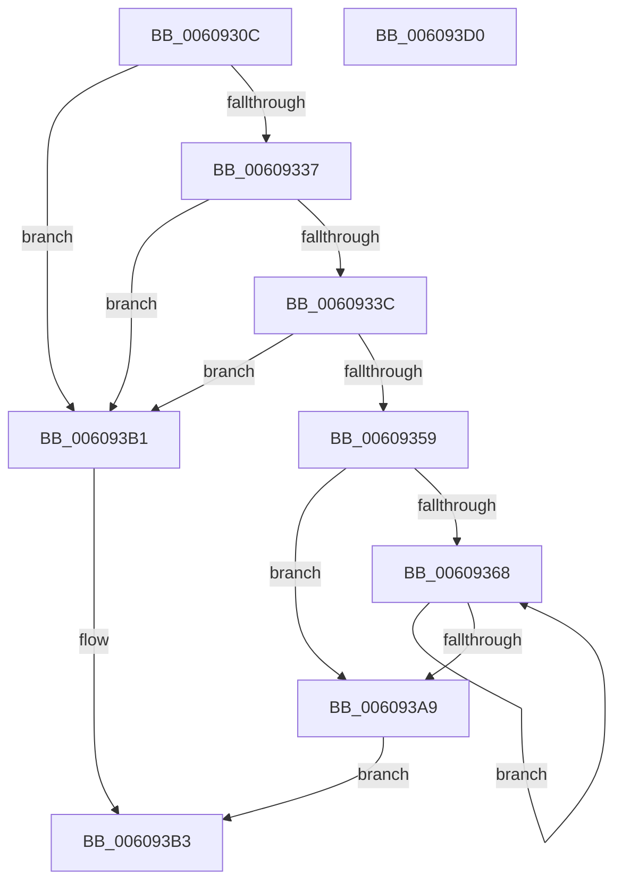

# SepGetSidValuesDump

- RVA: `0x0060930C`–`0x006093D1` (길이 `197` bytes)
- VA: `0x000000014060930C`
- 실행 섹션: `.text`
- PDB 이름 있음: `예`; PDB Function 태그: `아니요`
- unwind 정보 RVA: `0x00075C18`
- 디코드: `62`개 명령, `197/197` bytes 표시
- 미해석 바이트: `0` (있으면 어셈블리에 `.byte`로 보존)

> 이 문서는 커널 이미지의 기계어와 PDB 기호를 분석해 생성했습니다. 4번과 5번은 함수 원형과 자료형을 바이너리 사용 방식에서 추정한 C 해석이며 원본 소스 복구 결과는 아닙니다.

## 1. Dependencies

- 직접 호출 지점: **2**; 고유 호출 대상: **2**
- 직접 호출자로 확인된 함수: **1**
- RIP 상대 이미지 참조: **0**

### Outgoing calls
- `0x0060934C` → [ExAllocatePool2](../../poolcode/B8/ExAllocatePool2_function_00B820F0.md) (function, `0x00B820F0`)
- `0x0060937C` → [RtlCopySid](../../page/9A/RtlCopySid_function_009A9A50.md) (function, `0x009A9A50`)

### Direct callers
- [SepLogTokenSidManagement](../../page/79/SepLogTokenSidManagement_function_0079DA10.md) at `0x0079DCB6`
- [SepLogTokenSidManagement](../../page/79/SepLogTokenSidManagement_function_0079DA10.md) at `0x0079DD43`

### Static image references
- 디코드된 RIP-relative 메모리 참조가 없습니다.

## 2. Other-region calls and transfers

- 다른 실행 섹션으로 향하는 call: **2**
  - `0x0060934C` → [ExAllocatePool2](../../poolcode/B8/ExAllocatePool2_function_00B820F0.md) (`.text` → `POOLCODE`)
  - `0x0060937C` → [RtlCopySid](../../page/9A/RtlCopySid_function_009A9A50.md) (`.text` → `PAGE`)
- 별도 외부 분기/꼬리 이동을 확인하지 못했습니다.

## 3. Assembly (complete function range)

```asm
0060930C  48 89 5C 24 08                  mov qword ptr [rsp + 8], rbx
00609311  48 89 6C 24 10                  mov qword ptr [rsp + 0x10], rbp
00609316  48 89 74 24 18                  mov qword ptr [rsp + 0x18], rsi
0060931B  57                              push rdi
0060931C  41 54                           push r12
0060931E  41 55                           push r13
00609320  41 56                           push r14
00609322  41 57                           push r15
00609324  48 83 EC 20                     sub rsp, 0x20
00609328  33 FF                           xor edi, edi
0060932A  4C 8B F2                        mov r14, rdx
0060932D  89 3A                           mov dword ptr [rdx], edi
0060932F  48 8B F1                        mov rsi, rcx
00609332  48 85 C9                        test rcx, rcx
00609335  74 7A                           je 0x1406093b1
00609337  39 79 10                        cmp dword ptr [rcx + 0x10], edi
0060933A  74 75                           je 0x1406093b1
0060933C  8B 11                           mov edx, dword ptr [rcx]
0060933E  41 B8 53 65 53 69               mov r8d, 0x69536553
00609344  83 EA 18                        sub edx, 0x18
00609347  B9 00 01 00 00                  mov ecx, 0x100
0060934C  E8 9F 8D 57 00                  call 0x140b820f0
00609351  48 8B E8                        mov rbp, rax
00609354  48 85 C0                        test rax, rax
00609357  74 58                           je 0x1406093b1
00609359  4C 8D 7E 18                     lea r15, [rsi + 0x18]
0060935D  4C 8B E0                        mov r12, rax
00609360  44 8B EF                        mov r13d, edi
00609363  39 7E 10                        cmp dword ptr [rsi + 0x10], edi
00609366  76 41                           jbe 0x1406093a9
00609368  41 0F B6 4F 01                  movzx ecx, byte ptr [r15 + 1]
0060936D  4D 8B C7                        mov r8, r15
00609370  49 8B D4                        mov rdx, r12
00609373  8D 1C 8D 08 00 00 00            lea ebx, [rcx*4 + 8]
0060937A  8B CB                           mov ecx, ebx
0060937C  E8 CF 06 3A 00                  call 0x1409a9a50
00609381  41 0F B6 47 01                  movzx eax, byte ptr [r15 + 1]
00609386  B9 FC FF FF FF                  mov ecx, 0xfffffffc
0060938B  03 FB                           add edi, ebx
0060938D  41 FF C5                        inc r13d
00609390  48 8D 04 85 0B 00 00 00         lea rax, [rax*4 + 0xb]
00609398  48 23 C1                        and rax, rcx
0060939B  4C 03 F8                        add r15, rax
0060939E  8B C3                           mov eax, ebx
006093A0  4C 03 E0                        add r12, rax
006093A3  44 3B 6E 10                     cmp r13d, dword ptr [rsi + 0x10]
006093A7  72 BF                           jb 0x140609368
006093A9  41 89 3E                        mov dword ptr [r14], edi
006093AC  48 8B C5                        mov rax, rbp
006093AF  EB 02                           jmp 0x1406093b3
006093B1  33 C0                           xor eax, eax
006093B3  48 8B 5C 24 50                  mov rbx, qword ptr [rsp + 0x50]
006093B8  48 8B 6C 24 58                  mov rbp, qword ptr [rsp + 0x58]
006093BD  48 8B 74 24 60                  mov rsi, qword ptr [rsp + 0x60]
006093C2  48 83 C4 20                     add rsp, 0x20
006093C6  41 5F                           pop r15
006093C8  41 5E                           pop r14
006093CA  41 5D                           pop r13
006093CC  41 5C                           pop r12
006093CE  5F                              pop rdi
006093CF  C3                              ret
006093D0  CC                              int3
```

## 4. C-style interpretation (structured pseudocode)

```c
__int64 __fastcall SepGetSidValuesDump(__int64 a1, __int64 a2)
{
    __int64 result;
    __int64 v_r12;
    __int64 v_r13;
    __int64 v_r15;
    __int64 v_rdi;
    __int64 v_rsp;
    unsigned __int64 v_stack_p10;
    unsigned __int64 v_stack_p18;
    unsigned __int64 v_stack_p8;

    v_stack_p8 = v_rbx;
    v_stack_p10 = v_rbp;
    v_stack_p18 = v_rsi;
    v_rsp = (v_rsp) - (32);
    v_rdi = 0;
    *(unsigned int *)(a2) = 0;
    if (a1 == 0) goto loc_006093B1;
    if ((*(unsigned int *)(a1 + 16)) == 0) goto loc_006093B1;
    a2 = (unsigned int)(((unsigned int)(*(unsigned int *)(a1))) - (24));
    result = ExAllocatePool2(256, a2, (unsigned int)(0x69536553ULL), a4);
    if (result == 0) goto loc_006093B1;
    if ((*(unsigned int *)(a1 + 16)) <= 0) goto loc_006093A9;
loc_00609368:
    result = RtlCopySid((unsigned int)((unsigned int)(*(unsigned __int8 *)(a1 + 24 + 1) * 4 + 8)), result, a1 + 24, a4);
    v_rdi = (unsigned int)((v_rdi) + ((unsigned int)(*(unsigned __int8 *)(a1 + 24 + 1) * 4 + 8)));
    v_r13 = (unsigned int)((0) + 1);
    result = (*(unsigned __int8 *)(a1 + 24 + 1) * 4 + 11) & ((unsigned int)(0xFFFFFFFCULL));
    v_r15 = (a1 + 24) + (result);
    v_r12 = (result) + ((unsigned int)((unsigned int)(*(unsigned __int8 *)(a1 + 24 + 1) * 4 + 8)));
    if (((unsigned int)(v_r13)) < (*(unsigned int *)(a1 + 16))) goto loc_00609368;
loc_006093A9:
    *(unsigned int *)(a2) = (unsigned int)(v_rdi);
    goto loc_006093B3;
loc_006093B1:
    result = 0;
loc_006093B3:
    v_rsp = (v_rsp) + (32);
    return result;
}
```

## 5. (Beta) C Style

```c
int64_t SepGetSidValuesDump(void *Arg1, void *Arg2)
{
    uint8_t *arg1 = (uint8_t *)Arg1;
    uint8_t *arg2 = (uint8_t *)Arg2;

    int64_t result;
    int64_t local_r12;
    int64_t local_r13;
    int64_t local_r15;
    int64_t local_rdi;
    int64_t local_rsp;
    uint64_t v_stack_p10;
    uint64_t v_stack_p18;
    uint64_t v_stack_p8;

    v_stack_p8 = local_rbx;
    v_stack_p10 = local_rbp;
    v_stack_p18 = local_rsi;
    local_rsp = (local_rsp) - (32);
    local_rdi = 0;
    *(uint32_t *)(arg2) = 0;
    if (Arg1 == NULL) goto loc_006093B1;
    if ((*(uint32_t *)(arg1 + 0x10)) == 0) goto loc_006093B1;
    Arg2 = (uint32_t)(((uint32_t)(*(uint32_t *)(arg1))) - (24));
    result = ExAllocatePool2(256, Arg2, (uint32_t)(0x69536553ULL), a4);
    if (result == 0) goto loc_006093B1;
    if ((*(uint32_t *)(arg1 + 0x10)) <= 0) goto loc_006093A9;
loc_00609368:
    result = RtlCopySid((uint32_t)((uint32_t)(*(uint8_t *)(arg1 + 0x18 + 0x1) * 4 + 8)), result, Arg1 + 24, a4);
    local_rdi = (uint32_t)((local_rdi) + ((uint32_t)(*(uint8_t *)(arg1 + 0x18 + 0x1) * 4 + 8)));
    local_r13 = (uint32_t)((0) + 1);
    result = (*(uint8_t *)(arg1 + 0x18 + 0x1) * 4 + 11) & ((uint32_t)(0xFFFFFFFCULL));
    local_r15 = (Arg1 + 24) + (result);
    local_r12 = (result) + ((uint32_t)((uint32_t)(*(uint8_t *)(arg1 + 0x18 + 0x1) * 4 + 8)));
    if (((uint32_t)(local_r13)) < (*(uint32_t *)(arg1 + 0x10))) goto loc_00609368;
loc_006093A9:
    *(uint32_t *)(arg2) = (uint32_t)(local_rdi);
    goto loc_006093B3;
loc_006093B1:
    result = 0;
loc_006093B3:
    local_rsp = (local_rsp) + (32);
    return result;
}
```

### 관측된 메모리 오프셋

구조체 형식이 확인되지 않은 접근은 인자 기준의 오프셋으로만 기록했습니다.

| 기준 인자 | 오프셋 표현 | 폭 (bit) | 접근 |
|---|---:|---:|---|
| `Arg1` | `+ 0x1` | `8` | `R` |
| `Arg1` | `+ 0x10` | `32` | `R` |
| `Arg1` | `+ 0x18` | `64` | `R` |
| `Arg2` | `+ 0x0` | `32` | `W` |

## 6. Execution-region graph

[열기: 2D/3D 그래프와 함수 탐색 컨트롤 패널](../../../control-panel.html?section=text&rva=0x0060930C&view=graph)

- 2D 그래프는 위에서 아래로 흐르고, 3D 그래프는 빈 공간을 드래그해 회전합니다. Shift+드래그는 이동, 휠은 확대·축소, 함수 노드 선택은 대상 보고서 이동입니다.

### Static fallback


