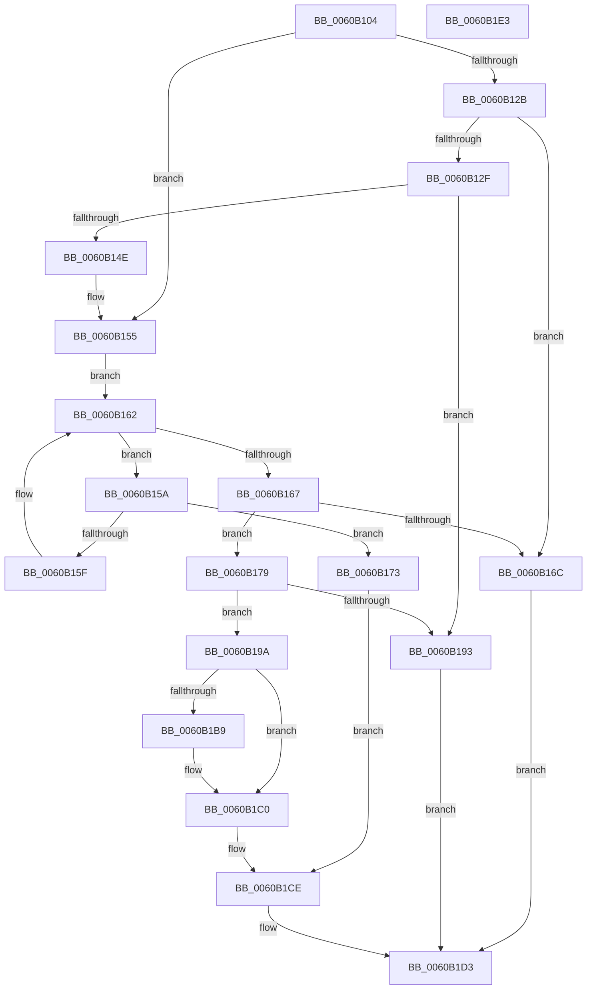

# SepGetTokenSessionAntiTamperMapEntry

- RVA: `0x0060B104`–`0x0060B1E4` (길이 `224` bytes)
- VA: `0x000000014060B104`
- 실행 섹션: `.text`
- PDB 이름 있음: `예`; PDB Function 태그: `아니요`
- unwind 정보 RVA: `0x00060BC4`
- 디코드: `65`개 명령, `224/224` bytes 표시
- 미해석 바이트: `0` (있으면 어셈블리에 `.byte`로 보존)

> 이 문서는 커널 이미지의 기계어와 PDB 기호를 분석해 생성했습니다. 4번과 5번은 함수 원형과 자료형을 바이너리 사용 방식에서 추정한 C 해석이며 원본 소스 복구 결과는 아닙니다.

## 1. Dependencies

- 직접 호출 지점: **2**; 고유 호출 대상: **1**
- 직접 호출자로 확인된 함수: **2**
- RIP 상대 이미지 참조: **2**

### Outgoing calls
- `0x0060B13D` → [ExAllocatePool2](../../poolcode/B8/ExAllocatePool2_function_00B820F0.md) (function, `0x00B820F0`)
- `0x0060B189` → [ExAllocatePool2](../../poolcode/B8/ExAllocatePool2_function_00B820F0.md) (function, `0x00B820F0`)

### Direct callers
- [SepSetTokenAntiTamperEntry](SepSetTokenAntiTamperEntry_function_0060B28C.md) at `0x0060B348`
- [SepSetTokenAntiTamperEntry](SepSetTokenAntiTamperEntry_function_0060B28C.md) at `0x0060B3D8`
- [SepDereferenceAntiTamperEntry](../../page/7A/SepDereferenceAntiTamperEntry_function_007A2E50.md) at `0x007A2EF8`

### Static image references
- `0x0060B11A` → RVA `0x00F04D08` (`.data`; read)
- `0x0060B142` → RVA `0x00F04D08` (`.data`; write)

## 2. Other-region calls and transfers

- 다른 실행 섹션으로 향하는 call: **2**
  - `0x0060B13D` → [ExAllocatePool2](../../poolcode/B8/ExAllocatePool2_function_00B820F0.md) (`.text` → `POOLCODE`)
  - `0x0060B189` → [ExAllocatePool2](../../poolcode/B8/ExAllocatePool2_function_00B820F0.md) (`.text` → `POOLCODE`)
- 별도 외부 분기/꼬리 이동을 확인하지 못했습니다.

## 3. Assembly (complete function range)

```asm
0060B104  48 89 5C 24 08                  mov qword ptr [rsp + 8], rbx
0060B109  48 89 74 24 10                  mov qword ptr [rsp + 0x10], rsi
0060B10E  57                              push rdi
0060B10F  48 83 EC 20                     sub rsp, 0x20
0060B113  49 83 20 00                     and qword ptr [r8], 0
0060B117  49 8B D8                        mov rbx, r8
0060B11A  48 8B 05 E7 9B 8F 00            mov rax, qword ptr [rip + 0x8f9be7]
0060B121  40 8A FA                        mov dil, dl
0060B124  8B F1                           mov esi, ecx
0060B126  48 85 C0                        test rax, rax
0060B129  75 2A                           jne 0x14060b155
0060B12B  84 D2                           test dl, dl
0060B12D  74 3D                           je 0x14060b16c
0060B12F  8D 50 10                        lea edx, [rax + 0x10]
0060B132  B9 00 01 00 00                  mov ecx, 0x100
0060B137  41 B8 53 65 4C 73               mov r8d, 0x734c6553
0060B13D  E8 AE 6F 57 00                  call 0x140b820f0
0060B142  48 89 05 BF 9B 8F 00            mov qword ptr [rip + 0x8f9bbf], rax
0060B149  48 85 C0                        test rax, rax
0060B14C  74 45                           je 0x14060b193
0060B14E  48 89 40 08                     mov qword ptr [rax + 8], rax
0060B152  48 89 00                        mov qword ptr [rax], rax
0060B155  48 8B 08                        mov rcx, qword ptr [rax]
0060B158  EB 08                           jmp 0x14060b162
0060B15A  39 71 10                        cmp dword ptr [rcx + 0x10], esi
0060B15D  74 14                           je 0x14060b173
0060B15F  48 8B 09                        mov rcx, qword ptr [rcx]
0060B162  48 3B C8                        cmp rcx, rax
0060B165  75 F3                           jne 0x14060b15a
0060B167  40 84 FF                        test dil, dil
0060B16A  75 0D                           jne 0x14060b179
0060B16C  B8 25 02 00 C0                  mov eax, 0xc0000225
0060B171  EB 60                           jmp 0x14060b1d3
0060B173  48 83 C1 18                     add rcx, 0x18
0060B177  EB 55                           jmp 0x14060b1ce
0060B179  BA 40 00 00 00                  mov edx, 0x40
0060B17E  B9 00 01 00 00                  mov ecx, 0x100
0060B183  41 B8 53 65 4C 73               mov r8d, 0x734c6553
0060B189  E8 62 6F 57 00                  call 0x140b820f0
0060B18E  48 85 C0                        test rax, rax
0060B191  75 07                           jne 0x14060b19a
0060B193  B8 9A 00 00 C0                  mov eax, 0xc000009a
0060B198  EB 39                           jmp 0x14060b1d3
0060B19A  48 8B 15 67 9B 8F 00            mov rdx, qword ptr [rip + 0x8f9b67]
0060B1A1  48 8D 48 18                     lea rcx, [rax + 0x18]
0060B1A5  48 83 21 00                     and qword ptr [rcx], 0
0060B1A9  C6 40 38 00                     mov byte ptr [rax + 0x38], 0
0060B1AD  89 70 10                        mov dword ptr [rax + 0x10], esi
0060B1B0  4C 8B 02                        mov r8, qword ptr [rdx]
0060B1B3  49 39 50 08                     cmp qword ptr [r8 + 8], rdx
0060B1B7  74 07                           je 0x14060b1c0
0060B1B9  B9 03 00 00 00                  mov ecx, 3
0060B1BE  CD 29                           int 0x29
0060B1C0  4C 89 00                        mov qword ptr [rax], r8
0060B1C3  48 89 50 08                     mov qword ptr [rax + 8], rdx
0060B1C7  49 89 40 08                     mov qword ptr [r8 + 8], rax
0060B1CB  48 89 02                        mov qword ptr [rdx], rax
0060B1CE  48 89 0B                        mov qword ptr [rbx], rcx
0060B1D1  33 C0                           xor eax, eax
0060B1D3  48 8B 5C 24 30                  mov rbx, qword ptr [rsp + 0x30]
0060B1D8  48 8B 74 24 38                  mov rsi, qword ptr [rsp + 0x38]
0060B1DD  48 83 C4 20                     add rsp, 0x20
0060B1E1  5F                              pop rdi
0060B1E2  C3                              ret
0060B1E3  CC                              int3
```

## 4. C-style interpretation (structured pseudocode)

```c
__int64 __fastcall SepGetTokenSessionAntiTamperMapEntry(int a1, unsigned __int8 a2, __int64 a3)
{
    __int64 result;
    __int64 v_rsp;
    unsigned __int64 v_stack_p10;
    unsigned __int64 v_stack_p8;

    v_stack_p8 = v_rbx;
    v_stack_p10 = v_rsi;
    v_rsp = (v_rsp) - (32);
    if (*(unsigned __int64 *)(v_rip + 9411559) != 0) goto loc_0060B155;
    if (a2 == 0) goto loc_0060B16C;
    result = ExAllocatePool2(256, *(unsigned __int64 *)(v_rip + 9411559) + 16, (unsigned int)(0x734C6553ULL), a4);
    *(unsigned __int64 *)(v_rip + 9411519) = result;
    if (result == 0) goto loc_0060B193;
    *(unsigned __int64 *)(result + 8) = result;
    *(unsigned __int64 *)(result) = result;
loc_0060B155:
    goto loc_0060B162;
loc_0060B15A:
    if ((*(unsigned int *)(*(unsigned __int64 *)(result) + 16)) == ((unsigned int)((unsigned int)(a1)))) goto loc_0060B173;
loc_0060B162:
    if ((*(unsigned __int64 *)(*(unsigned __int64 *)(result))) != result) goto loc_0060B15A;
    if (a2 != 0) goto loc_0060B179;
loc_0060B16C:
    goto loc_0060B1D3;
loc_0060B173:
    a1 = (*(unsigned __int64 *)(*(unsigned __int64 *)(result))) + (24);
    goto loc_0060B1CE;
loc_0060B179:
    result = ExAllocatePool2(256, 64, (unsigned int)(0x734C6553ULL), a4);
    if (result != 0) goto loc_0060B19A;
loc_0060B193:
    goto loc_0060B1D3;
loc_0060B19A:
    *(unsigned __int8 *)((unsigned int)(0xC000009AULL) + 56) = 0;
    *(unsigned int *)((unsigned int)(0xC000009AULL) + 16) = (unsigned int)((unsigned int)(a1));
    if ((*(unsigned __int64 *)(*(unsigned __int64 *)(*(unsigned __int64 *)(v_rip + 9411431)) + 8)) != (*(unsigned __int64 *)(v_rip + 9411431))) {
        a1 = 3;
    }
    *(unsigned __int64 *)((unsigned int)(0xC000009AULL)) = *(unsigned __int64 *)(*(unsigned __int64 *)(v_rip + 9411431));
    *(unsigned __int64 *)((unsigned int)(0xC000009AULL) + 8) = *(unsigned __int64 *)(v_rip + 9411431);
    *(unsigned __int64 *)(*(unsigned __int64 *)(*(unsigned __int64 *)(v_rip + 9411431)) + 8) = (unsigned int)(0xC000009AULL);
    *(unsigned __int64 *)(*(unsigned __int64 *)(v_rip + 9411431)) = (unsigned int)(0xC000009AULL);
loc_0060B1CE:
    *(unsigned __int64 *)(a3) = a1;
    result = 0;
loc_0060B1D3:
    v_rsp = (v_rsp) + (32);
    return result;
}
```

## 5. (Beta) C Style

```c
int64_t SepGetTokenSessionAntiTamperMapEntry(int32_t Arg1, uint8_t Arg2, void *Arg3)
{
    uint8_t *arg3 = (uint8_t *)Arg3;

    int64_t result;
    int64_t local_rsp;
    uint64_t v_stack_p10;
    uint64_t v_stack_p8;

    v_stack_p8 = local_rbx;
    v_stack_p10 = local_rsi;
    local_rsp = (local_rsp) - (32);
    if (*(uint64_t *)(v_rip + 0x8F9BE7) != 0) goto loc_0060B155;
    if (Arg2 == 0) goto loc_0060B16C;
    result = ExAllocatePool2(256, *(uint64_t *)(v_rip + 0x8F9BE7) + 16, (uint32_t)(0x734C6553ULL), a4);
    *(uint64_t *)(v_rip + 0x8F9BBF) = result;
    if (result == 0) goto loc_0060B193;
    *(uint64_t *)(result + 0x8) = result;
    *(uint64_t *)(result) = result;
loc_0060B155:
    goto loc_0060B162;
loc_0060B15A:
    if ((*(uint32_t *)(*(uint64_t *)(result) + 0x10)) == ((uint32_t)((uint32_t)(Arg1)))) goto loc_0060B173;
loc_0060B162:
    if ((*(uint64_t *)(*(uint64_t *)(result))) != result) goto loc_0060B15A;
    if (Arg2 != 0) goto loc_0060B179;
loc_0060B16C:
    goto loc_0060B1D3;
loc_0060B173:
    Arg1 = (*(uint64_t *)(*(uint64_t *)(result))) + (24);
    goto loc_0060B1CE;
loc_0060B179:
    result = ExAllocatePool2(256, 64, (uint32_t)(0x734C6553ULL), a4);
    if (result != 0) goto loc_0060B19A;
loc_0060B193:
    goto loc_0060B1D3;
loc_0060B19A:
    *(uint8_t *)((uint32_t)(0xC000009AULL) + 0x38) = 0;
    *(uint32_t *)((uint32_t)(0xC000009AULL) + 0x10) = (uint32_t)((uint32_t)(Arg1));
    if ((*(uint64_t *)(*(uint64_t *)(*(uint64_t *)(v_rip + 0x8F9B67)) + 0x8)) != (*(uint64_t *)(v_rip + 0x8F9B67))) {
        Arg1 = 3;
    }
    *(uint64_t *)((uint32_t)(0xC000009AULL)) = *(uint64_t *)(*(uint64_t *)(v_rip + 0x8F9B67));
    *(uint64_t *)((uint32_t)(0xC000009AULL) + 0x8) = *(uint64_t *)(v_rip + 0x8F9B67);
    *(uint64_t *)(*(uint64_t *)(*(uint64_t *)(v_rip + 0x8F9B67)) + 0x8) = (uint32_t)(0xC000009AULL);
    *(uint64_t *)(*(uint64_t *)(v_rip + 0x8F9B67)) = (uint32_t)(0xC000009AULL);
loc_0060B1CE:
    *(uint64_t *)(arg3) = Arg1;
    result = 0;
loc_0060B1D3:
    local_rsp = (local_rsp) + (32);
    return result;
}
```

### 관측된 메모리 오프셋

구조체 형식이 확인되지 않은 접근은 인자 기준의 오프셋으로만 기록했습니다.

| 기준 인자 | 오프셋 표현 | 폭 (bit) | 접근 |
|---|---:|---:|---|
| `Arg3` | `+ 0x0` | `64` | `R/W` |
| `Arg3` | `+ 0x0` | `64` | `W` |

## 6. Execution-region graph

[열기: 2D/3D 그래프와 함수 탐색 컨트롤 패널](../../../control-panel.html?section=text&rva=0x0060B104&view=graph)

- 2D 그래프는 위에서 아래로 흐르고, 3D 그래프는 빈 공간을 드래그해 회전합니다. Shift+드래그는 이동, 휠은 확대·축소, 함수 노드 선택은 대상 보고서 이동입니다.

### Static fallback


