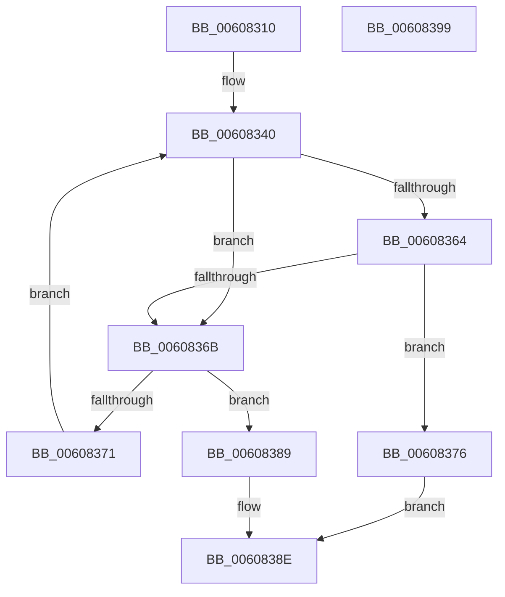

# SepImageHashFromEa

- RVA: `0x00608310`–`0x0060839A` (길이 `138` bytes)
- VA: `0x0000000140608310`
- 실행 섹션: `.text`
- PDB 이름 있음: `예`; PDB Function 태그: `아니요`
- unwind 정보 RVA: `0x000718C0`
- 디코드: `41`개 명령, `138/138` bytes 표시
- 미해석 바이트: `0` (있으면 어셈블리에 `.byte`로 보존)

> 이 문서는 커널 이미지의 기계어와 PDB 기호를 분석해 생성했습니다. 4번과 5번은 함수 원형과 자료형을 바이너리 사용 방식에서 추정한 C 해석이며 원본 소스 복구 결과는 아닙니다.

## 1. Dependencies

- 직접 호출 지점: **3**; 고유 호출 대상: **2**
- 직접 호출자로 확인된 함수: **1**
- RIP 상대 이미지 참조: **1**

### Outgoing calls
- `0x0060833B` → [RtlInitAnsiString](../47/RtlInitAnsiString_function_00470F40.md) (function, `0x00470F40`)
- `0x00608349` → [RtlInitAnsiString](../47/RtlInitAnsiString_function_00470F40.md) (function, `0x00470F40`)
- `0x0060835B` → [RtlEqualString](../48/RtlEqualString_function_0048BDE0.md) (function, `0x0048BDE0`)

### Direct callers
- [SepAppIdentityFromImageHash](SepAppIdentityFromImageHash_function_00607AA4.md) at `0x00607B4A`

### Static image references
- `0x0060831F` → RVA `0x006CD660` (` ?? ::FNODOBFM::`string'`; read)

## 2. Other-region calls and transfers

- 다른 실행 섹션으로 향하는 call: **0**
- 별도 외부 분기/꼬리 이동을 확인하지 못했습니다.

## 3. Assembly (complete function range)

```asm
00608310  48 8B C4                        mov rax, rsp
00608313  48 89 58 08                     mov qword ptr [rax + 8], rbx
00608317  57                              push rdi
00608318  48 83 EC 40                     sub rsp, 0x40
0060831C  48 8B D9                        mov rbx, rcx
0060831F  48 8D 15 3A 53 0C 00            lea rdx, [rip + 0xc533a]
00608326  0F 57 C0                        xorps xmm0, xmm0
00608329  48 8D 48 E8                     lea rcx, [rax - 0x18]
0060832D  0F 57 C9                        xorps xmm1, xmm1
00608330  49 8B F8                        mov rdi, r8
00608333  0F 11 40 D8                     movups xmmword ptr [rax - 0x28], xmm0
00608337  0F 11 48 E8                     movups xmmword ptr [rax - 0x18], xmm1
0060833B  E8 00 8C E6 FF                  call 0x140470f40
00608340  48 8D 53 08                     lea rdx, [rbx + 8]
00608344  48 8D 4C 24 20                  lea rcx, [rsp + 0x20]
00608349  E8 F2 8B E6 FF                  call 0x140470f40
0060834E  41 B0 01                        mov r8b, 1
00608351  48 8D 54 24 20                  lea rdx, [rsp + 0x20]
00608356  48 8D 4C 24 30                  lea rcx, [rsp + 0x30]
0060835B  E8 80 3A E8 FF                  call 0x14048bde0
00608360  84 C0                           test al, al
00608362  74 07                           je 0x14060836b
00608364  66 83 7B 06 20                  cmp word ptr [rbx + 6], 0x20
00608369  74 0B                           je 0x140608376
0060836B  8B 03                           mov eax, dword ptr [rbx]
0060836D  85 C0                           test eax, eax
0060836F  74 18                           je 0x140608389
00608371  48 03 D8                        add rbx, rax
00608374  EB CA                           jmp 0x140608340
00608376  0F 10 43 2A                     movups xmm0, xmmword ptr [rbx + 0x2a]
0060837A  33 C0                           xor eax, eax
0060837C  0F 11 07                        movups xmmword ptr [rdi], xmm0
0060837F  0F 10 4B 3A                     movups xmm1, xmmword ptr [rbx + 0x3a]
00608383  0F 11 4F 10                     movups xmmword ptr [rdi + 0x10], xmm1
00608387  EB 05                           jmp 0x14060838e
00608389  B8 25 02 00 C0                  mov eax, 0xc0000225
0060838E  48 8B 5C 24 50                  mov rbx, qword ptr [rsp + 0x50]
00608393  48 83 C4 40                     add rsp, 0x40
00608397  5F                              pop rdi
00608398  C3                              ret
00608399  CC                              int3
```

## 4. C-style interpretation (structured pseudocode)

```c
__int64 __fastcall SepImageHashFromEa(__int64 a1, __int64 a2, __int64 a3)
{
    __int64 result;
    __int64 v_rbx;
    __int64 v_rsp;
    unsigned __int64 v_stack_m18;
    unsigned __int64 v_stack_m28;
    unsigned __int64 v_stack_p8;

    *(unsigned __int64 *)(v_rsp + 8) = v_rbx;
    v_rsp = (v_rsp) - (64);
    *(unsigned __int64 *)(v_rsp - 40) = v_xmm0;
    *(unsigned __int64 *)(v_rsp - 24) = v_xmm1;
    result = RtlInitAnsiString(v_rsp - 24, v_rip + 807738, a3, a4);
loc_00608340:
    result = RtlInitAnsiString(v_stack_m28, a1 + 8, a3, a4);
    result = RtlEqualString(v_stack_m18, v_stack_m28, 1, a4);
    if ((unsigned __int8)(result) == 0) goto loc_0060836B;
    if ((*(unsigned __int16 *)(a1 + 6)) == 32) goto loc_00608376;
loc_0060836B:
    if ((unsigned int)((unsigned int)(*(unsigned int *)(a1))) == 0) goto loc_00608389;
    v_rbx = (a1) + ((unsigned int)(*(unsigned int *)(a1)));
    goto loc_00608340;
loc_00608376:
    result = 0;
    *(unsigned __int64 *)(a3) = v_xmm0;
    *(unsigned __int64 *)(a3 + 16) = v_xmm1;
    goto loc_0060838E;
loc_00608389:
loc_0060838E:
    v_rsp = (v_rsp) + (64);
    return (unsigned int)(0xC0000225ULL);
}
```

## 5. (Beta) C Style

```c
int64_t SepImageHashFromEa(void *Arg1, int64_t Arg2, void *Arg3)
{
    uint8_t *arg1 = (uint8_t *)Arg1;
    uint8_t *arg3 = (uint8_t *)Arg3;

    int64_t result;
    int64_t local_rbx;
    int64_t local_rsp;
    uint64_t v_stack_m18;
    uint64_t v_stack_m28;
    uint64_t v_stack_p8;

    *(uint64_t *)(local_rsp + 0x8) = local_rbx;
    local_rsp = (local_rsp) - (64);
    *(uint64_t *)(local_rsp - 0x28) = v_xmm0;
    *(uint64_t *)(local_rsp - 0x18) = v_xmm1;
    result = RtlInitAnsiString(local_rsp - 24, v_rip + 807738, Arg3, a4);
loc_00608340:
    result = RtlInitAnsiString(v_stack_m28, Arg1 + 8, Arg3, a4);
    result = RtlEqualString(v_stack_m18, v_stack_m28, 1, a4);
    if ((uint8_t)(result) == 0) goto loc_0060836B;
    if ((*(uint16_t *)(arg1 + 0x6)) == 32) goto loc_00608376;
loc_0060836B:
    if ((uint32_t)((uint32_t)(*(uint32_t *)(arg1))) == 0) goto loc_00608389;
    local_rbx = (Arg1) + ((uint32_t)(*(uint32_t *)(arg1)));
    goto loc_00608340;
loc_00608376:
    result = 0;
    *(uint64_t *)(arg3) = v_xmm0;
    *(uint64_t *)(arg3 + 0x10) = v_xmm1;
    goto loc_0060838E;
loc_00608389:
loc_0060838E:
    local_rsp = (local_rsp) + (64);
    return (uint32_t)(0xC0000225ULL);
}
```

### 관측된 메모리 오프셋

구조체 형식이 확인되지 않은 접근은 인자 기준의 오프셋으로만 기록했습니다.

| 기준 인자 | 오프셋 표현 | 폭 (bit) | 접근 |
|---|---:|---:|---|
| `Arg1` | `+ 0x0` | `32` | `R` |
| `Arg1` | `+ 0x6` | `16` | `R` |
| `Arg1` | `+ 0x8` | `64` | `R` |
| `Arg1` | `+ 0x2A` | `128` | `R` |
| `Arg1` | `+ 0x3A` | `128` | `R` |
| `Arg3` | `+ 0x0` | `128` | `R` |
| `Arg3` | `+ 0x10` | `128` | `R` |

## 6. Execution-region graph

[열기: 2D/3D 그래프와 함수 탐색 컨트롤 패널](../../../control-panel.html?section=text&rva=0x00608310&view=graph)

- 2D 그래프는 위에서 아래로 흐르고, 3D 그래프는 빈 공간을 드래그해 회전합니다. Shift+드래그는 이동, 휠은 확대·축소, 함수 노드 선택은 대상 보고서 이동입니다.

### Static fallback


