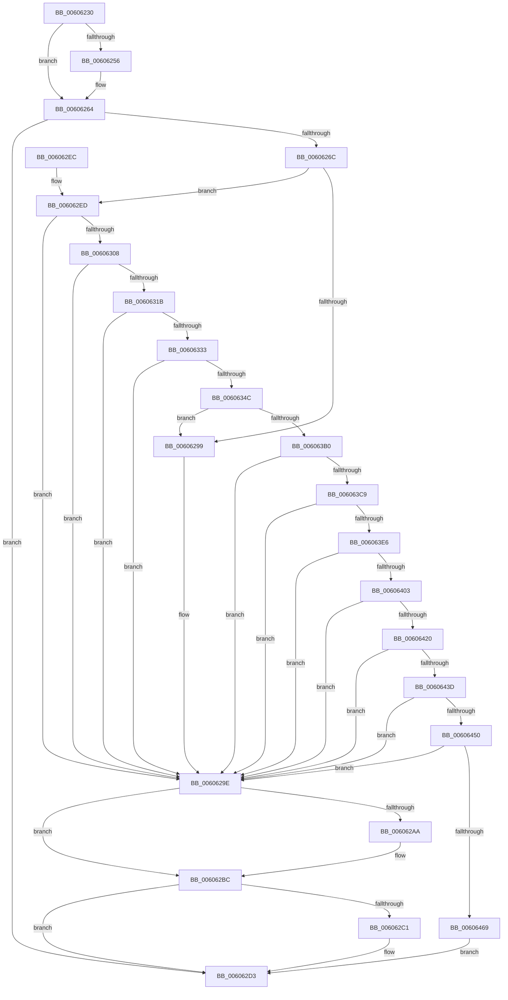

# SepInitProcessAuditSd

- RVA: `0x00606230`–`0x00606475` (길이 `581` bytes)
- VA: `0x0000000140606230`
- 실행 섹션: `.text`
- PDB 이름 있음: `예`; PDB Function 태그: `아니요`
- unwind 정보 RVA: `0x000D074C`
- 디코드: `145`개 명령, `581/581` bytes 표시
- 미해석 바이트: `0` (있으면 어셈블리에 `.byte`로 보존)

> 이 문서는 커널 이미지의 기계어와 PDB 기호를 분석해 생성했습니다. 4번과 5번은 함수 원형과 자료형을 바이너리 사용 방식에서 추정한 C 해석이며 원본 소스 복구 결과는 아닙니다.

## 1. Dependencies

- 직접 호출 지점: **17**; 고유 호출 대상: **9**
- 직접 호출자로 확인된 함수: **1**
- RIP 상대 이미지 참조: **11**

### Outgoing calls
- `0x00606258` → [ExFreePoolWithTag](../../poolcode/B8/ExFreePoolWithTag_function_00B82870.md) (function, `0x00B82870`)
- `0x0060628C` → [ExAllocatePool2](../../poolcode/B8/ExAllocatePool2_function_00B820F0.md) (function, `0x00B820F0`)
- `0x006062A0` → [SepAuditFailed](../../page/86/SepAuditFailed_function_0086EE20.md) (function, `0x0086EE20`)
- `0x006062AF` → [ExFreePoolWithTag](../../poolcode/B8/ExFreePoolWithTag_function_00B82870.md) (function, `0x00B82870`)
- `0x006062C6` → [ExFreePoolWithTag](../../poolcode/B8/ExFreePoolWithTag_function_00B82870.md) (function, `0x00B82870`)
- `0x006062FF` → [RtlCreateAcl](../../page/91/RtlCreateAcl_function_00916F00.md) (function, `0x00916F00`)
- `0x00606312` → [RtlAddAuditAccessAce](../../page/78/RtlAddAuditAccessAce_function_0078D410.md) (function, `0x0078D410`)
- `0x00606326` → [RtlCreateSecurityDescriptor](../../page/9F/RtlCreateSecurityDescriptor_function_009F1DF0.md) (function, `0x009F1DF0`)
- `0x0060633F` → [RtlSetSaclSecurityDescriptor](../../page/A1/RtlSetSaclSecurityDescriptor_function_00A18B80.md) (function, `0x00A18B80`)
- `0x0060639F` → [ExAllocatePool2](../../poolcode/B8/ExAllocatePool2_function_00B820F0.md) (function, `0x00B820F0`)
- `0x006063BC` → [RtlCreateAcl](../../page/91/RtlCreateAcl_function_00916F00.md) (function, `0x00916F00`)
- `0x006063D9` → [RtlAddAccessAllowedAce](../../page/92/RtlAddAccessAllowedAce_function_009298C0.md) (function, `0x009298C0`)
- `0x006063F6` → [RtlAddAccessAllowedAce](../../page/92/RtlAddAccessAllowedAce_function_009298C0.md) (function, `0x009298C0`)
- `0x00606413` → [RtlAddAccessAllowedAce](../../page/92/RtlAddAccessAllowedAce_function_009298C0.md) (function, `0x009298C0`)
- `0x00606430` → [RtlAddAccessAllowedAce](../../page/92/RtlAddAccessAllowedAce_function_009298C0.md) (function, `0x009298C0`)
- `0x00606443` → [RtlCreateSecurityDescriptor](../../page/9F/RtlCreateSecurityDescriptor_function_009F1DF0.md) (function, `0x009F1DF0`)
- `0x0060645C` → [RtlSetDaclSecurityDescriptor](../../page/9E/RtlSetDaclSecurityDescriptor_function_009EC210.md) (function, `0x009EC210`)

### Direct callers
- [SepInitializationPhase1](../../page/79/SepInitializationPhase1_function_0079C580.md) at `0x0079C7D3`

### Static image references
- `0x00606248` → RVA `0x00FD9D78` (`PAGEDATA`; read)
- `0x0060625D` → RVA `0x00FD9D78` (`PAGEDATA`; read/write)
- `0x00606264` → RVA `0x00FD8110` (`PAGEDATA`; read)
- `0x0060626C` → RVA `0x00E67D48` (`.data`; read)
- `0x006062CB` → RVA `0x00FDA000` (`PAGEDATA`; read/write)
- `0x0060634C` → RVA `0x00FD9C28` (`PAGEDATA`; read)
- `0x0060635E` → RVA `0x00FD9D78` (`PAGEDATA`; write)
- `0x0060636A` → RVA `0x00FD9BA8` (`PAGEDATA`; read)
- `0x00606375` → RVA `0x00FD9B58` (`PAGEDATA`; read)
- `0x00606383` → RVA `0x00E67D58` (`.data`; read)
- `0x00606469` → RVA `0x00FDA000` (`PAGEDATA`; write)

## 2. Other-region calls and transfers

- 다른 실행 섹션으로 향하는 call: **17**
  - `0x00606258` → [ExFreePoolWithTag](../../poolcode/B8/ExFreePoolWithTag_function_00B82870.md) (`.text` → `POOLCODE`)
  - `0x0060628C` → [ExAllocatePool2](../../poolcode/B8/ExAllocatePool2_function_00B820F0.md) (`.text` → `POOLCODE`)
  - `0x006062A0` → [SepAuditFailed](../../page/86/SepAuditFailed_function_0086EE20.md) (`.text` → `PAGE`)
  - `0x006062AF` → [ExFreePoolWithTag](../../poolcode/B8/ExFreePoolWithTag_function_00B82870.md) (`.text` → `POOLCODE`)
  - `0x006062C6` → [ExFreePoolWithTag](../../poolcode/B8/ExFreePoolWithTag_function_00B82870.md) (`.text` → `POOLCODE`)
  - `0x006062FF` → [RtlCreateAcl](../../page/91/RtlCreateAcl_function_00916F00.md) (`.text` → `PAGE`)
  - `0x00606312` → [RtlAddAuditAccessAce](../../page/78/RtlAddAuditAccessAce_function_0078D410.md) (`.text` → `PAGE`)
  - `0x00606326` → [RtlCreateSecurityDescriptor](../../page/9F/RtlCreateSecurityDescriptor_function_009F1DF0.md) (`.text` → `PAGE`)
  - `0x0060633F` → [RtlSetSaclSecurityDescriptor](../../page/A1/RtlSetSaclSecurityDescriptor_function_00A18B80.md) (`.text` → `PAGE`)
  - `0x0060639F` → [ExAllocatePool2](../../poolcode/B8/ExAllocatePool2_function_00B820F0.md) (`.text` → `POOLCODE`)
  - `0x006063BC` → [RtlCreateAcl](../../page/91/RtlCreateAcl_function_00916F00.md) (`.text` → `PAGE`)
  - `0x006063D9` → [RtlAddAccessAllowedAce](../../page/92/RtlAddAccessAllowedAce_function_009298C0.md) (`.text` → `PAGE`)
  - `0x006063F6` → [RtlAddAccessAllowedAce](../../page/92/RtlAddAccessAllowedAce_function_009298C0.md) (`.text` → `PAGE`)
  - `0x00606413` → [RtlAddAccessAllowedAce](../../page/92/RtlAddAccessAllowedAce_function_009298C0.md) (`.text` → `PAGE`)
  - `0x00606430` → [RtlAddAccessAllowedAce](../../page/92/RtlAddAccessAllowedAce_function_009298C0.md) (`.text` → `PAGE`)
  - `0x00606443` → [RtlCreateSecurityDescriptor](../../page/9F/RtlCreateSecurityDescriptor_function_009F1DF0.md) (`.text` → `PAGE`)
  - `0x0060645C` → [RtlSetDaclSecurityDescriptor](../../page/9E/RtlSetDaclSecurityDescriptor_function_009EC210.md) (`.text` → `PAGE`)
- 별도 외부 분기/꼬리 이동을 확인하지 못했습니다.

## 3. Assembly (complete function range)

```asm
00606230  48 89 5C 24 08                  mov qword ptr [rsp + 8], rbx
00606235  48 89 6C 24 10                  mov qword ptr [rsp + 0x10], rbp
0060623A  48 89 74 24 18                  mov qword ptr [rsp + 0x18], rsi
0060623F  57                              push rdi
00606240  41 54                           push r12
00606242  41 57                           push r15
00606244  48 83 EC 30                     sub rsp, 0x30
00606248  48 8B 0D 29 3B 9D 00            mov rcx, qword ptr [rip + 0x9d3b29]
0060624F  33 DB                           xor ebx, ebx
00606251  48 85 C9                        test rcx, rcx
00606254  74 0E                           je 0x140606264
00606256  33 D2                           xor edx, edx
00606258  E8 13 C6 57 00                  call 0x140b82870
0060625D  48 21 1D 14 3B 9D 00            and qword ptr [rip + 0x9d3b14], rbx
00606264  39 1D A6 1E 9D 00               cmp dword ptr [rip + 0x9d1ea6], ebx
0060626A  74 67                           je 0x1406062d3
0060626C  48 8B 05 D5 1A 86 00            mov rax, qword ptr [rip + 0x861ad5]
00606273  41 B8 53 65 53 64               mov r8d, 0x64536553
00606279  0F B6 48 01                     movzx ecx, byte ptr [rax + 1]
0060627D  8D 2C 8D 18 00 00 00            lea ebp, [rcx*4 + 0x18]
00606284  B9 00 01 00 00                  mov ecx, 0x100
00606289  8D 55 28                        lea edx, [rbp + 0x28]
0060628C  E8 5F BE 57 00                  call 0x140b820f0
00606291  48 8B F8                        mov rdi, rax
00606294  48 85 C0                        test rax, rax
00606297  75 54                           jne 0x1406062ed
00606299  B8 9A 00 00 C0                  mov eax, 0xc000009a
0060629E  8B C8                           mov ecx, eax
006062A0  E8 7B 8B 26 00                  call 0x14086ee20
006062A5  48 85 FF                        test rdi, rdi
006062A8  74 12                           je 0x1406062bc
006062AA  33 D2                           xor edx, edx
006062AC  48 8B CF                        mov rcx, rdi
006062AF  E8 BC C5 57 00                  call 0x140b82870
006062B4  48 83 25 BC 3A 9D 00 00         and qword ptr [rip + 0x9d3abc], 0
006062BC  48 85 DB                        test rbx, rbx
006062BF  74 12                           je 0x1406062d3
006062C1  33 D2                           xor edx, edx
006062C3  48 8B CB                        mov rcx, rbx
006062C6  E8 A5 C5 57 00                  call 0x140b82870
006062CB  48 83 25 2D 3D 9D 00 00         and qword ptr [rip + 0x9d3d2d], 0
006062D3  48 8B 5C 24 50                  mov rbx, qword ptr [rsp + 0x50]
006062D8  48 8B 6C 24 58                  mov rbp, qword ptr [rsp + 0x58]
006062DD  48 8B 74 24 60                  mov rsi, qword ptr [rsp + 0x60]
006062E2  48 83 C4 30                     add rsp, 0x30
006062E6  41 5F                           pop r15
006062E8  41 5C                           pop r12
006062EA  5F                              pop rdi
006062EB  C3                              ret
006062EC  CC                              int3
006062ED  48 8D 70 28                     lea rsi, [rax + 0x28]
006062F1  41 BC 02 00 00 00               mov r12d, 2
006062F7  45 8B C4                        mov r8d, r12d
006062FA  48 8B CE                        mov rcx, rsi
006062FD  8B D5                           mov edx, ebp
006062FF  E8 FC 0B 31 00                  call 0x140916f00
00606304  85 C0                           test eax, eax
00606306  78 96                           js 0x14060629e
00606308  44 8B 05 01 1E 9D 00            mov r8d, dword ptr [rip + 0x9d1e01]
0060630F  48 8B CE                        mov rcx, rsi
00606312  E8 F9 70 18 00                  call 0x14078d410
00606317  85 C0                           test eax, eax
00606319  78 83                           js 0x14060629e
0060631B  45 8D 7C 24 FF                  lea r15d, [r12 - 1]
00606320  48 8B CF                        mov rcx, rdi
00606323  41 8B D7                        mov edx, r15d
00606326  E8 C5 BA 3E 00                  call 0x1409f1df0
0060632B  85 C0                           test eax, eax
0060632D  0F 88 6B FF FF FF               js 0x14060629e
00606333  45 33 C9                        xor r9d, r9d
00606336  4C 8B C6                        mov r8, rsi
00606339  41 8A D7                        mov dl, r15b
0060633C  48 8B CF                        mov rcx, rdi
0060633F  E8 3C 28 41 00                  call 0x140a18b80
00606344  85 C0                           test eax, eax
00606346  0F 88 52 FF FF FF               js 0x14060629e
0060634C  48 8B 05 D5 38 9D 00            mov rax, qword ptr [rip + 0x9d38d5]
00606353  B9 00 01 00 00                  mov ecx, 0x100
00606358  41 B8 53 65 53 64               mov r8d, 0x64536553
0060635E  48 89 3D 13 3A 9D 00            mov qword ptr [rip + 0x9d3a13], rdi
00606365  44 0F B6 48 01                  movzx r9d, byte ptr [rax + 1]
0060636A  48 8B 05 37 38 9D 00            mov rax, qword ptr [rip + 0x9d3837]
00606371  0F B6 50 01                     movzx edx, byte ptr [rax + 1]
00606375  48 8B 05 DC 37 9D 00            mov rax, qword ptr [rip + 0x9d37dc]
0060637C  44 03 CA                        add r9d, edx
0060637F  0F B6 50 01                     movzx edx, byte ptr [rax + 1]
00606383  48 8B 05 CE 19 86 00            mov rax, qword ptr [rip + 0x8619ce]
0060638A  44 03 CA                        add r9d, edx
0060638D  0F B6 50 01                     movzx edx, byte ptr [rax + 1]
00606391  44 03 CA                        add r9d, edx
00606394  42 8D 2C 8D 48 00 00 00         lea ebp, [r9*4 + 0x48]
0060639C  8D 55 28                        lea edx, [rbp + 0x28]
0060639F  E8 4C BD 57 00                  call 0x140b820f0
006063A4  48 8B D8                        mov rbx, rax
006063A7  48 85 C0                        test rax, rax
006063AA  0F 84 E9 FE FF FF               je 0x140606299
006063B0  48 8D 70 28                     lea rsi, [rax + 0x28]
006063B4  45 8B C4                        mov r8d, r12d
006063B7  48 8B CE                        mov rcx, rsi
006063BA  8B D5                           mov edx, ebp
006063BC  E8 3F 0B 31 00                  call 0x140916f00
006063C1  85 C0                           test eax, eax
006063C3  0F 88 D5 FE FF FF               js 0x14060629e
006063C9  4C 8B 0D 88 19 86 00            mov r9, qword ptr [rip + 0x861988]
006063D0  45 8B C7                        mov r8d, r15d
006063D3  41 8B D4                        mov edx, r12d
006063D6  48 8B CE                        mov rcx, rsi
006063D9  E8 E2 34 32 00                  call 0x1409298c0
006063DE  85 C0                           test eax, eax
006063E0  0F 88 B8 FE FF FF               js 0x14060629e
006063E6  4C 8B 0D 6B 37 9D 00            mov r9, qword ptr [rip + 0x9d376b]
006063ED  45 8B C7                        mov r8d, r15d
006063F0  41 8B D4                        mov edx, r12d
006063F3  48 8B CE                        mov rcx, rsi
006063F6  E8 C5 34 32 00                  call 0x1409298c0
006063FB  85 C0                           test eax, eax
006063FD  0F 88 9B FE FF FF               js 0x14060629e
00606403  4C 8B 0D 9E 37 9D 00            mov r9, qword ptr [rip + 0x9d379e]
0060640A  45 8B C7                        mov r8d, r15d
0060640D  41 8B D4                        mov edx, r12d
00606410  48 8B CE                        mov rcx, rsi
00606413  E8 A8 34 32 00                  call 0x1409298c0
00606418  85 C0                           test eax, eax
0060641A  0F 88 7E FE FF FF               js 0x14060629e
00606420  4C 8B 0D 01 38 9D 00            mov r9, qword ptr [rip + 0x9d3801]
00606427  45 8B C7                        mov r8d, r15d
0060642A  41 8B D4                        mov edx, r12d
0060642D  48 8B CE                        mov rcx, rsi
00606430  E8 8B 34 32 00                  call 0x1409298c0
00606435  85 C0                           test eax, eax
00606437  0F 88 61 FE FF FF               js 0x14060629e
0060643D  41 8B D7                        mov edx, r15d
00606440  48 8B CB                        mov rcx, rbx
00606443  E8 A8 B9 3E 00                  call 0x1409f1df0
00606448  85 C0                           test eax, eax
0060644A  0F 88 4E FE FF FF               js 0x14060629e
00606450  45 33 C9                        xor r9d, r9d
00606453  4C 8B C6                        mov r8, rsi
00606456  41 8A D7                        mov dl, r15b
00606459  48 8B CB                        mov rcx, rbx
0060645C  E8 AF 5D 3E 00                  call 0x1409ec210
00606461  85 C0                           test eax, eax
00606463  0F 88 35 FE FF FF               js 0x14060629e
00606469  48 89 1D 90 3B 9D 00            mov qword ptr [rip + 0x9d3b90], rbx
00606470  E9 5E FE FF FF                  jmp 0x1406062d3
```

## 4. C-style interpretation (structured pseudocode)

```c
__int64 __fastcall SepInitProcessAuditSd(__int64 a1, int a2, __int64 a3, int a4)
{
    __int64 result;
    __int64 v_rbx;
    __int64 v_rsp;
    unsigned __int64 v_stack_p10;
    unsigned __int64 v_stack_p18;
    unsigned __int64 v_stack_p8;

    v_stack_p8 = v_rbx;
    v_stack_p10 = v_rbp;
    v_stack_p18 = v_rsi;
    v_rsp = (v_rsp) - (48);
    v_rbx = 0;
    if (*(unsigned __int64 *)(v_rip + 10304297) != 0) {
        a2 = 0;
        result = ExFreePoolWithTag(*(unsigned __int64 *)(v_rip + 10304297), a2, a3, a4);
    }
    if ((*(unsigned int *)(v_rip + 10296998)) == 0) goto loc_006062D3;
    result = ExAllocatePool2(256, *(unsigned __int8 *)(*(unsigned __int64 *)(v_rip + 8788693) + 1) * 4 + 24 + 40, (unsigned int)(0x64536553ULL), a4);
    if (result != 0) goto loc_006062ED;
loc_00606299:
loc_0060629E:
    result = SepAuditFailed((unsigned int)((unsigned int)((unsigned int)(0xC000009AULL))), *(unsigned __int8 *)(*(unsigned __int64 *)(v_rip + 8788693) + 1) * 4 + 24 + 40, (unsigned int)(0x64536553ULL), a4);
    if (result != 0) {
        a2 = 0;
        a1 = result;
        result = ExFreePoolWithTag(a1, a2, (unsigned int)(0x64536553ULL), a4);
    }
    if (0 != 0) {
        a2 = 0;
        a1 = 0;
        result = ExFreePoolWithTag(a1, a2, (unsigned int)(0x64536553ULL), a4);
    }
    v_rsp = (v_rsp) + (48);
    return result;
loc_006062ED:
    result = RtlCreateAcl(result + 40, (unsigned int)((unsigned int)(v_stack_p10)), 2, a4);
    if (sign_flag) goto loc_0060629E;
    result = RtlAddAuditAccessAce(result + 40, (unsigned int)((unsigned int)(v_stack_p10)), (unsigned int)(*(unsigned int *)(v_rip + 10296833)), a4);
    if (sign_flag) goto loc_0060629E;
    result = RtlCreateSecurityDescriptor(result, (unsigned int)((unsigned int)(2 - 1)), (unsigned int)(*(unsigned int *)(v_rip + 10296833)), a4);
    if (sign_flag) goto loc_0060629E;
    a4 = 0;
    result = RtlSetSaclSecurityDescriptor(result, (unsigned __int8)(2 - 1), result + 40, a4);
    if (sign_flag) goto loc_0060629E;
    *(unsigned __int64 *)(v_rip + 10304019) = result;
    a4 = (unsigned int)((*(unsigned __int8 *)(*(unsigned __int64 *)(v_rip + 10303701) + 1)) + ((unsigned int)(*(unsigned __int8 *)(*(unsigned __int64 *)(v_rip + 10303543) + 1))));
    a4 = (unsigned int)((a4) + ((unsigned int)(*(unsigned __int8 *)(*(unsigned __int64 *)(v_rip + 10303452) + 1))));
    a4 = (unsigned int)((a4) + ((unsigned int)(*(unsigned __int8 *)(*(unsigned __int64 *)(v_rip + 8788430) + 1))));
    result = ExAllocatePool2(256, a4 * 4 + 72 + 40, (unsigned int)(0x64536553ULL), a4);
    if (result == 0) goto loc_00606299;
    result = RtlCreateAcl(result + 40, (unsigned int)((unsigned int)(a4 * 4 + 72)), 2, a4);
    if (sign_flag) goto loc_0060629E;
    result = RtlAddAccessAllowedAce(result + 40, 2, (unsigned int)((unsigned int)(2 - 1)), *(unsigned __int64 *)(v_rip + 8788360));
    if (sign_flag) goto loc_0060629E;
    result = RtlAddAccessAllowedAce(result + 40, 2, (unsigned int)((unsigned int)(2 - 1)), *(unsigned __int64 *)(v_rip + 10303339));
    if (sign_flag) goto loc_0060629E;
    result = RtlAddAccessAllowedAce(result + 40, 2, (unsigned int)((unsigned int)(2 - 1)), *(unsigned __int64 *)(v_rip + 10303390));
    if (sign_flag) goto loc_0060629E;
    result = RtlAddAccessAllowedAce(result + 40, 2, (unsigned int)((unsigned int)(2 - 1)), *(unsigned __int64 *)(v_rip + 10303489));
    if (sign_flag) goto loc_0060629E;
    result = RtlCreateSecurityDescriptor(result, (unsigned int)((unsigned int)(2 - 1)), (unsigned int)((unsigned int)(2 - 1)), *(unsigned __int64 *)(v_rip + 10303489));
    if (sign_flag) goto loc_0060629E;
    a4 = 0;
    result = RtlSetDaclSecurityDescriptor(result, (unsigned __int8)(2 - 1), result + 40, a4);
    if (sign_flag) goto loc_0060629E;
    *(unsigned __int64 *)(v_rip + 10304400) = result;
    goto loc_006062D3;
}
```

## 5. (Beta) C Style

```c
int64_t SepInitProcessAuditSd(int64_t Arg1, int32_t Arg2, int64_t Arg3, int32_t Arg4)
{
    int64_t result;
    int64_t local_rbx;
    int64_t local_rsp;
    uint64_t v_stack_p10;
    uint64_t v_stack_p18;
    uint64_t v_stack_p8;

    v_stack_p8 = local_rbx;
    v_stack_p10 = local_rbp;
    v_stack_p18 = local_rsi;
    local_rsp = (local_rsp) - (48);
    local_rbx = 0;
    if (*(uint64_t *)(v_rip + 0x9D3B29) != 0) {
        Arg2 = 0;
        result = ExFreePoolWithTag(*(uint64_t *)(v_rip + 0x9D3B29), Arg2, Arg3, Arg4);
    }
    if ((*(uint32_t *)(v_rip + 0x9D1EA6)) == 0) goto loc_006062D3;
    result = ExAllocatePool2(256, *(uint8_t *)(*(uint64_t *)(v_rip + 0x861AD5) + 0x1) * 4 + 24 + 40, (uint32_t)(0x64536553ULL), Arg4);
    if (result != 0) goto loc_006062ED;
loc_00606299:
loc_0060629E:
    result = SepAuditFailed((uint32_t)((uint32_t)((uint32_t)(0xC000009AULL))), *(uint8_t *)(*(uint64_t *)(v_rip + 0x861AD5) + 0x1) * 4 + 24 + 40, (uint32_t)(0x64536553ULL), Arg4);
    if (result != 0) {
        Arg2 = 0;
        Arg1 = result;
        result = ExFreePoolWithTag(Arg1, Arg2, (uint32_t)(0x64536553ULL), Arg4);
    }
    if (0 != 0) {
        Arg2 = 0;
        Arg1 = 0;
        result = ExFreePoolWithTag(Arg1, Arg2, (uint32_t)(0x64536553ULL), Arg4);
    }
    local_rsp = (local_rsp) + (48);
    return result;
loc_006062ED:
    result = RtlCreateAcl(result + 40, (uint32_t)((uint32_t)(v_stack_p10)), 2, Arg4);
    if (sign_flag) goto loc_0060629E;
    result = RtlAddAuditAccessAce(result + 40, (uint32_t)((uint32_t)(v_stack_p10)), (uint32_t)(*(uint32_t *)(v_rip + 0x9D1E01)), Arg4);
    if (sign_flag) goto loc_0060629E;
    result = RtlCreateSecurityDescriptor(result, (uint32_t)((uint32_t)(2 - 1)), (uint32_t)(*(uint32_t *)(v_rip + 0x9D1E01)), Arg4);
    if (sign_flag) goto loc_0060629E;
    Arg4 = 0;
    result = RtlSetSaclSecurityDescriptor(result, (uint8_t)(2 - 1), result + 40, Arg4);
    if (sign_flag) goto loc_0060629E;
    *(uint64_t *)(v_rip + 0x9D3A13) = result;
    Arg4 = (uint32_t)((*(uint8_t *)(*(uint64_t *)(v_rip + 0x9D38D5) + 0x1)) + ((uint32_t)(*(uint8_t *)(*(uint64_t *)(v_rip + 0x9D3837) + 0x1))));
    Arg4 = (uint32_t)((Arg4) + ((uint32_t)(*(uint8_t *)(*(uint64_t *)(v_rip + 0x9D37DC) + 0x1))));
    Arg4 = (uint32_t)((Arg4) + ((uint32_t)(*(uint8_t *)(*(uint64_t *)(v_rip + 0x8619CE) + 0x1))));
    result = ExAllocatePool2(256, Arg4 * 4 + 72 + 40, (uint32_t)(0x64536553ULL), Arg4);
    if (result == 0) goto loc_00606299;
    result = RtlCreateAcl(result + 40, (uint32_t)((uint32_t)(Arg4 * 4 + 72)), 2, Arg4);
    if (sign_flag) goto loc_0060629E;
    result = RtlAddAccessAllowedAce(result + 40, 2, (uint32_t)((uint32_t)(2 - 1)), *(uint64_t *)(v_rip + 0x861988));
    if (sign_flag) goto loc_0060629E;
    result = RtlAddAccessAllowedAce(result + 40, 2, (uint32_t)((uint32_t)(2 - 1)), *(uint64_t *)(v_rip + 0x9D376B));
    if (sign_flag) goto loc_0060629E;
    result = RtlAddAccessAllowedAce(result + 40, 2, (uint32_t)((uint32_t)(2 - 1)), *(uint64_t *)(v_rip + 0x9D379E));
    if (sign_flag) goto loc_0060629E;
    result = RtlAddAccessAllowedAce(result + 40, 2, (uint32_t)((uint32_t)(2 - 1)), *(uint64_t *)(v_rip + 0x9D3801));
    if (sign_flag) goto loc_0060629E;
    result = RtlCreateSecurityDescriptor(result, (uint32_t)((uint32_t)(2 - 1)), (uint32_t)((uint32_t)(2 - 1)), *(uint64_t *)(v_rip + 0x9D3801));
    if (sign_flag) goto loc_0060629E;
    Arg4 = 0;
    result = RtlSetDaclSecurityDescriptor(result, (uint8_t)(2 - 1), result + 40, Arg4);
    if (sign_flag) goto loc_0060629E;
    *(uint64_t *)(v_rip + 0x9D3B90) = result;
    goto loc_006062D3;
}
```

## 6. Execution-region graph

[열기: 2D/3D 그래프와 함수 탐색 컨트롤 패널](../../../control-panel.html?section=text&rva=0x00606230&view=graph)

- 2D 그래프는 위에서 아래로 흐르고, 3D 그래프는 빈 공간을 드래그해 회전합니다. Shift+드래그는 이동, 휠은 확대·축소, 함수 노드 선택은 대상 보고서 이동입니다.

### Static fallback


