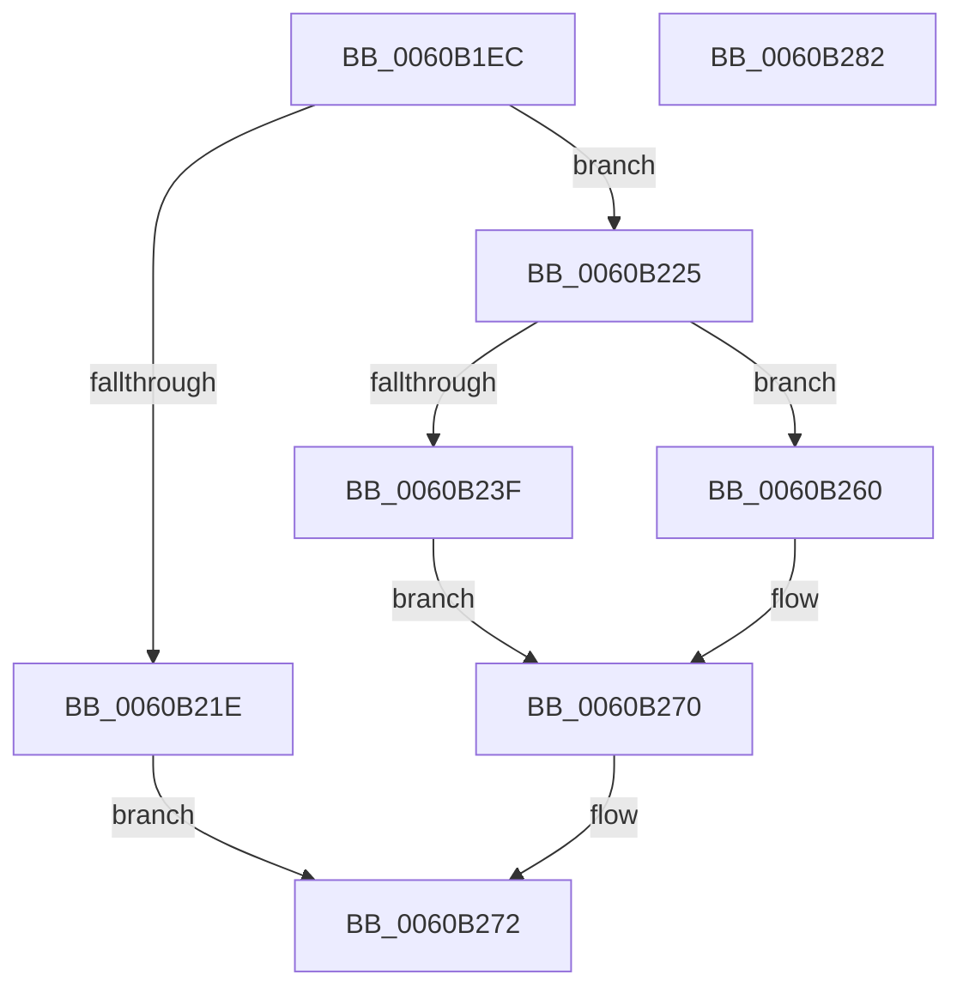

# SepInitializeAntiTamperTable

- RVA: `0x0060B1EC`–`0x0060B283` (길이 `151` bytes)
- VA: `0x000000014060B1EC`
- 실행 섹션: `.text`
- PDB 이름 있음: `예`; PDB Function 태그: `아니요`
- unwind 정보 RVA: `0x00060BC4`
- 디코드: `42`개 명령, `151/151` bytes 표시
- 미해석 바이트: `0` (있으면 어셈블리에 `.byte`로 보존)

> 이 문서는 커널 이미지의 기계어와 PDB 기호를 분석해 생성했습니다. 4번과 5번은 함수 원형과 자료형을 바이너리 사용 방식에서 추정한 C 해석이며 원본 소스 복구 결과는 아닙니다.

## 1. Dependencies

- 직접 호출 지점: **4**; 고유 호출 대상: **4**
- 직접 호출자로 확인된 함수: **1**
- RIP 상대 이미지 참조: **0**

### Outgoing calls
- `0x0060B215` → [RtlpCreateHashTable](../48/RtlpCreateHashTable_function_0048C400.md) (function, `0x0048C400`)
- `0x0060B235` → [ExAllocatePool2](../../poolcode/B8/ExAllocatePool2_function_00B820F0.md) (function, `0x00B820F0`)
- `0x0060B255` → [memset](../6C/memset_function_006C6C40.md) (function, `0x006C6C40`)
- `0x0060B263` → [RtlDeleteHashTable](../48/RtlDeleteHashTable_function_0048C570.md) (function, `0x0048C570`)

### Direct callers
- [SepSetTokenAntiTamperEntry](SepSetTokenAntiTamperEntry_function_0060B28C.md) at `0x0060B451`

### Static image references
- 디코드된 RIP-relative 메모리 참조가 없습니다.

## 2. Other-region calls and transfers

- 다른 실행 섹션으로 향하는 call: **1**
  - `0x0060B235` → [ExAllocatePool2](../../poolcode/B8/ExAllocatePool2_function_00B820F0.md) (`.text` → `POOLCODE`)
- 별도 외부 분기/꼬리 이동을 확인하지 못했습니다.

## 3. Assembly (complete function range)

```asm
0060B1EC  48 89 5C 24 08                  mov qword ptr [rsp + 8], rbx
0060B1F1  48 89 74 24 10                  mov qword ptr [rsp + 0x10], rsi
0060B1F6  57                              push rdi
0060B1F7  48 83 EC 20                     sub rsp, 0x20
0060B1FB  48 8D 79 18                     lea rdi, [rcx + 0x18]
0060B1FF  48 8B F1                        mov rsi, rcx
0060B202  33 DB                           xor ebx, ebx
0060B204  48 8B CF                        mov rcx, rdi
0060B207  45 33 C9                        xor r9d, r9d
0060B20A  48 89 1F                        mov qword ptr [rdi], rbx
0060B20D  45 33 C0                        xor r8d, r8d
0060B210  BA 80 00 00 00                  mov edx, 0x80
0060B215  E8 E6 11 E8 FF                  call 0x14048c400
0060B21A  84 C0                           test al, al
0060B21C  75 07                           jne 0x14060b225
0060B21E  B8 9A 00 00 C0                  mov eax, 0xc000009a
0060B223  EB 4D                           jmp 0x14060b272
0060B225  BA 80 00 00 00                  mov edx, 0x80
0060B22A  B9 00 01 00 00                  mov ecx, 0x100
0060B22F  41 B8 53 65 4C 73               mov r8d, 0x734c6553
0060B235  E8 B6 6E 57 00                  call 0x140b820f0
0060B23A  48 85 C0                        test rax, rax
0060B23D  74 21                           je 0x14060b260
0060B23F  33 D2                           xor edx, edx
0060B241  C7 46 08 00 04 00 00            mov dword ptr [rsi + 8], 0x400
0060B248  41 B8 80 00 00 00               mov r8d, 0x80
0060B24E  48 89 46 10                     mov qword ptr [rsi + 0x10], rax
0060B252  48 8B C8                        mov rcx, rax
0060B255  E8 E6 B9 0B 00                  call 0x1406c6c40
0060B25A  C6 46 20 01                     mov byte ptr [rsi + 0x20], 1
0060B25E  EB 10                           jmp 0x14060b270
0060B260  48 8B 0F                        mov rcx, qword ptr [rdi]
0060B263  E8 08 13 E8 FF                  call 0x14048c570
0060B268  48 89 1F                        mov qword ptr [rdi], rbx
0060B26B  BB 9A 00 00 C0                  mov ebx, 0xc000009a
0060B270  8B C3                           mov eax, ebx
0060B272  48 8B 5C 24 30                  mov rbx, qword ptr [rsp + 0x30]
0060B277  48 8B 74 24 38                  mov rsi, qword ptr [rsp + 0x38]
0060B27C  48 83 C4 20                     add rsp, 0x20
0060B280  5F                              pop rdi
0060B281  C3                              ret
0060B282  CC                              int3
```

## 4. C-style interpretation (structured pseudocode)

```c
__int64 __fastcall SepInitializeAntiTamperTable(__int64 a1, __int64 a2, int a3, int a4)
{
    __int64 result;
    __int64 v_rbx;
    __int64 v_rsp;
    unsigned __int64 v_stack_p10;
    unsigned __int64 v_stack_p8;

    v_stack_p8 = v_rbx;
    v_stack_p10 = v_rsi;
    v_rsp = (v_rsp) - (32);
    v_rbx = 0;
    a4 = 0;
    *(unsigned __int64 *)(a1 + 24) = 0;
    a3 = 0;
    result = RtlpCreateHashTable(a1 + 24, 128, a3, a4);
    if ((unsigned __int8)(result) != 0) goto loc_0060B225;
    goto loc_0060B272;
loc_0060B225:
    result = ExAllocatePool2(256, 128, (unsigned int)(0x734C6553ULL), a4);
    if (result == 0) goto loc_0060B260;
    a2 = 0;
    *(unsigned int *)(a1 + 8) = 0x400ULL;
    *(unsigned __int64 *)(a1 + 16) = result;
    result = memset(result, a2, 128, a4);
    *(unsigned __int8 *)(a1 + 32) = 1;
    goto loc_0060B270;
loc_0060B260:
    result = RtlDeleteHashTable(*(unsigned __int64 *)(a1 + 24), a2, 128, a4);
    *(unsigned __int64 *)(a1 + 24) = 0;
loc_0060B270:
loc_0060B272:
    v_rsp = (v_rsp) + (32);
    return (unsigned int)((unsigned int)((unsigned int)(0xC000009AULL)));
}
```

## 5. (Beta) C Style

```c
int64_t SepInitializeAntiTamperTable(void *Arg1, int64_t Arg2, int32_t Arg3, int32_t Arg4)
{
    uint8_t *arg1 = (uint8_t *)Arg1;

    int64_t result;
    int64_t local_rbx;
    int64_t local_rsp;
    uint64_t v_stack_p10;
    uint64_t v_stack_p8;

    v_stack_p8 = local_rbx;
    v_stack_p10 = local_rsi;
    local_rsp = (local_rsp) - (32);
    local_rbx = 0;
    Arg4 = 0;
    *(uint64_t *)(arg1 + 0x18) = 0;
    Arg3 = 0;
    result = RtlpCreateHashTable(Arg1 + 24, 128, Arg3, Arg4);
    if ((uint8_t)(result) != 0) goto loc_0060B225;
    goto loc_0060B272;
loc_0060B225:
    result = ExAllocatePool2(256, 128, (uint32_t)(0x734C6553ULL), Arg4);
    if (result == 0) goto loc_0060B260;
    Arg2 = 0;
    *(uint32_t *)(arg1 + 0x8) = 0x400ULL;
    *(uint64_t *)(arg1 + 0x10) = result;
    result = memset(result, Arg2, 128, Arg4);
    *(uint8_t *)(arg1 + 0x20) = 1;
    goto loc_0060B270;
loc_0060B260:
    result = RtlDeleteHashTable(*(uint64_t *)(arg1 + 0x18), Arg2, 128, Arg4);
    *(uint64_t *)(arg1 + 0x18) = 0;
loc_0060B270:
loc_0060B272:
    local_rsp = (local_rsp) + (32);
    return (uint32_t)((uint32_t)((uint32_t)(0xC000009AULL)));
}
```

### 관측된 메모리 오프셋

구조체 형식이 확인되지 않은 접근은 인자 기준의 오프셋으로만 기록했습니다.

| 기준 인자 | 오프셋 표현 | 폭 (bit) | 접근 |
|---|---:|---:|---|
| `Arg1` | `+ 0x0` | `64` | `R` |
| `Arg1` | `+ 0x0` | `64` | `W` |
| `Arg1` | `+ 0x8` | `32` | `W` |
| `Arg1` | `+ 0x10` | `64` | `W` |
| `Arg1` | `+ 0x18` | `64` | `R` |
| `Arg1` | `+ 0x20` | `8` | `W` |

## 6. Execution-region graph

[열기: 2D/3D 그래프와 함수 탐색 컨트롤 패널](../../../control-panel.html?section=text&rva=0x0060B1EC&view=graph)

- 2D 그래프는 위에서 아래로 흐르고, 3D 그래프는 빈 공간을 드래그해 회전합니다. Shift+드래그는 이동, 휠은 확대·축소, 함수 노드 선택은 대상 보고서 이동입니다.

### Static fallback


