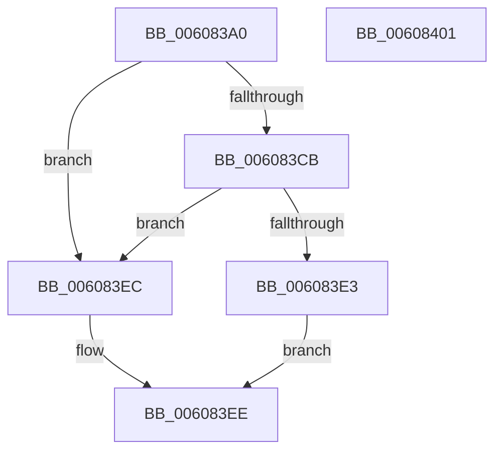

# SepIsAppSuiteSid

- RVA: `0x006083A0`–`0x00608402` (길이 `98` bytes)
- VA: `0x00000001406083A0`
- 실행 섹션: `.text`
- PDB 이름 있음: `예`; PDB Function 태그: `아니요`
- unwind 정보 RVA: `0x000BD6E0`
- 디코드: `28`개 명령, `98/98` bytes 표시
- 미해석 바이트: `0` (있으면 어셈블리에 `.byte`로 보존)

> 이 문서는 커널 이미지의 기계어와 PDB 기호를 분석해 생성했습니다. 4번과 5번은 함수 원형과 자료형을 바이너리 사용 방식에서 추정한 C 해석이며 원본 소스 복구 결과는 아닙니다.

## 1. Dependencies

- 직접 호출 지점: **2**; 고유 호출 대상: **2**
- 직접 호출자로 확인된 함수: **3**
- RIP 상대 이미지 참조: **1**

### Outgoing calls
- `0x006083D8` → [RtlCompareMemory](../6B/RtlCompareMemory_function_006BA670.md) (function, `0x006BA670`)
- `0x006083F6` → [_security_check_cookie](../6A/_security_check_cookie_function_006AC640.md) (function, `0x006AC640`)

### Direct callers
- [SepResolveAntiTamperEntrySids](SepResolveAntiTamperEntrySids_function_0060864C.md) at `0x006086D0`
- [SeQueryInformationToken](../../page/8B/SeQueryInformationToken_function_008B5090.md) at `0x008B60B1`
- [NtQueryInformationToken](../../page/AE/NtQueryInformationToken_function_00AECDD0.md) at `0x00AF0013`

### Static image references
- `0x006083A6` → RVA `0x00E0A740` (`.data`; read)

## 2. Other-region calls and transfers

- 다른 실행 섹션으로 향하는 call: **0**
- 별도 외부 분기/꼬리 이동을 확인하지 못했습니다.

## 3. Assembly (complete function range)

```asm
006083A0  40 53                           push rbx
006083A2  48 83 EC 30                     sub rsp, 0x30
006083A6  48 8B 05 93 23 80 00            mov rax, qword ptr [rip + 0x802393]
006083AD  48 33 C4                        xor rax, rsp
006083B0  48 89 44 24 28                  mov qword ptr [rsp + 0x28], rax
006083B5  33 C0                           xor eax, eax
006083B7  66 C7 44 24 24 00 14            mov word ptr [rsp + 0x24], 0x1400
006083BE  80 79 01 08                     cmp byte ptr [rcx + 1], 8
006083C2  48 8B D9                        mov rbx, rcx
006083C5  89 44 24 20                     mov dword ptr [rsp + 0x20], eax
006083C9  72 21                           jb 0x1406083ec
006083CB  48 83 C1 02                     add rcx, 2
006083CF  44 8D 40 06                     lea r8d, [rax + 6]
006083D3  48 8D 54 24 20                  lea rdx, [rsp + 0x20]
006083D8  E8 93 22 0B 00                  call 0x1406ba670
006083DD  48 83 F8 06                     cmp rax, 6
006083E1  75 09                           jne 0x1406083ec
006083E3  83 7B 08 05                     cmp dword ptr [rbx + 8], 5
006083E7  0F 94 C0                        sete al
006083EA  EB 02                           jmp 0x1406083ee
006083EC  32 C0                           xor al, al
006083EE  48 8B 4C 24 28                  mov rcx, qword ptr [rsp + 0x28]
006083F3  48 33 CC                        xor rcx, rsp
006083F6  E8 45 42 0A 00                  call 0x1406ac640
006083FB  48 83 C4 30                     add rsp, 0x30
006083FF  5B                              pop rbx
00608400  C3                              ret
00608401  CC                              int3
```

## 4. C-style interpretation (structured pseudocode)

```c
__int64 __fastcall SepIsAppSuiteSid(__int64 a1)
{
    __int64 result;
    __int64 v_rsp;
    unsigned __int64 v_stack_m10;
    unsigned __int16 v_stack_m14;
    unsigned int v_stack_m18;

    v_rsp = (v_rsp) - (48);
    result = (*(unsigned __int64 *)(v_rip + 8397715)) ^ (v_rsp);
    v_stack_m10 = result;
    result = 0;
    v_stack_m14 = 0x1400ULL;
    v_stack_m18 = 0;
    if ((*(unsigned __int8 *)(a1 + 1)) < 8) goto loc_006083EC;
    a1 = (a1) + (2);
    result = RtlCompareMemory(a1, v_stack_m18, result + 6, a4);
    if (result != 6) goto loc_006083EC;
    result = ((*(unsigned int *)(a1 + 8)) == 5) ? 1 : 0;
    goto loc_006083EE;
loc_006083EC:
    result = 0;
loc_006083EE:
    a1 = (v_stack_m10) ^ (v_rsp);
    result = _security_check_cookie(a1, v_stack_m18, result + 6, a4);
    v_rsp = (v_rsp) + (48);
    return result;
}
```

## 5. (Beta) C Style

```c
int64_t SepIsAppSuiteSid(void *Arg1)
{
    uint8_t *arg1 = (uint8_t *)Arg1;

    int64_t result;
    int64_t local_rsp;
    uint64_t v_stack_m10;
    uint16_t v_stack_m14;
    uint32_t v_stack_m18;

    local_rsp = (local_rsp) - (48);
    result = (*(uint64_t *)(v_rip + 0x802393)) ^ (local_rsp);
    v_stack_m10 = result;
    result = 0;
    v_stack_m14 = 0x1400ULL;
    v_stack_m18 = 0;
    if ((*(uint8_t *)(arg1 + 0x1)) < 8) goto loc_006083EC;
    Arg1 = (Arg1) + (2);
    result = RtlCompareMemory(Arg1, v_stack_m18, result + 6, a4);
    if (result != 6) goto loc_006083EC;
    result = ((*(uint32_t *)(arg1 + 0x8)) == 5) ? 1 : 0;
    goto loc_006083EE;
loc_006083EC:
    result = 0;
loc_006083EE:
    Arg1 = (v_stack_m10) ^ (local_rsp);
    result = _security_check_cookie(Arg1, v_stack_m18, result + 6, a4);
    local_rsp = (local_rsp) + (48);
    return result;
}
```

### 관측된 메모리 오프셋

구조체 형식이 확인되지 않은 접근은 인자 기준의 오프셋으로만 기록했습니다.

| 기준 인자 | 오프셋 표현 | 폭 (bit) | 접근 |
|---|---:|---:|---|
| `Arg1` | `+ 0x1` | `8` | `R` |
| `Arg1` | `+ 0x8` | `32` | `R` |

## 6. Execution-region graph

[열기: 2D/3D 그래프와 함수 탐색 컨트롤 패널](../../../control-panel.html?section=text&rva=0x006083A0&view=graph)

- 2D 그래프는 위에서 아래로 흐르고, 3D 그래프는 빈 공간을 드래그해 회전합니다. Shift+드래그는 이동, 휠은 확대·축소, 함수 노드 선택은 대상 보고서 이동입니다.

### Static fallback


