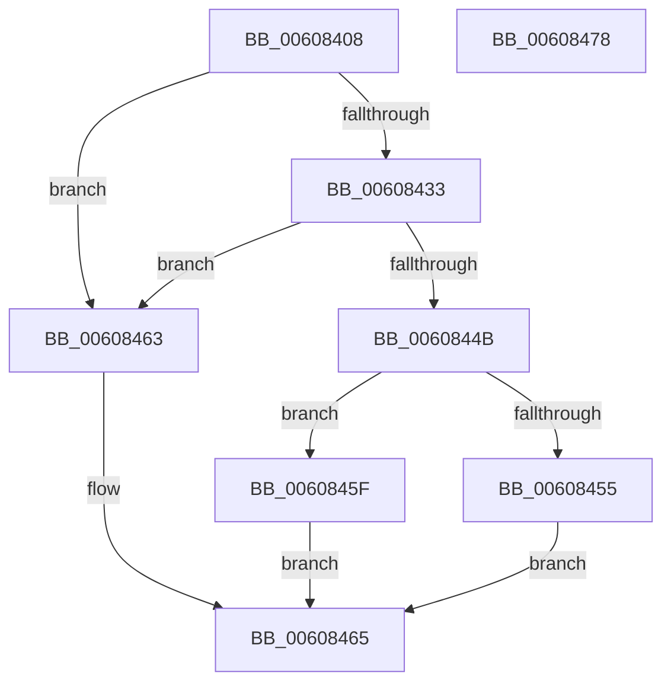

# SepIsTrustLabelSid

- RVA: `0x00608408`–`0x00608479` (길이 `113` bytes)
- VA: `0x0000000140608408`
- 실행 섹션: `.text`
- PDB 이름 있음: `예`; PDB Function 태그: `아니요`
- unwind 정보 RVA: `0x000BD6E0`
- 디코드: `33`개 명령, `113/113` bytes 표시
- 미해석 바이트: `0` (있으면 어셈블리에 `.byte`로 보존)

> 이 문서는 커널 이미지의 기계어와 PDB 기호를 분석해 생성했습니다. 4번과 5번은 함수 원형과 자료형을 바이너리 사용 방식에서 추정한 C 해석이며 원본 소스 복구 결과는 아닙니다.

## 1. Dependencies

- 직접 호출 지점: **2**; 고유 호출 대상: **2**
- 직접 호출자로 확인된 함수: **1**
- RIP 상대 이미지 참조: **1**

### Outgoing calls
- `0x00608440` → [RtlCompareMemory](../6B/RtlCompareMemory_function_006BA670.md) (function, `0x006BA670`)
- `0x0060846D` → [_security_check_cookie](../6A/_security_check_cookie_function_006AC640.md) (function, `0x006AC640`)

### Direct callers
- [SepApplyMandatoryAccess](SepApplyMandatoryAccess_function_00607FF4.md) at `0x0060808F`

### Static image references
- `0x0060840E` → RVA `0x00E0A740` (`.data`; read)

## 2. Other-region calls and transfers

- 다른 실행 섹션으로 향하는 call: **0**
- 별도 외부 분기/꼬리 이동을 확인하지 못했습니다.

## 3. Assembly (complete function range)

```asm
00608408  40 53                           push rbx
0060840A  48 83 EC 30                     sub rsp, 0x30
0060840E  48 8B 05 2B 23 80 00            mov rax, qword ptr [rip + 0x80232b]
00608415  48 33 C4                        xor rax, rsp
00608418  48 89 44 24 28                  mov qword ptr [rsp + 0x28], rax
0060841D  33 C0                           xor eax, eax
0060841F  66 C7 44 24 24 00 13            mov word ptr [rsp + 0x24], 0x1300
00608426  80 79 01 02                     cmp byte ptr [rcx + 1], 2
0060842A  48 8B D9                        mov rbx, rcx
0060842D  89 44 24 20                     mov dword ptr [rsp + 0x20], eax
00608431  75 30                           jne 0x140608463
00608433  48 83 C1 02                     add rcx, 2
00608437  44 8D 40 06                     lea r8d, [rax + 6]
0060843B  48 8D 54 24 20                  lea rdx, [rsp + 0x20]
00608440  E8 2B 22 0B 00                  call 0x1406ba670
00608445  48 83 F8 06                     cmp rax, 6
00608449  75 18                           jne 0x140608463
0060844B  8B 43 08                        mov eax, dword ptr [rbx + 8]
0060844E  3D 00 04 00 00                  cmp eax, 0x400
00608453  74 0A                           je 0x14060845f
00608455  3D 00 02 00 00                  cmp eax, 0x200
0060845A  0F 94 C0                        sete al
0060845D  EB 06                           jmp 0x140608465
0060845F  B0 01                           mov al, 1
00608461  EB 02                           jmp 0x140608465
00608463  32 C0                           xor al, al
00608465  48 8B 4C 24 28                  mov rcx, qword ptr [rsp + 0x28]
0060846A  48 33 CC                        xor rcx, rsp
0060846D  E8 CE 41 0A 00                  call 0x1406ac640
00608472  48 83 C4 30                     add rsp, 0x30
00608476  5B                              pop rbx
00608477  C3                              ret
00608478  CC                              int3
```

## 4. C-style interpretation (structured pseudocode)

```c
__int64 __fastcall SepIsTrustLabelSid(__int64 a1)
{
    __int64 result;
    __int64 v_rsp;
    unsigned __int64 v_stack_m10;
    unsigned __int16 v_stack_m14;
    unsigned int v_stack_m18;

    v_rsp = (v_rsp) - (48);
    result = (*(unsigned __int64 *)(v_rip + 8397611)) ^ (v_rsp);
    v_stack_m10 = result;
    result = 0;
    v_stack_m14 = 0x1300ULL;
    v_stack_m18 = 0;
    if ((*(unsigned __int8 *)(a1 + 1)) != 2) goto loc_00608463;
    a1 = (a1) + (2);
    result = RtlCompareMemory(a1, v_stack_m18, result + 6, a4);
    if (result != 6) goto loc_00608463;
    if (((unsigned int)((unsigned int)(*(unsigned int *)(a1 + 8)))) == 0x400ULL) goto loc_0060845F;
    result = (((unsigned int)((unsigned int)(*(unsigned int *)(a1 + 8)))) == 512) ? 1 : 0;
    goto loc_00608465;
loc_0060845F:
    goto loc_00608465;
loc_00608463:
    result = 0;
loc_00608465:
    a1 = (v_stack_m10) ^ (v_rsp);
    result = _security_check_cookie(a1, v_stack_m18, result + 6, a4);
    v_rsp = (v_rsp) + (48);
    return result;
}
```

## 5. (Beta) C Style

```c
int64_t SepIsTrustLabelSid(void *Arg1)
{
    uint8_t *arg1 = (uint8_t *)Arg1;

    int64_t result;
    int64_t local_rsp;
    uint64_t v_stack_m10;
    uint16_t v_stack_m14;
    uint32_t v_stack_m18;

    local_rsp = (local_rsp) - (48);
    result = (*(uint64_t *)(v_rip + 0x80232B)) ^ (local_rsp);
    v_stack_m10 = result;
    result = 0;
    v_stack_m14 = 0x1300ULL;
    v_stack_m18 = 0;
    if ((*(uint8_t *)(arg1 + 0x1)) != 2) goto loc_00608463;
    Arg1 = (Arg1) + (2);
    result = RtlCompareMemory(Arg1, v_stack_m18, result + 6, a4);
    if (result != 6) goto loc_00608463;
    if (((uint32_t)((uint32_t)(*(uint32_t *)(arg1 + 0x8)))) == 0x400ULL) goto loc_0060845F;
    result = (((uint32_t)((uint32_t)(*(uint32_t *)(arg1 + 0x8)))) == 512) ? 1 : 0;
    goto loc_00608465;
loc_0060845F:
    goto loc_00608465;
loc_00608463:
    result = 0;
loc_00608465:
    Arg1 = (v_stack_m10) ^ (local_rsp);
    result = _security_check_cookie(Arg1, v_stack_m18, result + 6, a4);
    local_rsp = (local_rsp) + (48);
    return result;
}
```

### 관측된 메모리 오프셋

구조체 형식이 확인되지 않은 접근은 인자 기준의 오프셋으로만 기록했습니다.

| 기준 인자 | 오프셋 표현 | 폭 (bit) | 접근 |
|---|---:|---:|---|
| `Arg1` | `+ 0x1` | `8` | `R` |
| `Arg1` | `+ 0x8` | `32` | `R` |

## 6. Execution-region graph

[열기: 2D/3D 그래프와 함수 탐색 컨트롤 패널](../../../control-panel.html?section=text&rva=0x00608408&view=graph)

- 2D 그래프는 위에서 아래로 흐르고, 3D 그래프는 빈 공간을 드래그해 회전합니다. Shift+드래그는 이동, 휠은 확대·축소, 함수 노드 선택은 대상 보고서 이동입니다.

### Static fallback


