# SepMandatoryAccessCheck

- RVA: `0x00608480`–`0x00608644` (길이 `452` bytes)
- VA: `0x0000000140608480`
- 실행 섹션: `.text`
- PDB 이름 있음: `예`; PDB Function 태그: `아니요`
- unwind 정보 RVA: `0x000D0FD0`
- 디코드: `130`개 명령, `452/452` bytes 표시
- 미해석 바이트: `0` (있으면 어셈블리에 `.byte`로 보존)

> 이 문서는 커널 이미지의 기계어와 PDB 기호를 분석해 생성했습니다. 4번과 5번은 함수 원형과 자료형을 바이너리 사용 방식에서 추정한 C 해석이며 원본 소스 복구 결과는 아닙니다.

## 1. Dependencies

- 직접 호출 지점: **7**; 고유 호출 대상: **7**
- 직접 호출자로 확인된 함수: **6**
- RIP 상대 이미지 참조: **0**

### Outgoing calls
- `0x00608513` → [ExAcquireResourceSharedLite](../21/ExAcquireResourceSharedLite_function_00211BC0.md) (function, `0x00211BC0`)
- `0x00608538` → [SeLockSubjectContext](../../page/8C/SeLockSubjectContext_function_008C64C0.md) (function, `0x008C64C0`)
- `0x00608592` → [SepApplyMandatoryAppAccess](SepApplyMandatoryAppAccess_function_006080D4.md) (function, `0x006080D4`)
- `0x006085B0` → [SepApplyMandatoryAccess](SepApplyMandatoryAccess_function_00607FF4.md) (function, `0x00607FF4`)
- `0x00608613` → [ExReleaseResourceLite](../25/ExReleaseResourceLite_function_0025FA10.md) (function, `0x0025FA10`)
- `0x00608618` → [KeLeaveCriticalRegion](../25/KeLeaveCriticalRegion_function_0025D8B0.md) (function, `0x0025D8B0`)
- `0x00608622` → [SeUnlockSubjectContext](../../page/8C/SeUnlockSubjectContext_function_008C6520.md) (function, `0x008C6520`)

### Direct callers
- [SeAccessCheckWithHint](../3A/SeAccessCheckWithHint_function_003A6C30.md) at `0x003A6F73`
- [SeAccessCheckByType](../44/SeAccessCheckByType_function_00440BC8.md) at `0x004413B2`
- [SepCommonAccessCheckEx](../47/SepCommonAccessCheckEx_function_0047602C.md) at `0x004765DA`
- [SeAdjustAntiTamperCreatorAccess](SeAdjustAntiTamperCreatorAccess_function_00607590.md) at `0x00607666`
- [SeComputeMandatoryDeniedAccess](SeComputeMandatoryDeniedAccess_function_006076BC.md) at `0x0060773F`
- [SepAccessCheckAndAuditAlarm](../../page/A1/SepAccessCheckAndAuditAlarm_function_00A1AF4C.md) at `0x00A1B9A7`

### Static image references
- 디코드된 RIP-relative 메모리 참조가 없습니다.

## 2. Other-region calls and transfers

- 다른 실행 섹션으로 향하는 call: **2**
  - `0x00608538` → [SeLockSubjectContext](../../page/8C/SeLockSubjectContext_function_008C64C0.md) (`.text` → `PAGE`)
  - `0x00608622` → [SeUnlockSubjectContext](../../page/8C/SeUnlockSubjectContext_function_008C6520.md) (`.text` → `PAGE`)
- 별도 외부 분기/꼬리 이동을 확인하지 못했습니다.

## 3. Assembly (complete function range)

```asm
00608480  48 8B C4                        mov rax, rsp
00608483  48 89 58 10                     mov qword ptr [rax + 0x10], rbx
00608487  48 89 68 18                     mov qword ptr [rax + 0x18], rbp
0060848B  48 89 78 20                     mov qword ptr [rax + 0x20], rdi
0060848F  41 54                           push r12
00608491  41 56                           push r14
00608493  41 57                           push r15
00608495  48 83 EC 30                     sub rsp, 0x30
00608499  49 8B E8                        mov rbp, r8
0060849C  4C 8B E2                        mov r12, rdx
0060849F  45 33 C0                        xor r8d, r8d
006084A2  41 8B D8                        mov ebx, r8d
006084A5  44 89 44 24 2C                  mov dword ptr [rsp + 0x2c], r8d
006084AA  89 58 08                        mov dword ptr [rax + 8], ebx
006084AD  48 8B 44 24 78                  mov rax, qword ptr [rsp + 0x78]
006084B2  44 89 44 24 28                  mov dword ptr [rsp + 0x28], r8d
006084B7  44 89 00                        mov dword ptr [rax], r8d
006084BA  0F B7 41 02                     movzx eax, word ptr [rcx + 2]
006084BE  A8 10                           test al, 0x10
006084C0  0F 84 61 01 00 00               je 0x140608627
006084C6  66 85 C0                        test ax, ax
006084C9  79 12                           jns 0x1406084dd
006084CB  8B 41 0C                        mov eax, dword ptr [rcx + 0xc]
006084CE  85 C0                           test eax, eax
006084D0  75 05                           jne 0x1406084d7
006084D2  41 8B F8                        mov edi, r8d
006084D5  EB 0A                           jmp 0x1406084e1
006084D7  48 8D 3C 01                     lea rdi, [rcx + rax]
006084DB  EB 04                           jmp 0x1406084e1
006084DD  48 8B 79 18                     mov rdi, qword ptr [rcx + 0x18]
006084E1  48 85 FF                        test rdi, rdi
006084E4  0F 84 3D 01 00 00               je 0x140608627
006084EA  0F B7 57 04                     movzx edx, word ptr [rdi + 4]
006084EE  89 54 24 20                     mov dword ptr [rsp + 0x20], edx
006084F2  48 85 ED                        test rbp, rbp
006084F5  74 39                           je 0x140608530
006084F7  45 84 C9                        test r9b, r9b
006084FA  74 2F                           je 0x14060852b
006084FC  65 48 8B 04 25 88 01 00 00      mov rax, qword ptr gs:[0x188]
00608505  B2 01                           mov dl, 1
00608507  66 FF 88 E4 01 00 00            dec word ptr [rax + 0x1e4]
0060850E  90                              nop
0060850F  48 8B 4D 30                     mov rcx, qword ptr [rbp + 0x30]
00608513  E8 A8 96 C0 FF                  call 0x140211bc0
00608518  8B 54 24 20                     mov edx, dword ptr [rsp + 0x20]
0060851C  45 33 C0                        xor r8d, r8d
0060851F  8B 5C 24 50                     mov ebx, dword ptr [rsp + 0x50]
00608523  C7 44 24 2C 01 00 00 00         mov dword ptr [rsp + 0x2c], 1
0060852B  4C 8B F5                        mov r14, rbp
0060852E  EB 2A                           jmp 0x14060855a
00608530  45 84 C9                        test r9b, r9b
00608533  74 17                           je 0x14060854c
00608535  49 8B CC                        mov rcx, r12
00608538  E8 83 DF 2B 00                  call 0x1408c64c0
0060853D  8B 54 24 20                     mov edx, dword ptr [rsp + 0x20]
00608541  45 33 C0                        xor r8d, r8d
00608544  C7 44 24 2C 01 00 00 00         mov dword ptr [rsp + 0x2c], 1
0060854C  4D 8B 34 24                     mov r14, qword ptr [r12]
00608550  4D 85 F6                        test r14, r14
00608553  75 05                           jne 0x14060855a
00608555  4D 8B 74 24 10                  mov r14, qword ptr [r12 + 0x10]
0060855A  48 83 C7 08                     add rdi, 8
0060855E  41 8B C8                        mov ecx, r8d
00608561  89 4C 24 24                     mov dword ptr [rsp + 0x24], ecx
00608565  85 D2                           test edx, edx
00608567  0F 84 96 00 00 00               je 0x140608603
0060856D  44 8B 7C 24 70                  mov r15d, dword ptr [rsp + 0x70]
00608572  41 81 E7 00 00 00 02            and r15d, 0x2000000
00608579  8A 07                           mov al, byte ptr [rdi]
0060857B  3C 16                           cmp al, 0x16
0060857D  75 1A                           jne 0x140608599
0060857F  4C 8D 44 24 50                  lea r8, [rsp + 0x50]
00608584  C7 44 24 28 01 00 00 00         mov dword ptr [rsp + 0x28], 1
0060858C  48 8B D7                        mov rdx, rdi
0060858F  49 8B CE                        mov rcx, r14
00608592  E8 3D FB FF FF                  call 0x1406080d4
00608597  EB 1C                           jmp 0x1406085b5
00608599  3C 17                           cmp al, 0x17
0060859B  75 27                           jne 0x1406085c4
0060859D  4C 8D 44 24 50                  lea r8, [rsp + 0x50]
006085A2  C7 44 24 28 01 00 00 00         mov dword ptr [rsp + 0x28], 1
006085AA  48 8B D7                        mov rdx, rdi
006085AD  49 8B CE                        mov rcx, r14
006085B0  E8 3F FA FF FF                  call 0x140607ff4
006085B5  8B 54 24 20                     mov edx, dword ptr [rsp + 0x20]
006085B9  45 33 C0                        xor r8d, r8d
006085BC  8B 4C 24 24                     mov ecx, dword ptr [rsp + 0x24]
006085C0  8B 5C 24 50                     mov ebx, dword ptr [rsp + 0x50]
006085C4  45 85 FF                        test r15d, r15d
006085C7  75 0C                           jne 0x1406085d5
006085C9  8B C3                           mov eax, ebx
006085CB  23 44 24 70                     and eax, dword ptr [rsp + 0x70]
006085CF  3B 44 24 70                     cmp eax, dword ptr [rsp + 0x70]
006085D3  74 13                           je 0x1406085e8
006085D5  0F B7 47 02                     movzx eax, word ptr [rdi + 2]
006085D9  FF C1                           inc ecx
006085DB  48 03 F8                        add rdi, rax
006085DE  89 4C 24 24                     mov dword ptr [rsp + 0x24], ecx
006085E2  3B CA                           cmp ecx, edx
006085E4  72 93                           jb 0x140608579
006085E6  EB 02                           jmp 0x1406085ea
006085E8  8B D8                           mov ebx, eax
006085EA  83 7C 24 28 00                  cmp dword ptr [rsp + 0x28], 0
006085EF  74 12                           je 0x140608603
006085F1  48 8B 44 24 78                  mov rax, qword ptr [rsp + 0x78]
006085F6  45 85 FF                        test r15d, r15d
006085F9  75 04                           jne 0x1406085ff
006085FB  23 5C 24 70                     and ebx, dword ptr [rsp + 0x70]
006085FF  F7 D3                           not ebx
00608601  89 18                           mov dword ptr [rax], ebx
00608603  44 39 44 24 2C                  cmp dword ptr [rsp + 0x2c], r8d
00608608  74 1D                           je 0x140608627
0060860A  48 85 ED                        test rbp, rbp
0060860D  74 10                           je 0x14060861f
0060860F  48 8B 4D 30                     mov rcx, qword ptr [rbp + 0x30]
00608613  E8 F8 73 C5 FF                  call 0x14025fa10
00608618  E8 93 52 C5 FF                  call 0x14025d8b0
0060861D  EB 08                           jmp 0x140608627
0060861F  49 8B CC                        mov rcx, r12
00608622  E8 F9 DE 2B 00                  call 0x1408c6520
00608627  48 8B 5C 24 58                  mov rbx, qword ptr [rsp + 0x58]
0060862C  33 C0                           xor eax, eax
0060862E  48 8B 6C 24 60                  mov rbp, qword ptr [rsp + 0x60]
00608633  48 8B 7C 24 68                  mov rdi, qword ptr [rsp + 0x68]
00608638  48 83 C4 30                     add rsp, 0x30
0060863C  41 5F                           pop r15
0060863E  41 5E                           pop r14
00608640  41 5C                           pop r12
00608642  C3                              ret
00608643  CC                              int3
```

## 4. C-style interpretation (structured pseudocode)

```c
__int64 __fastcall SepMandatoryAccessCheck(__int64 a1, __int64 a2, __int64 a3, unsigned __int8 a4, unsigned int a5, __int64 a6)
{
    __int64 result;
    __int64 v_r14;
    __int64 v_r15;
    __int64 v_rbx;
    __int64 v_rdi;
    __int64 v_rsp;
    unsigned int v_stack_m1C;
    unsigned int v_stack_m20;
    unsigned int v_stack_m24;
    unsigned int v_stack_m28;
    unsigned __int64 v_stack_p10;
    unsigned __int64 v_stack_p18;
    unsigned __int64 v_stack_p20;
    unsigned int v_stack_p8;

    *(unsigned __int64 *)(v_rsp + 16) = v_rbx;
    *(unsigned __int64 *)(v_rsp + 24) = v_rbp;
    *(unsigned __int64 *)(v_rsp + 32) = v_rdi;
    v_rsp = (v_rsp) - (48);
    a3 = 0;
    v_stack_m1C = 0;
    *(unsigned int *)(v_rsp + 8) = 0;
    v_stack_m20 = 0;
    *(unsigned int *)(a6) = 0;
    if ((((unsigned __int8)(*(unsigned __int16 *)(a1 + 2))) & (16)) == 0) goto loc_00608627;
    if (!sign_flag) goto loc_006084DD;
    if ((unsigned int)((unsigned int)(*(unsigned int *)(a1 + 12))) != 0) goto loc_006084D7;
    goto loc_006084E1;
loc_006084D7:
    goto loc_006084E1;
loc_006084DD:
loc_006084E1:
    if (*(unsigned __int64 *)(a1 + 24) == 0) goto loc_00608627;
    v_stack_m28 = (unsigned int)(*(unsigned __int16 *)(*(unsigned __int64 *)(a1 + 24) + 4));
    if (0 == 0) goto loc_00608530;
    result = (unsigned int)(*(unsigned int *)(a1 + 12));
    v_rbx = 0;
    if (a4 != 0) {
        result = *(unsigned __int64 *)(gs_base + (0 + 392));
        a2 = 1;
        a1 = *(unsigned __int64 *)(a3 + 48);
        result = ExAcquireResourceSharedLite(a1, a2, a3, a4);
        a2 = v_stack_m28;
        a3 = 0;
        v_rbx = v_stack_p8;
        v_stack_m1C = 1;
    }
    goto loc_0060855A;
loc_00608530:
    if (a4 != 0) {
        a1 = a2;
        result = SeLockSubjectContext(a1, a2, a3, a4);
        a2 = v_stack_m28;
        a3 = 0;
        v_stack_m1C = 1;
    }
    v_r14 = *(unsigned __int64 *)(a2);
    if (*(unsigned __int64 *)(a2) == 0) {
        v_r14 = *(unsigned __int64 *)(a2 + 16);
    }
    v_rdi = (*(unsigned __int64 *)(a1 + 24)) + (8);
    v_stack_m24 = 0;
    if ((unsigned int)(a2) == 0) goto loc_00608603;
    v_r15 = (unsigned int)(((unsigned int)(a5)) & (0x2000000ULL));
loc_00608579:
    if (((unsigned __int8)(*(unsigned __int8 *)(v_rdi))) != 22) goto loc_00608599;
    v_stack_m20 = 1;
    result = SepApplyMandatoryAppAccess(v_r14, v_rdi, v_stack_p8, a4);
    goto loc_006085B5;
loc_00608599:
    if (((unsigned __int8)(result)) != 23) goto loc_006085C4;
    v_stack_m20 = 1;
    result = SepApplyMandatoryAccess(v_r14, v_rdi, v_stack_p8, a4);
loc_006085B5:
    a3 = 0;
loc_006085C4:
    if ((unsigned int)(v_r15) != 0) goto loc_006085D5;
    result = (unsigned int)(((unsigned int)((unsigned int)((unsigned int)(v_stack_p8)))) & (a5));
    if (((unsigned int)(result)) == a5) goto loc_006085E8;
loc_006085D5:
    a1 = (unsigned int)(((unsigned int)(v_stack_m24)) + 1);
    v_rdi = (v_rdi) + (*(unsigned __int16 *)(v_rdi + 2));
    v_stack_m24 = (unsigned int)(a1);
    if (((unsigned int)(a1)) < ((unsigned int)((unsigned int)(v_stack_m28)))) goto loc_00608579;
    goto loc_006085EA;
loc_006085E8:
loc_006085EA:
    if (v_stack_m20 == 0) goto loc_00608603;
    v_rbx = (unsigned int)((unsigned int)(*(unsigned __int16 *)(v_rdi + 2)));
    if ((unsigned int)(v_r15) == 0) {
        v_rbx = (unsigned int)(((unsigned int)((unsigned int)(*(unsigned __int16 *)(v_rdi + 2)))) & (a5));
    }
    v_rbx = (unsigned int)(~(v_rbx));
    *(unsigned int *)(a6) = (unsigned int)(v_rbx);
loc_00608603:
    if (v_stack_m1C == 0) goto loc_00608627;
    if (0 == 0) goto loc_0060861F;
    result = ExReleaseResourceLite(*(unsigned __int64 *)(a3 + 48), (unsigned int)(v_stack_m28), a3, a4);
    result = KeLeaveCriticalRegion(*(unsigned __int64 *)(a3 + 48), (unsigned int)(v_stack_m28), a3, a4);
    goto loc_00608627;
loc_0060861F:
    result = SeUnlockSubjectContext(a2, (unsigned int)(v_stack_m28), a3, a4);
loc_00608627:
    result = 0;
    v_rsp = (v_rsp) + (48);
    return result;
}
```

## 5. (Beta) C Style

```c
int64_t SepMandatoryAccessCheck(void *Arg1, void *Arg2, int64_t Arg3, uint8_t Arg4, uint32_t Arg5, void *Arg6)
{
    uint8_t *arg1 = (uint8_t *)Arg1;
    uint8_t *arg2 = (uint8_t *)Arg2;
    uint8_t *arg6 = (uint8_t *)Arg6;

    int64_t result;
    int64_t local_r14;
    int64_t local_r15;
    int64_t local_rbx;
    int64_t local_rdi;
    int64_t local_rsp;
    uint32_t v_stack_m1C;
    uint32_t v_stack_m20;
    uint32_t v_stack_m24;
    uint32_t v_stack_m28;
    uint64_t v_stack_p10;
    uint64_t v_stack_p18;
    uint64_t v_stack_p20;
    uint32_t v_stack_p8;

    *(uint64_t *)(local_rsp + 0x10) = local_rbx;
    *(uint64_t *)(local_rsp + 0x18) = local_rbp;
    *(uint64_t *)(local_rsp + 0x20) = local_rdi;
    local_rsp = (local_rsp) - (48);
    Arg3 = 0;
    v_stack_m1C = 0;
    *(uint32_t *)(local_rsp + 0x8) = 0;
    v_stack_m20 = 0;
    *(uint32_t *)(arg6) = 0;
    if ((((uint8_t)(*(uint16_t *)(arg1 + 0x2))) & (16)) == 0) goto loc_00608627;
    if (!sign_flag) goto loc_006084DD;
    if ((uint32_t)((uint32_t)(*(uint32_t *)(arg1 + 0xC))) != 0) goto loc_006084D7;
    goto loc_006084E1;
loc_006084D7:
    goto loc_006084E1;
loc_006084DD:
loc_006084E1:
    if (*(uint64_t *)(arg1 + 0x18) == 0) goto loc_00608627;
    v_stack_m28 = (uint32_t)(*(uint16_t *)(*(uint64_t *)(arg1 + 0x18) + 0x4));
    if (0 == 0) goto loc_00608530;
    result = (uint32_t)(*(uint32_t *)(arg1 + 0xC));
    local_rbx = 0;
    if (Arg4 != 0) {
        result = *(uint64_t *)(gs_base + (0 + 0x188));
        Arg2 = 1;
        Arg1 = *(uint64_t *)(Arg3 + 0x30);
        result = ExAcquireResourceSharedLite(Arg1, Arg2, Arg3, Arg4);
        Arg2 = v_stack_m28;
        Arg3 = 0;
        local_rbx = v_stack_p8;
        v_stack_m1C = 1;
    }
    goto loc_0060855A;
loc_00608530:
    if (Arg4 != 0) {
        Arg1 = Arg2;
        result = SeLockSubjectContext(Arg1, Arg2, Arg3, Arg4);
        Arg2 = v_stack_m28;
        Arg3 = 0;
        v_stack_m1C = 1;
    }
    local_r14 = *(uint64_t *)(arg2);
    if (*(uint64_t *)(arg2) == 0) {
        local_r14 = *(uint64_t *)(arg2 + 0x10);
    }
    local_rdi = (*(uint64_t *)(arg1 + 0x18)) + (8);
    v_stack_m24 = 0;
    if ((uint32_t)(Arg2) == 0) goto loc_00608603;
    local_r15 = (uint32_t)(((uint32_t)(Arg5)) & (0x2000000ULL));
loc_00608579:
    if (((uint8_t)(*(uint8_t *)(local_rdi))) != 22) goto loc_00608599;
    v_stack_m20 = 1;
    result = SepApplyMandatoryAppAccess(local_r14, local_rdi, v_stack_p8, Arg4);
    goto loc_006085B5;
loc_00608599:
    if (((uint8_t)(result)) != 23) goto loc_006085C4;
    v_stack_m20 = 1;
    result = SepApplyMandatoryAccess(local_r14, local_rdi, v_stack_p8, Arg4);
loc_006085B5:
    Arg3 = 0;
loc_006085C4:
    if ((uint32_t)(local_r15) != 0) goto loc_006085D5;
    result = (uint32_t)(((uint32_t)((uint32_t)((uint32_t)(v_stack_p8)))) & (Arg5));
    if (((uint32_t)(result)) == Arg5) goto loc_006085E8;
loc_006085D5:
    Arg1 = (uint32_t)(((uint32_t)(v_stack_m24)) + 1);
    local_rdi = (local_rdi) + (*(uint16_t *)(local_rdi + 0x2));
    v_stack_m24 = (uint32_t)(Arg1);
    if (((uint32_t)(Arg1)) < ((uint32_t)((uint32_t)(v_stack_m28)))) goto loc_00608579;
    goto loc_006085EA;
loc_006085E8:
loc_006085EA:
    if (v_stack_m20 == 0) goto loc_00608603;
    local_rbx = (uint32_t)((uint32_t)(*(uint16_t *)(local_rdi + 0x2)));
    if ((uint32_t)(local_r15) == 0) {
        local_rbx = (uint32_t)(((uint32_t)((uint32_t)(*(uint16_t *)(local_rdi + 0x2)))) & (Arg5));
    }
    local_rbx = (uint32_t)(~(local_rbx));
    *(uint32_t *)(arg6) = (uint32_t)(local_rbx);
loc_00608603:
    if (v_stack_m1C == 0) goto loc_00608627;
    if (0 == 0) goto loc_0060861F;
    result = ExReleaseResourceLite(*(uint64_t *)(Arg3 + 0x30), (uint32_t)(v_stack_m28), Arg3, Arg4);
    result = KeLeaveCriticalRegion(*(uint64_t *)(Arg3 + 0x30), (uint32_t)(v_stack_m28), Arg3, Arg4);
    goto loc_00608627;
loc_0060861F:
    result = SeUnlockSubjectContext(Arg2, (uint32_t)(v_stack_m28), Arg3, Arg4);
loc_00608627:
    result = 0;
    local_rsp = (local_rsp) + (48);
    return result;
}
```

### 관측된 메모리 오프셋

구조체 형식이 확인되지 않은 접근은 인자 기준의 오프셋으로만 기록했습니다.

| 기준 인자 | 오프셋 표현 | 폭 (bit) | 접근 |
|---|---:|---:|---|
| `Arg1` | `+ 0x0 + rax*1` | `64` | `R` |
| `Arg1` | `+ 0x2` | `16` | `R` |
| `Arg1` | `+ 0xC` | `32` | `R` |
| `Arg1` | `+ 0x18` | `64` | `R` |
| `Arg2` | `+ 0x0` | `64` | `R` |
| `Arg2` | `+ 0x10` | `64` | `R` |
| `Arg6` | `+ 0x0` | `32` | `W` |

## 6. Execution-region graph

[열기: 2D/3D 그래프와 함수 탐색 컨트롤 패널](../../../control-panel.html?section=text&rva=0x00608480&view=graph)

- 2D 그래프는 위에서 아래로 흐르고, 3D 그래프는 빈 공간을 드래그해 회전합니다. Shift+드래그는 이동, 휠은 확대·축소, 함수 노드 선택은 대상 보고서 이동입니다.

### Static fallback

```mermaid
flowchart TD
  bb_00608480[BB_00608480]
  bb_006084C6[BB_006084C6]
  bb_006084CB[BB_006084CB]
  bb_006084D2[BB_006084D2]
  bb_006084D7[BB_006084D7]
  bb_006084DD[BB_006084DD]
  bb_006084E1[BB_006084E1]
  bb_006084EA[BB_006084EA]
  bb_006084F7[BB_006084F7]
  bb_006084FC[BB_006084FC]
  bb_0060852B[BB_0060852B]
  bb_00608530[BB_00608530]
  bb_00608535[BB_00608535]
  bb_0060854C[BB_0060854C]
  bb_00608555[BB_00608555]
  bb_0060855A[BB_0060855A]
  bb_0060856D[BB_0060856D]
  bb_00608579[BB_00608579]
  bb_0060857F[BB_0060857F]
  bb_00608599[BB_00608599]
  bb_0060859D[BB_0060859D]
  bb_006085B5[BB_006085B5]
  bb_006085C4[BB_006085C4]
  bb_006085C9[BB_006085C9]
  bb_006085D5[BB_006085D5]
  bb_006085E6[BB_006085E6]
  bb_006085E8[BB_006085E8]
  bb_006085EA[BB_006085EA]
  bb_006085F1[BB_006085F1]
  bb_006085FB[BB_006085FB]
  bb_006085FF[BB_006085FF]
  bb_00608603[BB_00608603]
  bb_0060860A[BB_0060860A]
  bb_0060860F[BB_0060860F]
  bb_0060861F[BB_0060861F]
  bb_00608627[BB_00608627]
  bb_00608643[BB_00608643]
  bb_00608480 -->|branch| bb_00608627
  bb_00608480 -->|fallthrough| bb_006084C6
  bb_006084C6 -->|branch| bb_006084DD
  bb_006084C6 -->|fallthrough| bb_006084CB
  bb_006084CB -->|branch| bb_006084D7
  bb_006084CB -->|fallthrough| bb_006084D2
  bb_006084D2 -->|branch| bb_006084E1
  bb_006084D7 -->|branch| bb_006084E1
  bb_006084DD -->|flow| bb_006084E1
  bb_006084E1 -->|branch| bb_00608627
  bb_006084E1 -->|fallthrough| bb_006084EA
  bb_006084EA -->|branch| bb_00608530
  bb_006084EA -->|fallthrough| bb_006084F7
  bb_006084F7 -->|branch| bb_0060852B
  bb_006084F7 -->|fallthrough| bb_006084FC
  bb_006084FC -->|flow| bb_0060852B
  bb_0060852B -->|branch| bb_0060855A
  bb_00608530 -->|branch| bb_0060854C
  bb_00608530 -->|fallthrough| bb_00608535
  bb_00608535 -->|flow| bb_0060854C
  bb_0060854C -->|branch| bb_0060855A
  bb_0060854C -->|fallthrough| bb_00608555
  bb_00608555 -->|flow| bb_0060855A
  bb_0060855A -->|branch| bb_00608603
  bb_0060855A -->|fallthrough| bb_0060856D
  bb_0060856D -->|flow| bb_00608579
  bb_00608579 -->|branch| bb_00608599
  bb_00608579 -->|fallthrough| bb_0060857F
  bb_0060857F -->|branch| bb_006085B5
  bb_00608599 -->|branch| bb_006085C4
  bb_00608599 -->|fallthrough| bb_0060859D
  bb_0060859D -->|flow| bb_006085B5
  bb_006085B5 -->|flow| bb_006085C4
  bb_006085C4 -->|branch| bb_006085D5
  bb_006085C4 -->|fallthrough| bb_006085C9
  bb_006085C9 -->|branch| bb_006085E8
  bb_006085C9 -->|fallthrough| bb_006085D5
  bb_006085D5 -->|branch| bb_00608579
  bb_006085D5 -->|fallthrough| bb_006085E6
  bb_006085E6 -->|branch| bb_006085EA
  bb_006085E8 -->|flow| bb_006085EA
  bb_006085EA -->|branch| bb_00608603
  bb_006085EA -->|fallthrough| bb_006085F1
  bb_006085F1 -->|branch| bb_006085FF
  bb_006085F1 -->|fallthrough| bb_006085FB
  bb_006085FB -->|flow| bb_006085FF
  bb_006085FF -->|flow| bb_00608603
  bb_00608603 -->|branch| bb_00608627
  bb_00608603 -->|fallthrough| bb_0060860A
  bb_0060860A -->|branch| bb_0060861F
  bb_0060860A -->|fallthrough| bb_0060860F
  bb_0060860F -->|branch| bb_00608627
  bb_0060861F -->|flow| bb_00608627
```


