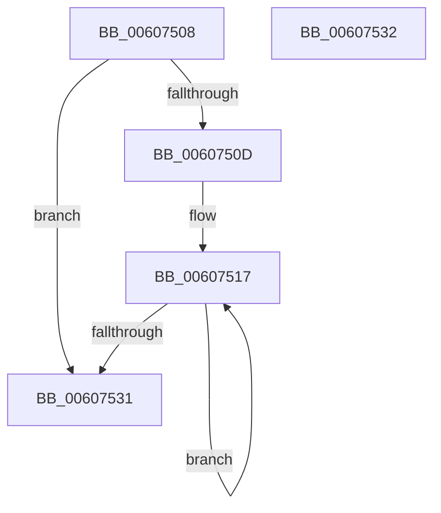

# SepMergeObjectTypeListAccesses

- RVA: `0x00607508`–`0x00607533` (길이 `43` bytes)
- VA: `0x0000000140607508`
- 실행 섹션: `.text`
- PDB 이름 있음: `예`; PDB Function 태그: `아니요`
- unwind 정보 RVA: `0x000DB714`
- 디코드: `14`개 명령, `43/43` bytes 표시
- 미해석 바이트: `0` (있으면 어셈블리에 `.byte`로 보존)

> 이 문서는 커널 이미지의 기계어와 PDB 기호를 분석해 생성했습니다. 4번과 5번은 함수 원형과 자료형을 바이너리 사용 방식에서 추정한 C 해석이며 원본 소스 복구 결과는 아닙니다.

## 1. Dependencies

- 직접 호출 지점: **0**; 고유 호출 대상: **0**
- 직접 호출자로 확인된 함수: **2**
- RIP 상대 이미지 참조: **0**

### Outgoing calls
- 직접 디코드된 call 명령이 없습니다.

### Direct callers
- [SeAccessCheckByType](../44/SeAccessCheckByType_function_00440BC8.md) at `0x00442108`
- [SepAccessCheckAndAuditAlarm](../../page/A1/SepAccessCheckAndAuditAlarm_function_00A1AF4C.md) at `0x00A1C3A0`
- [SepAccessCheckAndAuditAlarm](../../page/A1/SepAccessCheckAndAuditAlarm_function_00A1AF4C.md) at `0x00A1CC53`

### Static image references
- 디코드된 RIP-relative 메모리 참조가 없습니다.

## 2. Other-region calls and transfers

- 다른 실행 섹션으로 향하는 call: **0**
- 별도 외부 분기/꼬리 이동을 확인하지 못했습니다.

## 3. Assembly (complete function range)

```asm
00607508  45 85 C0                        test r8d, r8d
0060750B  74 24                           je 0x140607531
0060750D  4C 8D 49 1C                     lea r9, [rcx + 0x1c]
00607511  48 2B D1                        sub rdx, rcx
00607514  41 8B C8                        mov ecx, r8d
00607517  42 8B 04 0A                     mov eax, dword ptr [rdx + r9]
0060751B  41 21 01                        and dword ptr [r9], eax
0060751E  42 8B 44 0A 04                  mov eax, dword ptr [rdx + r9 + 4]
00607523  41 09 41 04                     or dword ptr [r9 + 4], eax
00607527  4D 8D 49 30                     lea r9, [r9 + 0x30]
0060752B  48 83 E9 01                     sub rcx, 1
0060752F  75 E6                           jne 0x140607517
00607531  C3                              ret
00607532  CC                              int3
```

## 4. C-style interpretation (structured pseudocode)

```c
__int64 __fastcall SepMergeObjectTypeListAccesses(__int64 a1, __int64 a2, int a3)
{
    if (a3 == 0) goto loc_00607531;
    a2 = (a2) - (a1);
loc_00607517:
    a1 = ((unsigned int)(a3)) - (1);
    if (condition_is_not_equal) goto loc_00607517;
loc_00607531:
    return (unsigned int)(*(unsigned int *)(a2 + a1 + 28 * 1 + 4));
}
```

## 5. (Beta) C Style

```c
int64_t SepMergeObjectTypeListAccesses(void *Arg1, void *Arg2, int32_t Arg3)
{
    uint8_t *arg1 = (uint8_t *)Arg1;
    uint8_t *arg2 = (uint8_t *)Arg2;

    if (Arg3 == 0) goto loc_00607531;
    Arg2 = (Arg2) - (Arg1);
loc_00607517:
    Arg1 = ((uint32_t)(Arg3)) - (1);
    if (condition_is_not_equal) goto loc_00607517;
loc_00607531:
    return (uint32_t)(*(uint32_t *)(arg2 + arg1 + 0x1C * 1 + 0x4));
}
```

### 관측된 메모리 오프셋

구조체 형식이 확인되지 않은 접근은 인자 기준의 오프셋으로만 기록했습니다.

| 기준 인자 | 오프셋 표현 | 폭 (bit) | 접근 |
|---|---:|---:|---|
| `Arg1` | `+ 0x0` | `32` | `R/W` |
| `Arg1` | `+ 0x4` | `32` | `R/W` |
| `Arg1` | `+ 0x1C` | `64` | `R` |
| `Arg1` | `+ 0x30` | `64` | `R` |
| `Arg2` | `+ 0x0 + r9*1` | `32` | `R` |
| `Arg2` | `+ 0x4 + r9*1` | `32` | `R` |

## 6. Execution-region graph

[열기: 2D/3D 그래프와 함수 탐색 컨트롤 패널](../../../control-panel.html?section=text&rva=0x00607508&view=graph)

- 2D 그래프는 위에서 아래로 흐르고, 3D 그래프는 빈 공간을 드래그해 회전합니다. Shift+드래그는 이동, 휠은 확대·축소, 함수 노드 선택은 대상 보고서 이동입니다.

### Static fallback


