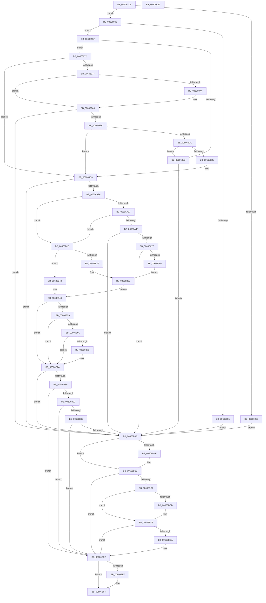

# SepOneWayLinkLogonSessions

- RVA: `0x006068D8`–`0x00606C18` (길이 `832` bytes)
- VA: `0x00000001406068D8`
- 실행 섹션: `.text`
- PDB 이름 있음: `예`; PDB Function 태그: `아니요`
- unwind 정보 RVA: `0x000BC240`
- 디코드: `217`개 명령, `832/832` bytes 표시
- 미해석 바이트: `0` (있으면 어셈블리에 `.byte`로 보존)

> 이 문서는 커널 이미지의 기계어와 PDB 기호를 분석해 생성했습니다. 4번과 5번은 함수 원형과 자료형을 바이너리 사용 방식에서 추정한 C 해석이며 원본 소스 복구 결과는 아닙니다.

## 1. Dependencies

- 직접 호출 지점: **20**; 고유 호출 대상: **10**
- 직접 호출자로 확인된 함수: **1**
- RIP 상대 이미지 참조: **3**

### Outgoing calls
- `0x00606930` → [Feature_ShadowAdmin__private_IsEnabledDeviceUsageNoInline](../4C/Feature_ShadowAdmin__private_IsEnabledDeviceUsageNoInline_function_004C78E8.md) (function, `0x004C78E8`)
- `0x0060694C` → [SeSinglePrivilegeCheck](../../page/87/SeSinglePrivilegeCheck_function_00871E20.md) (function, `0x00871E20`)
- `0x00606977` → [Feature_2045735225__private_IsEnabledDeviceUsageNoInline](../4F/Feature_2045735225__private_IsEnabledDeviceUsageNoInline_function_004F0968.md) (function, `0x004F0968`)
- `0x006069A9` → [ObReferenceObjectByHandle](../../page/86/ObReferenceObjectByHandle_function_00868DB0.md) (function, `0x00868DB0`)
- `0x006069CC` → [Feature_2045735225__private_IsEnabledDeviceUsageNoInline](../4F/Feature_2045735225__private_IsEnabledDeviceUsageNoInline_function_004F0968.md) (function, `0x004F0968`)
- `0x00606A1B` → [SepDuplicateToken](../../page/8B/SepDuplicateToken_function_008B87EC.md) (function, `0x008B87EC`)
- `0x00606A2A` → [Feature_2045735225__private_IsEnabledDeviceUsageNoInline](../4F/Feature_2045735225__private_IsEnabledDeviceUsageNoInline_function_004F0968.md) (function, `0x004F0968`)
- `0x00606A68` → [SepDuplicateToken](../../page/8B/SepDuplicateToken_function_008B87EC.md) (function, `0x008B87EC`)
- `0x00606A83` → [SepReferenceLogonSession](../../page/A3/SepReferenceLogonSession_function_00A3B74C.md) (function, `0x00A3B74C`)
- `0x00606B5E` → [SepRemoveTokenLogonSession](../../page/7A/SepRemoveTokenLogonSession_function_007A19C8.md) (function, `0x007A19C8`)
- `0x00606B63` → [Feature_2045735225__private_IsEnabledDeviceUsageNoInline](../4F/Feature_2045735225__private_IsEnabledDeviceUsageNoInline_function_004F0968.md) (function, `0x004F0968`)
- `0x00606B75` → [SepRemoveTokenLogonSession](../../page/7A/SepRemoveTokenLogonSession_function_007A19C8.md) (function, `0x007A19C8`)
- `0x00606B7E` → [SepStopReferencingLogonSession](../../page/A8/SepStopReferencingLogonSession_function_00A8E35C.md) (function, `0x00A8E35C`)
- `0x00606B89` → [Feature_2045735225__private_IsEnabledDeviceUsageNoInline](../4F/Feature_2045735225__private_IsEnabledDeviceUsageNoInline_function_004F0968.md) (function, `0x004F0968`)
- `0x00606B9B` → [SepStopReferencingLogonSession](../../page/A8/SepStopReferencingLogonSession_function_00A8E35C.md) (function, `0x00A8E35C`)
- `0x00606BB4` → [ObfDereferenceObjectWithTag](../2F/ObfDereferenceObjectWithTag_function_002F78E0.md) (function, `0x002F78E0`)
- `0x00606BB9` → [Feature_2045735225__private_IsEnabledDeviceUsageNoInline](../4F/Feature_2045735225__private_IsEnabledDeviceUsageNoInline_function_004F0968.md) (function, `0x004F0968`)
- `0x00606BD0` → [ObfDereferenceObjectWithTag](../2F/ObfDereferenceObjectWithTag_function_002F78E0.md) (function, `0x002F78E0`)
- `0x00606BDD` → [SepDeReferenceLogonSessionDirect](../44/SepDeReferenceLogonSessionDirect_function_0044EDCC.md) (function, `0x0044EDCC`)
- `0x00606BEF` → [ObfDereferenceObjectWithTag](../2F/ObfDereferenceObjectWithTag_function_002F78E0.md) (function, `0x002F78E0`)

### Direct callers
- [NtSetInformationToken](../../page/AF/NtSetInformationToken_function_00AF0530.md) at `0x00AF0CDF`

### Static image references
- `0x00606943` → RVA `0x00FD9B80` (`PAGEDATA`; read)
- `0x0060697C` → RVA `0x00FD8020` (`PAGEDATA`; read)
- `0x00606B51` → RVA `0x00FD8010` (`PAGEDATA`; read)

## 2. Other-region calls and transfers

- 다른 실행 섹션으로 향하는 call: **9**
  - `0x0060694C` → [SeSinglePrivilegeCheck](../../page/87/SeSinglePrivilegeCheck_function_00871E20.md) (`.text` → `PAGE`)
  - `0x006069A9` → [ObReferenceObjectByHandle](../../page/86/ObReferenceObjectByHandle_function_00868DB0.md) (`.text` → `PAGE`)
  - `0x00606A1B` → [SepDuplicateToken](../../page/8B/SepDuplicateToken_function_008B87EC.md) (`.text` → `PAGE`)
  - `0x00606A68` → [SepDuplicateToken](../../page/8B/SepDuplicateToken_function_008B87EC.md) (`.text` → `PAGE`)
  - `0x00606A83` → [SepReferenceLogonSession](../../page/A3/SepReferenceLogonSession_function_00A3B74C.md) (`.text` → `PAGE`)
  - `0x00606B5E` → [SepRemoveTokenLogonSession](../../page/7A/SepRemoveTokenLogonSession_function_007A19C8.md) (`.text` → `PAGE`)
  - `0x00606B75` → [SepRemoveTokenLogonSession](../../page/7A/SepRemoveTokenLogonSession_function_007A19C8.md) (`.text` → `PAGE`)
  - `0x00606B7E` → [SepStopReferencingLogonSession](../../page/A8/SepStopReferencingLogonSession_function_00A8E35C.md) (`.text` → `PAGE`)
  - `0x00606B9B` → [SepStopReferencingLogonSession](../../page/A8/SepStopReferencingLogonSession_function_00A8E35C.md) (`.text` → `PAGE`)
- 별도 외부 분기/꼬리 이동을 확인하지 못했습니다.

## 3. Assembly (complete function range)

```asm
006068D8  48 8B C4                        mov rax, rsp
006068DB  48 89 58 08                     mov qword ptr [rax + 8], rbx
006068DF  48 89 70 10                     mov qword ptr [rax + 0x10], rsi
006068E3  48 89 78 18                     mov qword ptr [rax + 0x18], rdi
006068E7  55                              push rbp
006068E8  41 54                           push r12
006068EA  41 55                           push r13
006068EC  41 56                           push r14
006068EE  41 57                           push r15
006068F0  48 8D 68 A1                     lea rbp, [rax - 0x5f]
006068F4  48 81 EC 90 00 00 00            sub rsp, 0x90
006068FB  45 33 ED                        xor r13d, r13d
006068FE  0F 57 C0                        xorps xmm0, xmm0
00606901  33 C0                           xor eax, eax
00606903  4C 89 6D E7                     mov qword ptr [rbp - 0x19], r13
00606907  48 89 45 1F                     mov qword ptr [rbp + 0x1f], rax
0060690B  41 8A D8                        mov bl, r8b
0060690E  89 45 27                        mov dword ptr [rbp + 0x27], eax
00606911  4C 8B F2                        mov r14, rdx
00606914  48 8B F9                        mov rdi, rcx
00606917  4C 89 6D EF                     mov qword ptr [rbp - 0x11], r13
0060691B  41 8B F5                        mov esi, r13d
0060691E  4C 89 6D 7F                     mov qword ptr [rbp + 0x7f], r13
00606922  0F 11 45 FF                     movups xmmword ptr [rbp - 1], xmm0
00606926  45 8B E5                        mov r12d, r13d
00606929  45 8A FD                        mov r15b, r13b
0060692C  0F 11 45 0F                     movups xmmword ptr [rbp + 0xf], xmm0
00606930  E8 B3 0F EC FF                  call 0x1404c78e8
00606935  85 C0                           test eax, eax
00606937  75 0A                           jne 0x140606943
00606939  BB 02 00 00 C0                  mov ebx, 0xc0000002
0060693E  E9 63 02 00 00                  jmp 0x140606ba6
00606943  48 8B 0D 36 32 9D 00            mov rcx, qword ptr [rip + 0x9d3236]
0060694A  8A D3                           mov dl, bl
0060694C  E8 CF B4 26 00                  call 0x140871e20
00606951  84 C0                           test al, al
00606953  75 0A                           jne 0x14060695f
00606955  BB 61 00 00 C0                  mov ebx, 0xc0000061
0060695A  E9 47 02 00 00                  jmp 0x140606ba6
0060695F  83 BF C0 00 00 00 01            cmp dword ptr [rdi + 0xc0], 1
00606966  74 0A                           je 0x140606972
00606968  BB 0D 00 00 C0                  mov ebx, 0xc000000d
0060696D  E9 34 02 00 00                  jmp 0x140606ba6
00606972  4D 85 F6                        test r14, r14
00606975  74 61                           je 0x1406069d8
00606977  E8 EC 9F EE FF                  call 0x1404f0968
0060697C  4C 8B 05 9D 16 9D 00            mov r8, qword ptr [rip + 0x9d169d]
00606983  85 C0                           test eax, eax
00606985  48 8D 45 F7                     lea rax, [rbp - 9]
00606989  4C 89 6C 24 28                  mov qword ptr [rsp + 0x28], r13
0060698E  48 89 44 24 20                  mov qword ptr [rsp + 0x20], rax
00606993  44 8A CB                        mov r9b, bl
00606996  4C 89 6D F7                     mov qword ptr [rbp - 9], r13
0060699A  49 8B CE                        mov rcx, r14
0060699D  BA 88 00 00 00                  mov edx, 0x88
006069A2  75 05                           jne 0x1406069a9
006069A4  BA 08 00 00 00                  mov edx, 8
006069A9  E8 02 24 26 00                  call 0x140868db0
006069AE  48 8B 75 F7                     mov rsi, qword ptr [rbp - 9]
006069B2  8B D8                           mov ebx, eax
006069B4  85 C0                           test eax, eax
006069B6  0F 88 EA 01 00 00               js 0x140606ba6
006069BC  48 8B 86 D8 00 00 00            mov rax, qword ptr [rsi + 0xd8]
006069C3  48 39 87 D8 00 00 00            cmp qword ptr [rdi + 0xd8], rax
006069CA  74 0C                           je 0x1406069d8
006069CC  E8 97 9F EE FF                  call 0x1404f0968
006069D1  85 C0                           test eax, eax
006069D3  74 93                           je 0x140606968
006069D5  41 B7 01                        mov r15b, 1
006069D8  48 8D 45 E7                     lea rax, [rbp - 0x19]
006069DC  C7 45 FF 30 00 00 00            mov dword ptr [rbp - 1], 0x30
006069E3  48 89 44 24 38                  mov qword ptr [rsp + 0x38], rax
006069E8  48 8D 55 FF                     lea rdx, [rbp - 1]
006069EC  44 88 6C 24 30                  mov byte ptr [rsp + 0x30], r13b
006069F1  0F 57 C0                        xorps xmm0, xmm0
006069F4  44 88 6C 24 28                  mov byte ptr [rsp + 0x28], r13b
006069F9  41 B9 01 00 00 00               mov r9d, 1
006069FF  45 33 C0                        xor r8d, r8d
00606A02  44 89 6C 24 20                  mov dword ptr [rsp + 0x20], r13d
00606A07  48 8B CF                        mov rcx, rdi
00606A0A  4C 89 6D 07                     mov qword ptr [rbp + 7], r13
00606A0E  44 89 6D 17                     mov dword ptr [rbp + 0x17], r13d
00606A12  4C 89 6D 0F                     mov qword ptr [rbp + 0xf], r13
00606A16  F3 0F 7F 45 1F                  movdqu xmmword ptr [rbp + 0x1f], xmm0
00606A1B  E8 CC 1D 2B 00                  call 0x1408b87ec
00606A20  8B D8                           mov ebx, eax
00606A22  85 C0                           test eax, eax
00606A24  0F 88 7C 01 00 00               js 0x140606ba6
00606A2A  E8 39 9F EE FF                  call 0x1404f0968
00606A2F  85 C0                           test eax, eax
00606A31  0F 84 DE 00 00 00               je 0x140606b15
00606A37  45 84 FF                        test r15b, r15b
00606A3A  0F 84 D5 00 00 00               je 0x140606b15
00606A40  48 8D 45 EF                     lea rax, [rbp - 0x11]
00606A44  41 B9 01 00 00 00               mov r9d, 1
00606A4A  48 89 44 24 38                  mov qword ptr [rsp + 0x38], rax
00606A4F  48 8D 55 FF                     lea rdx, [rbp - 1]
00606A53  44 88 6C 24 30                  mov byte ptr [rsp + 0x30], r13b
00606A58  45 33 C0                        xor r8d, r8d
00606A5B  44 88 6C 24 28                  mov byte ptr [rsp + 0x28], r13b
00606A60  48 8B CE                        mov rcx, rsi
00606A63  44 89 6C 24 20                  mov dword ptr [rsp + 0x20], r13d
00606A68  E8 7F 1D 2B 00                  call 0x1408b87ec
00606A6D  8B D8                           mov ebx, eax
00606A6F  85 C0                           test eax, eax
00606A71  0F 88 2F 01 00 00               js 0x140606ba6
00606A77  48 8B 4D EF                     mov rcx, qword ptr [rbp - 0x11]
00606A7B  48 8D 55 7F                     lea rdx, [rbp + 0x7f]
00606A7F  48 83 C1 18                     add rcx, 0x18
00606A83  E8 C4 4C 43 00                  call 0x140a3b74c
00606A88  4C 8B 65 7F                     mov r12, qword ptr [rbp + 0x7f]
00606A8C  8B D8                           mov ebx, eax
00606A8E  85 C0                           test eax, eax
00606A90  0F 88 10 01 00 00               js 0x140606ba6
00606A96  48 8B 45 EF                     mov rax, qword ptr [rbp - 0x11]
00606A9A  4C 8D 87 D8 00 00 00            lea r8, [rdi + 0xd8]
00606AA1  41 B9 00 00 00 08               mov r9d, 0x8000000
00606AA7  48 8B 90 D8 00 00 00            mov rdx, qword ptr [rax + 0xd8]
00606AAE  48 8B 45 E7                     mov rax, qword ptr [rbp - 0x19]
00606AB2  48 8B 88 D8 00 00 00            mov rcx, qword ptr [rax + 0xd8]
00606AB9  48 8B 42 08                     mov rax, qword ptr [rdx + 8]
00606ABD  48 89 41 18                     mov qword ptr [rcx + 0x18], rax
00606AC1  49 8B 00                        mov rax, qword ptr [r8]
00606AC4  83 48 28 02                     or dword ptr [rax + 0x28], 2
00606AC8  48 8B 45 E7                     mov rax, qword ptr [rbp - 0x19]
00606ACC  44 09 88 C8 00 00 00            or dword ptr [rax + 0xc8], r9d
00606AD3  48 8B 4D EF                     mov rcx, qword ptr [rbp - 0x11]
00606AD7  48 8B 81 D8 00 00 00            mov rax, qword ptr [rcx + 0xd8]
00606ADE  48 89 48 38                     mov qword ptr [rax + 0x38], rcx
00606AE2  48 8B 45 E7                     mov rax, qword ptr [rbp - 0x19]
00606AE6  48 8B 90 D8 00 00 00            mov rdx, qword ptr [rax + 0xd8]
00606AED  48 8B 45 EF                     mov rax, qword ptr [rbp - 0x11]
00606AF1  48 8B 88 D8 00 00 00            mov rcx, qword ptr [rax + 0xd8]
00606AF8  48 8B 42 08                     mov rax, qword ptr [rdx + 8]
00606AFC  48 89 41 10                     mov qword ptr [rcx + 0x10], rax
00606B00  48 8B 45 EF                     mov rax, qword ptr [rbp - 0x11]
00606B04  48 8B 88 D8 00 00 00            mov rcx, qword ptr [rax + 0xd8]
00606B0B  83 49 28 04                     or dword ptr [rcx + 0x28], 4
00606B0F  48 8B 45 EF                     mov rax, qword ptr [rbp - 0x11]
00606B13  EB 22                           jmp 0x140606b37
00606B15  4C 8D 87 D8 00 00 00            lea r8, [rdi + 0xd8]
00606B1C  49 8B 08                        mov rcx, qword ptr [r8]
00606B1F  8B 41 28                        mov eax, dword ptr [rcx + 0x28]
00606B22  4D 85 F6                        test r14, r14
00606B25  75 19                           jne 0x140606b40
00606B27  83 C8 02                        or eax, 2
00606B2A  41 B9 00 00 00 08               mov r9d, 0x8000000
00606B30  89 41 28                        mov dword ptr [rcx + 0x28], eax
00606B33  48 8B 45 E7                     mov rax, qword ptr [rbp - 0x19]
00606B37  44 09 88 C8 00 00 00            or dword ptr [rax + 0xc8], r9d
00606B3E  EB 06                           jmp 0x140606b46
00606B40  83 C8 04                        or eax, 4
00606B43  89 41 28                        mov dword ptr [rcx + 0x28], eax
00606B46  49 8B 08                        mov rcx, qword ptr [r8]
00606B49  48 8B 45 E7                     mov rax, qword ptr [rbp - 0x19]
00606B4D  48 89 41 38                     mov qword ptr [rcx + 0x38], rax
00606B51  44 39 2D B8 14 9D 00            cmp dword ptr [rip + 0x9d14b8], r13d
00606B58  74 20                           je 0x140606b7a
00606B5A  48 8B 4D E7                     mov rcx, qword ptr [rbp - 0x19]
00606B5E  E8 65 AE 19 00                  call 0x1407a19c8
00606B63  E8 00 9E EE FF                  call 0x1404f0968
00606B68  85 C0                           test eax, eax
00606B6A  74 0E                           je 0x140606b7a
00606B6C  45 84 FF                        test r15b, r15b
00606B6F  74 09                           je 0x140606b7a
00606B71  48 8B 4D EF                     mov rcx, qword ptr [rbp - 0x11]
00606B75  E8 4E AE 19 00                  call 0x1407a19c8
00606B7A  48 8B 4D E7                     mov rcx, qword ptr [rbp - 0x19]
00606B7E  E8 D9 77 48 00                  call 0x140a8e35c
00606B83  8B D8                           mov ebx, eax
00606B85  85 C0                           test eax, eax
00606B87  78 1D                           js 0x140606ba6
00606B89  E8 DA 9D EE FF                  call 0x1404f0968
00606B8E  85 C0                           test eax, eax
00606B90  74 50                           je 0x140606be2
00606B92  45 84 FF                        test r15b, r15b
00606B95  74 4B                           je 0x140606be2
00606B97  48 8B 4D EF                     mov rcx, qword ptr [rbp - 0x11]
00606B9B  E8 BC 77 48 00                  call 0x140a8e35c
00606BA0  8B D8                           mov ebx, eax
00606BA2  85 C0                           test eax, eax
00606BA4  79 3C                           jns 0x140606be2
00606BA6  48 8B 4D E7                     mov rcx, qword ptr [rbp - 0x19]
00606BAA  48 85 C9                        test rcx, rcx
00606BAD  74 0A                           je 0x140606bb9
00606BAF  BA 44 66 6C 74                  mov edx, 0x746c6644
00606BB4  E8 27 0D CF FF                  call 0x1402f78e0
00606BB9  E8 AA 9D EE FF                  call 0x1404f0968
00606BBE  85 C0                           test eax, eax
00606BC0  74 20                           je 0x140606be2
00606BC2  48 8B 4D EF                     mov rcx, qword ptr [rbp - 0x11]
00606BC6  48 85 C9                        test rcx, rcx
00606BC9  74 0A                           je 0x140606bd5
00606BCB  BA 44 66 6C 74                  mov edx, 0x746c6644
00606BD0  E8 0B 0D CF FF                  call 0x1402f78e0
00606BD5  4D 85 E4                        test r12, r12
00606BD8  74 08                           je 0x140606be2
00606BDA  49 8B CC                        mov rcx, r12
00606BDD  E8 EA 81 E4 FF                  call 0x14044edcc
00606BE2  48 85 F6                        test rsi, rsi
00606BE5  74 0D                           je 0x140606bf4
00606BE7  BA 44 66 6C 74                  mov edx, 0x746c6644
00606BEC  48 8B CE                        mov rcx, rsi
00606BEF  E8 EC 0C CF FF                  call 0x1402f78e0
00606BF4  4C 8D 9C 24 90 00 00 00         lea r11, [rsp + 0x90]
00606BFC  8B C3                           mov eax, ebx
00606BFE  49 8B 5B 30                     mov rbx, qword ptr [r11 + 0x30]
00606C02  49 8B 73 38                     mov rsi, qword ptr [r11 + 0x38]
00606C06  49 8B 7B 40                     mov rdi, qword ptr [r11 + 0x40]
00606C0A  49 8B E3                        mov rsp, r11
00606C0D  41 5F                           pop r15
00606C0F  41 5E                           pop r14
00606C11  41 5D                           pop r13
00606C13  41 5C                           pop r12
00606C15  5D                              pop rbp
00606C16  C3                              ret
00606C17  CC                              int3
```

## 4. C-style interpretation (structured pseudocode)

```c
__int64 __fastcall SepOneWayLinkLogonSessions(__int64 a1, __int64 a2, unsigned __int8 a3)
{
    __int64 result;
    __int64 v_r13;
    __int64 v_rsp;
    unsigned __int64 v_stack_m28;
    unsigned __int64 v_stack_m80;
    unsigned __int8 v_stack_m88;
    unsigned __int64 v_stack_m90;
    unsigned __int64 v_stack_m98;

    *(unsigned __int64 *)(v_rsp + 8) = v_rbx;
    *(unsigned __int64 *)(v_rsp + 16) = v_rsi;
    *(unsigned __int64 *)(v_rsp + 24) = v_rdi;
    v_rsp = (v_rsp) - (144);
    v_r13 = 0;
    result = 0;
    *(unsigned __int64 *)(v_rsp - 95 - 25) = 0;
    *(unsigned __int64 *)(v_rsp - 95 + 31) = 0;
    *(unsigned int *)(v_rsp - 95 + 39) = 0;
    *(unsigned __int64 *)(v_rsp - 95 - 17) = 0;
    *(unsigned __int64 *)(v_rsp - 95 + 127) = 0;
    *(unsigned __int64 *)(v_rsp - 95 - 1) = v_xmm0;
    *(unsigned __int64 *)(v_rsp - 95 + 15) = v_xmm0;
    result = Feature_ShadowAdmin__private_IsEnabledDeviceUsageNoInline(a1, a2, a3, a4);
    if ((unsigned int)(result) != 0) goto loc_00606943;
    goto loc_00606BA6;
loc_00606943:
    result = SeSinglePrivilegeCheck(*(unsigned __int64 *)(v_rip + 10302006), (unsigned __int8)((unsigned int)(0xC0000002ULL)), a3, a4);
    if ((unsigned __int8)(result) != 0) goto loc_0060695F;
    goto loc_00606BA6;
loc_0060695F:
    if ((*(unsigned int *)(a1 + 192)) == 1) goto loc_00606972;
loc_00606968:
    goto loc_00606BA6;
loc_00606972:
    if (a2 == 0) goto loc_006069D8;
    result = Feature_2045735225__private_IsEnabledDeviceUsageNoInline(*(unsigned __int64 *)(v_rip + 10302006), (unsigned __int8)((unsigned int)(0xC0000002ULL)), a3, a4);
    v_stack_m90 = 0;
    v_stack_m98 = v_rsp - 95 - 9;
    *(unsigned __int64 *)(v_rsp - 95 - 9) = 0;
    if ((unsigned int)(result) == 0) {
        a2 = 8;
    }
    result = ObReferenceObjectByHandle(a2, a2, *(unsigned __int64 *)(v_rip + 10294941), (unsigned __int8)((unsigned int)(0xC000000DULL)));
    if (sign_flag) goto loc_00606BA6;
    if ((*(unsigned __int64 *)(a1 + 216)) == (*(unsigned __int64 *)(*(unsigned __int64 *)(v_rsp - 95 - 9) + 216))) goto loc_006069D8;
    result = Feature_2045735225__private_IsEnabledDeviceUsageNoInline(a2, a2, *(unsigned __int64 *)(v_rip + 10294941), (unsigned __int8)((unsigned int)(0xC000000DULL)));
    if ((unsigned int)(result) == 0) goto loc_00606968;
loc_006069D8:
    *(unsigned int *)(v_rsp - 95 - 1) = 48;
    v_stack_m80 = v_rsp - 95 - 25;
    v_stack_m88 = 0;
    v_stack_m90 = 0;
    a3 = 0;
    v_stack_m98 = 0;
    *(unsigned __int64 *)(v_rsp - 95 + 7) = 0;
    *(unsigned int *)(v_rsp - 95 + 23) = 0;
    *(unsigned __int64 *)(v_rsp - 95 + 15) = 0;
    *(unsigned __int64 *)(v_rsp - 95 + 31) = v_xmm0;
    result = SepDuplicateToken(a1, v_rsp - 95 - 1, a3, 1);
    if (sign_flag) goto loc_00606BA6;
    result = Feature_2045735225__private_IsEnabledDeviceUsageNoInline(a1, v_rsp - 95 - 1, a3, 1);
    if ((unsigned int)(result) == 0) goto loc_00606B15;
    if (1 == 0) goto loc_00606B15;
    v_stack_m80 = v_rsp - 95 - 17;
    v_stack_m88 = 0;
    a3 = 0;
    v_stack_m90 = 0;
    v_stack_m98 = 0;
    result = SepDuplicateToken(*(unsigned __int64 *)(v_rsp - 95 - 9), v_rsp - 95 - 1, a3, 1);
    if (sign_flag) goto loc_00606BA6;
    a1 = (*(unsigned __int64 *)(v_rsp - 95 - 17)) + (24);
    result = SepReferenceLogonSession(a1, v_rsp - 95 + 127, a3, 1);
    if (sign_flag) goto loc_00606BA6;
    *(unsigned __int64 *)(*(unsigned __int64 *)(*(unsigned __int64 *)(v_rsp - 95 - 25) + 216) + 24) = *(unsigned __int64 *)(*(unsigned __int64 *)(*(unsigned __int64 *)(v_rsp - 95 - 17) + 216) + 8);
    *(unsigned __int64 *)(*(unsigned __int64 *)(*(unsigned __int64 *)(v_rsp - 95 - 17) + 216) + 56) = *(unsigned __int64 *)(v_rsp - 95 - 17);
    *(unsigned __int64 *)(*(unsigned __int64 *)(*(unsigned __int64 *)(v_rsp - 95 - 17) + 216) + 16) = *(unsigned __int64 *)(*(unsigned __int64 *)(*(unsigned __int64 *)(v_rsp - 95 - 25) + 216) + 8);
    goto loc_00606B37;
loc_00606B15:
    if (a2 != 0) goto loc_00606B40;
    result = (unsigned int)(((unsigned int)(*(unsigned int *)(*(unsigned __int64 *)(a1 + 216) + 40))) | (2));
    *(unsigned int *)(*(unsigned __int64 *)(a1 + 216) + 40) = (unsigned int)(result);
loc_00606B37:
    goto loc_00606B46;
loc_00606B40:
    result = (unsigned int)((*(unsigned __int64 *)(v_rsp - 95 - 25)) | (4));
    *(unsigned int *)(*(unsigned __int64 *)(a1 + 216) + 40) = (unsigned int)(result);
loc_00606B46:
    *(unsigned __int64 *)(*(unsigned __int64 *)(a1 + 216) + 56) = *(unsigned __int64 *)(v_rsp - 95 - 25);
    if ((*(unsigned int *)(v_rip + 10294456)) == 0) goto loc_00606B7A;
    result = SepRemoveTokenLogonSession(*(unsigned __int64 *)(v_rsp - 95 - 25), *(unsigned __int64 *)(*(unsigned __int64 *)(v_rsp - 95 - 25) + 216), a1 + 216, (unsigned int)(0x8000000ULL));
    result = Feature_2045735225__private_IsEnabledDeviceUsageNoInline(*(unsigned __int64 *)(v_rsp - 95 - 25), *(unsigned __int64 *)(*(unsigned __int64 *)(v_rsp - 95 - 25) + 216), a1 + 216, (unsigned int)(0x8000000ULL));
    if ((unsigned int)(result) == 0) goto loc_00606B7A;
    if (1 != 0) {
        a1 = *(unsigned __int64 *)(v_rsp - 95 - 17);
        result = SepRemoveTokenLogonSession(a1, *(unsigned __int64 *)(*(unsigned __int64 *)(v_rsp - 95 - 25) + 216), a1 + 216, (unsigned int)(0x8000000ULL));
    }
    result = SepStopReferencingLogonSession(*(unsigned __int64 *)(v_rsp - 95 - 25), *(unsigned __int64 *)(*(unsigned __int64 *)(v_rsp - 95 - 25) + 216), a1 + 216, (unsigned int)(0x8000000ULL));
    if (sign_flag) goto loc_00606BA6;
    result = Feature_2045735225__private_IsEnabledDeviceUsageNoInline(*(unsigned __int64 *)(v_rsp - 95 - 25), *(unsigned __int64 *)(*(unsigned __int64 *)(v_rsp - 95 - 25) + 216), a1 + 216, (unsigned int)(0x8000000ULL));
    if ((unsigned int)(result) == 0) goto loc_00606BE2;
    if (1 == 0) goto loc_00606BE2;
    result = SepStopReferencingLogonSession(*(unsigned __int64 *)(v_rsp - 95 - 17), *(unsigned __int64 *)(*(unsigned __int64 *)(v_rsp - 95 - 25) + 216), a1 + 216, (unsigned int)(0x8000000ULL));
    if (!sign_flag) goto loc_00606BE2;
loc_00606BA6:
    if (*(unsigned __int64 *)(v_rsp - 95 - 25) != 0) {
        a2 = 0x746C6644ULL;
        result = ObfDereferenceObjectWithTag(*(unsigned __int64 *)(v_rsp - 95 - 25), a2, a1 + 216, (unsigned int)(0x8000000ULL));
    }
    result = Feature_2045735225__private_IsEnabledDeviceUsageNoInline(*(unsigned __int64 *)(v_rsp - 95 - 25), a2, a1 + 216, (unsigned int)(0x8000000ULL));
    if ((unsigned int)(result) == 0) goto loc_00606BE2;
    if (*(unsigned __int64 *)(v_rsp - 95 - 17) != 0) {
        a2 = 0x746C6644ULL;
        result = ObfDereferenceObjectWithTag(*(unsigned __int64 *)(v_rsp - 95 - 17), a2, a1 + 216, (unsigned int)(0x8000000ULL));
    }
    if (*(unsigned __int64 *)(v_rsp - 95 + 127) != 0) {
        a1 = *(unsigned __int64 *)(v_rsp - 95 + 127);
        result = SepDeReferenceLogonSessionDirect(a1, a2, a1 + 216, (unsigned int)(0x8000000ULL));
    }
    if (*(unsigned __int64 *)(v_rsp - 95 - 9) != 0) {
        a2 = 0x746C6644ULL;
        a1 = *(unsigned __int64 *)(v_rsp - 95 - 9);
        result = ObfDereferenceObjectWithTag(a1, a2, a1 + 216, (unsigned int)(0x8000000ULL));
    }
    return (unsigned int)((unsigned int)((unsigned int)((unsigned int)(result))));
}
```

## 5. (Beta) C Style

```c
int64_t SepOneWayLinkLogonSessions(void *Arg1, int64_t Arg2, uint8_t Arg3)
{
    uint8_t *arg1 = (uint8_t *)Arg1;

    int64_t result;
    int64_t local_r13;
    int64_t local_rsp;
    uint64_t v_stack_m28;
    uint64_t v_stack_m80;
    uint8_t v_stack_m88;
    uint64_t v_stack_m90;
    uint64_t v_stack_m98;

    *(uint64_t *)(local_rsp + 0x8) = local_rbx;
    *(uint64_t *)(local_rsp + 0x10) = local_rsi;
    *(uint64_t *)(local_rsp + 0x18) = local_rdi;
    local_rsp = (local_rsp) - (144);
    local_r13 = 0;
    result = 0;
    *(uint64_t *)(local_rsp - 0x5F - 0x19) = 0;
    *(uint64_t *)(local_rsp - 0x5F + 0x1F) = 0;
    *(uint32_t *)(local_rsp - 0x5F + 0x27) = 0;
    *(uint64_t *)(local_rsp - 0x5F - 0x11) = 0;
    *(uint64_t *)(local_rsp - 0x5F + 0x7F) = 0;
    *(uint64_t *)(local_rsp - 0x5F - 0x1) = v_xmm0;
    *(uint64_t *)(local_rsp - 0x5F + 0xF) = v_xmm0;
    result = Feature_ShadowAdmin__private_IsEnabledDeviceUsageNoInline(Arg1, Arg2, Arg3, a4);
    if ((uint32_t)(result) != 0) goto loc_00606943;
    goto loc_00606BA6;
loc_00606943:
    result = SeSinglePrivilegeCheck(*(uint64_t *)(v_rip + 0x9D3236), (uint8_t)((uint32_t)(0xC0000002ULL)), Arg3, a4);
    if ((uint8_t)(result) != 0) goto loc_0060695F;
    goto loc_00606BA6;
loc_0060695F:
    if ((*(uint32_t *)(arg1 + 0xC0)) == 1) goto loc_00606972;
loc_00606968:
    goto loc_00606BA6;
loc_00606972:
    if (Arg2 == 0) goto loc_006069D8;
    result = Feature_2045735225__private_IsEnabledDeviceUsageNoInline(*(uint64_t *)(v_rip + 0x9D3236), (uint8_t)((uint32_t)(0xC0000002ULL)), Arg3, a4);
    v_stack_m90 = 0;
    v_stack_m98 = local_rsp - 95 - 9;
    *(uint64_t *)(local_rsp - 0x5F - 0x9) = 0;
    if ((uint32_t)(result) == 0) {
        Arg2 = 8;
    }
    result = ObReferenceObjectByHandle(Arg2, Arg2, *(uint64_t *)(v_rip + 0x9D169D), (uint8_t)((uint32_t)(0xC000000DULL)));
    if (sign_flag) goto loc_00606BA6;
    if ((*(uint64_t *)(arg1 + 0xD8)) == (*(uint64_t *)(*(uint64_t *)(local_rsp - 0x5F - 0x9) + 0xD8))) goto loc_006069D8;
    result = Feature_2045735225__private_IsEnabledDeviceUsageNoInline(Arg2, Arg2, *(uint64_t *)(v_rip + 0x9D169D), (uint8_t)((uint32_t)(0xC000000DULL)));
    if ((uint32_t)(result) == 0) goto loc_00606968;
loc_006069D8:
    *(uint32_t *)(local_rsp - 0x5F - 0x1) = 48;
    v_stack_m80 = local_rsp - 95 - 25;
    v_stack_m88 = 0;
    v_stack_m90 = 0;
    Arg3 = 0;
    v_stack_m98 = 0;
    *(uint64_t *)(local_rsp - 0x5F + 0x7) = 0;
    *(uint32_t *)(local_rsp - 0x5F + 0x17) = 0;
    *(uint64_t *)(local_rsp - 0x5F + 0xF) = 0;
    *(uint64_t *)(local_rsp - 0x5F + 0x1F) = v_xmm0;
    result = SepDuplicateToken(Arg1, local_rsp - 95 - 1, Arg3, 1);
    if (sign_flag) goto loc_00606BA6;
    result = Feature_2045735225__private_IsEnabledDeviceUsageNoInline(Arg1, local_rsp - 95 - 1, Arg3, 1);
    if ((uint32_t)(result) == 0) goto loc_00606B15;
    if (1 == 0) goto loc_00606B15;
    v_stack_m80 = local_rsp - 95 - 17;
    v_stack_m88 = 0;
    Arg3 = 0;
    v_stack_m90 = 0;
    v_stack_m98 = 0;
    result = SepDuplicateToken(*(uint64_t *)(local_rsp - 0x5F - 0x9), local_rsp - 95 - 1, Arg3, 1);
    if (sign_flag) goto loc_00606BA6;
    Arg1 = (*(uint64_t *)(local_rsp - 0x5F - 0x11)) + (24);
    result = SepReferenceLogonSession(Arg1, local_rsp - 95 + 127, Arg3, 1);
    if (sign_flag) goto loc_00606BA6;
    *(uint64_t *)(*(uint64_t *)(*(uint64_t *)(local_rsp - 0x5F - 0x19) + 0xD8) + 0x18) = *(uint64_t *)(*(uint64_t *)(*(uint64_t *)(local_rsp - 0x5F - 0x11) + 0xD8) + 0x8);
    *(uint64_t *)(*(uint64_t *)(*(uint64_t *)(local_rsp - 0x5F - 0x11) + 0xD8) + 0x38) = *(uint64_t *)(local_rsp - 0x5F - 0x11);
    *(uint64_t *)(*(uint64_t *)(*(uint64_t *)(local_rsp - 0x5F - 0x11) + 0xD8) + 0x10) = *(uint64_t *)(*(uint64_t *)(*(uint64_t *)(local_rsp - 0x5F - 0x19) + 0xD8) + 0x8);
    goto loc_00606B37;
loc_00606B15:
    if (Arg2 != 0) goto loc_00606B40;
    result = (uint32_t)(((uint32_t)(*(uint32_t *)(*(uint64_t *)(arg1 + 0xD8) + 0x28))) | (2));
    *(uint32_t *)(*(uint64_t *)(arg1 + 0xD8) + 0x28) = (uint32_t)(result);
loc_00606B37:
    goto loc_00606B46;
loc_00606B40:
    result = (uint32_t)((*(uint64_t *)(local_rsp - 0x5F - 0x19)) | (4));
    *(uint32_t *)(*(uint64_t *)(arg1 + 0xD8) + 0x28) = (uint32_t)(result);
loc_00606B46:
    *(uint64_t *)(*(uint64_t *)(arg1 + 0xD8) + 0x38) = *(uint64_t *)(local_rsp - 0x5F - 0x19);
    if ((*(uint32_t *)(v_rip + 0x9D14B8)) == 0) goto loc_00606B7A;
    result = SepRemoveTokenLogonSession(*(uint64_t *)(local_rsp - 0x5F - 0x19), *(uint64_t *)(*(uint64_t *)(local_rsp - 0x5F - 0x19) + 0xD8), Arg1 + 216, (uint32_t)(0x8000000ULL));
    result = Feature_2045735225__private_IsEnabledDeviceUsageNoInline(*(uint64_t *)(local_rsp - 0x5F - 0x19), *(uint64_t *)(*(uint64_t *)(local_rsp - 0x5F - 0x19) + 0xD8), Arg1 + 216, (uint32_t)(0x8000000ULL));
    if ((uint32_t)(result) == 0) goto loc_00606B7A;
    if (1 != 0) {
        Arg1 = *(uint64_t *)(local_rsp - 0x5F - 0x11);
        result = SepRemoveTokenLogonSession(Arg1, *(uint64_t *)(*(uint64_t *)(local_rsp - 0x5F - 0x19) + 0xD8), Arg1 + 216, (uint32_t)(0x8000000ULL));
    }
    result = SepStopReferencingLogonSession(*(uint64_t *)(local_rsp - 0x5F - 0x19), *(uint64_t *)(*(uint64_t *)(local_rsp - 0x5F - 0x19) + 0xD8), Arg1 + 216, (uint32_t)(0x8000000ULL));
    if (sign_flag) goto loc_00606BA6;
    result = Feature_2045735225__private_IsEnabledDeviceUsageNoInline(*(uint64_t *)(local_rsp - 0x5F - 0x19), *(uint64_t *)(*(uint64_t *)(local_rsp - 0x5F - 0x19) + 0xD8), Arg1 + 216, (uint32_t)(0x8000000ULL));
    if ((uint32_t)(result) == 0) goto loc_00606BE2;
    if (1 == 0) goto loc_00606BE2;
    result = SepStopReferencingLogonSession(*(uint64_t *)(local_rsp - 0x5F - 0x11), *(uint64_t *)(*(uint64_t *)(local_rsp - 0x5F - 0x19) + 0xD8), Arg1 + 216, (uint32_t)(0x8000000ULL));
    if (!sign_flag) goto loc_00606BE2;
loc_00606BA6:
    if (*(uint64_t *)(local_rsp - 0x5F - 0x19) != 0) {
        Arg2 = 0x746C6644ULL;
        result = ObfDereferenceObjectWithTag(*(uint64_t *)(local_rsp - 0x5F - 0x19), Arg2, Arg1 + 216, (uint32_t)(0x8000000ULL));
    }
    result = Feature_2045735225__private_IsEnabledDeviceUsageNoInline(*(uint64_t *)(local_rsp - 0x5F - 0x19), Arg2, Arg1 + 216, (uint32_t)(0x8000000ULL));
    if ((uint32_t)(result) == 0) goto loc_00606BE2;
    if (*(uint64_t *)(local_rsp - 0x5F - 0x11) != 0) {
        Arg2 = 0x746C6644ULL;
        result = ObfDereferenceObjectWithTag(*(uint64_t *)(local_rsp - 0x5F - 0x11), Arg2, Arg1 + 216, (uint32_t)(0x8000000ULL));
    }
    if (*(uint64_t *)(local_rsp - 0x5F + 0x7F) != 0) {
        Arg1 = *(uint64_t *)(local_rsp - 0x5F + 0x7F);
        result = SepDeReferenceLogonSessionDirect(Arg1, Arg2, Arg1 + 216, (uint32_t)(0x8000000ULL));
    }
    if (*(uint64_t *)(local_rsp - 0x5F - 0x9) != 0) {
        Arg2 = 0x746C6644ULL;
        Arg1 = *(uint64_t *)(local_rsp - 0x5F - 0x9);
        result = ObfDereferenceObjectWithTag(Arg1, Arg2, Arg1 + 216, (uint32_t)(0x8000000ULL));
    }
    return (uint32_t)((uint32_t)((uint32_t)((uint32_t)(result))));
}
```

### 관측된 메모리 오프셋

구조체 형식이 확인되지 않은 접근은 인자 기준의 오프셋으로만 기록했습니다.

| 기준 인자 | 오프셋 표현 | 폭 (bit) | 접근 |
|---|---:|---:|---|
| `Arg1` | `+ 0x0` | `64` | `R` |
| `Arg1` | `+ 0xC0` | `32` | `R` |
| `Arg1` | `+ 0xD8` | `64` | `R` |

## 6. Execution-region graph

[열기: 2D/3D 그래프와 함수 탐색 컨트롤 패널](../../../control-panel.html?section=text&rva=0x006068D8&view=graph)

- 2D 그래프는 위에서 아래로 흐르고, 3D 그래프는 빈 공간을 드래그해 회전합니다. Shift+드래그는 이동, 휠은 확대·축소, 함수 노드 선택은 대상 보고서 이동입니다.

### Static fallback


