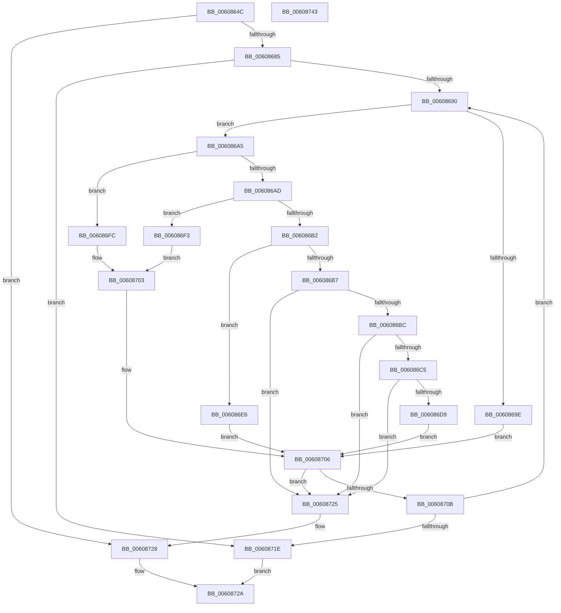

# SepResolveAntiTamperEntrySids

- RVA: `0x0060864C`–`0x00608744` (길이 `248` bytes)
- VA: `0x000000014060864C`
- 실행 섹션: `.text`
- PDB 이름 있음: `예`; PDB Function 태그: `예`
- unwind 정보 RVA: `0x00060300`
- 디코드: `72`개 명령, `248/248` bytes 표시
- 미해석 바이트: `0` (있으면 어셈블리에 `.byte`로 보존)

> 이 문서는 커널 이미지의 기계어와 PDB 기호를 분석해 생성했습니다. 4번과 5번은 함수 원형과 자료형을 바이너리 사용 방식에서 추정한 C 해석이며 원본 소스 복구 결과는 아닙니다.

## 1. Dependencies

- 직접 호출 지점: **1**; 고유 호출 대상: **1**
- 직접 호출자로 확인된 함수: **1**
- RIP 상대 이미지 참조: **0**

### Outgoing calls
- `0x006086D0` → [SepIsAppSuiteSid](SepIsAppSuiteSid_function_006083A0.md) (function, `0x006083A0`)

### Direct callers
- [SepConstructMandatoryAccessControlList](../../page/79/SepConstructMandatoryAccessControlList_function_0079D3AC.md) at `0x0079D43A`
- [SepConstructMandatoryAccessControlList](../../page/79/SepConstructMandatoryAccessControlList_function_0079D3AC.md) at `0x0079D4DF`

### Static image references
- 디코드된 RIP-relative 메모리 참조가 없습니다.

## 2. Other-region calls and transfers

- 다른 실행 섹션으로 향하는 call: **0**
- 별도 외부 분기/꼬리 이동을 확인하지 못했습니다.

## 3. Assembly (complete function range)

```asm
0060864C  48 89 5C 24 08                  mov qword ptr [rsp + 8], rbx
00608651  48 89 6C 24 10                  mov qword ptr [rsp + 0x10], rbp
00608656  48 89 74 24 18                  mov qword ptr [rsp + 0x18], rsi
0060865B  57                              push rdi
0060865C  41 56                           push r14
0060865E  41 57                           push r15
00608660  48 83 EC 20                     sub rsp, 0x20
00608664  44 8B 52 08                     mov r10d, dword ptr [rdx + 8]
00608668  49 8B F9                        mov rdi, r9
0060866B  41 83 21 00                     and dword ptr [r9], 0
0060866F  4D 8B F8                        mov r15, r8
00608672  48 8B EA                        mov rbp, rdx
00608675  48 8B D9                        mov rbx, rcx
00608678  41 8D 42 FF                     lea eax, [r10 - 1]
0060867C  83 F8 01                        cmp eax, 1
0060867F  0F 87 A3 00 00 00               ja 0x140608728
00608685  33 F6                           xor esi, esi
00608687  45 85 D2                        test r10d, r10d
0060868A  0F 84 8E 00 00 00               je 0x14060871e
00608690  48 8D 4E 01                     lea rcx, [rsi + 1]
00608694  48 03 C9                        add rcx, rcx
00608697  F6 44 CD 00 01                  test byte ptr [rbp + rcx*8], 1
0060869C  75 07                           jne 0x1406086a5
0060869E  48 8B 44 CD 08                  mov rax, qword ptr [rbp + rcx*8 + 8]
006086A3  EB 61                           jmp 0x140608706
006086A5  8B 4C CD 08                     mov ecx, dword ptr [rbp + rcx*8 + 8]
006086A9  85 C9                           test ecx, ecx
006086AB  74 4F                           je 0x1406086fc
006086AD  83 E9 01                        sub ecx, 1
006086B0  74 41                           je 0x1406086f3
006086B2  83 E9 01                        sub ecx, 1
006086B5  74 2F                           je 0x1406086e6
006086B7  83 F9 01                        cmp ecx, 1
006086BA  75 69                           jne 0x140608725
006086BC  83 BB A0 04 00 00 02            cmp dword ptr [rbx + 0x4a0], 2
006086C3  76 60                           jbe 0x140608725
006086C5  48 8B 8B 98 04 00 00            mov rcx, qword ptr [rbx + 0x498]
006086CC  48 8B 49 20                     mov rcx, qword ptr [rcx + 0x20]
006086D0  E8 CB FC FF FF                  call 0x1406083a0
006086D5  84 C0                           test al, al
006086D7  74 4C                           je 0x140608725
006086D9  48 8B 83 98 04 00 00            mov rax, qword ptr [rbx + 0x498]
006086E0  48 8B 40 20                     mov rax, qword ptr [rax + 0x20]
006086E4  EB 20                           jmp 0x140608706
006086E6  48 8B 83 98 04 00 00            mov rax, qword ptr [rbx + 0x498]
006086ED  48 8B 40 10                     mov rax, qword ptr [rax + 0x10]
006086F1  EB 13                           jmp 0x140608706
006086F3  48 8B 83 98 04 00 00            mov rax, qword ptr [rbx + 0x498]
006086FA  EB 07                           jmp 0x140608703
006086FC  48 8B 83 98 00 00 00            mov rax, qword ptr [rbx + 0x98]
00608703  48 8B 00                        mov rax, qword ptr [rax]
00608706  48 85 C0                        test rax, rax
00608709  74 1A                           je 0x140608725
0060870B  44 8B 55 08                     mov r10d, dword ptr [rbp + 8]
0060870F  49 89 04 F7                     mov qword ptr [r15 + rsi*8], rax
00608713  FF C6                           inc esi
00608715  41 3B F2                        cmp esi, r10d
00608718  0F 82 72 FF FF FF               jb 0x140608690
0060871E  44 89 17                        mov dword ptr [rdi], r10d
00608721  B0 01                           mov al, 1
00608723  EB 05                           jmp 0x14060872a
00608725  83 27 00                        and dword ptr [rdi], 0
00608728  32 C0                           xor al, al
0060872A  48 8B 5C 24 40                  mov rbx, qword ptr [rsp + 0x40]
0060872F  48 8B 6C 24 48                  mov rbp, qword ptr [rsp + 0x48]
00608734  48 8B 74 24 50                  mov rsi, qword ptr [rsp + 0x50]
00608739  48 83 C4 20                     add rsp, 0x20
0060873D  41 5F                           pop r15
0060873F  41 5E                           pop r14
00608741  5F                              pop rdi
00608742  C3                              ret
00608743  CC                              int3
```

## 4. C-style interpretation (structured pseudocode)

```c
__int64 __fastcall SepResolveAntiTamperEntrySids(__int64 a1, __int64 a2, __int64 a3, __int64 a4)
{
    __int64 result;
    __int64 v_rsi;
    __int64 v_rsp;
    unsigned __int64 v_stack_p10;
    unsigned __int64 v_stack_p18;
    unsigned __int64 v_stack_p8;

    v_stack_p8 = v_rbx;
    v_stack_p10 = v_rbp;
    v_stack_p18 = v_rsi;
    v_rsp = (v_rsp) - (32);
    if (((unsigned int)((unsigned int)(*(unsigned int *)(a2 + 8)) - 1)) > 1) goto loc_00608728;
    v_rsi = 0;
    if ((unsigned int)((unsigned int)(*(unsigned int *)(a2 + 8))) == 0) goto loc_0060871E;
loc_00608690:
    a1 = (v_rsi + 1) + (v_rsi + 1);
    if (((*(unsigned __int8 *)(a2 + a1 * 8)) & (1)) != 0) goto loc_006086A5;
    goto loc_00608706;
loc_006086A5:
    if ((unsigned int)((unsigned int)(*(unsigned int *)(a2 + a1 * 8 + 8))) == 0) goto loc_006086FC;
    a1 = (unsigned int)(((unsigned int)(*(unsigned int *)(a2 + a1 * 8 + 8))) - (1));
    if (condition_is_equal) goto loc_006086F3;
    a1 = (unsigned int)((a1) - (1));
    if (condition_is_equal) goto loc_006086E6;
    if (((unsigned int)(a1)) != 1) goto loc_00608725;
    if ((*(unsigned int *)(a1 + 1184)) <= 2) goto loc_00608725;
    result = SepIsAppSuiteSid(*(unsigned __int64 *)(*(unsigned __int64 *)(a1 + 1176) + 32), a2, a3, a4);
    if ((unsigned __int8)(result) == 0) goto loc_00608725;
    goto loc_00608706;
loc_006086E6:
    goto loc_00608706;
loc_006086F3:
    goto loc_00608703;
loc_006086FC:
loc_00608703:
loc_00608706:
    if (*(unsigned __int64 *)(*(unsigned __int64 *)(a1 + 152)) == 0) goto loc_00608725;
    *(unsigned __int64 *)(a3 + v_rsi * 8) = *(unsigned __int64 *)(*(unsigned __int64 *)(a1 + 152));
    v_rsi = (unsigned int)((v_rsi) + 1);
    if (((unsigned int)(v_rsi)) < ((unsigned int)((unsigned int)(*(unsigned int *)(a2 + 8))))) goto loc_00608690;
loc_0060871E:
    *(unsigned int *)(a4) = (unsigned int)((unsigned int)(*(unsigned int *)(a2 + 8)));
    goto loc_0060872A;
loc_00608725:
loc_00608728:
    result = 0;
loc_0060872A:
    v_rsp = (v_rsp) + (32);
    return result;
}
```

## 5. (Beta) C Style

```c
int64_t SepResolveAntiTamperEntrySids(void *Arg1, void *Arg2, void *Arg3, void *Arg4)
{
    uint8_t *arg1 = (uint8_t *)Arg1;
    uint8_t *arg2 = (uint8_t *)Arg2;
    uint8_t *arg3 = (uint8_t *)Arg3;
    uint8_t *arg4 = (uint8_t *)Arg4;

    int64_t result;
    int64_t local_rsi;
    int64_t local_rsp;
    uint64_t v_stack_p10;
    uint64_t v_stack_p18;
    uint64_t v_stack_p8;

    v_stack_p8 = local_rbx;
    v_stack_p10 = local_rbp;
    v_stack_p18 = local_rsi;
    local_rsp = (local_rsp) - (32);
    if (((uint32_t)((uint32_t)(*(uint32_t *)(arg2 + 0x8)) - 1)) > 1) goto loc_00608728;
    local_rsi = 0;
    if ((uint32_t)((uint32_t)(*(uint32_t *)(arg2 + 0x8))) == 0) goto loc_0060871E;
loc_00608690:
    Arg1 = (local_rsi + 1) + (local_rsi + 1);
    if (((*(uint8_t *)(arg2 + arg1 * 8)) & (1)) != 0) goto loc_006086A5;
    goto loc_00608706;
loc_006086A5:
    if ((uint32_t)((uint32_t)(*(uint32_t *)(arg2 + arg1 * 8 + 0x8))) == 0) goto loc_006086FC;
    Arg1 = (uint32_t)(((uint32_t)(*(uint32_t *)(arg2 + arg1 * 8 + 0x8))) - (1));
    if (condition_is_equal) goto loc_006086F3;
    Arg1 = (uint32_t)((Arg1) - (1));
    if (condition_is_equal) goto loc_006086E6;
    if (((uint32_t)(Arg1)) != 1) goto loc_00608725;
    if ((*(uint32_t *)(arg1 + 0x4A0)) <= 2) goto loc_00608725;
    result = SepIsAppSuiteSid(*(uint64_t *)(*(uint64_t *)(arg1 + 0x498) + 0x20), Arg2, Arg3, Arg4);
    if ((uint8_t)(result) == 0) goto loc_00608725;
    goto loc_00608706;
loc_006086E6:
    goto loc_00608706;
loc_006086F3:
    goto loc_00608703;
loc_006086FC:
loc_00608703:
loc_00608706:
    if (*(uint64_t *)(*(uint64_t *)(arg1 + 0x98)) == 0) goto loc_00608725;
    *(uint64_t *)(arg3 + local_rsi * 8) = *(uint64_t *)(*(uint64_t *)(arg1 + 0x98));
    local_rsi = (uint32_t)((local_rsi) + 1);
    if (((uint32_t)(local_rsi)) < ((uint32_t)((uint32_t)(*(uint32_t *)(arg2 + 0x8))))) goto loc_00608690;
loc_0060871E:
    *(uint32_t *)(arg4) = (uint32_t)((uint32_t)(*(uint32_t *)(arg2 + 0x8)));
    goto loc_0060872A;
loc_00608725:
loc_00608728:
    result = 0;
loc_0060872A:
    local_rsp = (local_rsp) + (32);
    return result;
}
```

### 관측된 메모리 오프셋

구조체 형식이 확인되지 않은 접근은 인자 기준의 오프셋으로만 기록했습니다.

| 기준 인자 | 오프셋 표현 | 폭 (bit) | 접근 |
|---|---:|---:|---|
| `Arg1` | `+ 0x98` | `64` | `R` |
| `Arg1` | `+ 0x498` | `64` | `R` |
| `Arg1` | `+ 0x4A0` | `32` | `R` |
| `Arg2` | `+ 0x0 + rcx*8` | `8` | `R` |
| `Arg2` | `+ 0x8` | `32` | `R` |
| `Arg2` | `+ 0x8 + rcx*8` | `32` | `R` |
| `Arg2` | `+ 0x8 + rcx*8` | `64` | `R` |
| `Arg3` | `+ 0x0 + rsi*8` | `64` | `W` |
| `Arg4` | `+ 0x0` | `32` | `R/W` |
| `Arg4` | `+ 0x0` | `32` | `W` |

## 6. Execution-region graph

[열기: 2D/3D 그래프와 함수 탐색 컨트롤 패널](../../../control-panel.html?section=text&rva=0x0060864C&view=graph)

- 2D 그래프는 위에서 아래로 흐르고, 3D 그래프는 빈 공간을 드래그해 회전합니다. Shift+드래그는 이동, 휠은 확대·축소, 함수 노드 선택은 대상 보고서 이동입니다.

### Static fallback


