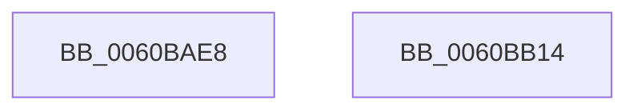

# SepRmCapPoolExpand

- RVA: `0x0060BAE8`–`0x0060BB15` (길이 `45` bytes)
- VA: `0x000000014060BAE8`
- 실행 섹션: `.text`
- PDB 이름 있음: `예`; PDB Function 태그: `아니요`
- unwind 정보 RVA: `0x0005CF00`
- 디코드: `13`개 명령, `45/45` bytes 표시
- 미해석 바이트: `0` (있으면 어셈블리에 `.byte`로 보존)

> 이 문서는 커널 이미지의 기계어와 PDB 기호를 분석해 생성했습니다. 4번과 5번은 함수 원형과 자료형을 바이너리 사용 방식에서 추정한 C 해석이며 원본 소스 복구 결과는 아닙니다.

## 1. Dependencies

- 직접 호출 지점: **2**; 고유 호출 대상: **2**
- 직접 호출자로 확인된 함수: **2**
- RIP 상대 이미지 참조: **0**

### Outgoing calls
- `0x0060BAF6` → [ExFreePoolWithTag](../../poolcode/B8/ExFreePoolWithTag_function_00B82870.md) (function, `0x00B82870`)
- `0x0060BB09` → [ExAllocatePool2](../../poolcode/B8/ExAllocatePool2_function_00B820F0.md) (function, `0x00B820F0`)

### Direct callers
- [SepReadAndInsertCaps](../../page/7A/SepReadAndInsertCaps_function_007A3960.md) at `0x007A3A21`
- [SepReadAndInsertCaps](../../page/7A/SepReadAndInsertCaps_function_007A3960.md) at `0x007A3AA9`
- [SepReadAndInsertCaps](../../page/7A/SepReadAndInsertCaps_function_007A3960.md) at `0x007A3B86`
- [SepReadAndPopulateCapes](../../page/7A/SepReadAndPopulateCapes_function_007A3CB8.md) at `0x007A3EFC`

### Static image references
- 디코드된 RIP-relative 메모리 참조가 없습니다.

## 2. Other-region calls and transfers

- 다른 실행 섹션으로 향하는 call: **2**
  - `0x0060BAF6` → [ExFreePoolWithTag](../../poolcode/B8/ExFreePoolWithTag_function_00B82870.md) (`.text` → `POOLCODE`)
  - `0x0060BB09` → [ExAllocatePool2](../../poolcode/B8/ExAllocatePool2_function_00B820F0.md) (`.text` → `POOLCODE`)
- 별도 외부 분기/꼬리 이동을 확인하지 못했습니다.

## 3. Assembly (complete function range)

```asm
0060BAE8  40 53                           push rbx
0060BAEA  48 83 EC 20                     sub rsp, 0x20
0060BAEE  48 8B DA                        mov rbx, rdx
0060BAF1  BA 53 65 53 70                  mov edx, 0x70536553
0060BAF6  E8 75 6D 57 00                  call 0x140b82870
0060BAFB  41 B8 53 65 53 70               mov r8d, 0x70536553
0060BB01  48 8B D3                        mov rdx, rbx
0060BB04  B9 00 01 00 00                  mov ecx, 0x100
0060BB09  E8 E2 65 57 00                  call 0x140b820f0
0060BB0E  48 83 C4 20                     add rsp, 0x20
0060BB12  5B                              pop rbx
0060BB13  C3                              ret
0060BB14  CC                              int3
```

## 4. C-style interpretation (structured pseudocode)

```c
__int64 __fastcall SepRmCapPoolExpand(__int64 a1, __int64 a2)
{
    __int64 result;
    __int64 v_rsp;

    v_rsp = (v_rsp) - (32);
    result = ExFreePoolWithTag(a1, (unsigned int)(0x70536553ULL), a3, a4);
    result = ExAllocatePool2(256, a2, (unsigned int)(0x70536553ULL), a4);
    v_rsp = (v_rsp) + (32);
    return result;
}
```

## 5. (Beta) C Style

```c
int64_t SepRmCapPoolExpand(int64_t Arg1, int64_t Arg2)
{
    int64_t result;
    int64_t local_rsp;

    local_rsp = (local_rsp) - (32);
    result = ExFreePoolWithTag(Arg1, (uint32_t)(0x70536553ULL), a3, a4);
    result = ExAllocatePool2(256, Arg2, (uint32_t)(0x70536553ULL), a4);
    local_rsp = (local_rsp) + (32);
    return result;
}
```

## 6. Execution-region graph

[열기: 2D/3D 그래프와 함수 탐색 컨트롤 패널](../../../control-panel.html?section=text&rva=0x0060BAE8&view=graph)

- 2D 그래프는 위에서 아래로 흐르고, 3D 그래프는 빈 공간을 드래그해 회전합니다. Shift+드래그는 이동, 휠은 확대·축소, 함수 노드 선택은 대상 보고서 이동입니다.

### Static fallback


