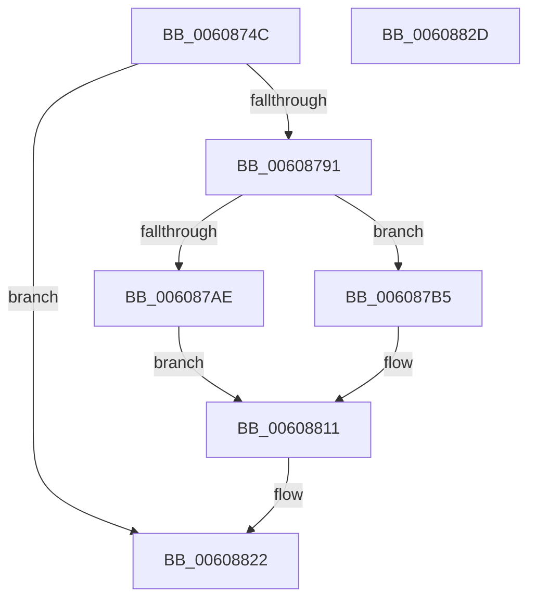

# SepSetImageEa

- RVA: `0x0060874C`–`0x0060882E` (길이 `226` bytes)
- VA: `0x000000014060874C`
- 실행 섹션: `.text`
- PDB 이름 있음: `예`; PDB Function 태그: `아니요`
- unwind 정보 RVA: `0x000718C0`
- 디코드: `55`개 명령, `226/226` bytes 표시
- 미해석 바이트: `0` (있으면 어셈블리에 `.byte`로 보존)

> 이 문서는 커널 이미지의 기계어와 PDB 기호를 분석해 생성했습니다. 4번과 5번은 함수 원형과 자료형을 바이너리 사용 방식에서 추정한 C 해석이며 원본 소스 복구 결과는 아닙니다.

## 1. Dependencies

- 직접 호출 지점: **5**; 고유 호출 대상: **5**
- 직접 호출자로 확인된 함수: **1**
- RIP 상대 이미지 참조: **4**

### Outgoing calls
- `0x00608784` → [ObReferenceObjectByHandleWithTag](../../page/86/ObReferenceObjectByHandleWithTag_function_00869610.md) (function, `0x00869610`)
- `0x006087A1` → [ExAllocatePool2](../../poolcode/B8/ExAllocatePool2_function_00B820F0.md) (function, `0x00B820F0`)
- `0x00608800` → [FsRtlSetKernelEaFile](../../page/A0/FsRtlSetKernelEaFile_function_00A0C8B0.md) (function, `0x00A0C8B0`)
- `0x0060880C` → [ExFreePoolWithTag](../../poolcode/B8/ExFreePoolWithTag_function_00B82870.md) (function, `0x00B82870`)
- `0x0060881B` → [ObfDereferenceObjectWithTag](../2F/ObfDereferenceObjectWithTag_function_002F78E0.md) (function, `0x002F78E0`)

### Direct callers
- [SepAppIdentityFromImageHash](SepAppIdentityFromImageHash_function_00607AA4.md) at `0x00607D20`

### Static image references
- `0x00608761` → RVA `0x00FC6AE0` (`ALMOSTRO`; read)
- `0x006087CA` → RVA `0x006CD660` (` ?? ::FNODOBFM::`string'`; read)
- `0x006087D5` → RVA `0x006CD670` (`.text`; read)
- `0x006087E0` → RVA `0x006CD680` (`.text`; read)

## 2. Other-region calls and transfers

- 다른 실행 섹션으로 향하는 call: **4**
  - `0x00608784` → [ObReferenceObjectByHandleWithTag](../../page/86/ObReferenceObjectByHandleWithTag_function_00869610.md) (`.text` → `PAGE`)
  - `0x006087A1` → [ExAllocatePool2](../../poolcode/B8/ExAllocatePool2_function_00B820F0.md) (`.text` → `POOLCODE`)
  - `0x00608800` → [FsRtlSetKernelEaFile](../../page/A0/FsRtlSetKernelEaFile_function_00A0C8B0.md) (`.text` → `PAGE`)
  - `0x0060880C` → [ExFreePoolWithTag](../../poolcode/B8/ExFreePoolWithTag_function_00B82870.md) (`.text` → `POOLCODE`)
- 별도 외부 분기/꼬리 이동을 확인하지 못했습니다.

## 3. Assembly (complete function range)

```asm
0060874C  4C 8B DC                        mov r11, rsp
0060874F  49 89 5B 08                     mov qword ptr [r11 + 8], rbx
00608753  57                              push rdi
00608754  48 83 EC 40                     sub rsp, 0x40
00608758  49 83 63 E8 00                  and qword ptr [r11 - 0x18], 0
0060875D  49 8D 43 20                     lea rax, [r11 + 0x20]
00608761  4C 8B 05 78 E3 9B 00            mov r8, qword ptr [rip + 0x9be378]
00608768  48 8B FA                        mov rdi, rdx
0060876B  49 83 63 20 00                  and qword ptr [r11 + 0x20], 0
00608770  45 33 C9                        xor r9d, r9d
00608773  49 89 43 E0                     mov qword ptr [r11 - 0x20], rax
00608777  BA FF 01 1F 00                  mov edx, 0x1f01ff
0060877C  C7 44 24 20 53 68 72 74         mov dword ptr [rsp + 0x20], 0x74726853
00608784  E8 87 0E 26 00                  call 0x140869610
00608789  85 C0                           test eax, eax
0060878B  0F 88 91 00 00 00               js 0x140608822
00608791  BA 4C 00 00 00                  mov edx, 0x4c
00608796  B9 00 01 00 00                  mov ecx, 0x100
0060879B  41 B8 53 65 45 61               mov r8d, 0x61456553
006087A1  E8 4A 99 57 00                  call 0x140b820f0
006087A6  48 8B D8                        mov rbx, rax
006087A9  48 85 C0                        test rax, rax
006087AC  75 07                           jne 0x1406087b5
006087AE  BF 17 00 00 C0                  mov edi, 0xc0000017
006087B3  EB 5C                           jmp 0x140608811
006087B5  83 20 00                        and dword ptr [rax], 0
006087B8  41 B8 4C 00 00 00               mov r8d, 0x4c
006087BE  48 8B 4C 24 68                  mov rcx, qword ptr [rsp + 0x68]
006087C3  48 8B D3                        mov rdx, rbx
006087C6  C6 40 05 21                     mov byte ptr [rax + 5], 0x21
006087CA  0F 10 05 8F 4E 0C 00            movups xmm0, xmmword ptr [rip + 0xc4e8f]
006087D1  0F 11 40 08                     movups xmmword ptr [rax + 8], xmm0
006087D5  0F 10 0D 94 4E 0C 00            movups xmm1, xmmword ptr [rip + 0xc4e94]
006087DC  0F 11 48 18                     movups xmmword ptr [rax + 0x18], xmm1
006087E0  0F B7 05 99 4E 0C 00            movzx eax, word ptr [rip + 0xc4e99]
006087E7  66 89 43 28                     mov word ptr [rbx + 0x28], ax
006087EB  66 C7 43 06 20 00               mov word ptr [rbx + 6], 0x20
006087F1  0F 10 07                        movups xmm0, xmmword ptr [rdi]
006087F4  0F 11 43 2A                     movups xmmword ptr [rbx + 0x2a], xmm0
006087F8  0F 10 4F 10                     movups xmm1, xmmword ptr [rdi + 0x10]
006087FC  0F 11 4B 3A                     movups xmmword ptr [rbx + 0x3a], xmm1
00608800  E8 AB 40 40 00                  call 0x140a0c8b0
00608805  33 D2                           xor edx, edx
00608807  48 8B CB                        mov rcx, rbx
0060880A  8B F8                           mov edi, eax
0060880C  E8 5F A0 57 00                  call 0x140b82870
00608811  48 8B 4C 24 68                  mov rcx, qword ptr [rsp + 0x68]
00608816  BA 53 68 72 74                  mov edx, 0x74726853
0060881B  E8 C0 F0 CE FF                  call 0x1402f78e0
00608820  8B C7                           mov eax, edi
00608822  48 8B 5C 24 50                  mov rbx, qword ptr [rsp + 0x50]
00608827  48 83 C4 40                     add rsp, 0x40
0060882B  5F                              pop rdi
0060882C  C3                              ret
0060882D  CC                              int3
```

## 4. C-style interpretation (structured pseudocode)

```c
__int64 __fastcall SepSetImageEa(__int64 a1, __int64 a2, __int64 a3, int a4)
{
    __int64 result;
    __int64 v_rsp;
    unsigned int v_stack_m28;
    unsigned __int64 v_stack_p20;
    unsigned __int64 v_stack_p8;

    *(unsigned __int64 *)(v_rsp + 8) = v_rbx;
    v_rsp = (v_rsp) - (64);
    a4 = 0;
    *(unsigned __int64 *)(v_rsp - 32) = v_rsp + 32;
    v_stack_m28 = 0x74726853ULL;
    result = ObReferenceObjectByHandleWithTag(a1, (unsigned int)(0x1F01FFULL), *(unsigned __int64 *)(v_rip + 10216312), a4);
    if (sign_flag) goto loc_00608822;
    result = ExAllocatePool2(256, 76, (unsigned int)(0x61456553ULL), a4);
    if (result != 0) goto loc_006087B5;
    goto loc_00608811;
loc_006087B5:
    *(unsigned __int8 *)(result + 5) = 33;
    *(unsigned __int64 *)(result + 8) = v_xmm0;
    *(unsigned __int64 *)(result + 24) = v_xmm1;
    *(unsigned __int16 *)(result + 40) = (unsigned __int16)(*(unsigned __int16 *)(v_rip + 806553));
    *(unsigned __int16 *)(result + 6) = 32;
    *(unsigned __int64 *)(result + 42) = v_xmm0;
    *(unsigned __int64 *)(result + 58) = v_xmm1;
    result = FsRtlSetKernelEaFile(v_stack_p20, result, 76, a4);
    a2 = 0;
    result = ExFreePoolWithTag(result, a2, 76, a4);
loc_00608811:
    result = ObfDereferenceObjectWithTag(v_stack_p20, (unsigned int)(0x74726853ULL), 76, a4);
loc_00608822:
    v_rsp = (v_rsp) + (64);
    return (unsigned int)((unsigned int)((unsigned int)((unsigned int)(result))));
}
```

## 5. (Beta) C Style

```c
int64_t SepSetImageEa(int64_t Arg1, void *Arg2, int64_t Arg3, int32_t Arg4)
{
    uint8_t *arg2 = (uint8_t *)Arg2;

    int64_t result;
    int64_t local_rsp;
    uint32_t v_stack_m28;
    uint64_t v_stack_p20;
    uint64_t v_stack_p8;

    *(uint64_t *)(local_rsp + 0x8) = local_rbx;
    local_rsp = (local_rsp) - (64);
    Arg4 = 0;
    *(uint64_t *)(local_rsp - 0x20) = local_rsp + 32;
    v_stack_m28 = 0x74726853ULL;
    result = ObReferenceObjectByHandleWithTag(Arg1, (uint32_t)(0x1F01FFULL), *(uint64_t *)(v_rip + 0x9BE378), Arg4);
    if (sign_flag) goto loc_00608822;
    result = ExAllocatePool2(256, 76, (uint32_t)(0x61456553ULL), Arg4);
    if (result != 0) goto loc_006087B5;
    goto loc_00608811;
loc_006087B5:
    *(uint8_t *)(result + 0x5) = 33;
    *(uint64_t *)(result + 0x8) = v_xmm0;
    *(uint64_t *)(result + 0x18) = v_xmm1;
    *(uint16_t *)(result + 0x28) = (uint16_t)(*(uint16_t *)(v_rip + 0xC4E99));
    *(uint16_t *)(result + 0x6) = 32;
    *(uint64_t *)(result + 0x2A) = v_xmm0;
    *(uint64_t *)(result + 0x3A) = v_xmm1;
    result = FsRtlSetKernelEaFile(v_stack_p20, result, 76, Arg4);
    Arg2 = 0;
    result = ExFreePoolWithTag(result, Arg2, 76, Arg4);
loc_00608811:
    result = ObfDereferenceObjectWithTag(v_stack_p20, (uint32_t)(0x74726853ULL), 76, Arg4);
loc_00608822:
    local_rsp = (local_rsp) + (64);
    return (uint32_t)((uint32_t)((uint32_t)((uint32_t)(result))));
}
```

### 관측된 메모리 오프셋

구조체 형식이 확인되지 않은 접근은 인자 기준의 오프셋으로만 기록했습니다.

| 기준 인자 | 오프셋 표현 | 폭 (bit) | 접근 |
|---|---:|---:|---|
| `Arg2` | `+ 0x0` | `128` | `R` |
| `Arg2` | `+ 0x10` | `128` | `R` |

## 6. Execution-region graph

[열기: 2D/3D 그래프와 함수 탐색 컨트롤 패널](../../../control-panel.html?section=text&rva=0x0060874C&view=graph)

- 2D 그래프는 위에서 아래로 흐르고, 3D 그래프는 빈 공간을 드래그해 회전합니다. Shift+드래그는 이동, 휠은 확대·축소, 함수 노드 선택은 대상 보고서 이동입니다.

### Static fallback


