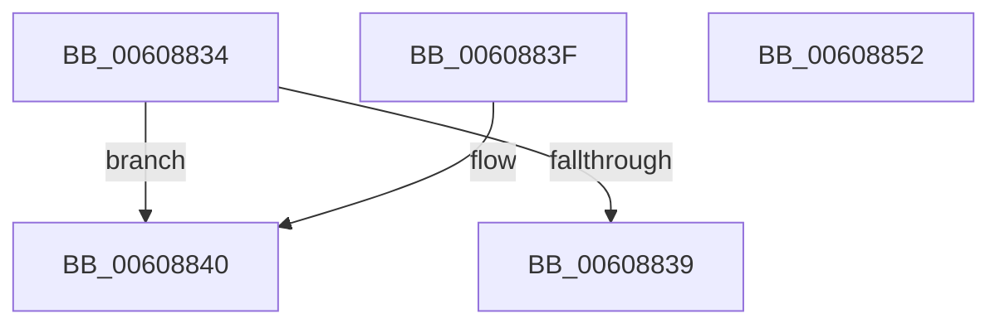

# SepSetObjectAntiTamperEntryEnumSid

- RVA: `0x00608834`–`0x00608853` (길이 `31` bytes)
- VA: `0x0000000140608834`
- 실행 섹션: `.text`
- PDB 이름 있음: `예`; PDB Function 태그: `아니요`
- unwind 정보 RVA: `0x000DB714`
- 디코드: `12`개 명령, `31/31` bytes 표시
- 미해석 바이트: `0` (있으면 어셈블리에 `.byte`로 보존)

> 이 문서는 커널 이미지의 기계어와 PDB 기호를 분석해 생성했습니다. 4번과 5번은 함수 원형과 자료형을 바이너리 사용 방식에서 추정한 C 해석이며 원본 소스 복구 결과는 아닙니다.

## 1. Dependencies

- 직접 호출 지점: **0**; 고유 호출 대상: **0**
- 직접 호출자로 확인된 함수: **2**
- RIP 상대 이미지 참조: **0**

### Outgoing calls
- 직접 디코드된 call 명령이 없습니다.

### Direct callers
- [SeInitializeObjectTypeEnumPolicyEntry](SeInitializeObjectTypeEnumPolicyEntry_function_00607790.md) at `0x006077CA`
- [SeInitializeObjectTypeUserAppInstancePolicyEntry](SeInitializeObjectTypeUserAppInstancePolicyEntry_function_00607870.md) at `0x006078A4`
- [SeInitializeObjectTypeUserAppInstancePolicyEntry](SeInitializeObjectTypeUserAppInstancePolicyEntry_function_00607870.md) at `0x006078C1`

### Static image references
- 디코드된 RIP-relative 메모리 참조가 없습니다.

## 2. Other-region calls and transfers

- 다른 실행 섹션으로 향하는 call: **0**
- 별도 외부 분기/꼬리 이동을 확인하지 못했습니다.

## 3. Assembly (complete function range)

```asm
00608834  3B 51 08                        cmp edx, dword ptr [rcx + 8]
00608837  72 07                           jb 0x140608840
00608839  B8 D1 04 00 C0                  mov eax, 0xc00004d1
0060883E  C3                              ret
0060883F  CC                              int3
00608840  8B C2                           mov eax, edx
00608842  48 03 C0                        add rax, rax
00608845  80 4C C1 10 01                  or byte ptr [rcx + rax*8 + 0x10], 1
0060884A  44 89 44 C1 18                  mov dword ptr [rcx + rax*8 + 0x18], r8d
0060884F  33 C0                           xor eax, eax
00608851  C3                              ret
00608852  CC                              int3
```

## 4. C-style interpretation (structured pseudocode)

```c
__int64 __fastcall SepSetObjectAntiTamperEntryEnumSid(__int64 a1, int a2, int a3)
{
    __int64 result;

    if (a2 < (*(unsigned int *)(a1 + 8))) goto loc_00608840;
    return (unsigned int)(0xC00004D1ULL);
loc_00608840:
    result = ((unsigned int)(a2)) + ((unsigned int)(a2));
    *(unsigned int *)(a1 + result * 8 + 24) = a3;
    result = 0;
    return result;
}
```

## 5. (Beta) C Style

```c
int64_t SepSetObjectAntiTamperEntryEnumSid(void *Arg1, int32_t Arg2, int32_t Arg3)
{
    uint8_t *arg1 = (uint8_t *)Arg1;

    int64_t result;

    if (Arg2 < (*(uint32_t *)(arg1 + 0x8))) goto loc_00608840;
    return (uint32_t)(0xC00004D1ULL);
loc_00608840:
    result = ((uint32_t)(Arg2)) + ((uint32_t)(Arg2));
    *(uint32_t *)(arg1 + result * 8 + 0x18) = Arg3;
    result = 0;
    return result;
}
```

### 관측된 메모리 오프셋

구조체 형식이 확인되지 않은 접근은 인자 기준의 오프셋으로만 기록했습니다.

| 기준 인자 | 오프셋 표현 | 폭 (bit) | 접근 |
|---|---:|---:|---|
| `Arg1` | `+ 0x8` | `32` | `R` |
| `Arg1` | `+ 0x10 + rax*8` | `8` | `R/W` |
| `Arg1` | `+ 0x18 + rax*8` | `32` | `W` |

## 6. Execution-region graph

[열기: 2D/3D 그래프와 함수 탐색 컨트롤 패널](../../../control-panel.html?section=text&rva=0x00608834&view=graph)

- 2D 그래프는 위에서 아래로 흐르고, 3D 그래프는 빈 공간을 드래그해 회전합니다. Shift+드래그는 이동, 휠은 확대·축소, 함수 노드 선택은 대상 보고서 이동입니다.

### Static fallback


