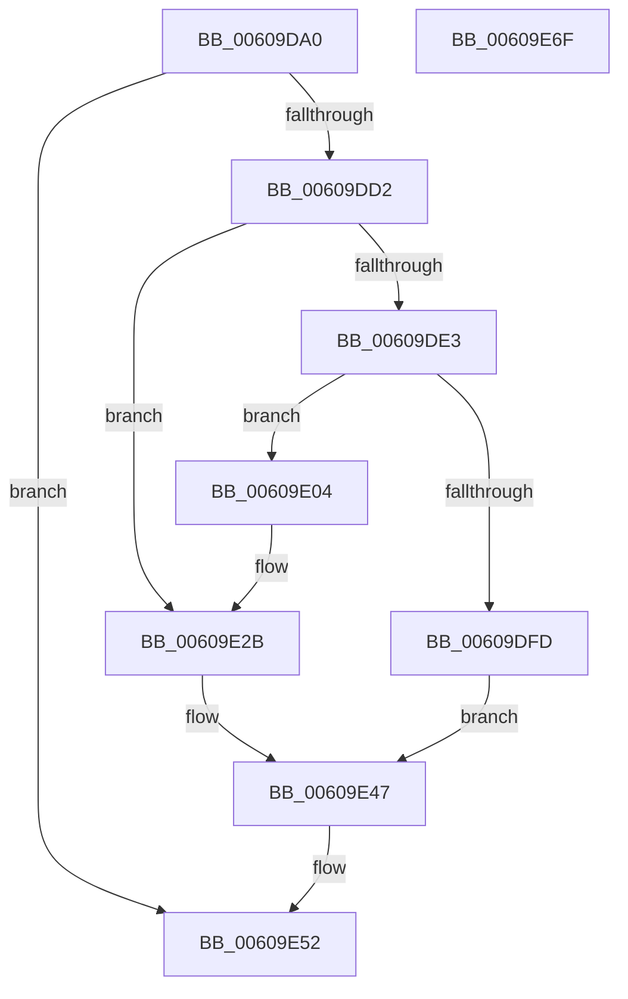

# SepSetSingletonEntry

- RVA: `0x00609DA0`–`0x00609E70` (길이 `208` bytes)
- VA: `0x0000000140609DA0`
- 실행 섹션: `.text`
- PDB 이름 있음: `예`; PDB Function 태그: `아니요`
- unwind 정보 RVA: `0x0005E6B4`
- 디코드: `58`개 명령, `208/208` bytes 표시
- 미해석 바이트: `0` (있으면 어셈블리에 `.byte`로 보존)

> 이 문서는 커널 이미지의 기계어와 PDB 기호를 분석해 생성했습니다. 4번과 5번은 함수 원형과 자료형을 바이너리 사용 방식에서 추정한 C 해석이며 원본 소스 복구 결과는 아닙니다.

## 1. Dependencies

- 직접 호출 지점: **5**; 고유 호출 대상: **5**
- 직접 호출자로 확인된 함수: **1**
- RIP 상대 이미지 참조: **1**

### Outgoing calls
- `0x00609DC1` → [SepGetSingletonEntryFromIndexNumber](../2F/SepGetSingletonEntryFromIndexNumber_function_002F095C.md) (function, `0x002F095C`)
- `0x00609DD5` → [ExAcquireSpinLockExclusive](../24/ExAcquireSpinLockExclusive_function_00248690.md) (function, `0x00248690`)
- `0x00609DEF` → [ExAllocatePool2](../../poolcode/B8/ExAllocatePool2_function_00B820F0.md) (function, `0x00B820F0`)
- `0x00609E35` → [AuthzBasepSetSecurityAttributesToken](../3A/AuthzBasepSetSecurityAttributesToken_function_003A8D1C.md) (function, `0x003A8D1C`)
- `0x00609E4D` → [ExReleaseSpinLockExclusive](../2C/ExReleaseSpinLockExclusive_function_002C0EF0.md) (function, `0x002C0EF0`)

### Direct callers
- [SeSetSecurityAttributesTokenEx](SeSetSecurityAttributesTokenEx_function_00609C00.md) at `0x00609CFD`

### Static image references
- `0x00609E3A` → RVA `0x00E08960` (`.data`; read)

## 2. Other-region calls and transfers

- 다른 실행 섹션으로 향하는 call: **1**
  - `0x00609DEF` → [ExAllocatePool2](../../poolcode/B8/ExAllocatePool2_function_00B820F0.md) (`.text` → `POOLCODE`)
- 별도 외부 분기/꼬리 이동을 확인하지 못했습니다.

## 3. Assembly (complete function range)

```asm
00609DA0  48 8B C4                        mov rax, rsp
00609DA3  48 89 58 08                     mov qword ptr [rax + 8], rbx
00609DA7  48 89 68 10                     mov qword ptr [rax + 0x10], rbp
00609DAB  48 89 70 18                     mov qword ptr [rax + 0x18], rsi
00609DAF  48 89 78 20                     mov qword ptr [rax + 0x20], rdi
00609DB3  41 56                           push r14
00609DB5  48 83 EC 20                     sub rsp, 0x20
00609DB9  49 8B E8                        mov rbp, r8
00609DBC  4C 8B F2                        mov r14, rdx
00609DBF  33 FF                           xor edi, edi
00609DC1  E8 96 6B CE FF                  call 0x1402f095c
00609DC6  48 8B D8                        mov rbx, rax
00609DC9  48 85 C0                        test rax, rax
00609DCC  0F 84 80 00 00 00               je 0x140609e52
00609DD2  48 8B C8                        mov rcx, rax
00609DD5  E8 B6 E8 C3 FF                  call 0x140248690
00609DDA  40 8A F0                        mov sil, al
00609DDD  48 39 7B 10                     cmp qword ptr [rbx + 0x10], rdi
00609DE1  75 48                           jne 0x140609e2b
00609DE3  8D 57 30                        lea edx, [rdi + 0x30]
00609DE6  41 B8 53 65 41 74               mov r8d, 0x74416553
00609DEC  8D 4F 40                        lea ecx, [rdi + 0x40]
00609DEF  E8 FC 82 57 00                  call 0x140b820f0
00609DF4  48 89 43 10                     mov qword ptr [rbx + 0x10], rax
00609DF8  48 85 C0                        test rax, rax
00609DFB  75 07                           jne 0x140609e04
00609DFD  BF 17 00 00 C0                  mov edi, 0xc0000017
00609E02  EB 43                           jmp 0x140609e47
00609E04  89 38                           mov dword ptr [rax], edi
00609E06  48 8B 43 10                     mov rax, qword ptr [rbx + 0x10]
00609E0A  89 78 18                        mov dword ptr [rax + 0x18], edi
00609E0D  48 8B 43 10                     mov rax, qword ptr [rbx + 0x10]
00609E11  48 83 C0 08                     add rax, 8
00609E15  48 89 40 08                     mov qword ptr [rax + 8], rax
00609E19  48 89 00                        mov qword ptr [rax], rax
00609E1C  48 8B 43 10                     mov rax, qword ptr [rbx + 0x10]
00609E20  48 83 C0 20                     add rax, 0x20
00609E24  48 89 40 08                     mov qword ptr [rax + 8], rax
00609E28  48 89 00                        mov qword ptr [rax], rax
00609E2B  48 8B 4B 10                     mov rcx, qword ptr [rbx + 0x10]
00609E2F  4C 8B C5                        mov r8, rbp
00609E32  49 8B D6                        mov rdx, r14
00609E35  E8 E2 EE D9 FF                  call 0x1403a8d1c
00609E3A  48 8B 0D 1F EB 7F 00            mov rcx, qword ptr [rip + 0x7feb1f]
00609E41  8B F8                           mov edi, eax
00609E43  83 49 10 01                     or dword ptr [rcx + 0x10], 1
00609E47  40 8A D6                        mov dl, sil
00609E4A  48 8B CB                        mov rcx, rbx
00609E4D  E8 9E 70 CB FF                  call 0x1402c0ef0
00609E52  48 8B 5C 24 30                  mov rbx, qword ptr [rsp + 0x30]
00609E57  8B C7                           mov eax, edi
00609E59  48 8B 7C 24 48                  mov rdi, qword ptr [rsp + 0x48]
00609E5E  48 8B 6C 24 38                  mov rbp, qword ptr [rsp + 0x38]
00609E63  48 8B 74 24 40                  mov rsi, qword ptr [rsp + 0x40]
00609E68  48 83 C4 20                     add rsp, 0x20
00609E6C  41 5E                           pop r14
00609E6E  C3                              ret
00609E6F  CC                              int3
```

## 4. C-style interpretation (structured pseudocode)

```c
__int64 __fastcall SepSetSingletonEntry(__int64 a1, __int64 a2, __int64 a3)
{
    __int64 result;
    __int64 v_rdi;
    __int64 v_rsp;
    unsigned __int64 v_stack_p10;
    unsigned __int64 v_stack_p18;
    unsigned __int64 v_stack_p20;
    unsigned __int64 v_stack_p8;

    *(unsigned __int64 *)(v_rsp + 8) = v_rbx;
    *(unsigned __int64 *)(v_rsp + 16) = v_rbp;
    *(unsigned __int64 *)(v_rsp + 24) = v_rsi;
    *(unsigned __int64 *)(v_rsp + 32) = v_rdi;
    v_rsp = (v_rsp) - (32);
    v_rdi = 0;
    result = SepGetSingletonEntryFromIndexNumber(a1, a2, a3, a4);
    if (result == 0) goto loc_00609E52;
    result = ExAcquireSpinLockExclusive(result, a2, a3, a4);
    if ((*(unsigned __int64 *)(result + 16)) != 0) goto loc_00609E2B;
    result = ExAllocatePool2(v_rdi + 64, v_rdi + 48, (unsigned int)(0x74416553ULL), a4);
    *(unsigned __int64 *)(result + 16) = result;
    if (result != 0) goto loc_00609E04;
    goto loc_00609E47;
loc_00609E04:
    *(unsigned int *)(result) = (unsigned int)((unsigned int)(0xC0000017ULL));
    *(unsigned int *)(*(unsigned __int64 *)(result + 16) + 24) = (unsigned int)((unsigned int)(0xC0000017ULL));
    result = (*(unsigned __int64 *)(result + 16)) + (8);
    *(unsigned __int64 *)(result + 8) = result;
    *(unsigned __int64 *)(result) = result;
    result = (*(unsigned __int64 *)(result + 16)) + (32);
    *(unsigned __int64 *)(result + 8) = result;
    *(unsigned __int64 *)(result) = result;
loc_00609E2B:
    result = AuthzBasepSetSecurityAttributesToken(*(unsigned __int64 *)(result + 16), a2, a3, a4);
loc_00609E47:
    result = ExReleaseSpinLockExclusive(result, (unsigned __int8)((unsigned __int8)(result)), a3, a4);
loc_00609E52:
    v_rsp = (v_rsp) + (32);
    return (unsigned int)((unsigned int)((unsigned int)((unsigned int)(result))));
}
```

## 5. (Beta) C Style

```c
int64_t SepSetSingletonEntry(int64_t Arg1, int64_t Arg2, int64_t Arg3)
{
    int64_t result;
    int64_t local_rdi;
    int64_t local_rsp;
    uint64_t v_stack_p10;
    uint64_t v_stack_p18;
    uint64_t v_stack_p20;
    uint64_t v_stack_p8;

    *(uint64_t *)(local_rsp + 0x8) = local_rbx;
    *(uint64_t *)(local_rsp + 0x10) = local_rbp;
    *(uint64_t *)(local_rsp + 0x18) = local_rsi;
    *(uint64_t *)(local_rsp + 0x20) = local_rdi;
    local_rsp = (local_rsp) - (32);
    local_rdi = 0;
    result = SepGetSingletonEntryFromIndexNumber(Arg1, Arg2, Arg3, a4);
    if (result == 0) goto loc_00609E52;
    result = ExAcquireSpinLockExclusive(result, Arg2, Arg3, a4);
    if ((*(uint64_t *)(result + 0x10)) != 0) goto loc_00609E2B;
    result = ExAllocatePool2(local_rdi + 64, local_rdi + 48, (uint32_t)(0x74416553ULL), a4);
    *(uint64_t *)(result + 0x10) = result;
    if (result != 0) goto loc_00609E04;
    goto loc_00609E47;
loc_00609E04:
    *(uint32_t *)(result) = (uint32_t)((uint32_t)(0xC0000017ULL));
    *(uint32_t *)(*(uint64_t *)(result + 0x10) + 0x18) = (uint32_t)((uint32_t)(0xC0000017ULL));
    result = (*(uint64_t *)(result + 0x10)) + (8);
    *(uint64_t *)(result + 0x8) = result;
    *(uint64_t *)(result) = result;
    result = (*(uint64_t *)(result + 0x10)) + (32);
    *(uint64_t *)(result + 0x8) = result;
    *(uint64_t *)(result) = result;
loc_00609E2B:
    result = AuthzBasepSetSecurityAttributesToken(*(uint64_t *)(result + 0x10), Arg2, Arg3, a4);
loc_00609E47:
    result = ExReleaseSpinLockExclusive(result, (uint8_t)((uint8_t)(result)), Arg3, a4);
loc_00609E52:
    local_rsp = (local_rsp) + (32);
    return (uint32_t)((uint32_t)((uint32_t)((uint32_t)(result))));
}
```

## 6. Execution-region graph

[열기: 2D/3D 그래프와 함수 탐색 컨트롤 패널](../../../control-panel.html?section=text&rva=0x00609DA0&view=graph)

- 2D 그래프는 위에서 아래로 흐르고, 3D 그래프는 빈 공간을 드래그해 회전합니다. Shift+드래그는 이동, 휠은 확대·축소, 함수 노드 선택은 대상 보고서 이동입니다.

### Static fallback


