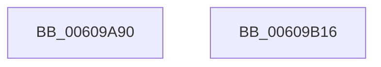

# SepSetTokenAllApplicationPackagesPolicy

- RVA: `0x00609A90`–`0x00609B17` (길이 `135` bytes)
- VA: `0x0000000140609A90`
- 실행 섹션: `.text`
- PDB 이름 있음: `예`; PDB Function 태그: `아니요`
- unwind 정보 RVA: `0x000C5708`
- 디코드: `34`개 명령, `135/135` bytes 표시
- 미해석 바이트: `0` (있으면 어셈블리에 `.byte`로 보존)

> 이 문서는 커널 이미지의 기계어와 PDB 기호를 분석해 생성했습니다. 4번과 5번은 함수 원형과 자료형을 바이너리 사용 방식에서 추정한 C 해석이며 원본 소스 복구 결과는 아닙니다.

## 1. Dependencies

- 직접 호출 지점: **2**; 고유 호출 대상: **2**
- 직접 호출자로 확인된 함수: **1**
- RIP 상대 이미지 참조: **1**

### Outgoing calls
- `0x00609AC2` → [RtlInitUnicodeString](../42/RtlInitUnicodeString_function_0042A780.md) (function, `0x0042A780`)
- `0x00609B03` → [AuthzBasepSetSecurityAttributesToken](../3A/AuthzBasepSetSecurityAttributesToken_function_003A8D1C.md) (function, `0x003A8D1C`)

### Direct callers
- [SeSubProcessToken](../../page/AA/SeSubProcessToken_function_00AAD570.md) at `0x00AADC16`

### Static image references
- `0x00609AAF` → RVA `0x006CD610` (` ?? ::FNODOBFM::`string'`; read)

## 2. Other-region calls and transfers

- 다른 실행 섹션으로 향하는 call: **0**
- 별도 외부 분기/꼬리 이동을 확인하지 못했습니다.

## 3. Assembly (complete function range)

```asm
00609A90  48 89 5C 24 18                  mov qword ptr [rsp + 0x18], rbx
00609A95  55                              push rbp
00609A96  48 8B EC                        mov rbp, rsp
00609A99  48 83 EC 60                     sub rsp, 0x60
00609A9D  33 C0                           xor eax, eax
00609A9F  0F 57 C0                        xorps xmm0, xmm0
00609AA2  48 89 45 F0                     mov qword ptr [rbp - 0x10], rax
00609AA6  48 8B D9                        mov rbx, rcx
00609AA9  8B C2                           mov eax, edx
00609AAB  48 8D 4D D0                     lea rcx, [rbp - 0x30]
00609AAF  48 8D 15 5A 3B 0C 00            lea rdx, [rip + 0xc3b5a]
00609AB6  48 89 45 10                     mov qword ptr [rbp + 0x10], rax
00609ABA  0F 11 45 D0                     movups xmmword ptr [rbp - 0x30], xmm0
00609ABE  0F 11 45 E0                     movups xmmword ptr [rbp - 0x20], xmm0
00609AC2  E8 B9 0C E2 FF                  call 0x14042a780
00609AC7  B9 01 00 00 00                  mov ecx, 1
00609ACC  48 C7 45 E0 02 00 00 00         mov qword ptr [rbp - 0x20], 2
00609AD4  48 8D 45 10                     lea rax, [rbp + 0x10]
00609AD8  89 4D E8                        mov dword ptr [rbp - 0x18], ecx
00609ADB  48 89 45 F0                     mov qword ptr [rbp - 0x10], rax
00609ADF  4C 8D 45 C0                     lea r8, [rbp - 0x40]
00609AE3  48 8D 45 D0                     lea rax, [rbp - 0x30]
00609AE7  89 4D C0                        mov dword ptr [rbp - 0x40], ecx
00609AEA  89 4D C4                        mov dword ptr [rbp - 0x3c], ecx
00609AED  48 8D 55 18                     lea rdx, [rbp + 0x18]
00609AF1  48 8B 8B 08 03 00 00            mov rcx, qword ptr [rbx + 0x308]
00609AF8  48 89 45 C8                     mov qword ptr [rbp - 0x38], rax
00609AFC  C7 45 18 04 00 00 00            mov dword ptr [rbp + 0x18], 4
00609B03  E8 14 F2 D9 FF                  call 0x1403a8d1c
00609B08  48 8B 9C 24 80 00 00 00         mov rbx, qword ptr [rsp + 0x80]
00609B10  48 83 C4 60                     add rsp, 0x60
00609B14  5D                              pop rbp
00609B15  C3                              ret
00609B16  CC                              int3
```

## 4. C-style interpretation (structured pseudocode)

```c
__int64 __fastcall SepSetTokenAllApplicationPackagesPolicy(__int64 a1, int a2)
{
    __int64 result;
    __int64 v_rsp;
    unsigned __int64 v_stack_m18;
    unsigned int v_stack_m20;
    unsigned __int64 v_stack_m28;
    unsigned __int64 v_stack_m38;
    unsigned __int64 v_stack_m40;
    unsigned int v_stack_m44;
    unsigned __int64 v_stack_m48;
    unsigned __int64 v_stack_p10;
    unsigned __int64 v_stack_p18;
    unsigned __int64 v_stack_p8;

    v_stack_p18 = v_rbx;
    v_rsp = (v_rsp) - (96);
    result = 0;
    v_stack_m18 = 0;
    v_stack_p8 = (unsigned int)(a2);
    v_stack_m38 = v_xmm0;
    v_stack_m28 = v_xmm0;
    result = RtlInitUnicodeString(v_stack_m38, v_rip + 801626, a3, a4);
    v_stack_m28 = 2;
    v_stack_m20 = 1;
    v_stack_m18 = v_stack_p8;
    v_stack_m48 = 1;
    v_stack_m44 = 1;
    v_stack_m40 = v_stack_m38;
    v_stack_p10 = 4;
    result = AuthzBasepSetSecurityAttributesToken(*(unsigned __int64 *)(a1 + 776), v_stack_p10, v_stack_m48, a4);
    v_rsp = (v_rsp) + (96);
    return result;
}
```

## 5. (Beta) C Style

```c
int64_t SepSetTokenAllApplicationPackagesPolicy(void *Arg1, int32_t Arg2)
{
    uint8_t *arg1 = (uint8_t *)Arg1;

    int64_t result;
    int64_t local_rsp;
    uint64_t v_stack_m18;
    uint32_t v_stack_m20;
    uint64_t v_stack_m28;
    uint64_t v_stack_m38;
    uint64_t v_stack_m40;
    uint32_t v_stack_m44;
    uint64_t v_stack_m48;
    uint64_t v_stack_p10;
    uint64_t v_stack_p18;
    uint64_t v_stack_p8;

    v_stack_p18 = local_rbx;
    local_rsp = (local_rsp) - (96);
    result = 0;
    v_stack_m18 = 0;
    v_stack_p8 = (uint32_t)(Arg2);
    v_stack_m38 = v_xmm0;
    v_stack_m28 = v_xmm0;
    result = RtlInitUnicodeString(v_stack_m38, v_rip + 801626, a3, a4);
    v_stack_m28 = 2;
    v_stack_m20 = 1;
    v_stack_m18 = v_stack_p8;
    v_stack_m48 = 1;
    v_stack_m44 = 1;
    v_stack_m40 = v_stack_m38;
    v_stack_p10 = 4;
    result = AuthzBasepSetSecurityAttributesToken(*(uint64_t *)(arg1 + 0x308), v_stack_p10, v_stack_m48, a4);
    local_rsp = (local_rsp) + (96);
    return result;
}
```

### 관측된 메모리 오프셋

구조체 형식이 확인되지 않은 접근은 인자 기준의 오프셋으로만 기록했습니다.

| 기준 인자 | 오프셋 표현 | 폭 (bit) | 접근 |
|---|---:|---:|---|
| `Arg1` | `+ 0x308` | `64` | `R` |

## 6. Execution-region graph

[열기: 2D/3D 그래프와 함수 탐색 컨트롤 패널](../../../control-panel.html?section=text&rva=0x00609A90&view=graph)

- 2D 그래프는 위에서 아래로 흐르고, 3D 그래프는 빈 공간을 드래그해 회전합니다. Shift+드래그는 이동, 휠은 확대·축소, 함수 노드 선택은 대상 보고서 이동입니다.

### Static fallback


