# SepSetTokenAntiTamperEntry

- RVA: `0x0060B28C`–`0x0060B58C` (길이 `768` bytes)
- VA: `0x000000014060B28C`
- 실행 섹션: `.text`
- PDB 이름 있음: `예`; PDB Function 태그: `아니요`
- unwind 정보 RVA: `0x000CCC68`
- 디코드: `209`개 명령, `768/768` bytes 표시
- 미해석 바이트: `0` (있으면 어셈블리에 `.byte`로 보존)

> 이 문서는 커널 이미지의 기계어와 PDB 기호를 분석해 생성했습니다. 4번과 5번은 함수 원형과 자료형을 바이너리 사용 방식에서 추정한 C 해석이며 원본 소스 복구 결과는 아닙니다.

## 1. Dependencies

- 직접 호출 지점: **25**; 고유 호출 대상: **10**
- 직접 호출자로 확인된 함수: **4**
- RIP 상대 이미지 참조: **3**

### Outgoing calls
- `0x0060B303` → [KeAbPreAcquire](../21/KeAbPreAcquire_function_00210230.md) (function, `0x00210230`)
- `0x0060B32E` → [ExfAcquirePushLockSharedEx](../21/ExfAcquirePushLockSharedEx_function_0021044C.md) (function, `0x0021044C`)
- `0x0060B348` → [SepGetTokenSessionAntiTamperMapEntry](SepGetTokenSessionAntiTamperMapEntry_function_0060B104.md) (function, `0x0060B104`)
- `0x0060B37C` → [ExfReleasePushLockShared](../26/ExfReleasePushLockShared_function_00263440.md) (function, `0x00263440`)
- `0x0060B384` → [KeAbPostRelease](../2E/KeAbPostRelease_function_002E1600.md) (function, `0x002E1600`)
- `0x0060B389` → [KeLeaveCriticalRegion](../25/KeLeaveCriticalRegion_function_0025D8B0.md) (function, `0x0025D8B0`)
- `0x0060B3A7` → [KeAbPreAcquire](../21/KeAbPreAcquire_function_00210230.md) (function, `0x00210230`)
- `0x0060B3C0` → [ExfAcquirePushLockExclusiveEx](../20/ExfAcquirePushLockExclusiveEx_function_0020FC90.md) (function, `0x0020FC90`)
- `0x0060B3D8` → [SepGetTokenSessionAntiTamperMapEntry](SepGetTokenSessionAntiTamperMapEntry_function_0060B104.md) (function, `0x0060B104`)
- `0x0060B41A` → [KeAbPreAcquire](../21/KeAbPreAcquire_function_00210230.md) (function, `0x00210230`)
- `0x0060B437` → [ExfAcquirePushLockExclusiveEx](../20/ExfAcquirePushLockExclusiveEx_function_0020FC90.md) (function, `0x0020FC90`)
- `0x0060B451` → [SepInitializeAntiTamperTable](SepInitializeAntiTamperTable_function_0060B1EC.md) (function, `0x0060B1EC`)
- `0x0060B46A` → [ExfTryToWakePushLock](../26/ExfTryToWakePushLock_function_00265DD0.md) (function, `0x00265DD0`)
- `0x0060B473` → [KeAbPostRelease](../2E/KeAbPostRelease_function_002E1600.md) (function, `0x002E1600`)
- `0x0060B478` → [KeLeaveCriticalRegion](../25/KeLeaveCriticalRegion_function_0025D8B0.md) (function, `0x0025D8B0`)
- `0x0060B4A8` → [KeAbPreAcquire](../21/KeAbPreAcquire_function_00210230.md) (function, `0x00210230`)
- `0x0060B4C5` → [ExfAcquirePushLockExclusiveEx](../20/ExfAcquirePushLockExclusiveEx_function_0020FC90.md) (function, `0x0020FC90`)
- `0x0060B4E1` → [SepGetAntiTamperEntry](SepGetAntiTamperEntry_function_0060AEE4.md) (function, `0x0060AEE4`)
- `0x0060B50D` → [ExfTryToWakePushLock](../26/ExfTryToWakePushLock_function_00265DD0.md) (function, `0x00265DD0`)
- `0x0060B516` → [KeAbPostRelease](../2E/KeAbPostRelease_function_002E1600.md) (function, `0x002E1600`)
- `0x0060B51B` → [KeLeaveCriticalRegion](../25/KeLeaveCriticalRegion_function_0025D8B0.md) (function, `0x0025D8B0`)
- `0x0060B53F` → [ExfTryToWakePushLock](../26/ExfTryToWakePushLock_function_00265DD0.md) (function, `0x00265DD0`)
- `0x0060B562` → [ExfReleasePushLockShared](../26/ExfReleasePushLockShared_function_00263440.md) (function, `0x00263440`)
- `0x0060B56E` → [KeAbPostRelease](../2E/KeAbPostRelease_function_002E1600.md) (function, `0x002E1600`)
- `0x0060B573` → [KeLeaveCriticalRegion](../25/KeLeaveCriticalRegion_function_0025D8B0.md) (function, `0x0025D8B0`)

### Direct callers
- [SeSetTokenTamperProtection](SeSetTokenTamperProtection_function_00609644.md) at `0x0060996B`
- [SeExchangePrimaryToken](../../page/7A/SeExchangePrimaryToken_function_007A07BC.md) at `0x007A0944`
- [SeSubProcessToken](../../page/AA/SeSubProcessToken_function_00AAD570.md) at `0x00AAD966`
- [SeSetSessionIdToken](../../page/AF/SeSetSessionIdToken_function_00AF1F0C.md) at `0x00AF1FFE`

### Static image references
- `0x0060B2D4` → RVA `0x00F04D20` (`.data`; read)
- `0x0060B2F1` → RVA `0x00F04D10` (`.data`; read)
- `0x0060B527` → RVA `0x00F04D10` (`.data`; read/write)

## 2. Other-region calls and transfers

- 다른 실행 섹션으로 향하는 call: **0**
- 별도 외부 분기/꼬리 이동을 확인하지 못했습니다.

## 3. Assembly (complete function range)

```asm
0060B28C  4C 89 4C 24 20                  mov qword ptr [rsp + 0x20], r9
0060B291  4C 89 44 24 18                  mov qword ptr [rsp + 0x18], r8
0060B296  48 89 4C 24 08                  mov qword ptr [rsp + 8], rcx
0060B29B  55                              push rbp
0060B29C  53                              push rbx
0060B29D  56                              push rsi
0060B29E  57                              push rdi
0060B29F  41 54                           push r12
0060B2A1  41 55                           push r13
0060B2A3  41 56                           push r14
0060B2A5  41 57                           push r15
0060B2A7  48 8B EC                        mov rbp, rsp
0060B2AA  48 83 EC 48                     sub rsp, 0x48
0060B2AE  44 8B F2                        mov r14d, edx
0060B2B1  48 83 CB FF                     or rbx, 0xffffffffffffffff
0060B2B5  33 D2                           xor edx, edx
0060B2B7  4D 8B F9                        mov r15, r9
0060B2BA  48 89 55 D8                     mov qword ptr [rbp - 0x28], rdx
0060B2BE  44 8A E2                        mov r12b, dl
0060B2C1  48 89 55 E0                     mov qword ptr [rbp - 0x20], rdx
0060B2C5  44 8A EA                        mov r13b, dl
0060B2C8  8B F2                           mov esi, edx
0060B2CA  41 83 FE 05                     cmp r14d, 5
0060B2CE  73 18                           jae 0x14060b2e8
0060B2D0  4B 8D 0C B6                     lea rcx, [r14 + r14*4]
0060B2D4  48 8D 05 45 9A 8F 00            lea rax, [rip + 0x8f9a45]
0060B2DB  4C 8D 34 C8                     lea r14, [rax + rcx*8]
0060B2DF  4C 89 75 D8                     mov qword ptr [rbp - 0x28], r14
0060B2E3  E9 0B 01 00 00                  jmp 0x14060b3f3
0060B2E8  65 48 8B 04 25 88 01 00 00      mov rax, qword ptr gs:[0x188]
0060B2F1  48 8D 0D 18 9A 8F 00            lea rcx, [rip + 0x8f9a18]
0060B2F8  45 33 C0                        xor r8d, r8d
0060B2FB  66 01 98 E4 01 00 00            add word ptr [rax + 0x1e4], bx
0060B302  90                              nop
0060B303  E8 28 4F C0 FF                  call 0x140210230
0060B308  48 8B F8                        mov rdi, rax
0060B30B  33 C0                           xor eax, eax
0060B30D  8D 48 11                        lea ecx, [rax + 0x11]
0060B310  F0 48 0F B1 0D F7 99 8F 00      lock cmpxchg qword ptr [rip + 0x8f99f7], rcx
0060B319  74 18                           je 0x14060b333
0060B31B  4C 8D 0D EE 99 8F 00            lea r9, [rip + 0x8f99ee]
0060B322  4C 8B C7                        mov r8, rdi
0060B325  33 D2                           xor edx, edx
0060B327  48 8D 0D E2 99 8F 00            lea rcx, [rip + 0x8f99e2]
0060B32E  E8 19 51 C0 FF                  call 0x14021044c
0060B333  48 85 FF                        test rdi, rdi
0060B336  74 04                           je 0x14060b33c
0060B338  C6 47 0A 01                     mov byte ptr [rdi + 0xa], 1
0060B33C  4C 8D 45 D8                     lea r8, [rbp - 0x28]
0060B340  33 D2                           xor edx, edx
0060B342  41 8B CE                        mov ecx, r14d
0060B345  41 B4 01                        mov r12b, 1
0060B348  E8 B7 FD FF FF                  call 0x14060b104
0060B34D  33 D2                           xor edx, edx
0060B34F  8B F0                           mov esi, eax
0060B351  85 C0                           test eax, eax
0060B353  0F 89 96 00 00 00               jns 0x14060b3ef
0060B359  3D 25 02 00 C0                  cmp eax, 0xc0000225
0060B35E  0F 85 E7 01 00 00               jne 0x14060b54b
0060B364  8D 42 11                        lea eax, [rdx + 0x11]
0060B367  F0 48 0F B1 15 A0 99 8F 00      lock cmpxchg qword ptr [rip + 0x8f99a0], rdx
0060B370  48 8D 35 99 99 8F 00            lea rsi, [rip + 0x8f9999]
0060B377  74 08                           je 0x14060b381
0060B379  48 8B CE                        mov rcx, rsi
0060B37C  E8 BF 80 C5 FF                  call 0x140263440
0060B381  48 8B CE                        mov rcx, rsi
0060B384  E8 77 62 CD FF                  call 0x1402e1600
0060B389  E8 22 25 C5 FF                  call 0x14025d8b0
0060B38E  65 48 8B 04 25 88 01 00 00      mov rax, qword ptr gs:[0x188]
0060B397  45 33 C0                        xor r8d, r8d
0060B39A  33 D2                           xor edx, edx
0060B39C  48 8B CE                        mov rcx, rsi
0060B39F  66 01 98 E4 01 00 00            add word ptr [rax + 0x1e4], bx
0060B3A6  90                              nop
0060B3A7  E8 84 4E C0 FF                  call 0x140210230
0060B3AC  F0 48 0F BA 2E 00               lock bts qword ptr [rsi], 0
0060B3B2  48 8B F8                        mov rdi, rax
0060B3B5  73 0E                           jae 0x14060b3c5
0060B3B7  4C 8B C6                        mov r8, rsi
0060B3BA  48 8B D0                        mov rdx, rax
0060B3BD  48 8B CE                        mov rcx, rsi
0060B3C0  E8 CB 48 C0 FF                  call 0x14020fc90
0060B3C5  48 85 FF                        test rdi, rdi
0060B3C8  74 04                           je 0x14060b3ce
0060B3CA  44 88 67 0A                     mov byte ptr [rdi + 0xa], r12b
0060B3CE  4C 8D 45 D8                     lea r8, [rbp - 0x28]
0060B3D2  41 8A D4                        mov dl, r12b
0060B3D5  41 8B CE                        mov ecx, r14d
0060B3D8  E8 27 FD FF FF                  call 0x14060b104
0060B3DD  33 D2                           xor edx, edx
0060B3DF  8B F0                           mov esi, eax
0060B3E1  44 8A E2                        mov r12b, dl
0060B3E4  41 B5 01                        mov r13b, 1
0060B3E7  85 C0                           test eax, eax
0060B3E9  0F 88 33 01 00 00               js 0x14060b522
0060B3EF  4C 8B 75 D8                     mov r14, qword ptr [rbp - 0x28]
0060B3F3  41 38 56 20                     cmp byte ptr [r14 + 0x20], dl
0060B3F7  0F 85 86 00 00 00               jne 0x14060b483
0060B3FD  65 48 8B 04 25 88 01 00 00      mov rax, qword ptr gs:[0x188]
0060B406  45 33 C0                        xor r8d, r8d
0060B409  48 8B 7D D8                     mov rdi, qword ptr [rbp - 0x28]
0060B40D  33 D2                           xor edx, edx
0060B40F  48 8B CF                        mov rcx, rdi
0060B412  66 01 98 E4 01 00 00            add word ptr [rax + 0x1e4], bx
0060B419  90                              nop
0060B41A  E8 11 4E C0 FF                  call 0x140210230
0060B41F  F0 48 0F BA 2F 00               lock bts qword ptr [rdi], 0
0060B425  48 8B 7D D8                     mov rdi, qword ptr [rbp - 0x28]
0060B429  4C 8B F8                        mov r15, rax
0060B42C  73 0E                           jae 0x14060b43c
0060B42E  4C 8B C7                        mov r8, rdi
0060B431  48 8B D0                        mov rdx, rax
0060B434  48 8B CF                        mov rcx, rdi
0060B437  E8 54 48 C0 FF                  call 0x14020fc90
0060B43C  33 C0                           xor eax, eax
0060B43E  4D 85 FF                        test r15, r15
0060B441  74 05                           je 0x14060b448
0060B443  41 C6 47 0A 01                  mov byte ptr [r15 + 0xa], 1
0060B448  41 38 46 20                     cmp byte ptr [r14 + 0x20], al
0060B44C  75 0A                           jne 0x14060b458
0060B44E  48 8B CF                        mov rcx, rdi
0060B451  E8 96 FD FF FF                  call 0x14060b1ec
0060B456  8B F0                           mov esi, eax
0060B458  48 8B C3                        mov rax, rbx
0060B45B  F0 48 0F C1 07                  lock xadd qword ptr [rdi], rax
0060B460  24 06                           and al, 6
0060B462  3C 02                           cmp al, 2
0060B464  75 09                           jne 0x14060b46f
0060B466  48 8B 4D D8                     mov rcx, qword ptr [rbp - 0x28]
0060B46A  E8 61 A9 C5 FF                  call 0x140265dd0
0060B46F  48 8B 4D D8                     mov rcx, qword ptr [rbp - 0x28]
0060B473  E8 88 61 CD FF                  call 0x1402e1600
0060B478  E8 33 24 C5 FF                  call 0x14025d8b0
0060B47D  4C 8B 7D 60                     mov r15, qword ptr [rbp + 0x60]
0060B481  33 D2                           xor edx, edx
0060B483  85 F6                           test esi, esi
0060B485  0F 85 97 00 00 00               jne 0x14060b522
0060B48B  65 48 8B 04 25 88 01 00 00      mov rax, qword ptr gs:[0x188]
0060B494  45 33 C0                        xor r8d, r8d
0060B497  48 8B 7D D8                     mov rdi, qword ptr [rbp - 0x28]
0060B49B  33 D2                           xor edx, edx
0060B49D  48 8B CF                        mov rcx, rdi
0060B4A0  66 01 98 E4 01 00 00            add word ptr [rax + 0x1e4], bx
0060B4A7  90                              nop
0060B4A8  E8 83 4D C0 FF                  call 0x140210230
0060B4AD  F0 48 0F BA 2F 00               lock bts qword ptr [rdi], 0
0060B4B3  48 8B 7D D8                     mov rdi, qword ptr [rbp - 0x28]
0060B4B7  48 8B F0                        mov rsi, rax
0060B4BA  73 0E                           jae 0x14060b4ca
0060B4BC  4C 8B C7                        mov r8, rdi
0060B4BF  48 8B D0                        mov rdx, rax
0060B4C2  48 8B CF                        mov rcx, rdi
0060B4C5  E8 C6 47 C0 FF                  call 0x14020fc90
0060B4CA  48 85 F6                        test rsi, rsi
0060B4CD  74 04                           je 0x14060b4d3
0060B4CF  C6 46 0A 01                     mov byte ptr [rsi + 0xa], 1
0060B4D3  48 8B 55 58                     mov rdx, qword ptr [rbp + 0x58]
0060B4D7  4C 8D 4D E0                     lea r9, [rbp - 0x20]
0060B4DB  4D 8B C7                        mov r8, r15
0060B4DE  48 8B CF                        mov rcx, rdi
0060B4E1  E8 FE F9 FF FF                  call 0x14060aee4
0060B4E6  8B F0                           mov esi, eax
0060B4E8  85 C0                           test eax, eax
0060B4EA  75 0F                           jne 0x14060b4fb
0060B4EC  48 8B 4D 48                     mov rcx, qword ptr [rbp + 0x48]
0060B4F0  48 8B 45 E0                     mov rax, qword ptr [rbp - 0x20]
0060B4F4  48 89 81 B8 05 00 00            mov qword ptr [rcx + 0x5b8], rax
0060B4FB  48 8B C3                        mov rax, rbx
0060B4FE  F0 48 0F C1 07                  lock xadd qword ptr [rdi], rax
0060B503  24 06                           and al, 6
0060B505  3C 02                           cmp al, 2
0060B507  75 09                           jne 0x14060b512
0060B509  48 8B 4D D8                     mov rcx, qword ptr [rbp - 0x28]
0060B50D  E8 BE A8 C5 FF                  call 0x140265dd0
0060B512  48 8B 4D D8                     mov rcx, qword ptr [rbp - 0x28]
0060B516  E8 E5 60 CD FF                  call 0x1402e1600
0060B51B  E8 90 23 C5 FF                  call 0x14025d8b0
0060B520  33 D2                           xor edx, edx
0060B522  45 84 ED                        test r13b, r13b
0060B525  74 1F                           je 0x14060b546
0060B527  F0 48 0F C1 1D E0 97 8F 00      lock xadd qword ptr [rip + 0x8f97e0], rbx
0060B530  80 E3 06                        and bl, 6
0060B533  80 FB 02                        cmp bl, 2
0060B536  75 2F                           jne 0x14060b567
0060B538  48 8D 0D D1 97 8F 00            lea rcx, [rip + 0x8f97d1]
0060B53F  E8 8C A8 C5 FF                  call 0x140265dd0
0060B544  EB 21                           jmp 0x14060b567
0060B546  45 84 E4                        test r12b, r12b
0060B549  74 2D                           je 0x14060b578
0060B54B  B8 11 00 00 00                  mov eax, 0x11
0060B550  F0 48 0F B1 15 B7 97 8F 00      lock cmpxchg qword ptr [rip + 0x8f97b7], rdx
0060B559  74 0C                           je 0x14060b567
0060B55B  48 8D 0D AE 97 8F 00            lea rcx, [rip + 0x8f97ae]
0060B562  E8 D9 7E C5 FF                  call 0x140263440
0060B567  48 8D 0D A2 97 8F 00            lea rcx, [rip + 0x8f97a2]
0060B56E  E8 8D 60 CD FF                  call 0x1402e1600
0060B573  E8 38 23 C5 FF                  call 0x14025d8b0
0060B578  8B C6                           mov eax, esi
0060B57A  48 83 C4 48                     add rsp, 0x48
0060B57E  41 5F                           pop r15
0060B580  41 5E                           pop r14
0060B582  41 5D                           pop r13
0060B584  41 5C                           pop r12
0060B586  5F                              pop rdi
0060B587  5E                              pop rsi
0060B588  5B                              pop rbx
0060B589  5D                              pop rbp
0060B58A  C3                              ret
0060B58B  CC                              int3
```

## 4. C-style interpretation (structured pseudocode)

```c
__int64 __fastcall SepSetTokenAntiTamperEntry(__int64 a1, int a2, __int64 a3, __int64 a4)
{
    __int64 result;
    __int64 v_rbx;
    __int64 v_rsi;
    __int64 v_rsp;
    unsigned __int64 v_stack_m60;
    unsigned __int64 v_stack_m68;
    unsigned __int64 v_stack_p18;
    unsigned __int64 v_stack_p20;
    unsigned __int64 v_stack_p8;

    v_stack_p20 = a4;
    v_stack_p18 = a3;
    v_stack_p8 = a1;
    v_rsp = (v_rsp) - (72);
    v_rbx = (v_rbx) | (-1);
    a2 = 0;
    v_stack_m68 = 0;
    v_stack_m60 = 0;
    if (((unsigned int)((unsigned int)(a2))) >= 5) goto loc_0060B2E8;
    v_stack_m68 = v_rip + 9411141 + (unsigned int)(a2) + (unsigned int)(a2) * 4 * 8;
    goto loc_0060B3F3;
loc_0060B2E8:
    a3 = 0;
    result = KeAbPreAcquire(v_rip + 9411096, a2, a3, a4);
    result = 0;
    if (!(condition_is_equal)) {
        a4 = v_rip + 9411054;
        a3 = 0;
        a2 = 0;
        a1 = v_rip + 9411042;
        result = ExfAcquirePushLockSharedEx(a1, a2, a3, a4);
    }
    if (result != 0) {
        *(unsigned __int8 *)(result + 10) = 1;
    }
    a2 = 0;
    result = SepGetTokenSessionAntiTamperMapEntry((unsigned int)((unsigned int)(v_rip + 9411141 + (unsigned int)(a2) + (unsigned int)(a2) * 4 * 8)), a2, v_stack_m68, a4);
    a2 = 0;
    if (!sign_flag) goto loc_0060B3EF;
    if (((unsigned int)(result)) != 0xC0000225ULL) goto loc_0060B54B;
    result = a2 + 17;
    if (((unsigned int)(result)) != 0xC0000225ULL) {
        a1 = v_rip + 9410969;
        result = ExfReleasePushLockShared(a1, a2, v_stack_m68, a4);
    }
    result = KeAbPostRelease(v_rip + 9410969, a2, v_stack_m68, a4);
    result = KeLeaveCriticalRegion(v_rip + 9410969, a2, v_stack_m68, a4);
    a3 = 0;
    a2 = 0;
    result = KeAbPreAcquire(v_rip + 9410969, a2, a3, a4);
    if (!(condition_is_above_or_equal)) {
        a3 = v_rip + 9410969;
        a2 = result;
        a1 = v_rip + 9410969;
        result = ExfAcquirePushLockExclusiveEx(a1, a2, a3, a4);
    }
    if (result != 0) {
        *(unsigned __int8 *)(result + 10) = 1;
    }
    result = SepGetTokenSessionAntiTamperMapEntry((unsigned int)((unsigned int)(v_rip + 9411141 + (unsigned int)(a2) + (unsigned int)(a2) * 4 * 8)), 1, v_stack_m68, a4);
    a2 = 0;
    if (sign_flag) goto loc_0060B522;
loc_0060B3EF:
loc_0060B3F3:
    if ((*(unsigned __int8 *)(v_stack_m68 + 32)) != 0) goto loc_0060B483;
    a3 = 0;
    a2 = 0;
    result = KeAbPreAcquire(v_stack_m68, a2, a3, a4);
    if (!(condition_is_above_or_equal)) {
        a3 = v_stack_m68;
        a2 = result;
        a1 = v_stack_m68;
        result = ExfAcquirePushLockExclusiveEx(a1, a2, a3, a4);
    }
    result = 0;
    if (0 != 0) {
        *(unsigned __int8 *)(result + 10) = 1;
    }
    v_rsi = (unsigned int)((unsigned int)(result));
    if ((*(unsigned __int8 *)(v_stack_m68 + 32)) == 0) {
        a1 = v_stack_m68;
        result = SepInitializeAntiTamperTable(a1, a2, a3, a4);
        v_rsi = (unsigned int)(result);
    }
    result = (unsigned __int8)((v_rbx) & (6));
    if (((unsigned __int8)(result)) == 2) {
        a1 = v_stack_m68;
        result = ExfTryToWakePushLock(a1, a2, a3, a4);
    }
    result = KeAbPostRelease(v_stack_m68, a2, a3, a4);
    result = KeLeaveCriticalRegion(v_stack_m68, a2, a3, a4);
    a2 = 0;
loc_0060B483:
    if ((unsigned int)(v_rsi) != 0) goto loc_0060B522;
    a3 = 0;
    a2 = 0;
    result = KeAbPreAcquire(v_stack_m68, a2, a3, a4);
    if (!(condition_is_above_or_equal)) {
        a3 = v_stack_m68;
        a2 = result;
        a1 = v_stack_m68;
        result = ExfAcquirePushLockExclusiveEx(a1, a2, a3, a4);
    }
    if (result != 0) {
        *(unsigned __int8 *)(result + 10) = 1;
    }
    result = SepGetAntiTamperEntry(v_stack_m68, v_stack_p18, v_stack_p20, v_stack_m60);
    if ((unsigned int)(result) == 0) {
        a1 = v_stack_p8;
        result = v_stack_m60;
        *(unsigned __int64 *)(a1 + 1464) = result;
    }
    result = (unsigned __int8)((v_rbx) & (6));
    if (((unsigned __int8)(result)) == 2) {
        a1 = v_stack_m68;
        result = ExfTryToWakePushLock(a1, v_stack_p18, v_stack_p20, v_stack_m60);
    }
    result = KeAbPostRelease(v_stack_m68, v_stack_p18, v_stack_p20, v_stack_m60);
    result = KeLeaveCriticalRegion(v_stack_m68, v_stack_p18, v_stack_p20, v_stack_m60);
    a2 = 0;
loc_0060B522:
    if (1 == 0) goto loc_0060B546;
    v_rbx = (unsigned __int8)((v_rbx) & (6));
    if (((unsigned __int8)(v_rbx)) != 2) goto loc_0060B567;
    result = ExfTryToWakePushLock(v_rip + 9410513, a2, v_stack_p20, v_stack_m60);
    goto loc_0060B567;
loc_0060B546:
    if (0 == 0) goto loc_0060B578;
loc_0060B54B:
    result = 17;
    if (0 != 0) {
        a1 = v_rip + 9410478;
        result = ExfReleasePushLockShared(a1, a2, v_stack_p20, v_stack_m60);
    }
    result = KeAbPostRelease(v_rip + 9410466, a2, v_stack_p20, v_stack_m60);
    result = KeLeaveCriticalRegion(v_rip + 9410466, a2, v_stack_p20, v_stack_m60);
loc_0060B578:
    v_rsp = (v_rsp) + (72);
    return (unsigned int)((unsigned int)((unsigned int)((unsigned int)(result))));
}
```

## 5. (Beta) C Style

```c
int64_t SepSetTokenAntiTamperEntry(int64_t Arg1, int32_t Arg2, int64_t Arg3, int64_t Arg4)
{
    int64_t result;
    int64_t local_rbx;
    int64_t local_rsi;
    int64_t local_rsp;
    uint64_t v_stack_m60;
    uint64_t v_stack_m68;
    uint64_t v_stack_p18;
    uint64_t v_stack_p20;
    uint64_t v_stack_p8;

    v_stack_p20 = Arg4;
    v_stack_p18 = Arg3;
    v_stack_p8 = Arg1;
    local_rsp = (local_rsp) - (72);
    local_rbx = (local_rbx) | (-1);
    Arg2 = 0;
    v_stack_m68 = 0;
    v_stack_m60 = 0;
    if (((uint32_t)((uint32_t)(Arg2))) >= 5) goto loc_0060B2E8;
    v_stack_m68 = v_rip + 9411141 + (uint32_t)(Arg2) + (uint32_t)(Arg2) * 4 * 8;
    goto loc_0060B3F3;
loc_0060B2E8:
    Arg3 = 0;
    result = KeAbPreAcquire(v_rip + 9411096, Arg2, Arg3, Arg4);
    result = 0;
    if (!(condition_is_equal)) {
        Arg4 = v_rip + 9411054;
        Arg3 = 0;
        Arg2 = 0;
        Arg1 = v_rip + 9411042;
        result = ExfAcquirePushLockSharedEx(Arg1, Arg2, Arg3, Arg4);
    }
    if (result != 0) {
        *(uint8_t *)(result + 0xA) = 1;
    }
    Arg2 = 0;
    result = SepGetTokenSessionAntiTamperMapEntry((uint32_t)((uint32_t)(v_rip + 9411141 + (uint32_t)(Arg2) + (uint32_t)(Arg2) * 4 * 8)), Arg2, v_stack_m68, Arg4);
    Arg2 = 0;
    if (!sign_flag) goto loc_0060B3EF;
    if (((uint32_t)(result)) != 0xC0000225ULL) goto loc_0060B54B;
    result = Arg2 + 17;
    if (((uint32_t)(result)) != 0xC0000225ULL) {
        Arg1 = v_rip + 9410969;
        result = ExfReleasePushLockShared(Arg1, Arg2, v_stack_m68, Arg4);
    }
    result = KeAbPostRelease(v_rip + 9410969, Arg2, v_stack_m68, Arg4);
    result = KeLeaveCriticalRegion(v_rip + 9410969, Arg2, v_stack_m68, Arg4);
    Arg3 = 0;
    Arg2 = 0;
    result = KeAbPreAcquire(v_rip + 9410969, Arg2, Arg3, Arg4);
    if (!(condition_is_above_or_equal)) {
        Arg3 = v_rip + 9410969;
        Arg2 = result;
        Arg1 = v_rip + 9410969;
        result = ExfAcquirePushLockExclusiveEx(Arg1, Arg2, Arg3, Arg4);
    }
    if (result != 0) {
        *(uint8_t *)(result + 0xA) = 1;
    }
    result = SepGetTokenSessionAntiTamperMapEntry((uint32_t)((uint32_t)(v_rip + 9411141 + (uint32_t)(Arg2) + (uint32_t)(Arg2) * 4 * 8)), 1, v_stack_m68, Arg4);
    Arg2 = 0;
    if (sign_flag) goto loc_0060B522;
loc_0060B3EF:
loc_0060B3F3:
    if ((*(uint8_t *)(v_stack_m68 + 0x20)) != 0) goto loc_0060B483;
    Arg3 = 0;
    Arg2 = 0;
    result = KeAbPreAcquire(v_stack_m68, Arg2, Arg3, Arg4);
    if (!(condition_is_above_or_equal)) {
        Arg3 = v_stack_m68;
        Arg2 = result;
        Arg1 = v_stack_m68;
        result = ExfAcquirePushLockExclusiveEx(Arg1, Arg2, Arg3, Arg4);
    }
    result = 0;
    if (0 != 0) {
        *(uint8_t *)(result + 0xA) = 1;
    }
    local_rsi = (uint32_t)((uint32_t)(result));
    if ((*(uint8_t *)(v_stack_m68 + 0x20)) == 0) {
        Arg1 = v_stack_m68;
        result = SepInitializeAntiTamperTable(Arg1, Arg2, Arg3, Arg4);
        local_rsi = (uint32_t)(result);
    }
    result = (uint8_t)((local_rbx) & (6));
    if (((uint8_t)(result)) == 2) {
        Arg1 = v_stack_m68;
        result = ExfTryToWakePushLock(Arg1, Arg2, Arg3, Arg4);
    }
    result = KeAbPostRelease(v_stack_m68, Arg2, Arg3, Arg4);
    result = KeLeaveCriticalRegion(v_stack_m68, Arg2, Arg3, Arg4);
    Arg2 = 0;
loc_0060B483:
    if ((uint32_t)(local_rsi) != 0) goto loc_0060B522;
    Arg3 = 0;
    Arg2 = 0;
    result = KeAbPreAcquire(v_stack_m68, Arg2, Arg3, Arg4);
    if (!(condition_is_above_or_equal)) {
        Arg3 = v_stack_m68;
        Arg2 = result;
        Arg1 = v_stack_m68;
        result = ExfAcquirePushLockExclusiveEx(Arg1, Arg2, Arg3, Arg4);
    }
    if (result != 0) {
        *(uint8_t *)(result + 0xA) = 1;
    }
    result = SepGetAntiTamperEntry(v_stack_m68, v_stack_p18, v_stack_p20, v_stack_m60);
    if ((uint32_t)(result) == 0) {
        Arg1 = v_stack_p8;
        result = v_stack_m60;
        *(uint64_t *)(Arg1 + 0x5B8) = result;
    }
    result = (uint8_t)((local_rbx) & (6));
    if (((uint8_t)(result)) == 2) {
        Arg1 = v_stack_m68;
        result = ExfTryToWakePushLock(Arg1, v_stack_p18, v_stack_p20, v_stack_m60);
    }
    result = KeAbPostRelease(v_stack_m68, v_stack_p18, v_stack_p20, v_stack_m60);
    result = KeLeaveCriticalRegion(v_stack_m68, v_stack_p18, v_stack_p20, v_stack_m60);
    Arg2 = 0;
loc_0060B522:
    if (1 == 0) goto loc_0060B546;
    local_rbx = (uint8_t)((local_rbx) & (6));
    if (((uint8_t)(local_rbx)) != 2) goto loc_0060B567;
    result = ExfTryToWakePushLock(v_rip + 9410513, Arg2, v_stack_p20, v_stack_m60);
    goto loc_0060B567;
loc_0060B546:
    if (0 == 0) goto loc_0060B578;
loc_0060B54B:
    result = 17;
    if (0 != 0) {
        Arg1 = v_rip + 9410478;
        result = ExfReleasePushLockShared(Arg1, Arg2, v_stack_p20, v_stack_m60);
    }
    result = KeAbPostRelease(v_rip + 9410466, Arg2, v_stack_p20, v_stack_m60);
    result = KeLeaveCriticalRegion(v_rip + 9410466, Arg2, v_stack_p20, v_stack_m60);
loc_0060B578:
    local_rsp = (local_rsp) + (72);
    return (uint32_t)((uint32_t)((uint32_t)((uint32_t)(result))));
}
```

## 6. Execution-region graph

[열기: 2D/3D 그래프와 함수 탐색 컨트롤 패널](../../../control-panel.html?section=text&rva=0x0060B28C&view=graph)

- 2D 그래프는 위에서 아래로 흐르고, 3D 그래프는 빈 공간을 드래그해 회전합니다. Shift+드래그는 이동, 휠은 확대·축소, 함수 노드 선택은 대상 보고서 이동입니다.

### Static fallback

```mermaid
flowchart TD
  bb_0060B28C[BB_0060B28C]
  bb_0060B2D0[BB_0060B2D0]
  bb_0060B2E8[BB_0060B2E8]
  bb_0060B31B[BB_0060B31B]
  bb_0060B333[BB_0060B333]
  bb_0060B338[BB_0060B338]
  bb_0060B33C[BB_0060B33C]
  bb_0060B359[BB_0060B359]
  bb_0060B364[BB_0060B364]
  bb_0060B379[BB_0060B379]
  bb_0060B381[BB_0060B381]
  bb_0060B3B7[BB_0060B3B7]
  bb_0060B3C5[BB_0060B3C5]
  bb_0060B3CA[BB_0060B3CA]
  bb_0060B3CE[BB_0060B3CE]
  bb_0060B3EF[BB_0060B3EF]
  bb_0060B3F3[BB_0060B3F3]
  bb_0060B3FD[BB_0060B3FD]
  bb_0060B42E[BB_0060B42E]
  bb_0060B43C[BB_0060B43C]
  bb_0060B443[BB_0060B443]
  bb_0060B448[BB_0060B448]
  bb_0060B44E[BB_0060B44E]
  bb_0060B458[BB_0060B458]
  bb_0060B466[BB_0060B466]
  bb_0060B46F[BB_0060B46F]
  bb_0060B483[BB_0060B483]
  bb_0060B48B[BB_0060B48B]
  bb_0060B4BC[BB_0060B4BC]
  bb_0060B4CA[BB_0060B4CA]
  bb_0060B4CF[BB_0060B4CF]
  bb_0060B4D3[BB_0060B4D3]
  bb_0060B4EC[BB_0060B4EC]
  bb_0060B4FB[BB_0060B4FB]
  bb_0060B509[BB_0060B509]
  bb_0060B512[BB_0060B512]
  bb_0060B522[BB_0060B522]
  bb_0060B527[BB_0060B527]
  bb_0060B538[BB_0060B538]
  bb_0060B546[BB_0060B546]
  bb_0060B54B[BB_0060B54B]
  bb_0060B55B[BB_0060B55B]
  bb_0060B567[BB_0060B567]
  bb_0060B578[BB_0060B578]
  bb_0060B58B[BB_0060B58B]
  bb_0060B28C -->|branch| bb_0060B2E8
  bb_0060B28C -->|fallthrough| bb_0060B2D0
  bb_0060B2D0 -->|branch| bb_0060B3F3
  bb_0060B2E8 -->|branch| bb_0060B333
  bb_0060B2E8 -->|fallthrough| bb_0060B31B
  bb_0060B31B -->|flow| bb_0060B333
  bb_0060B333 -->|branch| bb_0060B33C
  bb_0060B333 -->|fallthrough| bb_0060B338
  bb_0060B338 -->|flow| bb_0060B33C
  bb_0060B33C -->|branch| bb_0060B3EF
  bb_0060B33C -->|fallthrough| bb_0060B359
  bb_0060B359 -->|branch| bb_0060B54B
  bb_0060B359 -->|fallthrough| bb_0060B364
  bb_0060B364 -->|branch| bb_0060B381
  bb_0060B364 -->|fallthrough| bb_0060B379
  bb_0060B379 -->|flow| bb_0060B381
  bb_0060B381 -->|branch| bb_0060B3C5
  bb_0060B381 -->|fallthrough| bb_0060B3B7
  bb_0060B3B7 -->|flow| bb_0060B3C5
  bb_0060B3C5 -->|branch| bb_0060B3CE
  bb_0060B3C5 -->|fallthrough| bb_0060B3CA
  bb_0060B3CA -->|flow| bb_0060B3CE
  bb_0060B3CE -->|branch| bb_0060B522
  bb_0060B3CE -->|fallthrough| bb_0060B3EF
  bb_0060B3EF -->|flow| bb_0060B3F3
  bb_0060B3F3 -->|branch| bb_0060B483
  bb_0060B3F3 -->|fallthrough| bb_0060B3FD
  bb_0060B3FD -->|branch| bb_0060B43C
  bb_0060B3FD -->|fallthrough| bb_0060B42E
  bb_0060B42E -->|flow| bb_0060B43C
  bb_0060B43C -->|branch| bb_0060B448
  bb_0060B43C -->|fallthrough| bb_0060B443
  bb_0060B443 -->|flow| bb_0060B448
  bb_0060B448 -->|branch| bb_0060B458
  bb_0060B448 -->|fallthrough| bb_0060B44E
  bb_0060B44E -->|flow| bb_0060B458
  bb_0060B458 -->|branch| bb_0060B46F
  bb_0060B458 -->|fallthrough| bb_0060B466
  bb_0060B466 -->|flow| bb_0060B46F
  bb_0060B46F -->|flow| bb_0060B483
  bb_0060B483 -->|branch| bb_0060B522
  bb_0060B483 -->|fallthrough| bb_0060B48B
  bb_0060B48B -->|branch| bb_0060B4CA
  bb_0060B48B -->|fallthrough| bb_0060B4BC
  bb_0060B4BC -->|flow| bb_0060B4CA
  bb_0060B4CA -->|branch| bb_0060B4D3
  bb_0060B4CA -->|fallthrough| bb_0060B4CF
  bb_0060B4CF -->|flow| bb_0060B4D3
  bb_0060B4D3 -->|branch| bb_0060B4FB
  bb_0060B4D3 -->|fallthrough| bb_0060B4EC
  bb_0060B4EC -->|flow| bb_0060B4FB
  bb_0060B4FB -->|branch| bb_0060B512
  bb_0060B4FB -->|fallthrough| bb_0060B509
  bb_0060B509 -->|flow| bb_0060B512
  bb_0060B512 -->|flow| bb_0060B522
  bb_0060B522 -->|branch| bb_0060B546
  bb_0060B522 -->|fallthrough| bb_0060B527
  bb_0060B527 -->|branch| bb_0060B567
  bb_0060B527 -->|fallthrough| bb_0060B538
  bb_0060B538 -->|branch| bb_0060B567
  bb_0060B546 -->|branch| bb_0060B578
  bb_0060B546 -->|fallthrough| bb_0060B54B
  bb_0060B54B -->|branch| bb_0060B567
  bb_0060B54B -->|fallthrough| bb_0060B55B
  bb_0060B55B -->|flow| bb_0060B567
  bb_0060B567 -->|flow| bb_0060B578
```


