# SepSetTokenLowboxNumberEntry

- RVA: `0x0060B594`–`0x0060B88B` (길이 `759` bytes)
- VA: `0x000000014060B594`
- 실행 섹션: `.text`
- PDB 이름 있음: `예`; PDB Function 태그: `아니요`
- unwind 정보 RVA: `0x000D1670`
- 디코드: `207`개 명령, `759/759` bytes 표시
- 미해석 바이트: `0` (있으면 어셈블리에 `.byte`로 보존)

> 이 문서는 커널 이미지의 기계어와 PDB 기호를 분석해 생성했습니다. 4번과 5번은 함수 원형과 자료형을 바이너리 사용 방식에서 추정한 C 해석이며 원본 소스 복구 결과는 아닙니다.

## 1. Dependencies

- 직접 호출 지점: **25**; 고유 호출 대상: **10**
- 직접 호출자로 확인된 함수: **3**
- RIP 상대 이미지 참조: **3**

### Outgoing calls
- `0x0060B606` → [KeAbPreAcquire](../21/KeAbPreAcquire_function_00210230.md) (function, `0x00210230`)
- `0x0060B631` → [ExfAcquirePushLockSharedEx](../21/ExfAcquirePushLockSharedEx_function_0021044C.md) (function, `0x0021044C`)
- `0x0060B64B` → [SepGetTokenSessionMapEntry](../48/SepGetTokenSessionMapEntry_function_00489654.md) (function, `0x00489654`)
- `0x0060B67F` → [ExfReleasePushLockShared](../26/ExfReleasePushLockShared_function_00263440.md) (function, `0x00263440`)
- `0x0060B687` → [KeAbPostRelease](../2E/KeAbPostRelease_function_002E1600.md) (function, `0x002E1600`)
- `0x0060B68C` → [KeLeaveCriticalRegion](../25/KeLeaveCriticalRegion_function_0025D8B0.md) (function, `0x0025D8B0`)
- `0x0060B6AA` → [KeAbPreAcquire](../21/KeAbPreAcquire_function_00210230.md) (function, `0x00210230`)
- `0x0060B6C3` → [ExfAcquirePushLockExclusiveEx](../20/ExfAcquirePushLockExclusiveEx_function_0020FC90.md) (function, `0x0020FC90`)
- `0x0060B6DB` → [SepGetTokenSessionMapEntry](../48/SepGetTokenSessionMapEntry_function_00489654.md) (function, `0x00489654`)
- `0x0060B71D` → [KeAbPreAcquire](../21/KeAbPreAcquire_function_00210230.md) (function, `0x00210230`)
- `0x0060B73A` → [ExfAcquirePushLockExclusiveEx](../20/ExfAcquirePushLockExclusiveEx_function_0020FC90.md) (function, `0x0020FC90`)
- `0x0060B754` → [SepInitializeLowBoxNumberTable](../../page/7A/SepInitializeLowBoxNumberTable_function_007A31E4.md) (function, `0x007A31E4`)
- `0x0060B76D` → [ExfTryToWakePushLock](../26/ExfTryToWakePushLock_function_00265DD0.md) (function, `0x00265DD0`)
- `0x0060B776` → [KeAbPostRelease](../2E/KeAbPostRelease_function_002E1600.md) (function, `0x002E1600`)
- `0x0060B77B` → [KeLeaveCriticalRegion](../25/KeLeaveCriticalRegion_function_0025D8B0.md) (function, `0x0025D8B0`)
- `0x0060B7AB` → [KeAbPreAcquire](../21/KeAbPreAcquire_function_00210230.md) (function, `0x00210230`)
- `0x0060B7C8` → [ExfAcquirePushLockExclusiveEx](../20/ExfAcquirePushLockExclusiveEx_function_0020FC90.md) (function, `0x0020FC90`)
- `0x0060B7E0` → [SepGetLowBoxNumberEntry](../../page/A6/SepGetLowBoxNumberEntry_function_00A65040.md) (function, `0x00A65040`)
- `0x0060B80C` → [ExfTryToWakePushLock](../26/ExfTryToWakePushLock_function_00265DD0.md) (function, `0x00265DD0`)
- `0x0060B815` → [KeAbPostRelease](../2E/KeAbPostRelease_function_002E1600.md) (function, `0x002E1600`)
- `0x0060B81A` → [KeLeaveCriticalRegion](../25/KeLeaveCriticalRegion_function_0025D8B0.md) (function, `0x0025D8B0`)
- `0x0060B83E` → [ExfTryToWakePushLock](../26/ExfTryToWakePushLock_function_00265DD0.md) (function, `0x00265DD0`)
- `0x0060B861` → [ExfReleasePushLockShared](../26/ExfReleasePushLockShared_function_00263440.md) (function, `0x00263440`)
- `0x0060B86D` → [KeAbPostRelease](../2E/KeAbPostRelease_function_002E1600.md) (function, `0x002E1600`)
- `0x0060B872` → [KeLeaveCriticalRegion](../25/KeLeaveCriticalRegion_function_0025D8B0.md) (function, `0x0025D8B0`)

### Direct callers
- [SeExchangePrimaryToken](../../page/7A/SeExchangePrimaryToken_function_007A07BC.md) at `0x007A08FC`
- [SeSubProcessToken](../../page/AA/SeSubProcessToken_function_00AAD570.md) at `0x00AAD91F`
- [SeSetSessionIdToken](../../page/AF/SeSetSessionIdToken_function_00AF1F0C.md) at `0x00AF1FBE`

### Static image references
- `0x0060B5D7` → RVA `0x00F0FEA0` (`.data`; read)
- `0x0060B5F4` → RVA `0x00F0FE88` (`.data`; read)
- `0x0060B826` → RVA `0x00F0FE88` (`.data`; read/write)

## 2. Other-region calls and transfers

- 다른 실행 섹션으로 향하는 call: **2**
  - `0x0060B754` → [SepInitializeLowBoxNumberTable](../../page/7A/SepInitializeLowBoxNumberTable_function_007A31E4.md) (`.text` → `PAGE`)
  - `0x0060B7E0` → [SepGetLowBoxNumberEntry](../../page/A6/SepGetLowBoxNumberEntry_function_00A65040.md) (`.text` → `PAGE`)
- 별도 외부 분기/꼬리 이동을 확인하지 못했습니다.

## 3. Assembly (complete function range)

```asm
0060B594  4C 89 44 24 18                  mov qword ptr [rsp + 0x18], r8
0060B599  48 89 4C 24 08                  mov qword ptr [rsp + 8], rcx
0060B59E  55                              push rbp
0060B59F  53                              push rbx
0060B5A0  56                              push rsi
0060B5A1  57                              push rdi
0060B5A2  41 54                           push r12
0060B5A4  41 55                           push r13
0060B5A6  41 56                           push r14
0060B5A8  41 57                           push r15
0060B5AA  48 8B EC                        mov rbp, rsp
0060B5AD  48 83 EC 38                     sub rsp, 0x38
0060B5B1  44 8B F2                        mov r14d, edx
0060B5B4  48 83 CB FF                     or rbx, 0xffffffffffffffff
0060B5B8  33 D2                           xor edx, edx
0060B5BA  4D 8B F8                        mov r15, r8
0060B5BD  48 89 55 60                     mov qword ptr [rbp + 0x60], rdx
0060B5C1  44 8A E2                        mov r12b, dl
0060B5C4  48 89 55 E8                     mov qword ptr [rbp - 0x18], rdx
0060B5C8  44 8A EA                        mov r13b, dl
0060B5CB  8B F2                           mov esi, edx
0060B5CD  41 83 FE 05                     cmp r14d, 5
0060B5D1  73 18                           jae 0x14060b5eb
0060B5D3  4B 8D 0C B6                     lea rcx, [r14 + r14*4]
0060B5D7  48 8D 05 C2 48 90 00            lea rax, [rip + 0x9048c2]
0060B5DE  4C 8D 34 C8                     lea r14, [rax + rcx*8]
0060B5E2  4C 89 75 60                     mov qword ptr [rbp + 0x60], r14
0060B5E6  E9 0B 01 00 00                  jmp 0x14060b6f6
0060B5EB  65 48 8B 04 25 88 01 00 00      mov rax, qword ptr gs:[0x188]
0060B5F4  48 8D 0D 8D 48 90 00            lea rcx, [rip + 0x90488d]
0060B5FB  45 33 C0                        xor r8d, r8d
0060B5FE  66 01 98 E4 01 00 00            add word ptr [rax + 0x1e4], bx
0060B605  90                              nop
0060B606  E8 25 4C C0 FF                  call 0x140210230
0060B60B  48 8B F8                        mov rdi, rax
0060B60E  33 C0                           xor eax, eax
0060B610  8D 48 11                        lea ecx, [rax + 0x11]
0060B613  F0 48 0F B1 0D 6C 48 90 00      lock cmpxchg qword ptr [rip + 0x90486c], rcx
0060B61C  74 18                           je 0x14060b636
0060B61E  4C 8D 0D 63 48 90 00            lea r9, [rip + 0x904863]
0060B625  4C 8B C7                        mov r8, rdi
0060B628  33 D2                           xor edx, edx
0060B62A  48 8D 0D 57 48 90 00            lea rcx, [rip + 0x904857]
0060B631  E8 16 4E C0 FF                  call 0x14021044c
0060B636  48 85 FF                        test rdi, rdi
0060B639  74 04                           je 0x14060b63f
0060B63B  C6 47 0A 01                     mov byte ptr [rdi + 0xa], 1
0060B63F  4C 8D 45 60                     lea r8, [rbp + 0x60]
0060B643  33 D2                           xor edx, edx
0060B645  41 8B CE                        mov ecx, r14d
0060B648  41 B4 01                        mov r12b, 1
0060B64B  E8 04 E0 E7 FF                  call 0x140489654
0060B650  33 D2                           xor edx, edx
0060B652  8B F0                           mov esi, eax
0060B654  85 C0                           test eax, eax
0060B656  0F 89 96 00 00 00               jns 0x14060b6f2
0060B65C  3D 25 02 00 C0                  cmp eax, 0xc0000225
0060B661  0F 85 E3 01 00 00               jne 0x14060b84a
0060B667  8D 42 11                        lea eax, [rdx + 0x11]
0060B66A  F0 48 0F B1 15 15 48 90 00      lock cmpxchg qword ptr [rip + 0x904815], rdx
0060B673  48 8D 35 0E 48 90 00            lea rsi, [rip + 0x90480e]
0060B67A  74 08                           je 0x14060b684
0060B67C  48 8B CE                        mov rcx, rsi
0060B67F  E8 BC 7D C5 FF                  call 0x140263440
0060B684  48 8B CE                        mov rcx, rsi
0060B687  E8 74 5F CD FF                  call 0x1402e1600
0060B68C  E8 1F 22 C5 FF                  call 0x14025d8b0
0060B691  65 48 8B 04 25 88 01 00 00      mov rax, qword ptr gs:[0x188]
0060B69A  45 33 C0                        xor r8d, r8d
0060B69D  33 D2                           xor edx, edx
0060B69F  48 8B CE                        mov rcx, rsi
0060B6A2  66 01 98 E4 01 00 00            add word ptr [rax + 0x1e4], bx
0060B6A9  90                              nop
0060B6AA  E8 81 4B C0 FF                  call 0x140210230
0060B6AF  F0 48 0F BA 2E 00               lock bts qword ptr [rsi], 0
0060B6B5  48 8B F8                        mov rdi, rax
0060B6B8  73 0E                           jae 0x14060b6c8
0060B6BA  4C 8B C6                        mov r8, rsi
0060B6BD  48 8B D0                        mov rdx, rax
0060B6C0  48 8B CE                        mov rcx, rsi
0060B6C3  E8 C8 45 C0 FF                  call 0x14020fc90
0060B6C8  48 85 FF                        test rdi, rdi
0060B6CB  74 04                           je 0x14060b6d1
0060B6CD  44 88 67 0A                     mov byte ptr [rdi + 0xa], r12b
0060B6D1  4C 8D 45 60                     lea r8, [rbp + 0x60]
0060B6D5  41 8A D4                        mov dl, r12b
0060B6D8  41 8B CE                        mov ecx, r14d
0060B6DB  E8 74 DF E7 FF                  call 0x140489654
0060B6E0  33 D2                           xor edx, edx
0060B6E2  8B F0                           mov esi, eax
0060B6E4  44 8A E2                        mov r12b, dl
0060B6E7  41 B5 01                        mov r13b, 1
0060B6EA  85 C0                           test eax, eax
0060B6EC  0F 88 2F 01 00 00               js 0x14060b821
0060B6F2  4C 8B 75 60                     mov r14, qword ptr [rbp + 0x60]
0060B6F6  41 38 56 20                     cmp byte ptr [r14 + 0x20], dl
0060B6FA  0F 85 86 00 00 00               jne 0x14060b786
0060B700  65 48 8B 04 25 88 01 00 00      mov rax, qword ptr gs:[0x188]
0060B709  45 33 C0                        xor r8d, r8d
0060B70C  48 8B 7D 60                     mov rdi, qword ptr [rbp + 0x60]
0060B710  33 D2                           xor edx, edx
0060B712  48 8B CF                        mov rcx, rdi
0060B715  66 01 98 E4 01 00 00            add word ptr [rax + 0x1e4], bx
0060B71C  90                              nop
0060B71D  E8 0E 4B C0 FF                  call 0x140210230
0060B722  F0 48 0F BA 2F 00               lock bts qword ptr [rdi], 0
0060B728  48 8B 7D 60                     mov rdi, qword ptr [rbp + 0x60]
0060B72C  4C 8B F8                        mov r15, rax
0060B72F  73 0E                           jae 0x14060b73f
0060B731  4C 8B C7                        mov r8, rdi
0060B734  48 8B D0                        mov rdx, rax
0060B737  48 8B CF                        mov rcx, rdi
0060B73A  E8 51 45 C0 FF                  call 0x14020fc90
0060B73F  33 C0                           xor eax, eax
0060B741  4D 85 FF                        test r15, r15
0060B744  74 05                           je 0x14060b74b
0060B746  41 C6 47 0A 01                  mov byte ptr [r15 + 0xa], 1
0060B74B  41 38 46 20                     cmp byte ptr [r14 + 0x20], al
0060B74F  75 0A                           jne 0x14060b75b
0060B751  48 8B CF                        mov rcx, rdi
0060B754  E8 8B 7A 19 00                  call 0x1407a31e4
0060B759  8B F0                           mov esi, eax
0060B75B  48 8B C3                        mov rax, rbx
0060B75E  F0 48 0F C1 07                  lock xadd qword ptr [rdi], rax
0060B763  24 06                           and al, 6
0060B765  3C 02                           cmp al, 2
0060B767  75 09                           jne 0x14060b772
0060B769  48 8B 4D 60                     mov rcx, qword ptr [rbp + 0x60]
0060B76D  E8 5E A6 C5 FF                  call 0x140265dd0
0060B772  48 8B 4D 60                     mov rcx, qword ptr [rbp + 0x60]
0060B776  E8 85 5E CD FF                  call 0x1402e1600
0060B77B  E8 30 21 C5 FF                  call 0x14025d8b0
0060B780  4C 8B 7D 58                     mov r15, qword ptr [rbp + 0x58]
0060B784  33 D2                           xor edx, edx
0060B786  85 F6                           test esi, esi
0060B788  0F 85 93 00 00 00               jne 0x14060b821
0060B78E  65 48 8B 04 25 88 01 00 00      mov rax, qword ptr gs:[0x188]
0060B797  45 33 C0                        xor r8d, r8d
0060B79A  48 8B 7D 60                     mov rdi, qword ptr [rbp + 0x60]
0060B79E  33 D2                           xor edx, edx
0060B7A0  48 8B CF                        mov rcx, rdi
0060B7A3  66 01 98 E4 01 00 00            add word ptr [rax + 0x1e4], bx
0060B7AA  90                              nop
0060B7AB  E8 80 4A C0 FF                  call 0x140210230
0060B7B0  F0 48 0F BA 2F 00               lock bts qword ptr [rdi], 0
0060B7B6  48 8B 7D 60                     mov rdi, qword ptr [rbp + 0x60]
0060B7BA  48 8B F0                        mov rsi, rax
0060B7BD  73 0E                           jae 0x14060b7cd
0060B7BF  4C 8B C7                        mov r8, rdi
0060B7C2  48 8B D0                        mov rdx, rax
0060B7C5  48 8B CF                        mov rcx, rdi
0060B7C8  E8 C3 44 C0 FF                  call 0x14020fc90
0060B7CD  48 85 F6                        test rsi, rsi
0060B7D0  74 04                           je 0x14060b7d6
0060B7D2  C6 46 0A 01                     mov byte ptr [rsi + 0xa], 1
0060B7D6  4C 8D 45 E8                     lea r8, [rbp - 0x18]
0060B7DA  49 8B D7                        mov rdx, r15
0060B7DD  48 8B CF                        mov rcx, rdi
0060B7E0  E8 5B 98 45 00                  call 0x140a65040
0060B7E5  8B F0                           mov esi, eax
0060B7E7  85 C0                           test eax, eax
0060B7E9  75 0F                           jne 0x14060b7fa
0060B7EB  48 8B 4D 48                     mov rcx, qword ptr [rbp + 0x48]
0060B7EF  48 8B 45 E8                     mov rax, qword ptr [rbp - 0x18]
0060B7F3  48 89 81 38 04 00 00            mov qword ptr [rcx + 0x438], rax
0060B7FA  48 8B C3                        mov rax, rbx
0060B7FD  F0 48 0F C1 07                  lock xadd qword ptr [rdi], rax
0060B802  24 06                           and al, 6
0060B804  3C 02                           cmp al, 2
0060B806  75 09                           jne 0x14060b811
0060B808  48 8B 4D 60                     mov rcx, qword ptr [rbp + 0x60]
0060B80C  E8 BF A5 C5 FF                  call 0x140265dd0
0060B811  48 8B 4D 60                     mov rcx, qword ptr [rbp + 0x60]
0060B815  E8 E6 5D CD FF                  call 0x1402e1600
0060B81A  E8 91 20 C5 FF                  call 0x14025d8b0
0060B81F  33 D2                           xor edx, edx
0060B821  45 84 ED                        test r13b, r13b
0060B824  74 1F                           je 0x14060b845
0060B826  F0 48 0F C1 1D 59 46 90 00      lock xadd qword ptr [rip + 0x904659], rbx
0060B82F  80 E3 06                        and bl, 6
0060B832  80 FB 02                        cmp bl, 2
0060B835  75 2F                           jne 0x14060b866
0060B837  48 8D 0D 4A 46 90 00            lea rcx, [rip + 0x90464a]
0060B83E  E8 8D A5 C5 FF                  call 0x140265dd0
0060B843  EB 21                           jmp 0x14060b866
0060B845  45 84 E4                        test r12b, r12b
0060B848  74 2D                           je 0x14060b877
0060B84A  B8 11 00 00 00                  mov eax, 0x11
0060B84F  F0 48 0F B1 15 30 46 90 00      lock cmpxchg qword ptr [rip + 0x904630], rdx
0060B858  74 0C                           je 0x14060b866
0060B85A  48 8D 0D 27 46 90 00            lea rcx, [rip + 0x904627]
0060B861  E8 DA 7B C5 FF                  call 0x140263440
0060B866  48 8D 0D 1B 46 90 00            lea rcx, [rip + 0x90461b]
0060B86D  E8 8E 5D CD FF                  call 0x1402e1600
0060B872  E8 39 20 C5 FF                  call 0x14025d8b0
0060B877  8B C6                           mov eax, esi
0060B879  48 83 C4 38                     add rsp, 0x38
0060B87D  41 5F                           pop r15
0060B87F  41 5E                           pop r14
0060B881  41 5D                           pop r13
0060B883  41 5C                           pop r12
0060B885  5F                              pop rdi
0060B886  5E                              pop rsi
0060B887  5B                              pop rbx
0060B888  5D                              pop rbp
0060B889  C3                              ret
0060B88A  CC                              int3
```

## 4. C-style interpretation (structured pseudocode)

```c
__int64 __fastcall SepSetTokenLowboxNumberEntry(__int64 a1, int a2, __int64 a3)
{
    __int64 result;
    __int64 v_rbx;
    __int64 v_rsi;
    __int64 v_rsp;
    unsigned __int64 v_stack_m58;
    unsigned __int64 v_stack_p18;
    unsigned __int64 v_stack_p20;
    unsigned __int64 v_stack_p8;

    v_stack_p18 = a3;
    v_stack_p8 = a1;
    v_rsp = (v_rsp) - (56);
    v_rbx = (v_rbx) | (-1);
    a2 = 0;
    v_stack_p20 = 0;
    v_stack_m58 = 0;
    if (((unsigned int)((unsigned int)(a2))) >= 5) goto loc_0060B5EB;
    v_stack_p20 = v_rip + 9455810 + (unsigned int)(a2) + (unsigned int)(a2) * 4 * 8;
    goto loc_0060B6F6;
loc_0060B5EB:
    a3 = 0;
    result = KeAbPreAcquire(v_rip + 9455757, a2, a3, a4);
    result = 0;
    if (!(condition_is_equal)) {
        a4 = v_rip + 9455715;
        a3 = 0;
        a2 = 0;
        a1 = v_rip + 9455703;
        result = ExfAcquirePushLockSharedEx(a1, a2, a3, a4);
    }
    if (result != 0) {
        *(unsigned __int8 *)(result + 10) = 1;
    }
    a2 = 0;
    result = SepGetTokenSessionMapEntry((unsigned int)((unsigned int)(v_rip + 9455810 + (unsigned int)(a2) + (unsigned int)(a2) * 4 * 8)), a2, v_stack_p20, a4);
    a2 = 0;
    if (!sign_flag) goto loc_0060B6F2;
    if (((unsigned int)(result)) != 0xC0000225ULL) goto loc_0060B84A;
    result = a2 + 17;
    if (((unsigned int)(result)) != 0xC0000225ULL) {
        a1 = v_rip + 9455630;
        result = ExfReleasePushLockShared(a1, a2, v_stack_p20, a4);
    }
    result = KeAbPostRelease(v_rip + 9455630, a2, v_stack_p20, a4);
    result = KeLeaveCriticalRegion(v_rip + 9455630, a2, v_stack_p20, a4);
    a3 = 0;
    a2 = 0;
    result = KeAbPreAcquire(v_rip + 9455630, a2, a3, a4);
    if (!(condition_is_above_or_equal)) {
        a3 = v_rip + 9455630;
        a2 = result;
        a1 = v_rip + 9455630;
        result = ExfAcquirePushLockExclusiveEx(a1, a2, a3, a4);
    }
    if (result != 0) {
        *(unsigned __int8 *)(result + 10) = 1;
    }
    result = SepGetTokenSessionMapEntry((unsigned int)((unsigned int)(v_rip + 9455810 + (unsigned int)(a2) + (unsigned int)(a2) * 4 * 8)), 1, v_stack_p20, a4);
    a2 = 0;
    if (sign_flag) goto loc_0060B821;
loc_0060B6F2:
loc_0060B6F6:
    if ((*(unsigned __int8 *)(v_stack_p20 + 32)) != 0) goto loc_0060B786;
    a3 = 0;
    a2 = 0;
    result = KeAbPreAcquire(v_stack_p20, a2, a3, a4);
    if (!(condition_is_above_or_equal)) {
        a3 = v_stack_p20;
        a2 = result;
        a1 = v_stack_p20;
        result = ExfAcquirePushLockExclusiveEx(a1, a2, a3, a4);
    }
    result = 0;
    if (0 != 0) {
        *(unsigned __int8 *)(result + 10) = 1;
    }
    v_rsi = (unsigned int)((unsigned int)(result));
    if ((*(unsigned __int8 *)(v_stack_p20 + 32)) == 0) {
        a1 = v_stack_p20;
        result = SepInitializeLowBoxNumberTable(a1, a2, a3, a4);
        v_rsi = (unsigned int)(result);
    }
    result = (unsigned __int8)((v_rbx) & (6));
    if (((unsigned __int8)(result)) == 2) {
        a1 = v_stack_p20;
        result = ExfTryToWakePushLock(a1, a2, a3, a4);
    }
    result = KeAbPostRelease(v_stack_p20, a2, a3, a4);
    result = KeLeaveCriticalRegion(v_stack_p20, a2, a3, a4);
    a2 = 0;
loc_0060B786:
    if ((unsigned int)(v_rsi) != 0) goto loc_0060B821;
    a3 = 0;
    a2 = 0;
    result = KeAbPreAcquire(v_stack_p20, a2, a3, a4);
    if (!(condition_is_above_or_equal)) {
        a3 = v_stack_p20;
        a2 = result;
        a1 = v_stack_p20;
        result = ExfAcquirePushLockExclusiveEx(a1, a2, a3, a4);
    }
    if (result != 0) {
        *(unsigned __int8 *)(result + 10) = 1;
    }
    result = SepGetLowBoxNumberEntry(v_stack_p20, v_stack_p18, v_stack_m58, a4);
    if ((unsigned int)(result) == 0) {
        a1 = v_stack_p8;
        result = v_stack_m58;
        *(unsigned __int64 *)(a1 + 1080) = result;
    }
    result = (unsigned __int8)((v_rbx) & (6));
    if (((unsigned __int8)(result)) == 2) {
        a1 = v_stack_p20;
        result = ExfTryToWakePushLock(a1, v_stack_p18, v_stack_m58, a4);
    }
    result = KeAbPostRelease(v_stack_p20, v_stack_p18, v_stack_m58, a4);
    result = KeLeaveCriticalRegion(v_stack_p20, v_stack_p18, v_stack_m58, a4);
    a2 = 0;
loc_0060B821:
    if (1 == 0) goto loc_0060B845;
    v_rbx = (unsigned __int8)((v_rbx) & (6));
    if (((unsigned __int8)(v_rbx)) != 2) goto loc_0060B866;
    result = ExfTryToWakePushLock(v_rip + 9455178, a2, v_stack_m58, a4);
    goto loc_0060B866;
loc_0060B845:
    if (0 == 0) goto loc_0060B877;
loc_0060B84A:
    result = 17;
    if (0 != 0) {
        a1 = v_rip + 9455143;
        result = ExfReleasePushLockShared(a1, a2, v_stack_m58, a4);
    }
    result = KeAbPostRelease(v_rip + 9455131, a2, v_stack_m58, a4);
    result = KeLeaveCriticalRegion(v_rip + 9455131, a2, v_stack_m58, a4);
loc_0060B877:
    v_rsp = (v_rsp) + (56);
    return (unsigned int)((unsigned int)((unsigned int)((unsigned int)(result))));
}
```

## 5. (Beta) C Style

```c
int64_t SepSetTokenLowboxNumberEntry(int64_t Arg1, int32_t Arg2, int64_t Arg3)
{
    int64_t result;
    int64_t local_rbx;
    int64_t local_rsi;
    int64_t local_rsp;
    uint64_t v_stack_m58;
    uint64_t v_stack_p18;
    uint64_t v_stack_p20;
    uint64_t v_stack_p8;

    v_stack_p18 = Arg3;
    v_stack_p8 = Arg1;
    local_rsp = (local_rsp) - (56);
    local_rbx = (local_rbx) | (-1);
    Arg2 = 0;
    v_stack_p20 = 0;
    v_stack_m58 = 0;
    if (((uint32_t)((uint32_t)(Arg2))) >= 5) goto loc_0060B5EB;
    v_stack_p20 = v_rip + 9455810 + (uint32_t)(Arg2) + (uint32_t)(Arg2) * 4 * 8;
    goto loc_0060B6F6;
loc_0060B5EB:
    Arg3 = 0;
    result = KeAbPreAcquire(v_rip + 9455757, Arg2, Arg3, a4);
    result = 0;
    if (!(condition_is_equal)) {
        a4 = v_rip + 9455715;
        Arg3 = 0;
        Arg2 = 0;
        Arg1 = v_rip + 9455703;
        result = ExfAcquirePushLockSharedEx(Arg1, Arg2, Arg3, a4);
    }
    if (result != 0) {
        *(uint8_t *)(result + 0xA) = 1;
    }
    Arg2 = 0;
    result = SepGetTokenSessionMapEntry((uint32_t)((uint32_t)(v_rip + 9455810 + (uint32_t)(Arg2) + (uint32_t)(Arg2) * 4 * 8)), Arg2, v_stack_p20, a4);
    Arg2 = 0;
    if (!sign_flag) goto loc_0060B6F2;
    if (((uint32_t)(result)) != 0xC0000225ULL) goto loc_0060B84A;
    result = Arg2 + 17;
    if (((uint32_t)(result)) != 0xC0000225ULL) {
        Arg1 = v_rip + 9455630;
        result = ExfReleasePushLockShared(Arg1, Arg2, v_stack_p20, a4);
    }
    result = KeAbPostRelease(v_rip + 9455630, Arg2, v_stack_p20, a4);
    result = KeLeaveCriticalRegion(v_rip + 9455630, Arg2, v_stack_p20, a4);
    Arg3 = 0;
    Arg2 = 0;
    result = KeAbPreAcquire(v_rip + 9455630, Arg2, Arg3, a4);
    if (!(condition_is_above_or_equal)) {
        Arg3 = v_rip + 9455630;
        Arg2 = result;
        Arg1 = v_rip + 9455630;
        result = ExfAcquirePushLockExclusiveEx(Arg1, Arg2, Arg3, a4);
    }
    if (result != 0) {
        *(uint8_t *)(result + 0xA) = 1;
    }
    result = SepGetTokenSessionMapEntry((uint32_t)((uint32_t)(v_rip + 9455810 + (uint32_t)(Arg2) + (uint32_t)(Arg2) * 4 * 8)), 1, v_stack_p20, a4);
    Arg2 = 0;
    if (sign_flag) goto loc_0060B821;
loc_0060B6F2:
loc_0060B6F6:
    if ((*(uint8_t *)(v_stack_p20 + 0x20)) != 0) goto loc_0060B786;
    Arg3 = 0;
    Arg2 = 0;
    result = KeAbPreAcquire(v_stack_p20, Arg2, Arg3, a4);
    if (!(condition_is_above_or_equal)) {
        Arg3 = v_stack_p20;
        Arg2 = result;
        Arg1 = v_stack_p20;
        result = ExfAcquirePushLockExclusiveEx(Arg1, Arg2, Arg3, a4);
    }
    result = 0;
    if (0 != 0) {
        *(uint8_t *)(result + 0xA) = 1;
    }
    local_rsi = (uint32_t)((uint32_t)(result));
    if ((*(uint8_t *)(v_stack_p20 + 0x20)) == 0) {
        Arg1 = v_stack_p20;
        result = SepInitializeLowBoxNumberTable(Arg1, Arg2, Arg3, a4);
        local_rsi = (uint32_t)(result);
    }
    result = (uint8_t)((local_rbx) & (6));
    if (((uint8_t)(result)) == 2) {
        Arg1 = v_stack_p20;
        result = ExfTryToWakePushLock(Arg1, Arg2, Arg3, a4);
    }
    result = KeAbPostRelease(v_stack_p20, Arg2, Arg3, a4);
    result = KeLeaveCriticalRegion(v_stack_p20, Arg2, Arg3, a4);
    Arg2 = 0;
loc_0060B786:
    if ((uint32_t)(local_rsi) != 0) goto loc_0060B821;
    Arg3 = 0;
    Arg2 = 0;
    result = KeAbPreAcquire(v_stack_p20, Arg2, Arg3, a4);
    if (!(condition_is_above_or_equal)) {
        Arg3 = v_stack_p20;
        Arg2 = result;
        Arg1 = v_stack_p20;
        result = ExfAcquirePushLockExclusiveEx(Arg1, Arg2, Arg3, a4);
    }
    if (result != 0) {
        *(uint8_t *)(result + 0xA) = 1;
    }
    result = SepGetLowBoxNumberEntry(v_stack_p20, v_stack_p18, v_stack_m58, a4);
    if ((uint32_t)(result) == 0) {
        Arg1 = v_stack_p8;
        result = v_stack_m58;
        *(uint64_t *)(Arg1 + 0x438) = result;
    }
    result = (uint8_t)((local_rbx) & (6));
    if (((uint8_t)(result)) == 2) {
        Arg1 = v_stack_p20;
        result = ExfTryToWakePushLock(Arg1, v_stack_p18, v_stack_m58, a4);
    }
    result = KeAbPostRelease(v_stack_p20, v_stack_p18, v_stack_m58, a4);
    result = KeLeaveCriticalRegion(v_stack_p20, v_stack_p18, v_stack_m58, a4);
    Arg2 = 0;
loc_0060B821:
    if (1 == 0) goto loc_0060B845;
    local_rbx = (uint8_t)((local_rbx) & (6));
    if (((uint8_t)(local_rbx)) != 2) goto loc_0060B866;
    result = ExfTryToWakePushLock(v_rip + 9455178, Arg2, v_stack_m58, a4);
    goto loc_0060B866;
loc_0060B845:
    if (0 == 0) goto loc_0060B877;
loc_0060B84A:
    result = 17;
    if (0 != 0) {
        Arg1 = v_rip + 9455143;
        result = ExfReleasePushLockShared(Arg1, Arg2, v_stack_m58, a4);
    }
    result = KeAbPostRelease(v_rip + 9455131, Arg2, v_stack_m58, a4);
    result = KeLeaveCriticalRegion(v_rip + 9455131, Arg2, v_stack_m58, a4);
loc_0060B877:
    local_rsp = (local_rsp) + (56);
    return (uint32_t)((uint32_t)((uint32_t)((uint32_t)(result))));
}
```

## 6. Execution-region graph

[열기: 2D/3D 그래프와 함수 탐색 컨트롤 패널](../../../control-panel.html?section=text&rva=0x0060B594&view=graph)

- 2D 그래프는 위에서 아래로 흐르고, 3D 그래프는 빈 공간을 드래그해 회전합니다. Shift+드래그는 이동, 휠은 확대·축소, 함수 노드 선택은 대상 보고서 이동입니다.

### Static fallback

```mermaid
flowchart TD
  bb_0060B594[BB_0060B594]
  bb_0060B5D3[BB_0060B5D3]
  bb_0060B5EB[BB_0060B5EB]
  bb_0060B61E[BB_0060B61E]
  bb_0060B636[BB_0060B636]
  bb_0060B63B[BB_0060B63B]
  bb_0060B63F[BB_0060B63F]
  bb_0060B65C[BB_0060B65C]
  bb_0060B667[BB_0060B667]
  bb_0060B67C[BB_0060B67C]
  bb_0060B684[BB_0060B684]
  bb_0060B6BA[BB_0060B6BA]
  bb_0060B6C8[BB_0060B6C8]
  bb_0060B6CD[BB_0060B6CD]
  bb_0060B6D1[BB_0060B6D1]
  bb_0060B6F2[BB_0060B6F2]
  bb_0060B6F6[BB_0060B6F6]
  bb_0060B700[BB_0060B700]
  bb_0060B731[BB_0060B731]
  bb_0060B73F[BB_0060B73F]
  bb_0060B746[BB_0060B746]
  bb_0060B74B[BB_0060B74B]
  bb_0060B751[BB_0060B751]
  bb_0060B75B[BB_0060B75B]
  bb_0060B769[BB_0060B769]
  bb_0060B772[BB_0060B772]
  bb_0060B786[BB_0060B786]
  bb_0060B78E[BB_0060B78E]
  bb_0060B7BF[BB_0060B7BF]
  bb_0060B7CD[BB_0060B7CD]
  bb_0060B7D2[BB_0060B7D2]
  bb_0060B7D6[BB_0060B7D6]
  bb_0060B7EB[BB_0060B7EB]
  bb_0060B7FA[BB_0060B7FA]
  bb_0060B808[BB_0060B808]
  bb_0060B811[BB_0060B811]
  bb_0060B821[BB_0060B821]
  bb_0060B826[BB_0060B826]
  bb_0060B837[BB_0060B837]
  bb_0060B845[BB_0060B845]
  bb_0060B84A[BB_0060B84A]
  bb_0060B85A[BB_0060B85A]
  bb_0060B866[BB_0060B866]
  bb_0060B877[BB_0060B877]
  bb_0060B88A[BB_0060B88A]
  bb_0060B594 -->|branch| bb_0060B5EB
  bb_0060B594 -->|fallthrough| bb_0060B5D3
  bb_0060B5D3 -->|branch| bb_0060B6F6
  bb_0060B5EB -->|branch| bb_0060B636
  bb_0060B5EB -->|fallthrough| bb_0060B61E
  bb_0060B61E -->|flow| bb_0060B636
  bb_0060B636 -->|branch| bb_0060B63F
  bb_0060B636 -->|fallthrough| bb_0060B63B
  bb_0060B63B -->|flow| bb_0060B63F
  bb_0060B63F -->|branch| bb_0060B6F2
  bb_0060B63F -->|fallthrough| bb_0060B65C
  bb_0060B65C -->|branch| bb_0060B84A
  bb_0060B65C -->|fallthrough| bb_0060B667
  bb_0060B667 -->|branch| bb_0060B684
  bb_0060B667 -->|fallthrough| bb_0060B67C
  bb_0060B67C -->|flow| bb_0060B684
  bb_0060B684 -->|branch| bb_0060B6C8
  bb_0060B684 -->|fallthrough| bb_0060B6BA
  bb_0060B6BA -->|flow| bb_0060B6C8
  bb_0060B6C8 -->|branch| bb_0060B6D1
  bb_0060B6C8 -->|fallthrough| bb_0060B6CD
  bb_0060B6CD -->|flow| bb_0060B6D1
  bb_0060B6D1 -->|branch| bb_0060B821
  bb_0060B6D1 -->|fallthrough| bb_0060B6F2
  bb_0060B6F2 -->|flow| bb_0060B6F6
  bb_0060B6F6 -->|branch| bb_0060B786
  bb_0060B6F6 -->|fallthrough| bb_0060B700
  bb_0060B700 -->|branch| bb_0060B73F
  bb_0060B700 -->|fallthrough| bb_0060B731
  bb_0060B731 -->|flow| bb_0060B73F
  bb_0060B73F -->|branch| bb_0060B74B
  bb_0060B73F -->|fallthrough| bb_0060B746
  bb_0060B746 -->|flow| bb_0060B74B
  bb_0060B74B -->|branch| bb_0060B75B
  bb_0060B74B -->|fallthrough| bb_0060B751
  bb_0060B751 -->|flow| bb_0060B75B
  bb_0060B75B -->|branch| bb_0060B772
  bb_0060B75B -->|fallthrough| bb_0060B769
  bb_0060B769 -->|flow| bb_0060B772
  bb_0060B772 -->|flow| bb_0060B786
  bb_0060B786 -->|branch| bb_0060B821
  bb_0060B786 -->|fallthrough| bb_0060B78E
  bb_0060B78E -->|branch| bb_0060B7CD
  bb_0060B78E -->|fallthrough| bb_0060B7BF
  bb_0060B7BF -->|flow| bb_0060B7CD
  bb_0060B7CD -->|branch| bb_0060B7D6
  bb_0060B7CD -->|fallthrough| bb_0060B7D2
  bb_0060B7D2 -->|flow| bb_0060B7D6
  bb_0060B7D6 -->|branch| bb_0060B7FA
  bb_0060B7D6 -->|fallthrough| bb_0060B7EB
  bb_0060B7EB -->|flow| bb_0060B7FA
  bb_0060B7FA -->|branch| bb_0060B811
  bb_0060B7FA -->|fallthrough| bb_0060B808
  bb_0060B808 -->|flow| bb_0060B811
  bb_0060B811 -->|flow| bb_0060B821
  bb_0060B821 -->|branch| bb_0060B845
  bb_0060B821 -->|fallthrough| bb_0060B826
  bb_0060B826 -->|branch| bb_0060B866
  bb_0060B826 -->|fallthrough| bb_0060B837
  bb_0060B837 -->|branch| bb_0060B866
  bb_0060B845 -->|branch| bb_0060B877
  bb_0060B845 -->|fallthrough| bb_0060B84A
  bb_0060B84A -->|branch| bb_0060B866
  bb_0060B84A -->|fallthrough| bb_0060B85A
  bb_0060B85A -->|flow| bb_0060B866
  bb_0060B866 -->|flow| bb_0060B877
```


