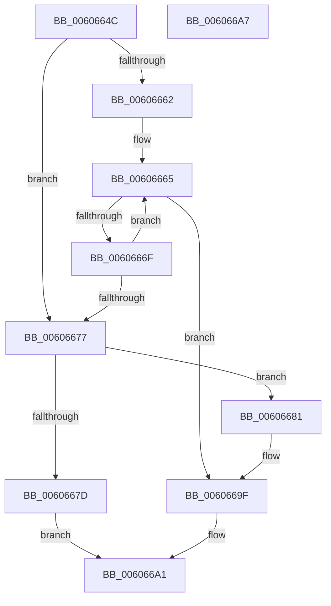

# SepTryAddUniqueAuditPrivilege

- RVA: `0x0060664C`–`0x006066A8` (길이 `92` bytes)
- VA: `0x000000014060664C`
- 실행 섹션: `.text`
- PDB 이름 있음: `예`; PDB Function 태그: `예`
- unwind 정보 RVA: `0x00071750`
- 디코드: `29`개 명령, `92/92` bytes 표시
- 미해석 바이트: `0` (있으면 어셈블리에 `.byte`로 보존)

> 이 문서는 커널 이미지의 기계어와 PDB 기호를 분석해 생성했습니다. 4번과 5번은 함수 원형과 자료형을 바이너리 사용 방식에서 추정한 C 해석이며 원본 소스 복구 결과는 아닙니다.

## 1. Dependencies

- 직접 호출 지점: **0**; 고유 호출 대상: **0**
- 직접 호출자로 확인된 함수: **1**
- RIP 상대 이미지 참조: **0**

### Outgoing calls
- 직접 디코드된 call 명령이 없습니다.

### Direct callers
- [SepAdjustPrivileges](../../page/9C/SepAdjustPrivileges_function_009C8DFC.md) at `0x009C8FE1`
- [SepAdjustPrivileges](../../page/9C/SepAdjustPrivileges_function_009C8DFC.md) at `0x009C9326`
- [SepAdjustPrivileges](../../page/9C/SepAdjustPrivileges_function_009C8DFC.md) at `0x009C93A6`

### Static image references
- 디코드된 RIP-relative 메모리 참조가 없습니다.

## 2. Other-region calls and transfers

- 다른 실행 섹션으로 향하는 call: **0**
- 별도 외부 분기/꼬리 이동을 확인하지 못했습니다.

## 3. Assembly (complete function range)

```asm
0060664C  48 89 5C 24 08                  mov qword ptr [rsp + 8], rbx
00606651  44 8B 12                        mov r10d, dword ptr [rdx]
00606654  45 33 C9                        xor r9d, r9d
00606657  48 8B DA                        mov rbx, rdx
0060665A  4C 8B D9                        mov r11, rcx
0060665D  45 85 D2                        test r10d, r10d
00606660  74 15                           je 0x140606677
00606662  41 8B 08                        mov ecx, dword ptr [r8]
00606665  4B 8D 14 49                     lea rdx, [r9 + r9*2]
00606669  41 39 0C 93                     cmp dword ptr [r11 + rdx*4], ecx
0060666D  74 30                           je 0x14060669f
0060666F  41 FF C1                        inc r9d
00606672  45 3B CA                        cmp r9d, r10d
00606675  72 EE                           jb 0x140606665
00606677  41 83 FA 25                     cmp r10d, 0x25
0060667B  72 04                           jb 0x140606681
0060667D  32 C0                           xor al, al
0060667F  EB 20                           jmp 0x1406066a1
00606681  41 8B 40 08                     mov eax, dword ptr [r8 + 8]
00606685  4B 8D 0C 52                     lea rcx, [r10 + r10*2]
00606689  F2 41 0F 10 00                  movsd xmm0, qword ptr [r8]
0060668E  F2 41 0F 11 04 8B               movsd qword ptr [r11 + rcx*4], xmm0
00606694  41 89 44 8B 08                  mov dword ptr [r11 + rcx*4 + 8], eax
00606699  41 8D 42 01                     lea eax, [r10 + 1]
0060669D  89 03                           mov dword ptr [rbx], eax
0060669F  B0 01                           mov al, 1
006066A1  48 8B 5C 24 08                  mov rbx, qword ptr [rsp + 8]
006066A6  C3                              ret
006066A7  CC                              int3
```

## 4. C-style interpretation (structured pseudocode)

```c
__int64 __fastcall SepTryAddUniqueAuditPrivilege(__int64 a1, __int64 a2, __int64 a3, int a4)
{
    __int64 result;
    unsigned __int64 v_stack_p8;

    v_stack_p8 = v_rbx;
    a4 = 0;
    if ((unsigned int)((unsigned int)(*(unsigned int *)(a2))) == 0) goto loc_00606677;
loc_00606665:
    if ((*(unsigned int *)(a1 + a4 + a4 * 2 * 4)) == ((unsigned int)((unsigned int)(*(unsigned int *)(a3))))) goto loc_0060669F;
    a4 = (unsigned int)((a4) + 1);
    if (a4 < ((unsigned int)((unsigned int)(*(unsigned int *)(a2))))) goto loc_00606665;
loc_00606677:
    if (((unsigned int)((unsigned int)(*(unsigned int *)(a2)))) < 37) goto loc_00606681;
    result = 0;
    goto loc_006066A1;
loc_00606681:
    *(unsigned __int64 *)(a1 + (unsigned int)(*(unsigned int *)(a2)) + (unsigned int)(*(unsigned int *)(a2)) * 2 * 4) = v_xmm0;
    *(unsigned int *)(a1 + (unsigned int)(*(unsigned int *)(a2)) + (unsigned int)(*(unsigned int *)(a2)) * 2 * 4 + 8) = (unsigned int)((unsigned int)(*(unsigned int *)(a3 + 8)));
    *(unsigned int *)(a2) = (unsigned int)((unsigned int)(*(unsigned int *)(a2)) + 1);
loc_0060669F:
loc_006066A1:
    return 1;
}
```

## 5. (Beta) C Style

```c
int64_t SepTryAddUniqueAuditPrivilege(void *Arg1, void *Arg2, void *Arg3, int32_t Arg4)
{
    uint8_t *arg1 = (uint8_t *)Arg1;
    uint8_t *arg2 = (uint8_t *)Arg2;
    uint8_t *arg3 = (uint8_t *)Arg3;

    int64_t result;
    uint64_t v_stack_p8;

    v_stack_p8 = local_rbx;
    Arg4 = 0;
    if ((uint32_t)((uint32_t)(*(uint32_t *)(arg2))) == 0) goto loc_00606677;
loc_00606665:
    if ((*(uint32_t *)(arg1 + Arg4 + Arg4 * 2 * 4)) == ((uint32_t)((uint32_t)(*(uint32_t *)(arg3))))) goto loc_0060669F;
    Arg4 = (uint32_t)((Arg4) + 1);
    if (Arg4 < ((uint32_t)((uint32_t)(*(uint32_t *)(arg2))))) goto loc_00606665;
loc_00606677:
    if (((uint32_t)((uint32_t)(*(uint32_t *)(arg2)))) < 37) goto loc_00606681;
    result = 0;
    goto loc_006066A1;
loc_00606681:
    *(uint64_t *)(arg1 + (uint32_t)(*(uint32_t *)(arg2)) + (uint32_t)(*(uint32_t *)(arg2)) * 2 * 4) = v_xmm0;
    *(uint32_t *)(arg1 + (uint32_t)(*(uint32_t *)(arg2)) + (uint32_t)(*(uint32_t *)(arg2)) * 2 * 4 + 0x8) = (uint32_t)((uint32_t)(*(uint32_t *)(arg3 + 0x8)));
    *(uint32_t *)(arg2) = (uint32_t)((uint32_t)(*(uint32_t *)(arg2)) + 1);
loc_0060669F:
loc_006066A1:
    return 1;
}
```

### 관측된 메모리 오프셋

구조체 형식이 확인되지 않은 접근은 인자 기준의 오프셋으로만 기록했습니다.

| 기준 인자 | 오프셋 표현 | 폭 (bit) | 접근 |
|---|---:|---:|---|
| `Arg1` | `+ 0x0 + rcx*4` | `64` | `W` |
| `Arg1` | `+ 0x0 + rdx*4` | `32` | `R` |
| `Arg1` | `+ 0x8 + rcx*4` | `32` | `W` |
| `Arg2` | `+ 0x0` | `32` | `R` |
| `Arg2` | `+ 0x0` | `32` | `W` |
| `Arg3` | `+ 0x0` | `32` | `R` |
| `Arg3` | `+ 0x0` | `64` | `R` |
| `Arg3` | `+ 0x8` | `32` | `R` |

## 6. Execution-region graph

[열기: 2D/3D 그래프와 함수 탐색 컨트롤 패널](../../../control-panel.html?section=text&rva=0x0060664C&view=graph)

- 2D 그래프는 위에서 아래로 흐르고, 3D 그래프는 빈 공간을 드래그해 회전합니다. Shift+드래그는 이동, 휠은 확대·축소, 함수 노드 선택은 대상 보고서 이동입니다.

### Static fallback


