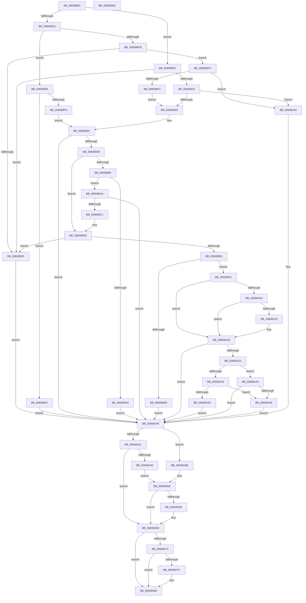

# SepVerifyDesktopAppxImage

- RVA: `0x0060885C`–`0x00608AB3` (길이 `599` bytes)
- VA: `0x000000014060885C`
- 실행 섹션: `.text`
- PDB 이름 있음: `예`; PDB Function 태그: `아니요`
- unwind 정보 RVA: `0x000D0FA8`
- 디코드: `168`개 명령, `599/599` bytes 표시
- 미해석 바이트: `0` (있으면 어셈블리에 `.byte`로 보존)

> 이 문서는 커널 이미지의 기계어와 PDB 기호를 분석해 생성했습니다. 4번과 5번은 함수 원형과 자료형을 바이너리 사용 방식에서 추정한 C 해석이며 원본 소스 복구 결과는 아닙니다.

## 1. Dependencies

- 직접 호출 지점: **14**; 고유 호출 대상: **10**
- 직접 호출자로 확인된 함수: **1**
- RIP 상대 이미지 참조: **1**

### Outgoing calls
- `0x006088BD` → [Feature_TrustedLaunchHosts__private_IsEnabledDeviceUsageNoInline](../4F/Feature_TrustedLaunchHosts__private_IsEnabledDeviceUsageNoInline_function_004F4150.md) (function, `0x004F4150`)
- `0x006088E4` → [PsReferenceProcessFilePointer](../../page/8D/PsReferenceProcessFilePointer_function_008D6870.md) (function, `0x008D6870`)
- `0x0060891E` → [PsReferenceProcessFilePointer](../../page/8D/PsReferenceProcessFilePointer_function_008D6870.md) (function, `0x008D6870`)
- `0x0060894C` → [RtlCreateSecurityDescriptor](../../page/9F/RtlCreateSecurityDescriptor_function_009F1DF0.md) (function, `0x009F1DF0`)
- `0x00608979` → [ObQuerySecurityObject](../../page/9A/ObQuerySecurityObject_function_009A3564.md) (function, `0x009A3564`)
- `0x00608993` → [ExAllocatePool2](../../poolcode/B8/ExAllocatePool2_function_00B820F0.md) (function, `0x00B820F0`)
- `0x006089B2` → [RtlCreateSecurityDescriptor](../../page/9F/RtlCreateSecurityDescriptor_function_009F1DF0.md) (function, `0x009F1DF0`)
- `0x006089D9` → [ObQuerySecurityObject](../../page/9A/ObQuerySecurityObject_function_009A3564.md) (function, `0x009A3564`)
- `0x006089FF` → [SepVerifyDesktopAppxPackageName](../3A/SepVerifyDesktopAppxPackageName_function_003A9728.md) (function, `0x003A9728`)
- `0x00608A13` → [SeGetTrustLabelAce](../3F/SeGetTrustLabelAce_function_003FDB20.md) (function, `0x003FDB20`)
- `0x00608A48` → [Feature_TrustedLaunchHosts__private_IsEnabledDeviceUsageNoInline](../4F/Feature_TrustedLaunchHosts__private_IsEnabledDeviceUsageNoInline_function_004F4150.md) (function, `0x004F4150`)
- `0x00608A68` → [ObfDereferenceObjectWithTag](../2F/ObfDereferenceObjectWithTag_function_002F78E0.md) (function, `0x002F78E0`)
- `0x00608A81` → [ExFreePoolWithTag](../../poolcode/B8/ExFreePoolWithTag_function_00B82870.md) (function, `0x00B82870`)
- `0x00608A92` → [_security_check_cookie](../6A/_security_check_cookie_function_006AC640.md) (function, `0x006AC640`)

### Direct callers
- [SepDesktopAppxSubProcessToken](../45/SepDesktopAppxSubProcessToken_function_0045BD90.md) at `0x0045BFE1`

### Static image references
- `0x0060887B` → RVA `0x00E0A740` (`.data`; read)

## 2. Other-region calls and transfers

- 다른 실행 섹션으로 향하는 call: **8**
  - `0x006088E4` → [PsReferenceProcessFilePointer](../../page/8D/PsReferenceProcessFilePointer_function_008D6870.md) (`.text` → `PAGE`)
  - `0x0060891E` → [PsReferenceProcessFilePointer](../../page/8D/PsReferenceProcessFilePointer_function_008D6870.md) (`.text` → `PAGE`)
  - `0x0060894C` → [RtlCreateSecurityDescriptor](../../page/9F/RtlCreateSecurityDescriptor_function_009F1DF0.md) (`.text` → `PAGE`)
  - `0x00608979` → [ObQuerySecurityObject](../../page/9A/ObQuerySecurityObject_function_009A3564.md) (`.text` → `PAGE`)
  - `0x00608993` → [ExAllocatePool2](../../poolcode/B8/ExAllocatePool2_function_00B820F0.md) (`.text` → `POOLCODE`)
  - `0x006089B2` → [RtlCreateSecurityDescriptor](../../page/9F/RtlCreateSecurityDescriptor_function_009F1DF0.md) (`.text` → `PAGE`)
  - `0x006089D9` → [ObQuerySecurityObject](../../page/9A/ObQuerySecurityObject_function_009A3564.md) (`.text` → `PAGE`)
  - `0x00608A81` → [ExFreePoolWithTag](../../poolcode/B8/ExFreePoolWithTag_function_00B82870.md) (`.text` → `POOLCODE`)
- 별도 외부 분기/꼬리 이동을 확인하지 못했습니다.

## 3. Assembly (complete function range)

```asm
0060885C  48 89 5C 24 20                  mov qword ptr [rsp + 0x20], rbx
00608861  55                              push rbp
00608862  56                              push rsi
00608863  57                              push rdi
00608864  41 54                           push r12
00608866  41 55                           push r13
00608868  41 56                           push r14
0060886A  41 57                           push r15
0060886C  48 8D AC 24 A0 FE FF FF         lea rbp, [rsp - 0x160]
00608874  48 81 EC 60 02 00 00            sub rsp, 0x260
0060887B  48 8B 05 BE 1E 80 00            mov rax, qword ptr [rip + 0x801ebe]
00608882  48 33 C4                        xor rax, rsp
00608885  48 89 85 50 01 00 00            mov qword ptr [rbp + 0x150], rax
0060888C  48 8B 85 C0 01 00 00            mov rax, qword ptr [rbp + 0x1c0]
00608893  33 F6                           xor esi, esi
00608895  33 FF                           xor edi, edi
00608897  4C 89 44 24 40                  mov qword ptr [rsp + 0x40], r8
0060889C  45 32 E4                        xor r12b, r12b
0060889F  48 89 44 24 48                  mov qword ptr [rsp + 0x48], rax
006088A4  45 8A F9                        mov r15b, r9b
006088A7  48 89 7C 24 38                  mov qword ptr [rsp + 0x38], rdi
006088AC  40 88 30                        mov byte ptr [rax], sil
006088AF  4C 8B F2                        mov r14, rdx
006088B2  48 8B D9                        mov rbx, rcx
006088B5  40 88 74 24 30                  mov byte ptr [rsp + 0x30], sil
006088BA  45 33 ED                        xor r13d, r13d
006088BD  E8 8E B8 EE FF                  call 0x1404f4150
006088C2  85 C0                           test eax, eax
006088C4  74 46                           je 0x14060890c
006088C6  48 85 DB                        test rbx, rbx
006088C9  74 2D                           je 0x1406088f8
006088CB  8B 83 FC 05 00 00               mov eax, dword ptr [rbx + 0x5fc]
006088D1  A8 01                           test al, 1
006088D3  74 07                           je 0x1406088dc
006088D5  33 DB                           xor ebx, ebx
006088D7  E9 6C 01 00 00                  jmp 0x140608a48
006088DC  48 8D 54 24 38                  lea rdx, [rsp + 0x38]
006088E1  48 8B CB                        mov rcx, rbx
006088E4  E8 87 DF 2C 00                  call 0x1408d6870
006088E9  8B D8                           mov ebx, eax
006088EB  85 C0                           test eax, eax
006088ED  0F 88 50 01 00 00               js 0x140608a43
006088F3  41 B4 01                        mov r12b, 1
006088F6  EB 35                           jmp 0x14060892d
006088F8  4D 85 F6                        test r14, r14
006088FB  74 05                           je 0x140608902
006088FD  49 8B FE                        mov rdi, r14
00608900  EB 30                           jmp 0x140608932
00608902  BB 30 00 00 C0                  mov ebx, 0xc0000030
00608907  E9 3C 01 00 00                  jmp 0x140608a48
0060890C  8B 83 FC 05 00 00               mov eax, dword ptr [rbx + 0x5fc]
00608912  A8 01                           test al, 1
00608914  75 BF                           jne 0x1406088d5
00608916  48 8D 54 24 38                  lea rdx, [rsp + 0x38]
0060891B  48 8B CB                        mov rcx, rbx
0060891E  E8 4D DF 2C 00                  call 0x1408d6870
00608923  8B D8                           mov ebx, eax
00608925  85 C0                           test eax, eax
00608927  0F 88 16 01 00 00               js 0x140608a43
0060892D  48 8B 7C 24 38                  mov rdi, qword ptr [rsp + 0x38]
00608932  41 BE 00 02 00 00               mov r14d, 0x200
00608938  48 8D 4C 24 50                  lea rcx, [rsp + 0x50]
0060893D  BA 01 00 00 00                  mov edx, 1
00608942  44 89 74 24 38                  mov dword ptr [rsp + 0x38], r14d
00608947  48 8D 74 24 50                  lea rsi, [rsp + 0x50]
0060894C  E8 9F 94 3E 00                  call 0x1409f1df0
00608951  8B D8                           mov ebx, eax
00608953  85 C0                           test eax, eax
00608955  0F 88 ED 00 00 00               js 0x140608a48
0060895B  45 8B CE                        mov r9d, r14d
0060895E  48 8D 44 24 38                  lea rax, [rsp + 0x38]
00608963  41 BE 84 00 00 00               mov r14d, 0x84
00608969  48 89 44 24 20                  mov qword ptr [rsp + 0x20], rax
0060896E  41 8B D6                        mov edx, r14d
00608971  4C 8D 44 24 50                  lea r8, [rsp + 0x50]
00608976  48 8B CF                        mov rcx, rdi
00608979  E8 E6 AB 39 00                  call 0x1409a3564
0060897E  3D 23 00 00 C0                  cmp eax, 0xc0000023
00608983  75 59                           jne 0x1406089de
00608985  8B 54 24 38                     mov edx, dword ptr [rsp + 0x38]
00608989  41 8D 4E 7C                     lea ecx, [r14 + 0x7c]
0060898D  41 B8 53 65 20 20               mov r8d, 0x20206553
00608993  E8 58 97 57 00                  call 0x140b820f0
00608998  48 8B F0                        mov rsi, rax
0060899B  48 85 C0                        test rax, rax
0060899E  75 0A                           jne 0x1406089aa
006089A0  BB 17 00 00 C0                  mov ebx, 0xc0000017
006089A5  E9 9E 00 00 00                  jmp 0x140608a48
006089AA  BA 01 00 00 00                  mov edx, 1
006089AF  48 8B CE                        mov rcx, rsi
006089B2  E8 39 94 3E 00                  call 0x1409f1df0
006089B7  8B D8                           mov ebx, eax
006089B9  85 C0                           test eax, eax
006089BB  0F 88 87 00 00 00               js 0x140608a48
006089C1  44 8B 4C 24 38                  mov r9d, dword ptr [rsp + 0x38]
006089C6  48 8D 44 24 38                  lea rax, [rsp + 0x38]
006089CB  4C 8B C6                        mov r8, rsi
006089CE  48 89 44 24 20                  mov qword ptr [rsp + 0x20], rax
006089D3  41 8B D6                        mov edx, r14d
006089D6  48 8B CF                        mov rcx, rdi
006089D9  E8 86 AB 39 00                  call 0x1409a3564
006089DE  85 C0                           test eax, eax
006089E0  0F 88 EF FE FF FF               js 0x1406088d5
006089E6  48 85 F6                        test rsi, rsi
006089E9  75 07                           jne 0x1406089f2
006089EB  BB 0B 09 00 C0                  mov ebx, 0xc000090b
006089F0  EB 56                           jmp 0x140608a48
006089F2  48 8B 4C 24 40                  mov rcx, qword ptr [rsp + 0x40]
006089F7  4C 8D 44 24 30                  lea r8, [rsp + 0x30]
006089FC  48 8B D6                        mov rdx, rsi
006089FF  E8 24 0D DA FF                  call 0x1403a9728
00608A04  8B D8                           mov ebx, eax
00608A06  85 C0                           test eax, eax
00608A08  78 11                           js 0x140608a1b
00608A0A  41 80 FF 01                     cmp r15b, 1
00608A0E  75 0B                           jne 0x140608a1b
00608A10  48 8B CE                        mov rcx, rsi
00608A13  E8 08 51 DF FF                  call 0x1403fdb20
00608A18  4C 8B E8                        mov r13, rax
00608A1B  80 7C 24 30 01                  cmp byte ptr [rsp + 0x30], 1
00608A20  75 26                           jne 0x140608a48
00608A22  41 80 FF 01                     cmp r15b, 1
00608A26  75 0C                           jne 0x140608a34
00608A28  4D 85 ED                        test r13, r13
00608A2B  75 0C                           jne 0x140608a39
00608A2D  BB 62 04 00 C0                  mov ebx, 0xc0000462
00608A32  EB 14                           jmp 0x140608a48
00608A34  45 84 FF                        test r15b, r15b
00608A37  75 0F                           jne 0x140608a48
00608A39  48 8B 44 24 48                  mov rax, qword ptr [rsp + 0x48]
00608A3E  C6 00 01                        mov byte ptr [rax], 1
00608A41  EB 05                           jmp 0x140608a48
00608A43  48 8B 7C 24 38                  mov rdi, qword ptr [rsp + 0x38]
00608A48  E8 03 B7 EE FF                  call 0x1404f4150
00608A4D  85 C0                           test eax, eax
00608A4F  74 0A                           je 0x140608a5b
00608A51  48 85 FF                        test rdi, rdi
00608A54  74 17                           je 0x140608a6d
00608A56  45 84 E4                        test r12b, r12b
00608A59  EB 03                           jmp 0x140608a5e
00608A5B  48 85 FF                        test rdi, rdi
00608A5E  74 0D                           je 0x140608a6d
00608A60  BA 44 66 6C 74                  mov edx, 0x746c6644
00608A65  48 8B CF                        mov rcx, rdi
00608A68  E8 73 EE CE FF                  call 0x1402f78e0
00608A6D  48 85 F6                        test rsi, rsi
00608A70  74 14                           je 0x140608a86
00608A72  48 8D 44 24 50                  lea rax, [rsp + 0x50]
00608A77  48 3B F0                        cmp rsi, rax
00608A7A  74 0A                           je 0x140608a86
00608A7C  33 D2                           xor edx, edx
00608A7E  48 8B CE                        mov rcx, rsi
00608A81  E8 EA 9D 57 00                  call 0x140b82870
00608A86  8B C3                           mov eax, ebx
00608A88  48 8B 8D 50 01 00 00            mov rcx, qword ptr [rbp + 0x150]
00608A8F  48 33 CC                        xor rcx, rsp
00608A92  E8 A9 3B 0A 00                  call 0x1406ac640
00608A97  48 8B 9C 24 B8 02 00 00         mov rbx, qword ptr [rsp + 0x2b8]
00608A9F  48 81 C4 60 02 00 00            add rsp, 0x260
00608AA6  41 5F                           pop r15
00608AA8  41 5E                           pop r14
00608AAA  41 5D                           pop r13
00608AAC  41 5C                           pop r12
00608AAE  5F                              pop rdi
00608AAF  5E                              pop rsi
00608AB0  5D                              pop rbp
00608AB1  C3                              ret
00608AB2  CC                              int3
```

## 4. C-style interpretation (structured pseudocode)

```c
__int64 __fastcall SepVerifyDesktopAppxImage(__int64 a1, __int64 a2, __int64 a3, unsigned __int8 a4, __int64 a5)
{
    __int64 result;
    __int64 v_r12;
    __int64 v_r13;
    __int64 v_rbx;
    __int64 v_rdi;
    __int64 v_rsi;
    __int64 v_rsp;
    unsigned __int64 v_stack_m198;
    unsigned __int64 v_stack_m248;
    unsigned __int64 v_stack_m250;
    unsigned __int64 v_stack_m258;
    unsigned __int64 v_stack_m260;
    unsigned __int8 v_stack_m268;
    unsigned __int64 v_stack_m278;
    unsigned __int64 v_stack_m48;
    unsigned __int64 v_stack_p20;

    v_stack_p20 = v_rbx;
    v_rsp = (v_rsp) - (608);
    result = (*(unsigned __int64 *)(v_rip + 8396478)) ^ (v_rsp);
    v_stack_m48 = result;
    v_rsi = 0;
    v_rdi = 0;
    v_stack_m258 = a3;
    v_r12 = 0;
    v_stack_m250 = a5;
    v_stack_m260 = 0;
    *(unsigned __int8 *)(a5) = 0;
    v_stack_m268 = 0;
    v_r13 = 0;
    result = Feature_TrustedLaunchHosts__private_IsEnabledDeviceUsageNoInline(a1, a2, a3, a4);
    if ((unsigned int)(result) == 0) goto loc_0060890C;
    if (a1 == 0) goto loc_006088F8;
    if ((((unsigned __int8)((unsigned int)(*(unsigned int *)(a1 + 1532)))) & (1)) == 0) goto loc_006088DC;
loc_006088D5:
    v_rbx = 0;
    goto loc_00608A48;
loc_006088DC:
    result = PsReferenceProcessFilePointer(0, v_stack_m260, a3, a4);
    if (sign_flag) goto loc_00608A43;
    goto loc_0060892D;
loc_006088F8:
    if (a2 == 0) goto loc_00608902;
    goto loc_00608932;
loc_00608902:
    goto loc_00608A48;
loc_0060890C:
    if ((((unsigned __int8)((unsigned int)(*(unsigned int *)((unsigned int)(0xC0000030ULL) + 1532)))) & (1)) != 0) goto loc_006088D5;
    result = PsReferenceProcessFilePointer((unsigned int)(0xC0000030ULL), v_stack_m260, a3, a4);
    if (sign_flag) goto loc_00608A43;
loc_0060892D:
loc_00608932:
    v_stack_m260 = 512;
    result = RtlCreateSecurityDescriptor(v_stack_m248, 1, a3, a4);
    if (sign_flag) goto loc_00608A48;
    v_stack_m278 = v_stack_m260;
    result = ObQuerySecurityObject(v_stack_m260, 132, v_stack_m248, 512);
    if (((unsigned int)(result)) != 0xC0000023ULL) goto loc_006089DE;
    result = ExAllocatePool2(132 + 124, (unsigned int)(v_stack_m260), (unsigned int)(0x20206553ULL), 512);
    if (result != 0) goto loc_006089AA;
    goto loc_00608A48;
loc_006089AA:
    result = RtlCreateSecurityDescriptor(result, 1, (unsigned int)(0x20206553ULL), 512);
    if (sign_flag) goto loc_00608A48;
    v_stack_m278 = v_stack_m260;
    result = ObQuerySecurityObject(v_stack_m260, 132, result, (unsigned int)(v_stack_m260));
loc_006089DE:
    if (sign_flag) goto loc_006088D5;
    if (result != 0) goto loc_006089F2;
    goto loc_00608A48;
loc_006089F2:
    result = SepVerifyDesktopAppxPackageName(v_stack_m258, result, v_stack_m268, (unsigned int)(v_stack_m260));
    if (sign_flag) goto loc_00608A1B;
    if (a4 == 1) {
        a1 = result;
        result = SeGetTrustLabelAce(a1, result, v_stack_m268, (unsigned int)(v_stack_m260));
        v_r13 = result;
    }
    if (v_stack_m268 != 1) goto loc_00608A48;
    if (a4 != 1) goto loc_00608A34;
    if (v_r13 != 0) goto loc_00608A39;
    goto loc_00608A48;
loc_00608A34:
    if (a4 != 0) goto loc_00608A48;
loc_00608A39:
    *(unsigned __int8 *)(v_stack_m250) = 1;
    goto loc_00608A48;
loc_00608A43:
loc_00608A48:
    result = Feature_TrustedLaunchHosts__private_IsEnabledDeviceUsageNoInline(a1, result, v_stack_m268, (unsigned int)(v_stack_m260));
    if ((unsigned int)(result) == 0) goto loc_00608A5B;
    if (v_stack_m260 == 0) goto loc_00608A6D;
    goto loc_00608A5E;
loc_00608A5B:
loc_00608A5E:
    if (v_stack_m260 != 0) {
        a2 = 0x746C6644ULL;
        a1 = v_stack_m260;
        result = ObfDereferenceObjectWithTag(a1, a2, v_stack_m268, (unsigned int)(v_stack_m260));
    }
    if (result == 0) goto loc_00608A86;
    result = v_stack_m248;
    if (result != v_stack_m248) {
        a2 = 0;
        a1 = result;
        result = ExFreePoolWithTag(a1, a2, v_stack_m268, (unsigned int)(v_stack_m260));
    }
    a1 = (v_stack_m48) ^ (v_rsp);
    result = _security_check_cookie(a1, a2, v_stack_m268, (unsigned int)(v_stack_m260));
    v_rsp = (v_rsp) + (608);
    return result;
}
```

## 5. (Beta) C Style

```c
int64_t SepVerifyDesktopAppxImage(void *Arg1, int64_t Arg2, int64_t Arg3, uint8_t Arg4, void *Arg5)
{
    uint8_t *arg1 = (uint8_t *)Arg1;
    uint8_t *arg5 = (uint8_t *)Arg5;

    int64_t result;
    int64_t local_r12;
    int64_t local_r13;
    int64_t local_rbx;
    int64_t local_rdi;
    int64_t local_rsi;
    int64_t local_rsp;
    uint64_t v_stack_m198;
    uint64_t v_stack_m248;
    uint64_t v_stack_m250;
    uint64_t v_stack_m258;
    uint64_t v_stack_m260;
    uint8_t v_stack_m268;
    uint64_t v_stack_m278;
    uint64_t v_stack_m48;
    uint64_t v_stack_p20;

    v_stack_p20 = local_rbx;
    local_rsp = (local_rsp) - (608);
    result = (*(uint64_t *)(v_rip + 0x801EBE)) ^ (local_rsp);
    v_stack_m48 = result;
    local_rsi = 0;
    local_rdi = 0;
    v_stack_m258 = Arg3;
    local_r12 = 0;
    v_stack_m250 = Arg5;
    v_stack_m260 = 0;
    *(uint8_t *)(arg5) = 0;
    v_stack_m268 = 0;
    local_r13 = 0;
    result = Feature_TrustedLaunchHosts__private_IsEnabledDeviceUsageNoInline(Arg1, Arg2, Arg3, Arg4);
    if ((uint32_t)(result) == 0) goto loc_0060890C;
    if (Arg1 == NULL) goto loc_006088F8;
    if ((((uint8_t)((uint32_t)(*(uint32_t *)(arg1 + 0x5FC)))) & (1)) == 0) goto loc_006088DC;
loc_006088D5:
    local_rbx = 0;
    goto loc_00608A48;
loc_006088DC:
    result = PsReferenceProcessFilePointer(0, v_stack_m260, Arg3, Arg4);
    if (sign_flag) goto loc_00608A43;
    goto loc_0060892D;
loc_006088F8:
    if (Arg2 == 0) goto loc_00608902;
    goto loc_00608932;
loc_00608902:
    goto loc_00608A48;
loc_0060890C:
    if ((((uint8_t)((uint32_t)(*(uint32_t *)((uint32_t)(0xC0000030ULL) + 0x5FC)))) & (1)) != 0) goto loc_006088D5;
    result = PsReferenceProcessFilePointer((uint32_t)(0xC0000030ULL), v_stack_m260, Arg3, Arg4);
    if (sign_flag) goto loc_00608A43;
loc_0060892D:
loc_00608932:
    v_stack_m260 = 512;
    result = RtlCreateSecurityDescriptor(v_stack_m248, 1, Arg3, Arg4);
    if (sign_flag) goto loc_00608A48;
    v_stack_m278 = v_stack_m260;
    result = ObQuerySecurityObject(v_stack_m260, 132, v_stack_m248, 512);
    if (((uint32_t)(result)) != 0xC0000023ULL) goto loc_006089DE;
    result = ExAllocatePool2(132 + 124, (uint32_t)(v_stack_m260), (uint32_t)(0x20206553ULL), 512);
    if (result != 0) goto loc_006089AA;
    goto loc_00608A48;
loc_006089AA:
    result = RtlCreateSecurityDescriptor(result, 1, (uint32_t)(0x20206553ULL), 512);
    if (sign_flag) goto loc_00608A48;
    v_stack_m278 = v_stack_m260;
    result = ObQuerySecurityObject(v_stack_m260, 132, result, (uint32_t)(v_stack_m260));
loc_006089DE:
    if (sign_flag) goto loc_006088D5;
    if (result != 0) goto loc_006089F2;
    goto loc_00608A48;
loc_006089F2:
    result = SepVerifyDesktopAppxPackageName(v_stack_m258, result, v_stack_m268, (uint32_t)(v_stack_m260));
    if (sign_flag) goto loc_00608A1B;
    if (Arg4 == 1) {
        Arg1 = result;
        result = SeGetTrustLabelAce(Arg1, result, v_stack_m268, (uint32_t)(v_stack_m260));
        local_r13 = result;
    }
    if (v_stack_m268 != 1) goto loc_00608A48;
    if (Arg4 != 1) goto loc_00608A34;
    if (local_r13 != 0) goto loc_00608A39;
    goto loc_00608A48;
loc_00608A34:
    if (Arg4 != 0) goto loc_00608A48;
loc_00608A39:
    *(uint8_t *)(v_stack_m250) = 1;
    goto loc_00608A48;
loc_00608A43:
loc_00608A48:
    result = Feature_TrustedLaunchHosts__private_IsEnabledDeviceUsageNoInline(Arg1, result, v_stack_m268, (uint32_t)(v_stack_m260));
    if ((uint32_t)(result) == 0) goto loc_00608A5B;
    if (v_stack_m260 == 0) goto loc_00608A6D;
    goto loc_00608A5E;
loc_00608A5B:
loc_00608A5E:
    if (v_stack_m260 != 0) {
        Arg2 = 0x746C6644ULL;
        Arg1 = v_stack_m260;
        result = ObfDereferenceObjectWithTag(Arg1, Arg2, v_stack_m268, (uint32_t)(v_stack_m260));
    }
    if (result == 0) goto loc_00608A86;
    result = v_stack_m248;
    if (result != v_stack_m248) {
        Arg2 = 0;
        Arg1 = result;
        result = ExFreePoolWithTag(Arg1, Arg2, v_stack_m268, (uint32_t)(v_stack_m260));
    }
    Arg1 = (v_stack_m48) ^ (local_rsp);
    result = _security_check_cookie(Arg1, Arg2, v_stack_m268, (uint32_t)(v_stack_m260));
    local_rsp = (local_rsp) + (608);
    return result;
}
```

### 관측된 메모리 오프셋

구조체 형식이 확인되지 않은 접근은 인자 기준의 오프셋으로만 기록했습니다.

| 기준 인자 | 오프셋 표현 | 폭 (bit) | 접근 |
|---|---:|---:|---|
| `Arg1` | `+ 0x5FC` | `32` | `R` |
| `Arg5` | `+ 0x0` | `8` | `W` |

## 6. Execution-region graph

[열기: 2D/3D 그래프와 함수 탐색 컨트롤 패널](../../../control-panel.html?section=text&rva=0x0060885C&view=graph)

- 2D 그래프는 위에서 아래로 흐르고, 3D 그래프는 빈 공간을 드래그해 회전합니다. Shift+드래그는 이동, 휠은 확대·축소, 함수 노드 선택은 대상 보고서 이동입니다.

### Static fallback


