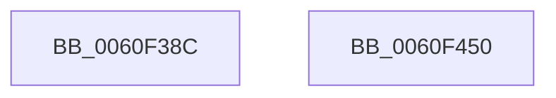

# SmEtwLogRegionOp

- RVA: `0x0060F38C`–`0x0060F451` (길이 `197` bytes)
- VA: `0x000000014060F38C`
- 실행 섹션: `.text`
- PDB 이름 있음: `예`; PDB Function 태그: `아니요`
- unwind 정보 RVA: `0x000D1FD8`
- 디코드: `44`개 명령, `197/197` bytes 표시
- 미해석 바이트: `0` (있으면 어셈블리에 `.byte`로 보존)

> 이 문서는 커널 이미지의 기계어와 PDB 기호를 분석해 생성했습니다. 4번과 5번은 함수 원형과 자료형을 바이너리 사용 방식에서 추정한 C 해석이며 원본 소스 복구 결과는 아닙니다.

## 1. Dependencies

- 직접 호출 지점: **2**; 고유 호출 대상: **2**
- 직접 호출자로 확인된 함수: **4**
- RIP 상대 이미지 참조: **2**

### Outgoing calls
- `0x0060F436` → [EtwWriteEx](../25/EtwWriteEx_function_0025F0D0.md) (function, `0x0025F0D0`)
- `0x0060F442` → [_security_check_cookie](../6A/_security_check_cookie_function_006AC640.md) (function, `0x006AC640`)

### Direct callers
- [ST_STORE&lt;SM_TRAITS&gt;::StReleaseRegion](../3A/ST_STORE_SM_TRAITS_StReleaseRegion_function_003AF138.md) at `0x003AF2B1`
- [ST_STORE&lt;SM_TRAITS&gt;::StDmDeviceIoCompletion](../4B/ST_STORE_SM_TRAITS_StDmDeviceIoCompletion_function_004BBB70.md) at `0x004BBC8C`
- [ST_STORE&lt;SM_TRAITS&gt;::StDmEtwRegionRundown](ST_STORE_SM_TRAITS_StDmEtwRegionRundown_function_0060D6B0.md) at `0x0060D730`
- [ST_STORE&lt;SM_TRAITS&gt;::StDmRegionEvict](ST_STORE_SM_TRAITS_StDmRegionEvict_function_0060DF9C.md) at `0x0060E04A`

### Static image references
- `0x0060F3A3` → RVA `0x00E0A740` (`.data`; read)
- `0x0060F3BC` → RVA `0x0000B860` (`.rdata`; read)

## 2. Other-region calls and transfers

- 다른 실행 섹션으로 향하는 call: **0**
- 별도 외부 분기/꼬리 이동을 확인하지 못했습니다.

## 3. Assembly (complete function range)

```asm
0060F38C  4C 8B DC                        mov r11, rsp
0060F38F  45 89 4B 20                     mov dword ptr [r11 + 0x20], r9d
0060F393  4D 89 43 18                     mov qword ptr [r11 + 0x18], r8
0060F397  55                              push rbp
0060F398  49 8D 6B B9                     lea rbp, [r11 - 0x47]
0060F39C  48 81 EC A0 00 00 00            sub rsp, 0xa0
0060F3A3  48 8B 05 96 B3 7F 00            mov rax, qword ptr [rip + 0x7fb396]
0060F3AA  48 33 C4                        xor rax, rsp
0060F3AD  48 89 45 2F                     mov qword ptr [rbp + 0x2f], rax
0060F3B1  48 8B 09                        mov rcx, qword ptr [rcx]
0060F3B4  48 8D 45 5F                     lea rax, [rbp + 0x5f]
0060F3B8  48 89 45 DF                     mov qword ptr [rbp - 0x21], rax
0060F3BC  4C 8D 15 9D C4 9F FF            lea r10, [rip - 0x603b63]
0060F3C3  45 33 C9                        xor r9d, r9d
0060F3C6  8B D2                           mov edx, edx
0060F3C8  48 8D 45 67                     lea rax, [rbp + 0x67]
0060F3CC  48 C7 45 E7 08 00 00 00         mov qword ptr [rbp - 0x19], 8
0060F3D4  48 89 45 EF                     mov qword ptr [rbp - 0x11], rax
0060F3D8  45 33 C0                        xor r8d, r8d
0060F3DB  48 8D 45 6F                     lea rax, [rbp + 0x6f]
0060F3DF  48 C7 45 F7 04 00 00 00         mov qword ptr [rbp - 9], 4
0060F3E7  49 8B 14 D2                     mov rdx, qword ptr [r10 + rdx*8]
0060F3EB  48 89 45 FF                     mov qword ptr [rbp - 1], rax
0060F3EF  48 8D 45 77                     lea rax, [rbp + 0x77]
0060F3F3  48 89 45 0F                     mov qword ptr [rbp + 0xf], rax
0060F3F7  48 8D 45 7F                     lea rax, [rbp + 0x7f]
0060F3FB  48 89 45 1F                     mov qword ptr [rbp + 0x1f], rax
0060F3FF  48 8D 45 DF                     lea rax, [rbp - 0x21]
0060F403  49 89 43 90                     mov qword ptr [r11 - 0x70], rax
0060F407  C7 44 24 30 05 00 00 00         mov dword ptr [rsp + 0x30], 5
0060F40F  4D 89 4B 80                     mov qword ptr [r11 - 0x80], r9
0060F413  4C 89 4C 24 20                  mov qword ptr [rsp + 0x20], r9
0060F418  41 B9 01 00 00 00               mov r9d, 1
0060F41E  48 C7 45 07 04 00 00 00         mov qword ptr [rbp + 7], 4
0060F426  48 C7 45 17 02 00 00 00         mov qword ptr [rbp + 0x17], 2
0060F42E  48 C7 45 27 02 00 00 00         mov qword ptr [rbp + 0x27], 2
0060F436  E8 95 FC C4 FF                  call 0x14025f0d0
0060F43B  48 8B 4D 2F                     mov rcx, qword ptr [rbp + 0x2f]
0060F43F  48 33 CC                        xor rcx, rsp
0060F442  E8 F9 D1 09 00                  call 0x1406ac640
0060F447  48 81 C4 A0 00 00 00            add rsp, 0xa0
0060F44E  5D                              pop rbp
0060F44F  C3                              ret
0060F450  CC                              int3
```

## 4. C-style interpretation (structured pseudocode)

```c
__int64 __fastcall SmEtwLogRegionOp(__int64 a1, int a2, __int64 a3, int a4)
{
    __int64 result;
    __int64 v_rsp;
    unsigned int v_stack_m78;
    unsigned __int64 v_stack_m88;

    *(unsigned int *)(v_rsp + 32) = a4;
    *(unsigned __int64 *)(v_rsp + 24) = a3;
    v_rsp = (v_rsp) - (160);
    result = (*(unsigned __int64 *)(v_rip + 8369046)) ^ (v_rsp);
    *(unsigned __int64 *)(v_rsp - 71 + 47) = result;
    *(unsigned __int64 *)(v_rsp - 71 - 33) = v_rsp - 71 + 95;
    a4 = 0;
    *(unsigned __int64 *)(v_rsp - 71 - 25) = 8;
    *(unsigned __int64 *)(v_rsp - 71 - 17) = v_rsp - 71 + 103;
    a3 = 0;
    *(unsigned __int64 *)(v_rsp - 71 - 9) = 4;
    *(unsigned __int64 *)(v_rsp - 71 - 1) = v_rsp - 71 + 111;
    *(unsigned __int64 *)(v_rsp - 71 + 15) = v_rsp - 71 + 119;
    *(unsigned __int64 *)(v_rsp - 71 + 31) = v_rsp - 71 + 127;
    *(unsigned __int64 *)(v_rsp - 112) = v_rsp - 71 - 33;
    v_stack_m78 = 5;
    *(unsigned __int64 *)(v_rsp - 128) = 0;
    v_stack_m88 = 0;
    *(unsigned __int64 *)(v_rsp - 71 + 7) = 4;
    *(unsigned __int64 *)(v_rsp - 71 + 23) = 2;
    *(unsigned __int64 *)(v_rsp - 71 + 39) = 2;
    result = EtwWriteEx(*(unsigned __int64 *)(a1), *(unsigned __int64 *)(v_rip - 6306659 + (unsigned int)(a2) * 8), a3, 1);
    a1 = (*(unsigned __int64 *)(v_rsp - 71 + 47)) ^ (v_rsp);
    result = _security_check_cookie(a1, *(unsigned __int64 *)(v_rip - 6306659 + (unsigned int)(a2) * 8), a3, 1);
    v_rsp = (v_rsp) + (160);
    return result;
}
```

## 5. (Beta) C Style

```c
int64_t SmEtwLogRegionOp(void *Arg1, int32_t Arg2, int64_t Arg3, int32_t Arg4)
{
    uint8_t *arg1 = (uint8_t *)Arg1;

    int64_t result;
    int64_t local_rsp;
    uint32_t v_stack_m78;
    uint64_t v_stack_m88;

    *(uint32_t *)(local_rsp + 0x20) = Arg4;
    *(uint64_t *)(local_rsp + 0x18) = Arg3;
    local_rsp = (local_rsp) - (160);
    result = (*(uint64_t *)(v_rip + 0x7FB396)) ^ (local_rsp);
    *(uint64_t *)(local_rsp - 0x47 + 0x2F) = result;
    *(uint64_t *)(local_rsp - 0x47 - 0x21) = local_rsp - 71 + 95;
    Arg4 = 0;
    *(uint64_t *)(local_rsp - 0x47 - 0x19) = 8;
    *(uint64_t *)(local_rsp - 0x47 - 0x11) = local_rsp - 71 + 103;
    Arg3 = 0;
    *(uint64_t *)(local_rsp - 0x47 - 0x9) = 4;
    *(uint64_t *)(local_rsp - 0x47 - 0x1) = local_rsp - 71 + 111;
    *(uint64_t *)(local_rsp - 0x47 + 0xF) = local_rsp - 71 + 119;
    *(uint64_t *)(local_rsp - 0x47 + 0x1F) = local_rsp - 71 + 127;
    *(uint64_t *)(local_rsp - 0x70) = local_rsp - 71 - 33;
    v_stack_m78 = 5;
    *(uint64_t *)(local_rsp - 0x80) = 0;
    v_stack_m88 = 0;
    *(uint64_t *)(local_rsp - 0x47 + 0x7) = 4;
    *(uint64_t *)(local_rsp - 0x47 + 0x17) = 2;
    *(uint64_t *)(local_rsp - 0x47 + 0x27) = 2;
    result = EtwWriteEx(*(uint64_t *)(arg1), *(uint64_t *)(v_rip - 0x603B63 + (uint32_t)(Arg2) * 8), Arg3, 1);
    Arg1 = (*(uint64_t *)(local_rsp - 0x47 + 0x2F)) ^ (local_rsp);
    result = _security_check_cookie(Arg1, *(uint64_t *)(v_rip - 0x603B63 + (uint32_t)(Arg2) * 8), Arg3, 1);
    local_rsp = (local_rsp) + (160);
    return result;
}
```

### 관측된 메모리 오프셋

구조체 형식이 확인되지 않은 접근은 인자 기준의 오프셋으로만 기록했습니다.

| 기준 인자 | 오프셋 표현 | 폭 (bit) | 접근 |
|---|---:|---:|---|
| `Arg1` | `+ 0x0` | `64` | `R` |

## 6. Execution-region graph

[열기: 2D/3D 그래프와 함수 탐색 컨트롤 패널](../../../control-panel.html?section=text&rva=0x0060F38C&view=graph)

- 2D 그래프는 위에서 아래로 흐르고, 3D 그래프는 빈 공간을 드래그해 회전합니다. Shift+드래그는 이동, 휠은 확대·축소, 함수 노드 선택은 대상 보고서 이동입니다.

### Static fallback


