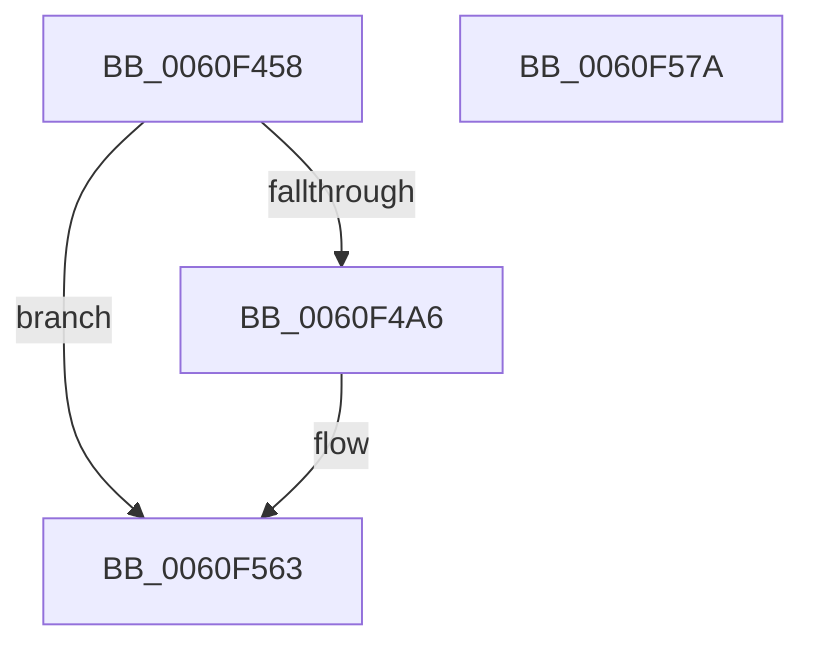

# SmEtwLogStoreCorruption

- RVA: `0x0060F458`–`0x0060F57B` (길이 `291` bytes)
- VA: `0x000000014060F458`
- 실행 섹션: `.text`
- PDB 이름 있음: `예`; PDB Function 태그: `아니요`
- unwind 정보 RVA: `0x000D1F9C`
- 디코드: `70`개 명령, `291/291` bytes 표시
- 미해석 바이트: `0` (있으면 어셈블리에 `.byte`로 보존)

> 이 문서는 커널 이미지의 기계어와 PDB 기호를 분석해 생성했습니다. 4번과 5번은 함수 원형과 자료형을 바이너리 사용 방식에서 추정한 C 해석이며 원본 소스 복구 결과는 아닙니다.

## 1. Dependencies

- 직접 호출 지점: **4**; 고유 호출 대상: **4**
- 직접 호출자로 확인된 함수: **1**
- RIP 상대 이미지 참조: **2**

### Outgoing calls
- `0x0060F499` → [EtwEventEnabled](../39/EtwEventEnabled_function_00392450.md) (function, `0x00392450`)
- `0x0060F4D0` → [MmGetPhysicalAddress](../23/MmGetPhysicalAddress_function_0023A500.md) (function, `0x0023A500`)
- `0x0060F55E` → [EtwWriteEx](../25/EtwWriteEx_function_0025F0D0.md) (function, `0x0025F0D0`)
- `0x0060F56A` → [_security_check_cookie](../6A/_security_check_cookie_function_006AC640.md) (function, `0x006AC640`)

### Direct callers
- [ST_STORE&lt;SM_TRAITS&gt;::StDmPageError](ST_STORE_SM_TRAITS_StDmPageError_function_0060DDDC.md) at `0x0060DE71`

### Static image references
- `0x0060F46C` → RVA `0x00E0A740` (`.data`; read)
- `0x0060F481` → RVA `0x0000B8A0` (`.rdata`; read)

## 2. Other-region calls and transfers

- 다른 실행 섹션으로 향하는 call: **0**
- 별도 외부 분기/꼬리 이동을 확인하지 못했습니다.

## 3. Assembly (complete function range)

```asm
0060F458  4C 89 44 24 18                  mov qword ptr [rsp + 0x18], r8
0060F45D  55                              push rbp
0060F45E  53                              push rbx
0060F45F  57                              push rdi
0060F460  48 8D 6C 24 C9                  lea rbp, [rsp - 0x37]
0060F465  48 81 EC E0 00 00 00            sub rsp, 0xe0
0060F46C  48 8B 05 CD B2 7F 00            mov rax, qword ptr [rip + 0x7fb2cd]
0060F473  48 33 C4                        xor rax, rsp
0060F476  48 89 45 27                     mov qword ptr [rbp + 0x27], rax
0060F47A  48 8B 45 7F                     mov rax, qword ptr [rbp + 0x7f]
0060F47E  48 8B D9                        mov rbx, rcx
0060F481  48 8B 3D 18 C4 9F FF            mov rdi, qword ptr [rip - 0x603be8]
0060F488  48 8B D7                        mov rdx, rdi
0060F48B  4C 89 4D 9F                     mov qword ptr [rbp - 0x61], r9
0060F48F  48 8B 08                        mov rcx, qword ptr [rax]
0060F492  48 89 4D 97                     mov qword ptr [rbp - 0x69], rcx
0060F496  48 8B 0B                        mov rcx, qword ptr [rbx]
0060F499  E8 B2 2F D8 FF                  call 0x140392450
0060F49E  84 C0                           test al, al
0060F4A0  0F 84 BD 00 00 00               je 0x14060f563
0060F4A6  48 8B 4D 9F                     mov rcx, qword ptr [rbp - 0x61]
0060F4AA  48 8D 45 67                     lea rax, [rbp + 0x67]
0060F4AE  83 65 C3 00                     and dword ptr [rbp - 0x3d], 0
0060F4B2  83 65 D3 00                     and dword ptr [rbp - 0x2d], 0
0060F4B6  48 89 45 B7                     mov qword ptr [rbp - 0x49], rax
0060F4BA  48 8D 45 9F                     lea rax, [rbp - 0x61]
0060F4BE  48 89 45 C7                     mov qword ptr [rbp - 0x39], rax
0060F4C2  C7 45 BF 08 00 00 00            mov dword ptr [rbp - 0x41], 8
0060F4C9  C7 45 CF 08 00 00 00            mov dword ptr [rbp - 0x31], 8
0060F4D0  E8 2B B0 C2 FF                  call 0x14023a500
0060F4D5  83 65 E3 00                     and dword ptr [rbp - 0x1d], 0
0060F4D9  41 B9 01 00 00 00               mov r9d, 1
0060F4DF  83 65 F3 00                     and dword ptr [rbp - 0xd], 0
0060F4E3  45 33 C0                        xor r8d, r8d
0060F4E6  83 65 03 00                     and dword ptr [rbp + 3], 0
0060F4EA  48 8B D7                        mov rdx, rdi
0060F4ED  83 65 13 00                     and dword ptr [rbp + 0x13], 0
0060F4F1  83 65 23 00                     and dword ptr [rbp + 0x23], 0
0060F4F5  48 8B 0B                        mov rcx, qword ptr [rbx]
0060F4F8  48 89 45 A7                     mov qword ptr [rbp - 0x59], rax
0060F4FC  48 8D 45 A7                     lea rax, [rbp - 0x59]
0060F500  48 89 45 D7                     mov qword ptr [rbp - 0x29], rax
0060F504  48 8D 45 77                     lea rax, [rbp + 0x77]
0060F508  48 89 45 E7                     mov qword ptr [rbp - 0x19], rax
0060F50C  48 8D 45 97                     lea rax, [rbp - 0x69]
0060F510  48 89 45 F7                     mov qword ptr [rbp - 9], rax
0060F514  48 8D 45 98                     lea rax, [rbp - 0x68]
0060F518  48 89 45 07                     mov qword ptr [rbp + 7], rax
0060F51C  48 8D 45 9B                     lea rax, [rbp - 0x65]
0060F520  48 89 45 17                     mov qword ptr [rbp + 0x17], rax
0060F524  48 8D 45 B7                     lea rax, [rbp - 0x49]
0060F528  48 89 44 24 38                  mov qword ptr [rsp + 0x38], rax
0060F52D  C7 44 24 30 07 00 00 00         mov dword ptr [rsp + 0x30], 7
0060F535  48 83 64 24 28 00               and qword ptr [rsp + 0x28], 0
0060F53B  48 83 64 24 20 00               and qword ptr [rsp + 0x20], 0
0060F541  C7 45 DF 08 00 00 00            mov dword ptr [rbp - 0x21], 8
0060F548  C7 45 EF 02 00 00 00            mov dword ptr [rbp - 0x11], 2
0060F54F  44 89 4D FF                     mov dword ptr [rbp - 1], r9d
0060F553  44 89 4D 0F                     mov dword ptr [rbp + 0xf], r9d
0060F557  C7 45 1F 04 00 00 00            mov dword ptr [rbp + 0x1f], 4
0060F55E  E8 6D FB C4 FF                  call 0x14025f0d0
0060F563  48 8B 4D 27                     mov rcx, qword ptr [rbp + 0x27]
0060F567  48 33 CC                        xor rcx, rsp
0060F56A  E8 D1 D0 09 00                  call 0x1406ac640
0060F56F  48 81 C4 E0 00 00 00            add rsp, 0xe0
0060F576  5F                              pop rdi
0060F577  5B                              pop rbx
0060F578  5D                              pop rbp
0060F579  C3                              ret
0060F57A  CC                              int3
```

## 4. C-style interpretation (structured pseudocode)

```c
__int64 __fastcall SmEtwLogStoreCorruption(__int64 a1, __int64 a2, __int64 a3, __int64 a4, __int64 a5, __int64 a6)
{
    __int64 result;
    __int64 v_rsp;
    unsigned __int64 v_stack_m28;
    unsigned int v_stack_m2C;
    unsigned int v_stack_m30;
    unsigned __int64 v_stack_m38;
    unsigned int v_stack_m3C;
    unsigned int v_stack_m40;
    unsigned __int64 v_stack_m48;
    unsigned int v_stack_m4C;
    unsigned __int64 v_stack_m4F;
    unsigned int v_stack_m50;
    unsigned __int64 v_stack_m58;
    unsigned int v_stack_m5C;
    unsigned int v_stack_m60;
    unsigned __int64 v_stack_m68;
    unsigned int v_stack_m6C;
    unsigned int v_stack_m70;
    unsigned __int64 v_stack_m78;
    unsigned int v_stack_m7C;
    unsigned int v_stack_m80;
    unsigned __int64 v_stack_m88;
    unsigned int v_stack_m8C;
    unsigned int v_stack_m90;
    unsigned __int64 v_stack_m98;
    unsigned __int64 v_stack_mA8;
    unsigned __int64 v_stack_mB0;
    unsigned __int64 v_stack_mB4;
    unsigned __int64 v_stack_mB7;
    unsigned __int64 v_stack_mB8;
    unsigned __int64 v_stack_mC0;
    unsigned int v_stack_mC8;
    unsigned __int64 v_stack_mD0;
    unsigned __int64 v_stack_mD8;
    unsigned __int64 v_stack_p18;

    v_stack_p18 = a3;
    v_rsp = (v_rsp) - (224);
    result = (*(unsigned __int64 *)(v_rip + 8368845)) ^ (v_rsp);
    v_stack_m28 = result;
    v_stack_mB0 = a4;
    v_stack_mB8 = *(unsigned __int64 *)(a6);
    result = EtwEventEnabled(*(unsigned __int64 *)(a1), *(unsigned __int64 *)(v_rip - 6306792), a3, a4);
    if ((unsigned __int8)(result) != 0) {
        a1 = v_stack_mB0;
        result = v_stack_p18;
        v_stack_m98 = result;
        result = v_stack_mB0;
        v_stack_m88 = result;
        v_stack_m90 = 8;
        v_stack_m80 = 8;
        result = MmGetPhysicalAddress(a1, *(unsigned __int64 *)(v_rip - 6306792), a3, a4);
        a4 = 1;
        a3 = 0;
        a2 = *(unsigned __int64 *)(v_rip - 6306792);
        a1 = *(unsigned __int64 *)(a1);
        v_stack_mA8 = result;
        result = v_stack_mA8;
        v_stack_m78 = result;
        result = a5;
        v_stack_m68 = result;
        result = v_stack_mB8;
        v_stack_m58 = result;
        result = v_stack_mB7;
        v_stack_m48 = result;
        result = v_stack_mB4;
        v_stack_m38 = result;
        result = v_stack_m98;
        v_stack_mC0 = result;
        v_stack_mC8 = 7;
        v_stack_m70 = 8;
        v_stack_m60 = 2;
        v_stack_m50 = (unsigned int)(a4);
        v_stack_m40 = (unsigned int)(a4);
        v_stack_m30 = 4;
        result = EtwWriteEx(a1, a2, a3, a4);
    }
    a1 = (v_stack_m28) ^ (v_rsp);
    result = _security_check_cookie(a1, a2, a3, a4);
    v_rsp = (v_rsp) + (224);
    return result;
}
```

## 5. (Beta) C Style

```c
int64_t SmEtwLogStoreCorruption(void *Arg1, int64_t Arg2, int64_t Arg3, int64_t Arg4, int64_t Arg5, void *Arg6)
{
    uint8_t *arg1 = (uint8_t *)Arg1;
    uint8_t *arg6 = (uint8_t *)Arg6;

    int64_t result;
    int64_t local_rsp;
    uint64_t v_stack_m28;
    uint32_t v_stack_m2C;
    uint32_t v_stack_m30;
    uint64_t v_stack_m38;
    uint32_t v_stack_m3C;
    uint32_t v_stack_m40;
    uint64_t v_stack_m48;
    uint32_t v_stack_m4C;
    uint64_t v_stack_m4F;
    uint32_t v_stack_m50;
    uint64_t v_stack_m58;
    uint32_t v_stack_m5C;
    uint32_t v_stack_m60;
    uint64_t v_stack_m68;
    uint32_t v_stack_m6C;
    uint32_t v_stack_m70;
    uint64_t v_stack_m78;
    uint32_t v_stack_m7C;
    uint32_t v_stack_m80;
    uint64_t v_stack_m88;
    uint32_t v_stack_m8C;
    uint32_t v_stack_m90;
    uint64_t v_stack_m98;
    uint64_t v_stack_mA8;
    uint64_t v_stack_mB0;
    uint64_t v_stack_mB4;
    uint64_t v_stack_mB7;
    uint64_t v_stack_mB8;
    uint64_t v_stack_mC0;
    uint32_t v_stack_mC8;
    uint64_t v_stack_mD0;
    uint64_t v_stack_mD8;
    uint64_t v_stack_p18;

    v_stack_p18 = Arg3;
    local_rsp = (local_rsp) - (224);
    result = (*(uint64_t *)(v_rip + 0x7FB2CD)) ^ (local_rsp);
    v_stack_m28 = result;
    v_stack_mB0 = Arg4;
    v_stack_mB8 = *(uint64_t *)(arg6);
    result = EtwEventEnabled(*(uint64_t *)(arg1), *(uint64_t *)(v_rip - 0x603BE8), Arg3, Arg4);
    if ((uint8_t)(result) != 0) {
        Arg1 = v_stack_mB0;
        result = v_stack_p18;
        v_stack_m98 = result;
        result = v_stack_mB0;
        v_stack_m88 = result;
        v_stack_m90 = 8;
        v_stack_m80 = 8;
        result = MmGetPhysicalAddress(Arg1, *(uint64_t *)(v_rip - 0x603BE8), Arg3, Arg4);
        Arg4 = 1;
        Arg3 = 0;
        Arg2 = *(uint64_t *)(v_rip - 0x603BE8);
        Arg1 = *(uint64_t *)(arg1);
        v_stack_mA8 = result;
        result = v_stack_mA8;
        v_stack_m78 = result;
        result = Arg5;
        v_stack_m68 = result;
        result = v_stack_mB8;
        v_stack_m58 = result;
        result = v_stack_mB7;
        v_stack_m48 = result;
        result = v_stack_mB4;
        v_stack_m38 = result;
        result = v_stack_m98;
        v_stack_mC0 = result;
        v_stack_mC8 = 7;
        v_stack_m70 = 8;
        v_stack_m60 = 2;
        v_stack_m50 = (uint32_t)(Arg4);
        v_stack_m40 = (uint32_t)(Arg4);
        v_stack_m30 = 4;
        result = EtwWriteEx(Arg1, Arg2, Arg3, Arg4);
    }
    Arg1 = (v_stack_m28) ^ (local_rsp);
    result = _security_check_cookie(Arg1, Arg2, Arg3, Arg4);
    local_rsp = (local_rsp) + (224);
    return result;
}
```

### 관측된 메모리 오프셋

구조체 형식이 확인되지 않은 접근은 인자 기준의 오프셋으로만 기록했습니다.

| 기준 인자 | 오프셋 표현 | 폭 (bit) | 접근 |
|---|---:|---:|---|
| `Arg1` | `+ 0x0` | `64` | `R` |
| `Arg6` | `+ 0x0` | `64` | `R` |

## 6. Execution-region graph

[열기: 2D/3D 그래프와 함수 탐색 컨트롤 패널](../../../control-panel.html?section=text&rva=0x0060F458&view=graph)

- 2D 그래프는 위에서 아래로 흐르고, 3D 그래프는 빈 공간을 드래그해 회전합니다. Shift+드래그는 이동, 휠은 확대·축소, 함수 노드 선택은 대상 보고서 이동입니다.

### Static fallback


