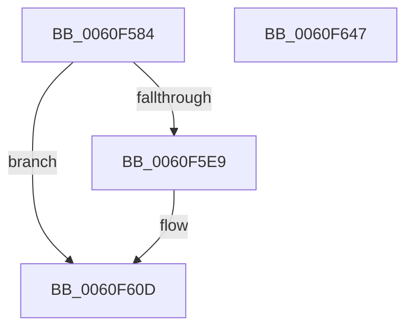

# SmEtwLogStoreOp

- RVA: `0x0060F584`–`0x0060F648` (길이 `196` bytes)
- VA: `0x000000014060F584`
- 실행 섹션: `.text`
- PDB 이름 있음: `예`; PDB Function 태그: `아니요`
- unwind 정보 RVA: `0x0009EA9C`
- 디코드: `45`개 명령, `196/196` bytes 표시
- 미해석 바이트: `0` (있으면 어셈블리에 `.byte`로 보존)

> 이 문서는 커널 이미지의 기계어와 PDB 기호를 분석해 생성했습니다. 4번과 5번은 함수 원형과 자료형을 바이너리 사용 방식에서 추정한 C 해석이며 원본 소스 복구 결과는 아닙니다.

## 1. Dependencies

- 직접 호출 지점: **2**; 고유 호출 대상: **2**
- 직접 호출자로 확인된 함수: **3**
- RIP 상대 이미지 참조: **2**

### Outgoing calls
- `0x0060F62D` → [EtwWriteEx](../25/EtwWriteEx_function_0025F0D0.md) (function, `0x0025F0D0`)
- `0x0060F639` → [_security_check_cookie](../6A/_security_check_cookie_function_006AC640.md) (function, `0x006AC640`)

### Direct callers
- [ST_STORE&lt;SM_TRAITS&gt;::StDmPageRemove](../20/ST_STORE_SM_TRAITS_StDmPageRemove_function_002049A0.md) at `0x00204B67`
- [sub_004EBF65](../4E/Unknown_function_004EBF65.md) at `0x004EC07D`
- [ST_STORE&lt;SM_TRAITS&gt;::StDmEtwPageRundown](ST_STORE_SM_TRAITS_StDmEtwPageRundown_function_0060D544.md) at `0x0060D66C`

### Static image references
- `0x0060F592` → RVA `0x00E0A740` (`.data`; read)
- `0x0060F5A5` → RVA `0x0000B860` (`.rdata`; read)

## 2. Other-region calls and transfers

- 다른 실행 섹션으로 향하는 call: **0**
- 별도 외부 분기/꼬리 이동을 확인하지 못했습니다.

## 3. Assembly (complete function range)

```asm
0060F584  40 55                           push rbp
0060F586  48 8D 6C 24 C9                  lea rbp, [rsp - 0x37]
0060F58B  48 81 EC A0 00 00 00            sub rsp, 0xa0
0060F592  48 8B 05 A7 B1 7F 00            mov rax, qword ptr [rip + 0x7fb1a7]
0060F599  48 33 C4                        xor rax, rsp
0060F59C  48 89 45 27                     mov qword ptr [rbp + 0x27], rax
0060F5A0  45 33 DB                        xor r11d, r11d
0060F5A3  8B C2                           mov eax, edx
0060F5A5  4C 8D 15 B4 C2 9F FF            lea r10, [rip - 0x603d4c]
0060F5AC  4C 89 45 D7                     mov qword ptr [rbp - 0x29], r8
0060F5B0  48 C7 45 DF 04 00 00 00         mov qword ptr [rbp - 0x21], 4
0060F5B8  48 C7 45 EF 08 00 00 00         mov qword ptr [rbp - 0x11], 8
0060F5C0  4D 8B 14 C2                     mov r10, qword ptr [r10 + rax*8]
0060F5C4  45 8D 4B 01                     lea r9d, [r11 + 1]
0060F5C8  48 C7 45 FF 04 00 00 00         mov qword ptr [rbp - 1], 4
0060F5D0  48 8D 45 6F                     lea rax, [rbp + 0x6f]
0060F5D4  48 89 45 E7                     mov qword ptr [rbp - 0x19], rax
0060F5D8  48 8D 45 67                     lea rax, [rbp + 0x67]
0060F5DC  48 89 45 F7                     mov qword ptr [rbp - 9], rax
0060F5E0  41 8D 43 03                     lea eax, [r11 + 3]
0060F5E4  41 3B D1                        cmp edx, r9d
0060F5E7  74 24                           je 0x14060f60d
0060F5E9  48 8D 45 77                     lea rax, [rbp + 0x77]
0060F5ED  48 C7 45 0F 02 00 00 00         mov qword ptr [rbp + 0xf], 2
0060F5F5  48 89 45 07                     mov qword ptr [rbp + 7], rax
0060F5F9  48 8D 45 7F                     lea rax, [rbp + 0x7f]
0060F5FD  48 89 45 17                     mov qword ptr [rbp + 0x17], rax
0060F601  41 8D 43 05                     lea eax, [r11 + 5]
0060F605  48 C7 45 1F 02 00 00 00         mov qword ptr [rbp + 0x1f], 2
0060F60D  48 8B 09                        mov rcx, qword ptr [rcx]
0060F610  48 8D 55 D7                     lea rdx, [rbp - 0x29]
0060F614  48 89 54 24 38                  mov qword ptr [rsp + 0x38], rdx
0060F619  45 33 C0                        xor r8d, r8d
0060F61C  89 44 24 30                     mov dword ptr [rsp + 0x30], eax
0060F620  49 8B D2                        mov rdx, r10
0060F623  4C 89 5C 24 28                  mov qword ptr [rsp + 0x28], r11
0060F628  4C 89 5C 24 20                  mov qword ptr [rsp + 0x20], r11
0060F62D  E8 9E FA C4 FF                  call 0x14025f0d0
0060F632  48 8B 4D 27                     mov rcx, qword ptr [rbp + 0x27]
0060F636  48 33 CC                        xor rcx, rsp
0060F639  E8 02 D0 09 00                  call 0x1406ac640
0060F63E  48 81 C4 A0 00 00 00            add rsp, 0xa0
0060F645  5D                              pop rbp
0060F646  C3                              ret
0060F647  CC                              int3
```

## 4. C-style interpretation (structured pseudocode)

```c
__int64 __fastcall SmEtwLogStoreOp(__int64 a1, int a2, __int64 a3, __int64 a4, __int64 a5, __int64 a6, __int64 a7, __int64 a8)
{
    __int64 result;
    __int64 v_r11;
    __int64 v_rsp;
    unsigned __int64 v_stack_m18;
    unsigned __int64 v_stack_m20;
    unsigned __int64 v_stack_m28;
    unsigned __int64 v_stack_m30;
    unsigned __int64 v_stack_m38;
    unsigned __int64 v_stack_m3F;
    unsigned __int64 v_stack_m40;
    unsigned __int64 v_stack_m48;
    unsigned __int64 v_stack_m50;
    unsigned __int64 v_stack_m58;
    unsigned __int64 v_stack_m60;
    unsigned __int64 v_stack_m68;
    unsigned __int64 v_stack_m70;
    unsigned int v_stack_m78;
    unsigned __int64 v_stack_m80;
    unsigned __int64 v_stack_m88;

    v_rsp = (v_rsp) - (160);
    result = (*(unsigned __int64 *)(v_rip + 8368551)) ^ (v_rsp);
    v_stack_m18 = result;
    v_r11 = 0;
    v_stack_m68 = a3;
    v_stack_m60 = 4;
    v_stack_m50 = 8;
    v_stack_m40 = 4;
    v_stack_m58 = a6;
    v_stack_m48 = a5;
    result = v_r11 + 3;
    if (a2 != ((unsigned int)(v_r11 + 1))) {
        result = a7;
        v_stack_m30 = 2;
        v_stack_m38 = result;
        result = a8;
        v_stack_m28 = result;
        result = v_r11 + 5;
        v_stack_m20 = 2;
    }
    v_stack_m70 = v_stack_m68;
    a3 = 0;
    v_stack_m78 = (unsigned int)(result);
    v_stack_m80 = 0;
    v_stack_m88 = 0;
    result = EtwWriteEx(*(unsigned __int64 *)(a1), *(unsigned __int64 *)(v_rip - 6307148 + (unsigned int)(a2) * 8), a3, v_r11 + 1);
    a1 = (v_stack_m18) ^ (v_rsp);
    result = _security_check_cookie(a1, *(unsigned __int64 *)(v_rip - 6307148 + (unsigned int)(a2) * 8), a3, v_r11 + 1);
    v_rsp = (v_rsp) + (160);
    return result;
}
```

## 5. (Beta) C Style

```c
int64_t SmEtwLogStoreOp(void *Arg1, int32_t Arg2, int64_t Arg3, int64_t Arg4, int64_t Arg5, int64_t Arg6, int64_t Arg7, int64_t Arg8)
{
    uint8_t *arg1 = (uint8_t *)Arg1;

    int64_t result;
    int64_t local_r11;
    int64_t local_rsp;
    uint64_t v_stack_m18;
    uint64_t v_stack_m20;
    uint64_t v_stack_m28;
    uint64_t v_stack_m30;
    uint64_t v_stack_m38;
    uint64_t v_stack_m3F;
    uint64_t v_stack_m40;
    uint64_t v_stack_m48;
    uint64_t v_stack_m50;
    uint64_t v_stack_m58;
    uint64_t v_stack_m60;
    uint64_t v_stack_m68;
    uint64_t v_stack_m70;
    uint32_t v_stack_m78;
    uint64_t v_stack_m80;
    uint64_t v_stack_m88;

    local_rsp = (local_rsp) - (160);
    result = (*(uint64_t *)(v_rip + 0x7FB1A7)) ^ (local_rsp);
    v_stack_m18 = result;
    local_r11 = 0;
    v_stack_m68 = Arg3;
    v_stack_m60 = 4;
    v_stack_m50 = 8;
    v_stack_m40 = 4;
    v_stack_m58 = Arg6;
    v_stack_m48 = Arg5;
    result = local_r11 + 3;
    if (Arg2 != ((uint32_t)(local_r11 + 1))) {
        result = Arg7;
        v_stack_m30 = 2;
        v_stack_m38 = result;
        result = Arg8;
        v_stack_m28 = result;
        result = local_r11 + 5;
        v_stack_m20 = 2;
    }
    v_stack_m70 = v_stack_m68;
    Arg3 = 0;
    v_stack_m78 = (uint32_t)(result);
    v_stack_m80 = 0;
    v_stack_m88 = 0;
    result = EtwWriteEx(*(uint64_t *)(arg1), *(uint64_t *)(v_rip - 0x603D4C + (uint32_t)(Arg2) * 8), Arg3, local_r11 + 1);
    Arg1 = (v_stack_m18) ^ (local_rsp);
    result = _security_check_cookie(Arg1, *(uint64_t *)(v_rip - 0x603D4C + (uint32_t)(Arg2) * 8), Arg3, local_r11 + 1);
    local_rsp = (local_rsp) + (160);
    return result;
}
```

### 관측된 메모리 오프셋

구조체 형식이 확인되지 않은 접근은 인자 기준의 오프셋으로만 기록했습니다.

| 기준 인자 | 오프셋 표현 | 폭 (bit) | 접근 |
|---|---:|---:|---|
| `Arg1` | `+ 0x0` | `64` | `R` |

## 6. Execution-region graph

[열기: 2D/3D 그래프와 함수 탐색 컨트롤 패널](../../../control-panel.html?section=text&rva=0x0060F584&view=graph)

- 2D 그래프는 위에서 아래로 흐르고, 3D 그래프는 빈 공간을 드래그해 회전합니다. Shift+드래그는 이동, 휠은 확대·축소, 함수 노드 선택은 대상 보고서 이동입니다.

### Static fallback


