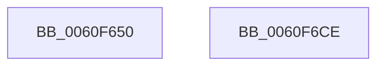

# SmEtwLogStoreStateChange

- RVA: `0x0060F650`–`0x0060F6CF` (길이 `127` bytes)
- VA: `0x000000014060F650`
- 실행 섹션: `.text`
- PDB 이름 있음: `예`; PDB Function 태그: `아니요`
- unwind 정보 RVA: `0x000A6BF4`
- 디코드: `29`개 명령, `127/127` bytes 표시
- 미해석 바이트: `0` (있으면 어셈블리에 `.byte`로 보존)

> 이 문서는 커널 이미지의 기계어와 PDB 기호를 분석해 생성했습니다. 4번과 5번은 함수 원형과 자료형을 바이너리 사용 방식에서 추정한 C 해석이며 원본 소스 복구 결과는 아닙니다.

## 1. Dependencies

- 직접 호출 지점: **2**; 고유 호출 대상: **2**
- 직접 호출자로 확인된 함수: **1**
- RIP 상대 이미지 참조: **2**

### Outgoing calls
- `0x0060F6B7` → [EtwWriteEx](../25/EtwWriteEx_function_0025F0D0.md) (function, `0x0025F0D0`)
- `0x0060F6C4` → [_security_check_cookie](../6A/_security_check_cookie_function_006AC640.md) (function, `0x006AC640`)

### Direct callers
- [ST_STORE&lt;SM_TRAITS&gt;::StEmptyStore](../4F/ST_STORE_SM_TRAITS_StEmptyStore_function_004FB4B0.md) at `0x004FB4D4`

### Static image references
- `0x0060F65F` → RVA `0x00E0A740` (`.data`; read)
- `0x0060F66E` → RVA `0x0000B8A8` (`.rdata`; read)

## 2. Other-region calls and transfers

- 다른 실행 섹션으로 향하는 call: **0**
- 별도 외부 분기/꼬리 이동을 확인하지 못했습니다.

## 3. Assembly (complete function range)

```asm
0060F650  4C 8B DC                        mov r11, rsp
0060F653  4D 89 4B 20                     mov qword ptr [r11 + 0x20], r9
0060F657  4D 89 43 18                     mov qword ptr [r11 + 0x18], r8
0060F65B  48 83 EC 78                     sub rsp, 0x78
0060F65F  48 8B 05 DA B0 7F 00            mov rax, qword ptr [rip + 0x7fb0da]
0060F666  48 33 C4                        xor rax, rsp
0060F669  48 89 44 24 60                  mov qword ptr [rsp + 0x60], rax
0060F66E  48 8B 15 33 C2 9F FF            mov rdx, qword ptr [rip - 0x603dcd]
0060F675  49 8D 43 18                     lea rax, [r11 + 0x18]
0060F679  48 8B 09                        mov rcx, qword ptr [rcx]
0060F67C  45 33 C0                        xor r8d, r8d
0060F67F  49 89 43 C8                     mov qword ptr [r11 - 0x38], rax
0060F683  49 8D 43 20                     lea rax, [r11 + 0x20]
0060F687  49 89 43 D8                     mov qword ptr [r11 - 0x28], rax
0060F68B  49 8D 43 C8                     lea rax, [r11 - 0x38]
0060F68F  49 89 43 C0                     mov qword ptr [r11 - 0x40], rax
0060F693  C7 44 24 30 02 00 00 00         mov dword ptr [rsp + 0x30], 2
0060F69B  45 8D 48 01                     lea r9d, [r8 + 1]
0060F69F  4D 89 43 B0                     mov qword ptr [r11 - 0x50], r8
0060F6A3  4D 89 43 A8                     mov qword ptr [r11 - 0x58], r8
0060F6A7  49 C7 43 D0 08 00 00 00         mov qword ptr [r11 - 0x30], 8
0060F6AF  49 C7 43 E0 08 00 00 00         mov qword ptr [r11 - 0x20], 8
0060F6B7  E8 14 FA C4 FF                  call 0x14025f0d0
0060F6BC  48 8B 4C 24 60                  mov rcx, qword ptr [rsp + 0x60]
0060F6C1  48 33 CC                        xor rcx, rsp
0060F6C4  E8 77 CF 09 00                  call 0x1406ac640
0060F6C9  48 83 C4 78                     add rsp, 0x78
0060F6CD  C3                              ret
0060F6CE  CC                              int3
```

## 4. C-style interpretation (structured pseudocode)

```c
__int64 __fastcall SmEtwLogStoreStateChange(__int64 a1, __int64 a2, __int64 a3, __int64 a4)
{
    __int64 result;
    __int64 v_rsp;
    unsigned __int64 v_stack_m18;
    unsigned int v_stack_m48;

    *(unsigned __int64 *)(v_rsp + 32) = a4;
    *(unsigned __int64 *)(v_rsp + 24) = a3;
    v_rsp = (v_rsp) - (120);
    result = (*(unsigned __int64 *)(v_rip + 8368346)) ^ (v_rsp);
    v_stack_m18 = result;
    a3 = 0;
    *(unsigned __int64 *)(v_rsp - 56) = v_rsp + 24;
    *(unsigned __int64 *)(v_rsp - 40) = v_rsp + 32;
    *(unsigned __int64 *)(v_rsp - 64) = v_rsp - 56;
    v_stack_m48 = 2;
    *(unsigned __int64 *)(v_rsp - 80) = 0;
    *(unsigned __int64 *)(v_rsp - 88) = 0;
    *(unsigned __int64 *)(v_rsp - 48) = 8;
    *(unsigned __int64 *)(v_rsp - 32) = 8;
    result = EtwWriteEx(*(unsigned __int64 *)(a1), *(unsigned __int64 *)(v_rip - 6307277), a3, a3 + 1);
    a1 = (v_stack_m18) ^ (v_rsp);
    result = _security_check_cookie(a1, *(unsigned __int64 *)(v_rip - 6307277), a3, a3 + 1);
    v_rsp = (v_rsp) + (120);
    return result;
}
```

## 5. (Beta) C Style

```c
int64_t SmEtwLogStoreStateChange(void *Arg1, int64_t Arg2, int64_t Arg3, int64_t Arg4)
{
    uint8_t *arg1 = (uint8_t *)Arg1;

    int64_t result;
    int64_t local_rsp;
    uint64_t v_stack_m18;
    uint32_t v_stack_m48;

    *(uint64_t *)(local_rsp + 0x20) = Arg4;
    *(uint64_t *)(local_rsp + 0x18) = Arg3;
    local_rsp = (local_rsp) - (120);
    result = (*(uint64_t *)(v_rip + 0x7FB0DA)) ^ (local_rsp);
    v_stack_m18 = result;
    Arg3 = 0;
    *(uint64_t *)(local_rsp - 0x38) = local_rsp + 24;
    *(uint64_t *)(local_rsp - 0x28) = local_rsp + 32;
    *(uint64_t *)(local_rsp - 0x40) = local_rsp - 56;
    v_stack_m48 = 2;
    *(uint64_t *)(local_rsp - 0x50) = 0;
    *(uint64_t *)(local_rsp - 0x58) = 0;
    *(uint64_t *)(local_rsp - 0x30) = 8;
    *(uint64_t *)(local_rsp - 0x20) = 8;
    result = EtwWriteEx(*(uint64_t *)(arg1), *(uint64_t *)(v_rip - 0x603DCD), Arg3, Arg3 + 1);
    Arg1 = (v_stack_m18) ^ (local_rsp);
    result = _security_check_cookie(Arg1, *(uint64_t *)(v_rip - 0x603DCD), Arg3, Arg3 + 1);
    local_rsp = (local_rsp) + (120);
    return result;
}
```

### 관측된 메모리 오프셋

구조체 형식이 확인되지 않은 접근은 인자 기준의 오프셋으로만 기록했습니다.

| 기준 인자 | 오프셋 표현 | 폭 (bit) | 접근 |
|---|---:|---:|---|
| `Arg1` | `+ 0x0` | `64` | `R` |

## 6. Execution-region graph

[열기: 2D/3D 그래프와 함수 탐색 컨트롤 패널](../../../control-panel.html?section=text&rva=0x0060F650&view=graph)

- 2D 그래프는 위에서 아래로 흐르고, 3D 그래프는 빈 공간을 드래그해 회전합니다. Shift+드래그는 이동, 휠은 확대·축소, 함수 노드 선택은 대상 보고서 이동입니다.

### Static fallback


