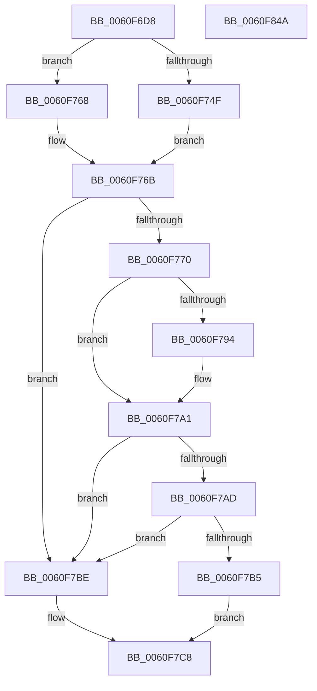

# SmKmEtwAppendObjectName

- RVA: `0x0060F6D8`–`0x0060F84B` (길이 `371` bytes)
- VA: `0x000000014060F6D8`
- 실행 섹션: `.text`
- PDB 이름 있음: `예`; PDB Function 태그: `아니요`
- unwind 정보 RVA: `0x000CA7C4`
- 디코드: `110`개 명령, `371/371` bytes 표시
- 미해석 바이트: `0` (있으면 어셈블리에 `.byte`로 보존)

> 이 문서는 커널 이미지의 기계어와 PDB 기호를 분석해 생성했습니다. 4번과 5번은 함수 원형과 자료형을 바이너리 사용 방식에서 추정한 C 해석이며 원본 소스 복구 결과는 아닙니다.

## 1. Dependencies

- 직접 호출 지점: **7**; 고유 호출 대상: **6**
- 직접 호출자로 확인된 함수: **1**
- RIP 상대 이미지 참조: **3**

### Outgoing calls
- `0x0060F75B` → [IoGetDeviceAttachmentBaseRefWithTag](../27/IoGetDeviceAttachmentBaseRefWithTag_function_00272788.md) (function, `0x00272788`)
- `0x0060F772` → [IoSetThreadHardErrorMode](../46/IoSetThreadHardErrorMode_function_00466BF0.md) (function, `0x00466BF0`)
- `0x0060F788` → [ObQueryNameString](../../page/8A/ObQueryNameString_function_008A7EB0.md) (function, `0x008A7EB0`)
- `0x0060F79C` → [ObfDereferenceObjectWithTag](../2F/ObfDereferenceObjectWithTag_function_002F78E0.md) (function, `0x002F78E0`)
- `0x0060F7A4` → [IoSetThreadHardErrorMode](../46/IoSetThreadHardErrorMode_function_00466BF0.md) (function, `0x00466BF0`)
- `0x0060F7D2` → [memcpy](../6C/memcpy_function_006C6840.md) (function, `0x006C6840`)
- `0x0060F82D` → [_security_check_cookie](../6A/_security_check_cookie_function_006AC640.md) (function, `0x006AC640`)

### Direct callers
- [SmKmStoreTerminateWorker](SmKmStoreTerminateWorker_function_0060FB30.md) at `0x0060FD54`

### Static image references
- `0x0060F6EC` → RVA `0x00E0A740` (`.data`; read)
- `0x0060F701` → RVA `0x006CD930` (` ?? ::FNODOBFM::`string'`; read)
- `0x0060F710` → RVA `0x006CD940` (`.text`; read)

## 2. Other-region calls and transfers

- 다른 실행 섹션으로 향하는 call: **1**
  - `0x0060F788` → [ObQueryNameString](../../page/8A/ObQueryNameString_function_008A7EB0.md) (`.text` → `PAGE`)
- 별도 외부 분기/꼬리 이동을 확인하지 못했습니다.

## 3. Assembly (complete function range)

```asm
0060F6D8  48 89 5C 24 18                  mov qword ptr [rsp + 0x18], rbx
0060F6DD  55                              push rbp
0060F6DE  56                              push rsi
0060F6DF  57                              push rdi
0060F6E0  41 54                           push r12
0060F6E2  41 55                           push r13
0060F6E4  41 56                           push r14
0060F6E6  41 57                           push r15
0060F6E8  48 83 EC 50                     sub rsp, 0x50
0060F6EC  48 8B 05 4D B0 7F 00            mov rax, qword ptr [rip + 0x7fb04d]
0060F6F3  48 33 C4                        xor rax, rsp
0060F6F6  48 89 44 24 48                  mov qword ptr [rsp + 0x48], rax
0060F6FB  8B 41 18                        mov eax, dword ptr [rcx + 0x18]
0060F6FE  45 33 E4                        xor r12d, r12d
0060F701  0F 10 05 28 E2 0B 00            movups xmm0, xmmword ptr [rip + 0xbe228]
0060F708  48 8B E9                        mov rbp, rcx
0060F70B  44 89 64 24 20                  mov dword ptr [rsp + 0x20], r12d
0060F710  0F 10 0D 29 E2 0B 00            movups xmm1, xmmword ptr [rip + 0xbe229]
0060F717  8B C8                           mov ecx, eax
0060F719  48 8B DA                        mov rbx, rdx
0060F71C  0F 11 44 24 28                  movups xmmword ptr [rsp + 0x28], xmm0
0060F721  48 03 4D 08                     add rcx, qword ptr [rbp + 8]
0060F725  44 8B 75 1C                     mov r14d, dword ptr [rbp + 0x1c]
0060F729  44 2B F0                        sub r14d, eax
0060F72C  0F 11 4C 24 38                  movups xmmword ptr [rsp + 0x38], xmm1
0060F731  4C 8D 69 02                     lea r13, [rcx + 2]
0060F735  49 8D 7D 07                     lea rdi, [r13 + 7]
0060F739  48 83 E7 F8                     and rdi, 0xfffffffffffffff8
0060F73D  44 2B F7                        sub r14d, edi
0060F740  44 03 F1                        add r14d, ecx
0060F743  4C 89 27                        mov qword ptr [rdi], r12
0060F746  4C 89 67 08                     mov qword ptr [rdi + 8], r12
0060F74A  F6 C2 01                        test dl, 1
0060F74D  74 19                           je 0x14060f768
0060F74F  48 83 E3 FE                     and rbx, 0xfffffffffffffffe
0060F753  BA 44 66 6C 74                  mov edx, 0x746c6644
0060F758  48 8B CB                        mov rcx, rbx
0060F75B  E8 28 30 C6 FF                  call 0x140272788
0060F760  48 8B D8                        mov rbx, rax
0060F763  48 8B F0                        mov rsi, rax
0060F766  EB 03                           jmp 0x14060f76b
0060F768  49 8B F4                        mov rsi, r12
0060F76B  48 85 DB                        test rbx, rbx
0060F76E  74 4E                           je 0x14060f7be
0060F770  33 C9                           xor ecx, ecx
0060F772  E8 79 74 E5 FF                  call 0x140466bf0
0060F777  4C 8D 4C 24 20                  lea r9, [rsp + 0x20]
0060F77C  45 8B C6                        mov r8d, r14d
0060F77F  48 8B D7                        mov rdx, rdi
0060F782  48 8B CB                        mov rcx, rbx
0060F785  44 8A F8                        mov r15b, al
0060F788  E8 23 87 29 00                  call 0x1408a7eb0
0060F78D  8B D8                           mov ebx, eax
0060F78F  48 85 F6                        test rsi, rsi
0060F792  74 0D                           je 0x14060f7a1
0060F794  BA 44 66 6C 74                  mov edx, 0x746c6644
0060F799  48 8B CE                        mov rcx, rsi
0060F79C  E8 3F 81 CE FF                  call 0x1402f78e0
0060F7A1  41 8A CF                        mov cl, r15b
0060F7A4  E8 47 74 E5 FF                  call 0x140466bf0
0060F7A9  85 DB                           test ebx, ebx
0060F7AB  78 11                           js 0x14060f7be
0060F7AD  0F B7 1F                        movzx ebx, word ptr [rdi]
0060F7B0  66 85 DB                        test bx, bx
0060F7B3  74 09                           je 0x14060f7be
0060F7B5  48 8B 57 08                     mov rdx, qword ptr [rdi + 8]
0060F7B9  66 D1 EB                        shr bx, 1
0060F7BC  EB 0A                           jmp 0x14060f7c8
0060F7BE  48 8D 54 24 28                  lea rdx, [rsp + 0x28]
0060F7C3  BB 0F 00 00 00                  mov ebx, 0xf
0060F7C8  44 0F B7 C3                     movzx r8d, bx
0060F7CC  49 8B CD                        mov rcx, r13
0060F7CF  4D 03 C0                        add r8, r8
0060F7D2  E8 69 70 0B 00                  call 0x1406c6840
0060F7D7  8B 55 18                        mov edx, dword ptr [rbp + 0x18]
0060F7DA  48 03 55 08                     add rdx, qword ptr [rbp + 8]
0060F7DE  0F B7 CB                        movzx ecx, bx
0060F7E1  03 C9                           add ecx, ecx
0060F7E3  66 89 1A                        mov word ptr [rdx], bx
0060F7E6  8B 45 10                        mov eax, dword ptr [rbp + 0x10]
0060F7E9  48 C1 E0 04                     shl rax, 4
0060F7ED  48 03 45 00                     add rax, qword ptr [rbp]
0060F7F1  48 89 10                        mov qword ptr [rax], rdx
0060F7F4  48 C7 40 08 02 00 00 00         mov qword ptr [rax + 8], 2
0060F7FC  FF 45 10                        inc dword ptr [rbp + 0x10]
0060F7FF  8B 55 10                        mov edx, dword ptr [rbp + 0x10]
0060F802  83 45 18 02                     add dword ptr [rbp + 0x18], 2
0060F806  8B 45 18                        mov eax, dword ptr [rbp + 0x18]
0060F809  48 03 45 08                     add rax, qword ptr [rbp + 8]
0060F80D  48 C1 E2 04                     shl rdx, 4
0060F811  48 03 55 00                     add rdx, qword ptr [rbp]
0060F815  48 89 02                        mov qword ptr [rdx], rax
0060F818  89 4A 08                        mov dword ptr [rdx + 8], ecx
0060F81B  44 89 62 0C                     mov dword ptr [rdx + 0xc], r12d
0060F81F  FF 45 10                        inc dword ptr [rbp + 0x10]
0060F822  01 4D 18                        add dword ptr [rbp + 0x18], ecx
0060F825  48 8B 4C 24 48                  mov rcx, qword ptr [rsp + 0x48]
0060F82A  48 33 CC                        xor rcx, rsp
0060F82D  E8 0E CE 09 00                  call 0x1406ac640
0060F832  48 8B 9C 24 A0 00 00 00         mov rbx, qword ptr [rsp + 0xa0]
0060F83A  48 83 C4 50                     add rsp, 0x50
0060F83E  41 5F                           pop r15
0060F840  41 5E                           pop r14
0060F842  41 5D                           pop r13
0060F844  41 5C                           pop r12
0060F846  5F                              pop rdi
0060F847  5E                              pop rsi
0060F848  5D                              pop rbp
0060F849  C3                              ret
0060F84A  CC                              int3
```

## 4. C-style interpretation (structured pseudocode)

```c
__int64 __fastcall SmKmEtwAppendObjectName(__int64 a1, __int64 a2)
{
    __int64 result;
    __int64 v_r12;
    __int64 v_r14;
    __int64 v_rbx;
    __int64 v_rdi;
    __int64 v_rsp;
    unsigned __int64 v_stack_m40;
    unsigned __int64 v_stack_m50;
    unsigned __int64 v_stack_m60;
    unsigned int v_stack_m68;
    unsigned __int64 v_stack_p18;

    v_stack_p18 = v_rbx;
    v_rsp = (v_rsp) - (80);
    result = (*(unsigned __int64 *)(v_rip + 8368205)) ^ (v_rsp);
    v_stack_m40 = result;
    v_r12 = 0;
    v_stack_m68 = 0;
    v_stack_m60 = v_xmm0;
    a1 = ((unsigned int)((unsigned int)((unsigned int)(*(unsigned int *)(a1 + 24))))) + (*(unsigned __int64 *)(a1 + 8));
    v_r14 = (unsigned int)(((unsigned int)(*(unsigned int *)(a1 + 28))) - ((unsigned int)((unsigned int)(*(unsigned int *)(a1 + 24)))));
    v_stack_m50 = v_xmm1;
    v_rdi = (a1 + 2 + 7) & (-8);
    v_r14 = (unsigned int)((v_r14) - ((unsigned int)(v_rdi)));
    v_r14 = (unsigned int)((v_r14) + ((unsigned int)(a1)));
    *(unsigned __int64 *)(v_rdi) = 0;
    *(unsigned __int64 *)(v_rdi + 8) = 0;
    if ((((unsigned __int8)(a2)) & (1)) == 0) goto loc_0060F768;
    v_rbx = (a2) & (-2);
    result = IoGetDeviceAttachmentBaseRefWithTag(v_rbx, (unsigned int)(0x746C6644ULL), a3, a4);
    goto loc_0060F76B;
loc_0060F768:
loc_0060F76B:
    if (result == 0) goto loc_0060F7BE;
    a1 = 0;
    result = IoSetThreadHardErrorMode(a1, (unsigned int)(0x746C6644ULL), a3, a4);
    result = ObQueryNameString(result, v_rdi, (unsigned int)((unsigned int)(v_r14)), v_stack_m68);
    if (0 != 0) {
        a2 = 0x746C6644ULL;
        a1 = 0;
        result = ObfDereferenceObjectWithTag(a1, a2, (unsigned int)((unsigned int)(v_r14)), v_stack_m68);
    }
    result = IoSetThreadHardErrorMode((unsigned __int8)((unsigned __int8)(result)), a2, (unsigned int)((unsigned int)(v_r14)), v_stack_m68);
    if (sign_flag) goto loc_0060F7BE;
    if ((unsigned __int16)(*(unsigned __int16 *)(v_rdi)) == 0) goto loc_0060F7BE;
    v_rbx = (unsigned __int16)((*(unsigned __int16 *)(v_rdi)) >> (1));
    goto loc_0060F7C8;
loc_0060F7BE:
loc_0060F7C8:
    a3 = (15) + (15);
    result = memcpy(a1 + 2, v_stack_m60, a3, v_stack_m68);
    a2 = ((unsigned int)(*(unsigned int *)(a1 + 24))) + (*(unsigned __int64 *)(a1 + 8));
    a1 = (unsigned int)((15) + (15));
    *(unsigned __int16 *)(a2) = 15;
    result = ((unsigned int)(*(unsigned int *)(a1 + 16))) << (4);
    result = (result) + (*(unsigned __int64 *)(a1));
    *(unsigned __int64 *)(result) = a2;
    *(unsigned __int64 *)(result + 8) = 2;
    result = ((unsigned int)(*(unsigned int *)(a1 + 24))) + (*(unsigned __int64 *)(a1 + 8));
    a2 = ((unsigned int)(*(unsigned int *)(a1 + 16))) << (4);
    a2 = (a2) + (*(unsigned __int64 *)(a1));
    *(unsigned __int64 *)(a2) = result;
    *(unsigned int *)(a2 + 8) = (unsigned int)(a1);
    *(unsigned int *)(a2 + 12) = 0;
    a1 = (v_stack_m40) ^ (v_rsp);
    result = _security_check_cookie(a1, a2, a3, v_stack_m68);
    v_rsp = (v_rsp) + (80);
    return result;
}
```

## 5. (Beta) C Style

```c
int64_t SmKmEtwAppendObjectName(void *Arg1, int64_t Arg2)
{
    uint8_t *arg1 = (uint8_t *)Arg1;

    int64_t result;
    int64_t local_r12;
    int64_t local_r14;
    int64_t local_rbx;
    int64_t local_rdi;
    int64_t local_rsp;
    uint64_t v_stack_m40;
    uint64_t v_stack_m50;
    uint64_t v_stack_m60;
    uint32_t v_stack_m68;
    uint64_t v_stack_p18;

    v_stack_p18 = local_rbx;
    local_rsp = (local_rsp) - (80);
    result = (*(uint64_t *)(v_rip + 0x7FB04D)) ^ (local_rsp);
    v_stack_m40 = result;
    local_r12 = 0;
    v_stack_m68 = 0;
    v_stack_m60 = v_xmm0;
    Arg1 = ((uint32_t)((uint32_t)((uint32_t)(*(uint32_t *)(arg1 + 0x18))))) + (*(uint64_t *)(arg1 + 0x8));
    local_r14 = (uint32_t)(((uint32_t)(*(uint32_t *)(arg1 + 0x1C))) - ((uint32_t)((uint32_t)(*(uint32_t *)(arg1 + 0x18)))));
    v_stack_m50 = v_xmm1;
    local_rdi = (Arg1 + 2 + 7) & (-8);
    local_r14 = (uint32_t)((local_r14) - ((uint32_t)(local_rdi)));
    local_r14 = (uint32_t)((local_r14) + ((uint32_t)(Arg1)));
    *(uint64_t *)(local_rdi) = 0;
    *(uint64_t *)(local_rdi + 0x8) = 0;
    if ((((uint8_t)(Arg2)) & (1)) == 0) goto loc_0060F768;
    local_rbx = (Arg2) & (-2);
    result = IoGetDeviceAttachmentBaseRefWithTag(local_rbx, (uint32_t)(0x746C6644ULL), a3, a4);
    goto loc_0060F76B;
loc_0060F768:
loc_0060F76B:
    if (result == 0) goto loc_0060F7BE;
    Arg1 = 0;
    result = IoSetThreadHardErrorMode(Arg1, (uint32_t)(0x746C6644ULL), a3, a4);
    result = ObQueryNameString(result, local_rdi, (uint32_t)((uint32_t)(local_r14)), v_stack_m68);
    if (0 != 0) {
        Arg2 = 0x746C6644ULL;
        Arg1 = 0;
        result = ObfDereferenceObjectWithTag(Arg1, Arg2, (uint32_t)((uint32_t)(local_r14)), v_stack_m68);
    }
    result = IoSetThreadHardErrorMode((uint8_t)((uint8_t)(result)), Arg2, (uint32_t)((uint32_t)(local_r14)), v_stack_m68);
    if (sign_flag) goto loc_0060F7BE;
    if ((uint16_t)(*(uint16_t *)(local_rdi)) == 0) goto loc_0060F7BE;
    local_rbx = (uint16_t)((*(uint16_t *)(local_rdi)) >> (1));
    goto loc_0060F7C8;
loc_0060F7BE:
loc_0060F7C8:
    a3 = (15) + (15);
    result = memcpy(Arg1 + 2, v_stack_m60, a3, v_stack_m68);
    Arg2 = ((uint32_t)(*(uint32_t *)(arg1 + 0x18))) + (*(uint64_t *)(arg1 + 0x8));
    Arg1 = (uint32_t)((15) + (15));
    *(uint16_t *)(Arg2) = 15;
    result = ((uint32_t)(*(uint32_t *)(arg1 + 0x10))) << (4);
    result = (result) + (*(uint64_t *)(arg1));
    *(uint64_t *)(result) = Arg2;
    *(uint64_t *)(result + 0x8) = 2;
    result = ((uint32_t)(*(uint32_t *)(arg1 + 0x18))) + (*(uint64_t *)(arg1 + 0x8));
    Arg2 = ((uint32_t)(*(uint32_t *)(arg1 + 0x10))) << (4);
    Arg2 = (Arg2) + (*(uint64_t *)(arg1));
    *(uint64_t *)(Arg2) = result;
    *(uint32_t *)(Arg2 + 0x8) = (uint32_t)(Arg1);
    *(uint32_t *)(Arg2 + 0xC) = 0;
    Arg1 = (v_stack_m40) ^ (local_rsp);
    result = _security_check_cookie(Arg1, Arg2, a3, v_stack_m68);
    local_rsp = (local_rsp) + (80);
    return result;
}
```

### 관측된 메모리 오프셋

구조체 형식이 확인되지 않은 접근은 인자 기준의 오프셋으로만 기록했습니다.

| 기준 인자 | 오프셋 표현 | 폭 (bit) | 접근 |
|---|---:|---:|---|
| `Arg1` | `+ 0x0` | `64` | `R` |
| `Arg1` | `+ 0x8` | `64` | `R` |
| `Arg1` | `+ 0x10` | `32` | `R` |
| `Arg1` | `+ 0x10` | `32` | `R/W` |
| `Arg1` | `+ 0x18` | `32` | `R` |
| `Arg1` | `+ 0x18` | `32` | `R/W` |
| `Arg1` | `+ 0x1C` | `32` | `R` |

## 6. Execution-region graph

[열기: 2D/3D 그래프와 함수 탐색 컨트롤 패널](../../../control-panel.html?section=text&rva=0x0060F6D8&view=graph)

- 2D 그래프는 위에서 아래로 흐르고, 3D 그래프는 빈 공간을 드래그해 회전합니다. Shift+드래그는 이동, 휠은 확대·축소, 함수 노드 선택은 대상 보고서 이동입니다.

### Static fallback


