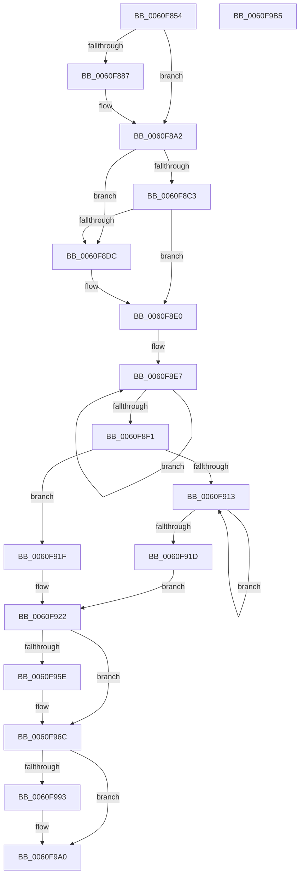

# SmKmEtwAppendProductName

- RVA: `0x0060F854`–`0x0060F9B6` (길이 `354` bytes)
- VA: `0x000000014060F854`
- 실행 섹션: `.text`
- PDB 이름 있음: `예`; PDB Function 태그: `아니요`
- unwind 정보 RVA: `0x000D1E0C`
- 디코드: `112`개 명령, `354/354` bytes 표시
- 미해석 바이트: `0` (있으면 어셈블리에 `.byte`로 보존)

> 이 문서는 커널 이미지의 기계어와 PDB 기호를 분석해 생성했습니다. 4번과 5번은 함수 원형과 자료형을 바이너리 사용 방식에서 추정한 C 해석이며 원본 소스 복구 결과는 아닙니다.

## 1. Dependencies

- 직접 호출 지점: **5**; 고유 호출 대상: **5**
- 직접 호출자로 확인된 함수: **1**
- RIP 상대 이미지 참조: **0**

### Outgoing calls
- `0x0060F893` → [SmKmStoreFileOpenVolume](../../page/7A/SmKmStoreFileOpenVolume_function_007A9C14.md) (function, `0x007A9C14`)
- `0x0060F8D3` → [SmKmVolumeQueryUniqueId](../../page/7A/SmKmVolumeQueryUniqueId_function_007A9FE8.md) (function, `0x007A9FE8`)
- `0x0060F90A` → [SmUniqueIdParseProductName](SmUniqueIdParseProductName_function_0060ECC0.md) (function, `0x0060ECC0`)
- `0x0060F967` → [memcpy](../6C/memcpy_function_006C6840.md) (function, `0x006C6840`)
- `0x0060F99B` → [ObfDereferenceObjectWithTag](../2F/ObfDereferenceObjectWithTag_function_002F78E0.md) (function, `0x002F78E0`)

### Direct callers
- [SmKmStoreTerminateWorker](SmKmStoreTerminateWorker_function_0060FB30.md) at `0x0060FD46`

### Static image references
- 디코드된 RIP-relative 메모리 참조가 없습니다.

## 2. Other-region calls and transfers

- 다른 실행 섹션으로 향하는 call: **2**
  - `0x0060F893` → [SmKmStoreFileOpenVolume](../../page/7A/SmKmStoreFileOpenVolume_function_007A9C14.md) (`.text` → `PAGE`)
  - `0x0060F8D3` → [SmKmVolumeQueryUniqueId](../../page/7A/SmKmVolumeQueryUniqueId_function_007A9FE8.md) (`.text` → `PAGE`)
- 별도 외부 분기/꼬리 이동을 확인하지 못했습니다.

## 3. Assembly (complete function range)

```asm
0060F854  4C 8B DC                        mov r11, rsp
0060F857  49 89 5B 18                     mov qword ptr [r11 + 0x18], rbx
0060F85B  55                              push rbp
0060F85C  56                              push rsi
0060F85D  57                              push rdi
0060F85E  41 54                           push r12
0060F860  41 55                           push r13
0060F862  41 56                           push r14
0060F864  41 57                           push r15
0060F866  48 83 EC 20                     sub rsp, 0x20
0060F86A  45 33 ED                        xor r13d, r13d
0060F86D  4C 8B F1                        mov r14, rcx
0060F870  48 8B 4A 18                     mov rcx, qword ptr [rdx + 0x18]
0060F874  48 8B C2                        mov rax, rdx
0060F877  4D 89 6B 10                     mov qword ptr [r11 + 0x10], r13
0060F87B  41 8B ED                        mov ebp, r13d
0060F87E  49 89 4B 08                     mov qword ptr [r11 + 8], rcx
0060F882  48 85 C9                        test rcx, rcx
0060F885  75 1B                           jne 0x14060f8a2
0060F887  48 8B 48 08                     mov rcx, qword ptr [rax + 8]
0060F88B  4D 8D 43 08                     lea r8, [r11 + 8]
0060F88F  49 8D 53 10                     lea rdx, [r11 + 0x10]
0060F893  E8 7C A3 19 00                  call 0x1407a9c14
0060F898  48 8B 4C 24 60                  mov rcx, qword ptr [rsp + 0x60]
0060F89D  48 8B 6C 24 68                  mov rbp, qword ptr [rsp + 0x68]
0060F8A2  41 8B 46 18                     mov eax, dword ptr [r14 + 0x18]
0060F8A6  41 8B 5E 1C                     mov ebx, dword ptr [r14 + 0x1c]
0060F8AA  8B D0                           mov edx, eax
0060F8AC  49 03 56 08                     add rdx, qword ptr [r14 + 8]
0060F8B0  2B D8                           sub ebx, eax
0060F8B2  48 8D 7A 01                     lea rdi, [rdx + 1]
0060F8B6  48 83 E7 FE                     and rdi, 0xfffffffffffffffe
0060F8BA  2B DF                           sub ebx, edi
0060F8BC  03 DA                           add ebx, edx
0060F8BE  48 85 C9                        test rcx, rcx
0060F8C1  74 19                           je 0x14060f8dc
0060F8C3  41 B8 00 01 00 00               mov r8d, 0x100
0060F8C9  48 8B D7                        mov rdx, rdi
0060F8CC  41 3B D8                        cmp ebx, r8d
0060F8CF  44 0F 42 C3                     cmovb r8d, ebx
0060F8D3  E8 10 A7 19 00                  call 0x1407a9fe8
0060F8D8  85 C0                           test eax, eax
0060F8DA  79 04                           jns 0x14060f8e0
0060F8DC  66 44 89 2F                     mov word ptr [rdi], r13w
0060F8E0  48 83 CE FF                     or rsi, 0xffffffffffffffff
0060F8E4  48 8B CE                        mov rcx, rsi
0060F8E7  48 FF C1                        inc rcx
0060F8EA  66 44 39 2C 4F                  cmp word ptr [rdi + rcx*2], r13w
0060F8EF  75 F6                           jne 0x14060f8e7
0060F8F1  44 8B F9                        mov r15d, ecx
0060F8F4  8D 04 09                        lea eax, [rcx + rcx]
0060F8F7  2B D8                           sub ebx, eax
0060F8F9  49 FF C7                        inc r15
0060F8FC  48 8B CF                        mov rcx, rdi
0060F8FF  4E 8D 3C 7F                     lea r15, [rdi + r15*2]
0060F903  49 8B D7                        mov rdx, r15
0060F906  44 8D 43 FE                     lea r8d, [rbx - 2]
0060F90A  E8 B1 F3 FF FF                  call 0x14060ecc0
0060F90F  85 C0                           test eax, eax
0060F911  78 0C                           js 0x14060f91f
0060F913  48 FF C6                        inc rsi
0060F916  66 45 39 2C 77                  cmp word ptr [r15 + rsi*2], r13w
0060F91B  75 F6                           jne 0x14060f913
0060F91D  EB 03                           jmp 0x14060f922
0060F91F  41 8B F5                        mov esi, r13d
0060F922  45 8B 46 18                     mov r8d, dword ptr [r14 + 0x18]
0060F926  4D 8B 4E 08                     mov r9, qword ptr [r14 + 8]
0060F92A  41 8B 4E 10                     mov ecx, dword ptr [r14 + 0x10]
0060F92E  4D 8B 26                        mov r12, qword ptr [r14]
0060F931  8B C1                           mov eax, ecx
0060F933  48 03 C0                        add rax, rax
0060F936  45 8D 68 02                     lea r13d, [r8 + 2]
0060F93A  4B 8D 14 08                     lea rdx, [r8 + r9]
0060F93E  41 8B DD                        mov ebx, r13d
0060F941  66 89 32                        mov word ptr [rdx], si
0060F944  8D 79 01                        lea edi, [rcx + 1]
0060F947  49 03 D9                        add rbx, r9
0060F94A  03 F6                           add esi, esi
0060F94C  49 89 14 C4                     mov qword ptr [r12 + rax*8], rdx
0060F950  49 C7 44 C4 08 02 00 00 00      mov qword ptr [r12 + rax*8 + 8], 2
0060F959  4D 85 FF                        test r15, r15
0060F95C  74 0E                           je 0x14060f96c
0060F95E  44 8B C6                        mov r8d, esi
0060F961  49 8B D7                        mov rdx, r15
0060F964  48 8B CB                        mov rcx, rbx
0060F967  E8 D4 6E 0B 00                  call 0x1406c6840
0060F96C  8B C7                           mov eax, edi
0060F96E  48 C1 E0 04                     shl rax, 4
0060F972  49 03 C4                        add rax, r12
0060F975  83 60 0C 00                     and dword ptr [rax + 0xc], 0
0060F979  48 89 18                        mov qword ptr [rax], rbx
0060F97C  89 70 08                        mov dword ptr [rax + 8], esi
0060F97F  8D 47 01                        lea eax, [rdi + 1]
0060F982  41 89 46 10                     mov dword ptr [r14 + 0x10], eax
0060F986  42 8D 04 2E                     lea eax, [rsi + r13]
0060F98A  41 89 46 18                     mov dword ptr [r14 + 0x18], eax
0060F98E  48 85 ED                        test rbp, rbp
0060F991  74 0D                           je 0x14060f9a0
0060F993  BA 44 66 6C 74                  mov edx, 0x746c6644
0060F998  48 8B CD                        mov rcx, rbp
0060F99B  E8 40 7F CE FF                  call 0x1402f78e0
0060F9A0  48 8B 5C 24 70                  mov rbx, qword ptr [rsp + 0x70]
0060F9A5  48 83 C4 20                     add rsp, 0x20
0060F9A9  41 5F                           pop r15
0060F9AB  41 5E                           pop r14
0060F9AD  41 5D                           pop r13
0060F9AF  41 5C                           pop r12
0060F9B1  5F                              pop rdi
0060F9B2  5E                              pop rsi
0060F9B3  5D                              pop rbp
0060F9B4  C3                              ret
0060F9B5  CC                              int3
```

## 4. C-style interpretation (structured pseudocode)

```c
__int64 __fastcall SmKmEtwAppendProductName(__int64 a1, __int64 a2)
{
    __int64 result;
    __int64 v_r13;
    __int64 v_r15;
    __int64 v_rbp;
    __int64 v_rbx;
    __int64 v_rdi;
    __int64 v_rsi;
    __int64 v_rsp;
    unsigned __int64 v_stack_p10;
    unsigned __int64 v_stack_p18;
    unsigned __int64 v_stack_p8;

    *(unsigned __int64 *)(v_rsp + 24) = v_rbx;
    v_rsp = (v_rsp) - (32);
    v_r13 = 0;
    *(unsigned __int64 *)(v_rsp + 16) = 0;
    *(unsigned __int64 *)(v_rsp + 8) = *(unsigned __int64 *)(a2 + 24);
    result = a2;
    v_rbp = 0;
    if (*(unsigned __int64 *)(a2 + 24) == 0) {
        a1 = *(unsigned __int64 *)(a2 + 8);
        a3 = v_rsp + 8;
        a2 = v_rsp + 16;
        result = SmKmStoreFileOpenVolume(a1, a2, a3, a4);
        a1 = v_stack_p8;
        v_rbp = v_stack_p10;
    }
    a2 = ((unsigned int)((unsigned int)((unsigned int)(*(unsigned int *)(a1 + 24))))) + (*(unsigned __int64 *)(a1 + 8));
    v_rbx = (unsigned int)(((unsigned int)(*(unsigned int *)(a1 + 28))) - ((unsigned int)((unsigned int)(*(unsigned int *)(a1 + 24)))));
    v_rdi = (a2 + 1) & (-2);
    v_rbx = (unsigned int)((v_rbx) - ((unsigned int)(v_rdi)));
    v_rbx = (unsigned int)((v_rbx) + ((unsigned int)(a2)));
    if (a1 == 0) goto loc_0060F8DC;
    a3 = 256;
    if (((unsigned int)(v_rbx)) < 256) { a3 = (unsigned int)(v_rbx); }
    result = SmKmVolumeQueryUniqueId(a1, v_rdi, a3, a4);
    if (sign_flag) {
        *(unsigned __int16 *)(v_rdi) = 0;
    }
    v_rsi = (v_rsi) | (-1);
loc_0060F8E7:
    a1 = (v_rsi) + 1;
    if ((*(unsigned __int16 *)(v_rdi + a1 * 2)) != 0) goto loc_0060F8E7;
    v_rbx = (unsigned int)((v_rbx) - ((unsigned int)(a1 + a1 * 1)));
    v_r15 = ((unsigned int)((unsigned int)(a1))) + 1;
    result = SmUniqueIdParseProductName(v_rdi, v_rdi + v_r15 * 2, v_rbx - 2, a4);
    if (sign_flag) goto loc_0060F91F;
loc_0060F913:
    v_rsi = (v_rsi) + 1;
    if ((*(unsigned __int16 *)(v_rdi + v_r15 * 2 + v_rsi * 2)) != 0) goto loc_0060F913;
    goto loc_0060F922;
loc_0060F91F:
loc_0060F922:
    result = ((unsigned int)((unsigned int)((unsigned int)(*(unsigned int *)(a1 + 16))))) + ((unsigned int)((unsigned int)((unsigned int)(*(unsigned int *)(a1 + 16)))));
    *(unsigned __int16 *)((unsigned int)(*(unsigned int *)(a1 + 24)) + *(unsigned __int64 *)(a1 + 8) * 1) = 0;
    v_rbx = ((unsigned int)((unsigned int)((unsigned int)(*(unsigned int *)(a1 + 24)) + 2))) + (*(unsigned __int64 *)(a1 + 8));
    v_rsi = (unsigned int)((0) + (0));
    *(unsigned __int64 *)(*(unsigned __int64 *)(a1) + result * 8) = (unsigned int)(*(unsigned int *)(a1 + 24)) + *(unsigned __int64 *)(a1 + 8) * 1;
    *(unsigned __int64 *)(*(unsigned __int64 *)(a1) + result * 8 + 8) = 2;
    if (v_rdi + v_r15 * 2 != 0) {
        a3 = (unsigned int)(v_rsi);
        a2 = v_rdi + v_r15 * 2;
        a1 = v_rbx;
        result = memcpy(a1, a2, a3, *(unsigned __int64 *)(a1 + 8));
    }
    result = ((unsigned int)((unsigned int)((unsigned int)(*(unsigned int *)(a1 + 16)) + 1))) << (4);
    result = (result) + (*(unsigned __int64 *)(a1));
    *(unsigned __int64 *)(result) = v_rbx;
    *(unsigned int *)(result + 8) = (unsigned int)(v_rsi);
    *(unsigned int *)(a1 + 16) = (unsigned int)((unsigned int)(*(unsigned int *)(a1 + 16)) + 1 + 1);
    *(unsigned int *)(a1 + 24) = (unsigned int)(v_rsi + (unsigned int)(*(unsigned int *)(a1 + 24)) + 2 * 1);
    result = v_rsi + (unsigned int)(*(unsigned int *)(a1 + 24)) + 2 * 1;
    if (v_rbp != 0) {
        a2 = 0x746C6644ULL;
        a1 = v_rbp;
        result = ObfDereferenceObjectWithTag(a1, a2, a3, *(unsigned __int64 *)(a1 + 8));
    }
    v_rsp = (v_rsp) + (32);
    return result;
}
```

## 5. (Beta) C Style

```c
int64_t SmKmEtwAppendProductName(void *Arg1, void *Arg2)
{
    uint8_t *arg1 = (uint8_t *)Arg1;
    uint8_t *arg2 = (uint8_t *)Arg2;

    int64_t result;
    int64_t local_r13;
    int64_t local_r15;
    int64_t local_rbp;
    int64_t local_rbx;
    int64_t local_rdi;
    int64_t local_rsi;
    int64_t local_rsp;
    uint64_t v_stack_p10;
    uint64_t v_stack_p18;
    uint64_t v_stack_p8;

    *(uint64_t *)(local_rsp + 0x18) = local_rbx;
    local_rsp = (local_rsp) - (32);
    local_r13 = 0;
    *(uint64_t *)(local_rsp + 0x10) = 0;
    *(uint64_t *)(local_rsp + 0x8) = *(uint64_t *)(arg2 + 0x18);
    result = Arg2;
    local_rbp = 0;
    if (*(uint64_t *)(arg2 + 0x18) == 0) {
        Arg1 = *(uint64_t *)(arg2 + 0x8);
        a3 = local_rsp + 8;
        Arg2 = local_rsp + 16;
        result = SmKmStoreFileOpenVolume(Arg1, Arg2, a3, a4);
        Arg1 = v_stack_p8;
        local_rbp = v_stack_p10;
    }
    Arg2 = ((uint32_t)((uint32_t)((uint32_t)(*(uint32_t *)(arg1 + 0x18))))) + (*(uint64_t *)(arg1 + 0x8));
    local_rbx = (uint32_t)(((uint32_t)(*(uint32_t *)(arg1 + 0x1C))) - ((uint32_t)((uint32_t)(*(uint32_t *)(arg1 + 0x18)))));
    local_rdi = (Arg2 + 1) & (-2);
    local_rbx = (uint32_t)((local_rbx) - ((uint32_t)(local_rdi)));
    local_rbx = (uint32_t)((local_rbx) + ((uint32_t)(Arg2)));
    if (Arg1 == NULL) goto loc_0060F8DC;
    a3 = 256;
    if (((uint32_t)(local_rbx)) < 256) { a3 = (uint32_t)(local_rbx); }
    result = SmKmVolumeQueryUniqueId(Arg1, local_rdi, a3, a4);
    if (sign_flag) {
        *(uint16_t *)(local_rdi) = 0;
    }
    local_rsi = (local_rsi) | (-1);
loc_0060F8E7:
    Arg1 = (local_rsi) + 1;
    if ((*(uint16_t *)(local_rdi + arg1 * 2)) != 0) goto loc_0060F8E7;
    local_rbx = (uint32_t)((local_rbx) - ((uint32_t)(Arg1 + Arg1 * 1)));
    local_r15 = ((uint32_t)((uint32_t)(Arg1))) + 1;
    result = SmUniqueIdParseProductName(local_rdi, local_rdi + local_r15 * 2, local_rbx - 2, a4);
    if (sign_flag) goto loc_0060F91F;
loc_0060F913:
    local_rsi = (local_rsi) + 1;
    if ((*(uint16_t *)(local_rdi + local_r15 * 2 + local_rsi * 2)) != 0) goto loc_0060F913;
    goto loc_0060F922;
loc_0060F91F:
loc_0060F922:
    result = ((uint32_t)((uint32_t)((uint32_t)(*(uint32_t *)(arg1 + 0x10))))) + ((uint32_t)((uint32_t)((uint32_t)(*(uint32_t *)(arg1 + 0x10)))));
    *(uint16_t *)((uint32_t)(*(uint32_t *)(arg1 + 0x18)) + *(uint64_t *)(arg1 + 0x8) * 1) = 0;
    local_rbx = ((uint32_t)((uint32_t)((uint32_t)(*(uint32_t *)(arg1 + 0x18)) + 2))) + (*(uint64_t *)(arg1 + 0x8));
    local_rsi = (uint32_t)((0) + (0));
    *(uint64_t *)(*(uint64_t *)(arg1) + result * 8) = (uint32_t)(*(uint32_t *)(arg1 + 0x18)) + *(uint64_t *)(arg1 + 0x8) * 1;
    *(uint64_t *)(*(uint64_t *)(arg1) + result * 8 + 0x8) = 2;
    if (local_rdi + local_r15 * 2 != 0) {
        a3 = (uint32_t)(local_rsi);
        Arg2 = local_rdi + local_r15 * 2;
        Arg1 = local_rbx;
        result = memcpy(Arg1, Arg2, a3, *(uint64_t *)(arg1 + 0x8));
    }
    result = ((uint32_t)((uint32_t)((uint32_t)(*(uint32_t *)(arg1 + 0x10)) + 1))) << (4);
    result = (result) + (*(uint64_t *)(arg1));
    *(uint64_t *)(result) = local_rbx;
    *(uint32_t *)(result + 0x8) = (uint32_t)(local_rsi);
    *(uint32_t *)(arg1 + 0x10) = (uint32_t)((uint32_t)(*(uint32_t *)(arg1 + 0x10)) + 1 + 1);
    *(uint32_t *)(arg1 + 0x18) = (uint32_t)(local_rsi + (uint32_t)(*(uint32_t *)(arg1 + 0x18)) + 2 * 1);
    result = local_rsi + (uint32_t)(*(uint32_t *)(arg1 + 0x18)) + 2 * 1;
    if (local_rbp != 0) {
        Arg2 = 0x746C6644ULL;
        Arg1 = local_rbp;
        result = ObfDereferenceObjectWithTag(Arg1, Arg2, a3, *(uint64_t *)(arg1 + 0x8));
    }
    local_rsp = (local_rsp) + (32);
    return result;
}
```

### 관측된 메모리 오프셋

구조체 형식이 확인되지 않은 접근은 인자 기준의 오프셋으로만 기록했습니다.

| 기준 인자 | 오프셋 표현 | 폭 (bit) | 접근 |
|---|---:|---:|---|
| `Arg1` | `+ 0x0` | `64` | `R` |
| `Arg1` | `+ 0x8` | `64` | `R` |
| `Arg1` | `+ 0x10` | `32` | `R` |
| `Arg1` | `+ 0x10` | `32` | `W` |
| `Arg1` | `+ 0x18` | `32` | `R` |
| `Arg1` | `+ 0x18` | `32` | `W` |
| `Arg1` | `+ 0x1C` | `32` | `R` |
| `Arg2` | `+ 0x8` | `64` | `R` |
| `Arg2` | `+ 0x18` | `64` | `R` |

## 6. Execution-region graph

[열기: 2D/3D 그래프와 함수 탐색 컨트롤 패널](../../../control-panel.html?section=text&rva=0x0060F854&view=graph)

- 2D 그래프는 위에서 아래로 흐르고, 3D 그래프는 빈 공간을 드래그해 회전합니다. Shift+드래그는 이동, 휠은 확대·축소, 함수 노드 선택은 대상 보고서 이동입니다.

### Static fallback


