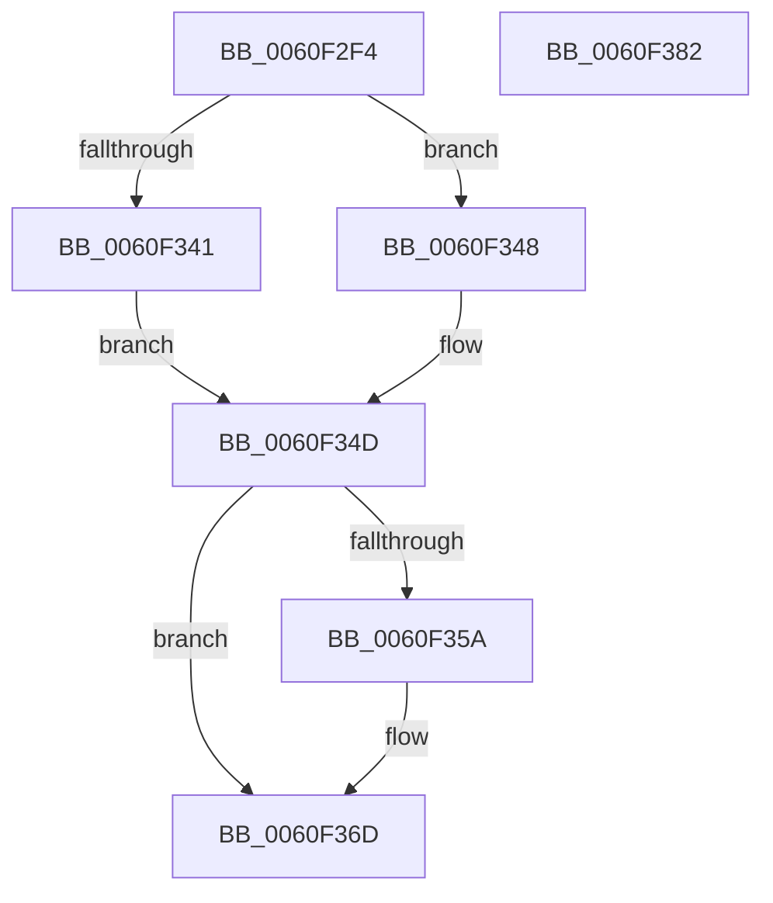

# SmKmIssueFileIo

- RVA: `0x0060F2F4`–`0x0060F383` (길이 `143` bytes)
- VA: `0x000000014060F2F4`
- 실행 섹션: `.text`
- PDB 이름 있음: `예`; PDB Function 태그: `아니요`
- unwind 정보 RVA: `0x0007F83C`
- 디코드: `43`개 명령, `143/143` bytes 표시
- 미해석 바이트: `0` (있으면 어셈블리에 `.byte`로 보존)

> 이 문서는 커널 이미지의 기계어와 PDB 기호를 분석해 생성했습니다. 4번과 5번은 함수 원형과 자료형을 바이너리 사용 방식에서 추정한 C 해석이며 원본 소스 복구 결과는 아닙니다.

## 1. Dependencies

- 직접 호출 지점: **3**; 고유 호출 대상: **3**
- 직접 호출자로 확인된 함수: **1**
- RIP 상대 이미지 참조: **0**

### Outgoing calls
- `0x0060F341` → [NtReadFile](../../page/8A/NtReadFile_function_008AEF10.md) (function, `0x008AEF10`)
- `0x0060F348` → [NtWriteFile](../../page/8E/NtWriteFile_function_008E92D0.md) (function, `0x008E92D0`)
- `0x0060F368` → [guard_dispatch_icall](../6B/guard_dispatch_icall_function_006BAAD0.md) (function, `0x006BAAD0`)

### Direct callers
- [SmIssueIo](../61/SmIssueIo_function_00610F90.md) at `0x006110CB`

### Static image references
- 디코드된 RIP-relative 메모리 참조가 없습니다.

## 2. Other-region calls and transfers

- 다른 실행 섹션으로 향하는 call: **2**
  - `0x0060F341` → [NtReadFile](../../page/8A/NtReadFile_function_008AEF10.md) (`.text` → `PAGE`)
  - `0x0060F348` → [NtWriteFile](../../page/8E/NtWriteFile_function_008E92D0.md) (`.text` → `PAGE`)
- 별도 외부 분기/꼬리 이동을 확인하지 못했습니다.

## 3. Assembly (complete function range)

```asm
0060F2F4  4C 8B DC                        mov r11, rsp
0060F2F7  49 89 5B 08                     mov qword ptr [r11 + 8], rbx
0060F2FB  49 89 73 10                     mov qword ptr [r11 + 0x10], rsi
0060F2FF  57                              push rdi
0060F300  48 83 EC 50                     sub rsp, 0x50
0060F304  49 83 63 E8 00                  and qword ptr [r11 - 0x18], 0
0060F309  49 8B F1                        mov rsi, r9
0060F30C  44 8B 4A 10                     mov r9d, dword ptr [rdx + 0x10]
0060F310  48 8B 1A                        mov rbx, qword ptr [rdx]
0060F313  4C 8B 52 08                     mov r10, qword ptr [rdx + 8]
0060F317  8B 42 20                        mov eax, dword ptr [rdx + 0x20]
0060F31A  33 D2                           xor edx, edx
0060F31C  48 8B BC 24 80 00 00 00         mov rdi, qword ptr [rsp + 0x80]
0060F324  48 8B 09                        mov rcx, qword ptr [rcx]
0060F327  4D 89 43 E0                     mov qword ptr [r11 - 0x20], r8
0060F32B  4C 8B C6                        mov r8, rsi
0060F32E  45 89 4B D8                     mov dword ptr [r11 - 0x28], r9d
0060F332  4C 8B CF                        mov r9, rdi
0060F335  4D 89 53 D0                     mov qword ptr [r11 - 0x30], r10
0060F339  49 89 5B C8                     mov qword ptr [r11 - 0x38], rbx
0060F33D  A8 01                           test al, 1
0060F33F  74 07                           je 0x14060f348
0060F341  E8 CA FB 29 00                  call 0x1408aef10
0060F346  EB 05                           jmp 0x14060f34d
0060F348  E8 83 9F 2D 00                  call 0x1408e92d0
0060F34D  BA 00 00 00 C0                  mov edx, 0xc0000000
0060F352  8B C8                           mov ecx, eax
0060F354  23 C2                           and eax, edx
0060F356  3B C2                           cmp eax, edx
0060F358  75 13                           jne 0x14060f36d
0060F35A  89 0B                           mov dword ptr [rbx], ecx
0060F35C  45 33 C0                        xor r8d, r8d
0060F35F  48 8B CF                        mov rcx, rdi
0060F362  48 8B D3                        mov rdx, rbx
0060F365  48 8B C6                        mov rax, rsi
0060F368  E8 63 B7 0A 00                  call 0x1406baad0
0060F36D  48 8B 5C 24 60                  mov rbx, qword ptr [rsp + 0x60]
0060F372  B8 03 01 00 00                  mov eax, 0x103
0060F377  48 8B 74 24 68                  mov rsi, qword ptr [rsp + 0x68]
0060F37C  48 83 C4 50                     add rsp, 0x50
0060F380  5F                              pop rdi
0060F381  C3                              ret
0060F382  CC                              int3
```

## 4. C-style interpretation (structured pseudocode)

```c
__int64 __fastcall SmKmIssueFileIo(__int64 a1, __int64 a2, __int64 a3, __int64 a4, __int64 a5)
{
    __int64 result;
    __int64 v_rsp;
    unsigned __int64 v_stack_p10;
    unsigned __int64 v_stack_p8;

    *(unsigned __int64 *)(v_rsp + 8) = v_rbx;
    *(unsigned __int64 *)(v_rsp + 16) = v_rsi;
    v_rsp = (v_rsp) - (80);
    a2 = 0;
    *(unsigned __int64 *)(v_rsp - 32) = a3;
    *(unsigned int *)(v_rsp - 40) = (unsigned int)((unsigned int)(*(unsigned int *)(a2 + 16)));
    *(unsigned __int64 *)(v_rsp - 48) = *(unsigned __int64 *)(a2 + 8);
    *(unsigned __int64 *)(v_rsp - 56) = *(unsigned __int64 *)(a2);
    if ((((unsigned __int8)((unsigned int)(*(unsigned int *)(a2 + 32)))) & (1)) == 0) goto loc_0060F348;
    result = NtReadFile(*(unsigned __int64 *)(a1), a2, a4, a5);
    goto loc_0060F34D;
loc_0060F348:
    result = NtWriteFile(*(unsigned __int64 *)(a1), a2, a4, a5);
loc_0060F34D:
    result = (unsigned int)((result) & ((unsigned int)((unsigned int)(0xC0000000ULL))));
    if (((unsigned int)(result)) == ((unsigned int)((unsigned int)(0xC0000000ULL)))) {
        *(unsigned int *)(*(unsigned __int64 *)(a2)) = (unsigned int)((unsigned int)((unsigned int)(result)));
        a3 = 0;
        a1 = a5;
        a2 = *(unsigned __int64 *)(a2);
        result = a4;
        result = guard_dispatch_icall(a1, a2, a3, a5);
    }
    v_rsp = (v_rsp) + (80);
    return 259;
}
```

## 5. (Beta) C Style

```c
int64_t SmKmIssueFileIo(void *Arg1, void *Arg2, int64_t Arg3, int64_t Arg4, int64_t Arg5)
{
    uint8_t *arg1 = (uint8_t *)Arg1;
    uint8_t *arg2 = (uint8_t *)Arg2;

    int64_t result;
    int64_t local_rsp;
    uint64_t v_stack_p10;
    uint64_t v_stack_p8;

    *(uint64_t *)(local_rsp + 0x8) = local_rbx;
    *(uint64_t *)(local_rsp + 0x10) = local_rsi;
    local_rsp = (local_rsp) - (80);
    Arg2 = 0;
    *(uint64_t *)(local_rsp - 0x20) = Arg3;
    *(uint32_t *)(local_rsp - 0x28) = (uint32_t)((uint32_t)(*(uint32_t *)(arg2 + 0x10)));
    *(uint64_t *)(local_rsp - 0x30) = *(uint64_t *)(arg2 + 0x8);
    *(uint64_t *)(local_rsp - 0x38) = *(uint64_t *)(arg2);
    if ((((uint8_t)((uint32_t)(*(uint32_t *)(arg2 + 0x20)))) & (1)) == 0) goto loc_0060F348;
    result = NtReadFile(*(uint64_t *)(arg1), Arg2, Arg4, Arg5);
    goto loc_0060F34D;
loc_0060F348:
    result = NtWriteFile(*(uint64_t *)(arg1), Arg2, Arg4, Arg5);
loc_0060F34D:
    result = (uint32_t)((result) & ((uint32_t)((uint32_t)(0xC0000000ULL))));
    if (((uint32_t)(result)) == ((uint32_t)((uint32_t)(0xC0000000ULL)))) {
        *(uint32_t *)(*(uint64_t *)(arg2)) = (uint32_t)((uint32_t)((uint32_t)(result)));
        Arg3 = 0;
        Arg1 = Arg5;
        Arg2 = *(uint64_t *)(arg2);
        result = Arg4;
        result = guard_dispatch_icall(Arg1, Arg2, Arg3, Arg5);
    }
    local_rsp = (local_rsp) + (80);
    return 259;
}
```

### 관측된 메모리 오프셋

구조체 형식이 확인되지 않은 접근은 인자 기준의 오프셋으로만 기록했습니다.

| 기준 인자 | 오프셋 표현 | 폭 (bit) | 접근 |
|---|---:|---:|---|
| `Arg1` | `+ 0x0` | `64` | `R` |
| `Arg2` | `+ 0x0` | `64` | `R` |
| `Arg2` | `+ 0x8` | `64` | `R` |
| `Arg2` | `+ 0x10` | `32` | `R` |
| `Arg2` | `+ 0x20` | `32` | `R` |

## 6. Execution-region graph

[열기: 2D/3D 그래프와 함수 탐색 컨트롤 패널](../../../control-panel.html?section=text&rva=0x0060F2F4&view=graph)

- 2D 그래프는 위에서 아래로 흐르고, 3D 그래프는 빈 공간을 드래그해 회전합니다. Shift+드래그는 이동, 휠은 확대·축소, 함수 노드 선택은 대상 보고서 이동입니다.

### Static fallback


