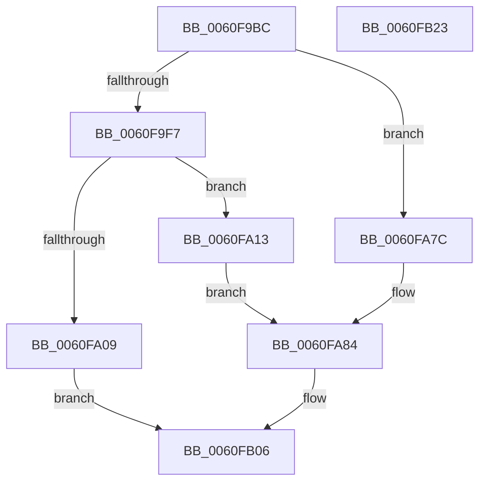

# SmKmIssueVolumeIo

- RVA: `0x0060F9BC`–`0x0060FB24` (길이 `360` bytes)
- VA: `0x000000014060F9BC`
- 실행 섹션: `.text`
- PDB 이름 있음: `예`; PDB Function 태그: `아니요`
- unwind 정보 RVA: `0x00075C18`
- 디코드: `94`개 명령, `360/360` bytes 표시
- 미해석 바이트: `0` (있으면 어셈블리에 `.byte`로 보존)

> 이 문서는 커널 이미지의 기계어와 PDB 기호를 분석해 생성했습니다. 4번과 5번은 함수 원형과 자료형을 바이너리 사용 방식에서 추정한 C 해석이며 원본 소스 복구 결과는 아닙니다.

## 1. Dependencies

- 직접 호출 지점: **4**; 고유 호출 대상: **4**
- 직접 호출자로 확인된 함수: **1**
- RIP 상대 이미지 참조: **0**

### Outgoing calls
- `0x0060F9FC` → [IoAllocateIrp](../20/IoAllocateIrp_function_002065D0.md) (function, `0x002065D0`)
- `0x0060FA68` → [MmBuildMdlForNonPagedPool](../23/MmBuildMdlForNonPagedPool_function_0023A870.md) (function, `0x0023A870`)
- `0x0060FA75` → [MmMdlPageContentsState](../45/MmMdlPageContentsState_function_00452790.md) (function, `0x00452790`)
- `0x0060FAFC` → [IofCallDriver](../29/IofCallDriver_function_0029B4B0.md) (function, `0x0029B4B0`)

### Direct callers
- [SmIssueIo](../61/SmIssueIo_function_00610F90.md) at `0x006110D2`

### Static image references
- 디코드된 RIP-relative 메모리 참조가 없습니다.

## 2. Other-region calls and transfers

- 다른 실행 섹션으로 향하는 call: **0**
- 별도 외부 분기/꼬리 이동을 확인하지 못했습니다.

## 3. Assembly (complete function range)

```asm
0060F9BC  48 89 5C 24 08                  mov qword ptr [rsp + 8], rbx
0060F9C1  48 89 6C 24 10                  mov qword ptr [rsp + 0x10], rbp
0060F9C6  48 89 74 24 18                  mov qword ptr [rsp + 0x18], rsi
0060F9CB  57                              push rdi
0060F9CC  41 54                           push r12
0060F9CE  41 55                           push r13
0060F9D0  41 56                           push r14
0060F9D2  41 57                           push r15
0060F9D4  48 83 EC 20                     sub rsp, 0x20
0060F9D8  48 8B 1A                        mov rbx, qword ptr [rdx]
0060F9DB  45 33 ED                        xor r13d, r13d
0060F9DE  48 8B 69 18                     mov rbp, qword ptr [rcx + 0x18]
0060F9E2  4D 8B F9                        mov r15, r9
0060F9E5  4D 8B E0                        mov r12, r8
0060F9E8  48 8B FA                        mov rdi, rdx
0060F9EB  4C 8B F1                        mov r14, rcx
0060F9EE  F6 C3 01                        test bl, 1
0060F9F1  0F 85 85 00 00 00               jne 0x14060fa7c
0060F9F7  8A 4D 4C                        mov cl, byte ptr [rbp + 0x4c]
0060F9FA  33 D2                           xor edx, edx
0060F9FC  E8 CF 6B BF FF                  call 0x1402065d0
0060FA01  48 8B D8                        mov rbx, rax
0060FA04  48 85 C0                        test rax, rax
0060FA07  75 0A                           jne 0x14060fa13
0060FA09  B8 9A 00 00 C0                  mov eax, 0xc000009a
0060FA0E  E9 F3 00 00 00                  jmp 0x14060fb06
0060FA13  48 8B 37                        mov rsi, qword ptr [rdi]
0060FA16  41 BA FF 0F 00 00               mov r10d, 0xfff
0060FA1C  48 8B 57 08                     mov rdx, qword ptr [rdi + 8]
0060FA20  44 8B 4F 10                     mov r9d, dword ptr [rdi + 0x10]
0060FA24  44 8B C2                        mov r8d, edx
0060FA27  41 8B C0                        mov eax, r8d
0060FA2A  48 81 E2 00 F0 FF FF            and rdx, 0xfffffffffffff000
0060FA31  49 23 C2                        and rax, r10
0060FA34  4C 89 2E                        mov qword ptr [rsi], r13
0060FA37  45 23 C2                        and r8d, r10d
0060FA3A  66 44 89 6E 0A                  mov word ptr [rsi + 0xa], r13w
0060FA3F  49 8D 89 FF 0F 00 00            lea rcx, [r9 + 0xfff]
0060FA46  48 89 56 20                     mov qword ptr [rsi + 0x20], rdx
0060FA4A  48 03 C8                        add rcx, rax
0060FA4D  44 89 46 2C                     mov dword ptr [rsi + 0x2c], r8d
0060FA51  48 C1 E9 0C                     shr rcx, 0xc
0060FA55  66 83 C1 06                     add cx, 6
0060FA59  44 89 4E 28                     mov dword ptr [rsi + 0x28], r9d
0060FA5D  66 C1 E1 03                     shl cx, 3
0060FA61  66 89 4E 08                     mov word ptr [rsi + 8], cx
0060FA65  48 8B CE                        mov rcx, rsi
0060FA68  E8 03 AE C2 FF                  call 0x14023a870
0060FA6D  BA 01 00 00 00                  mov edx, 1
0060FA72  48 8B CE                        mov rcx, rsi
0060FA75  E8 16 2D E4 FF                  call 0x140452790
0060FA7A  EB 08                           jmp 0x14060fa84
0060FA7C  48 8B 72 08                     mov rsi, qword ptr [rdx + 8]
0060FA80  48 83 E3 FE                     and rbx, 0xfffffffffffffffe
0060FA84  48 89 73 08                     mov qword ptr [rbx + 8], rsi
0060FA88  48 8B D3                        mov rdx, rbx
0060FA8B  65 48 8B 04 25 88 01 00 00      mov rax, qword ptr gs:[0x188]
0060FA94  48 8B CD                        mov rcx, rbp
0060FA97  4C 8B 8B B8 00 00 00            mov r9, qword ptr [rbx + 0xb8]
0060FA9E  48 89 83 98 00 00 00            mov qword ptr [rbx + 0x98], rax
0060FAA5  48 8D 43 30                     lea rax, [rbx + 0x30]
0060FAA9  48 89 43 48                     mov qword ptr [rbx + 0x48], rax
0060FAAD  44 88 6B 40                     mov byte ptr [rbx + 0x40], r13b
0060FAB1  49 8B 46 08                     mov rax, qword ptr [r14 + 8]
0060FAB5  48 89 83 C0 00 00 00            mov qword ptr [rbx + 0xc0], rax
0060FABC  8B 47 20                        mov eax, dword ptr [rdi + 0x20]
0060FABF  24 01                           and al, 1
0060FAC1  F6 D8                           neg al
0060FAC3  1A C0                           sbb al, al
0060FAC5  04 04                           add al, 4
0060FAC7  41 88 41 B8                     mov byte ptr [r9 - 0x48], al
0060FACB  49 8B 04 24                     mov rax, qword ptr [r12]
0060FACF  44 8B 47 10                     mov r8d, dword ptr [rdi + 0x10]
0060FAD3  49 89 41 D0                     mov qword ptr [r9 - 0x30], rax
0060FAD7  48 8B 44 24 70                  mov rax, qword ptr [rsp + 0x70]
0060FADC  45 89 41 C0                     mov dword ptr [r9 - 0x40], r8d
0060FAE0  41 C7 41 C8 73 44 4D 53         mov dword ptr [r9 - 0x38], 0x534d4473
0060FAE8  4C 8B 83 B8 00 00 00            mov r8, qword ptr [rbx + 0xb8]
0060FAEF  4D 89 78 F0                     mov qword ptr [r8 - 0x10], r15
0060FAF3  49 89 40 F8                     mov qword ptr [r8 - 8], rax
0060FAF7  41 C6 40 BB E0                  mov byte ptr [r8 - 0x45], 0xe0
0060FAFC  E8 AF B9 C8 FF                  call 0x14029b4b0
0060FB01  B8 03 01 00 00                  mov eax, 0x103
0060FB06  48 8B 5C 24 50                  mov rbx, qword ptr [rsp + 0x50]
0060FB0B  48 8B 6C 24 58                  mov rbp, qword ptr [rsp + 0x58]
0060FB10  48 8B 74 24 60                  mov rsi, qword ptr [rsp + 0x60]
0060FB15  48 83 C4 20                     add rsp, 0x20
0060FB19  41 5F                           pop r15
0060FB1B  41 5E                           pop r14
0060FB1D  41 5D                           pop r13
0060FB1F  41 5C                           pop r12
0060FB21  5F                              pop rdi
0060FB22  C3                              ret
0060FB23  CC                              int3
```

## 4. C-style interpretation (structured pseudocode)

```c
__int64 __fastcall SmKmIssueVolumeIo(__int64 a1, __int64 a2, __int64 a3, __int64 a4, __int64 a5)
{
    __int64 result;
    __int64 v_r13;
    __int64 v_rbx;
    __int64 v_rsp;
    unsigned __int64 v_stack_p10;
    unsigned __int64 v_stack_p18;
    unsigned __int64 v_stack_p8;

    v_stack_p8 = v_rbx;
    v_stack_p10 = v_rbp;
    v_stack_p18 = v_rsi;
    v_rsp = (v_rsp) - (32);
    v_r13 = 0;
    if ((((unsigned __int8)(*(unsigned __int64 *)(a2))) & (1)) != 0) goto loc_0060FA7C;
    a2 = 0;
    result = IoAllocateIrp(*(unsigned __int8 *)(*(unsigned __int64 *)(a1 + 24) + 76), a2, a3, a4);
    if (result != 0) goto loc_0060FA13;
    goto loc_0060FB06;
loc_0060FA13:
    a2 = (*(unsigned __int64 *)(a2 + 8)) & (0xFFFFFFFFFFFFF000ULL);
    result = ((unsigned int)((unsigned int)((unsigned int)((unsigned int)(*(unsigned __int64 *)(a2 + 8)))))) & ((unsigned int)(0xFFFULL));
    *(unsigned __int64 *)(*(unsigned __int64 *)(a2)) = 0;
    a3 = (unsigned int)(((unsigned int)((unsigned int)(*(unsigned __int64 *)(a2 + 8)))) & ((unsigned int)((unsigned int)(0xFFFULL))));
    *(unsigned __int16 *)(*(unsigned __int64 *)(a2) + 10) = 0;
    *(unsigned __int64 *)(*(unsigned __int64 *)(a2) + 32) = a2;
    a1 = ((unsigned int)(*(unsigned int *)(a2 + 16)) + 4095) + (result);
    *(unsigned int *)(*(unsigned __int64 *)(a2) + 44) = (unsigned int)(a3);
    a1 = (a1) >> (12);
    a1 = (unsigned __int16)((a1) + (6));
    *(unsigned int *)(*(unsigned __int64 *)(a2) + 40) = (unsigned int)((unsigned int)(*(unsigned int *)(a2 + 16)));
    a1 = (unsigned __int16)((a1) << (3));
    *(unsigned __int16 *)(*(unsigned __int64 *)(a2) + 8) = (unsigned __int16)(a1);
    result = MmBuildMdlForNonPagedPool(*(unsigned __int64 *)(a2), a2, a3, (unsigned int)(*(unsigned int *)(a2 + 16)));
    result = MmMdlPageContentsState(*(unsigned __int64 *)(a2), 1, a3, (unsigned int)(*(unsigned int *)(a2 + 16)));
    goto loc_0060FA84;
loc_0060FA7C:
    v_rbx = (result) & (-2);
loc_0060FA84:
    *(unsigned __int64 *)(v_rbx + 8) = *(unsigned __int64 *)(1 + 8);
    *(unsigned __int64 *)(v_rbx + 152) = *(unsigned __int64 *)(gs_base + (0 + 392));
    *(unsigned __int64 *)(v_rbx + 72) = v_rbx + 48;
    *(unsigned __int8 *)(v_rbx + 64) = 0;
    *(unsigned __int64 *)(v_rbx + 192) = *(unsigned __int64 *)(a1 + 8);
    result = (unsigned __int8)(((unsigned int)(*(unsigned int *)(a2 + 32))) & (1));
    result = (unsigned __int8)(-(result));
    result = (unsigned __int8)((result) + (4));
    *(unsigned __int8 *)(*(unsigned __int64 *)(v_rbx + 184) - 72) = (unsigned __int8)(result);
    *(unsigned __int64 *)(*(unsigned __int64 *)(v_rbx + 184) - 48) = *(unsigned __int64 *)(a3);
    *(unsigned int *)(*(unsigned __int64 *)(v_rbx + 184) - 64) = (unsigned int)((unsigned int)(*(unsigned int *)(a2 + 16)));
    *(unsigned int *)(*(unsigned __int64 *)(v_rbx + 184) - 56) = 0x534D4473ULL;
    *(unsigned __int64 *)(*(unsigned __int64 *)(v_rbx + 184) - 16) = a4;
    *(unsigned __int64 *)(*(unsigned __int64 *)(v_rbx + 184) - 8) = a5;
    *(unsigned __int8 *)(*(unsigned __int64 *)(v_rbx + 184) - 69) = 224;
    result = IofCallDriver(*(unsigned __int64 *)(a1 + 24), v_rbx, *(unsigned __int64 *)(v_rbx + 184), *(unsigned __int64 *)(v_rbx + 184));
loc_0060FB06:
    v_rsp = (v_rsp) + (32);
    return 259;
}
```

## 5. (Beta) C Style

```c
int64_t SmKmIssueVolumeIo(void *Arg1, void *Arg2, void *Arg3, int64_t Arg4, int64_t Arg5)
{
    uint8_t *arg1 = (uint8_t *)Arg1;
    uint8_t *arg2 = (uint8_t *)Arg2;
    uint8_t *arg3 = (uint8_t *)Arg3;

    int64_t result;
    int64_t local_r13;
    int64_t local_rbx;
    int64_t local_rsp;
    uint64_t v_stack_p10;
    uint64_t v_stack_p18;
    uint64_t v_stack_p8;

    v_stack_p8 = local_rbx;
    v_stack_p10 = local_rbp;
    v_stack_p18 = local_rsi;
    local_rsp = (local_rsp) - (32);
    local_r13 = 0;
    if ((((uint8_t)(*(uint64_t *)(arg2))) & (1)) != 0) goto loc_0060FA7C;
    Arg2 = 0;
    result = IoAllocateIrp(*(uint8_t *)(*(uint64_t *)(arg1 + 0x18) + 0x4C), Arg2, Arg3, Arg4);
    if (result != 0) goto loc_0060FA13;
    goto loc_0060FB06;
loc_0060FA13:
    Arg2 = (*(uint64_t *)(arg2 + 0x8)) & (0xFFFFFFFFFFFFF000ULL);
    result = ((uint32_t)((uint32_t)((uint32_t)((uint32_t)(*(uint64_t *)(arg2 + 0x8)))))) & ((uint32_t)(0xFFFULL));
    *(uint64_t *)(*(uint64_t *)(arg2)) = 0;
    Arg3 = (uint32_t)(((uint32_t)((uint32_t)(*(uint64_t *)(arg2 + 0x8)))) & ((uint32_t)((uint32_t)(0xFFFULL))));
    *(uint16_t *)(*(uint64_t *)(arg2) + 0xA) = 0;
    *(void **)(*(uint64_t *)(arg2) + 0x20) = Arg2;
    Arg1 = ((uint32_t)(*(uint32_t *)(arg2 + 0x10)) + 4095) + (result);
    *(uint32_t *)(*(uint64_t *)(arg2) + 0x2C) = (uint32_t)(Arg3);
    Arg1 = (Arg1) >> (12);
    Arg1 = (uint16_t)((Arg1) + (6));
    *(uint32_t *)(*(uint64_t *)(arg2) + 0x28) = (uint32_t)((uint32_t)(*(uint32_t *)(arg2 + 0x10)));
    Arg1 = (uint16_t)((Arg1) << (3));
    *(uint16_t *)(*(uint64_t *)(arg2) + 0x8) = (uint16_t)(Arg1);
    result = MmBuildMdlForNonPagedPool(*(uint64_t *)(arg2), Arg2, Arg3, (uint32_t)(*(uint32_t *)(arg2 + 0x10)));
    result = MmMdlPageContentsState(*(uint64_t *)(arg2), 1, Arg3, (uint32_t)(*(uint32_t *)(arg2 + 0x10)));
    goto loc_0060FA84;
loc_0060FA7C:
    local_rbx = (result) & (-2);
loc_0060FA84:
    *(uint64_t *)(local_rbx + 0x8) = *(uint64_t *)(1 + 0x8);
    *(uint64_t *)(local_rbx + 0x98) = *(uint64_t *)(gs_base + (0 + 0x188));
    *(uint64_t *)(local_rbx + 0x48) = local_rbx + 48;
    *(uint8_t *)(local_rbx + 0x40) = 0;
    *(uint64_t *)(local_rbx + 0xC0) = *(uint64_t *)(arg1 + 0x8);
    result = (uint8_t)(((uint32_t)(*(uint32_t *)(arg2 + 0x20))) & (1));
    result = (uint8_t)(-(result));
    result = (uint8_t)((result) + (4));
    *(uint8_t *)(*(uint64_t *)(local_rbx + 0xB8) - 0x48) = (uint8_t)(result);
    *(uint64_t *)(*(uint64_t *)(local_rbx + 0xB8) - 0x30) = *(uint64_t *)(arg3);
    *(uint32_t *)(*(uint64_t *)(local_rbx + 0xB8) - 0x40) = (uint32_t)((uint32_t)(*(uint32_t *)(arg2 + 0x10)));
    *(uint32_t *)(*(uint64_t *)(local_rbx + 0xB8) - 0x38) = 0x534D4473ULL;
    *(uint64_t *)(*(uint64_t *)(local_rbx + 0xB8) - 0x10) = Arg4;
    *(uint64_t *)(*(uint64_t *)(local_rbx + 0xB8) - 0x8) = Arg5;
    *(uint8_t *)(*(uint64_t *)(local_rbx + 0xB8) - 0x45) = 224;
    result = IofCallDriver(*(uint64_t *)(arg1 + 0x18), local_rbx, *(uint64_t *)(local_rbx + 0xB8), *(uint64_t *)(local_rbx + 0xB8));
loc_0060FB06:
    local_rsp = (local_rsp) + (32);
    return 259;
}
```

### 관측된 메모리 오프셋

구조체 형식이 확인되지 않은 접근은 인자 기준의 오프셋으로만 기록했습니다.

| 기준 인자 | 오프셋 표현 | 폭 (bit) | 접근 |
|---|---:|---:|---|
| `Arg1` | `+ 0x8` | `64` | `R` |
| `Arg1` | `+ 0x18` | `64` | `R` |
| `Arg2` | `+ 0x0` | `64` | `R` |
| `Arg2` | `+ 0x8` | `64` | `R` |
| `Arg2` | `+ 0x10` | `32` | `R` |
| `Arg2` | `+ 0x20` | `32` | `R` |
| `Arg3` | `+ 0x0` | `64` | `R` |

## 6. Execution-region graph

[열기: 2D/3D 그래프와 함수 탐색 컨트롤 패널](../../../control-panel.html?section=text&rva=0x0060F9BC&view=graph)

- 2D 그래프는 위에서 아래로 흐르고, 3D 그래프는 빈 공간을 드래그해 회전합니다. Shift+드래그는 이동, 휠은 확대·축소, 함수 노드 선택은 대상 보고서 이동입니다.

### Static fallback


