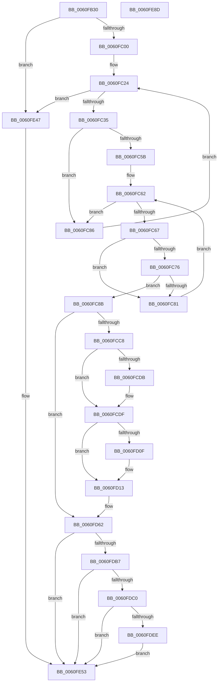

# SmKmStoreTerminateWorker

- RVA: `0x0060FB30`–`0x0060FE8E` (길이 `862` bytes)
- VA: `0x000000014060FB30`
- 실행 섹션: `.text`
- PDB 이름 있음: `예`; PDB Function 태그: `아니요`
- unwind 정보 RVA: `0x000D1E68`
- 디코드: `212`개 명령, `862/862` bytes 표시
- 미해석 바이트: `0` (있으면 어셈블리에 `.byte`로 보존)

> 이 문서는 커널 이미지의 기계어와 PDB 기호를 분석해 생성했습니다. 4번과 5번은 함수 원형과 자료형을 바이너리 사용 방식에서 추정한 C 해석이며 원본 소스 복구 결과는 아닙니다.

## 1. Dependencies

- 직접 호출 지점: **16**; 고유 호출 대상: **12**
- 직접 호출자로 확인된 함수: **0**
- RIP 상대 이미지 참조: **3**

### Outgoing calls
- `0x0060FB80` → [memset](../6C/memset_function_006C6C40.md) (function, `0x006C6C40`)
- `0x0060FBA2` → [memset](../6C/memset_function_006C6C40.md) (function, `0x006C6C40`)
- `0x0060FBB5` → [memset](../6C/memset_function_006C6C40.md) (function, `0x006C6C40`)
- `0x0060FBF3` → [ZwQuerySystemInformation](../6A/ZwQuerySystemInformation_function_006AD790.md) (function, `0x006AD790`)
- `0x0060FC52` → [ZwQuerySystemInformation](../6A/ZwQuerySystemInformation_function_006AD790.md) (function, `0x006AD790`)
- `0x0060FCB7` → [SmEtwEnabled](../3A/SmEtwEnabled_function_003AF2D0.md) (function, `0x003AF2D0`)
- `0x0060FD46` → [SmKmEtwAppendProductName](SmKmEtwAppendProductName_function_0060F854.md) (function, `0x0060F854`)
- `0x0060FD54` → [SmKmEtwAppendObjectName](SmKmEtwAppendObjectName_function_0060F6D8.md) (function, `0x0060F6D8`)
- `0x0060FD69` → [SmKmStoreDereference](../20/SmKmStoreDereference_function_00206574.md) (function, `0x00206574`)
- `0x0060FDAA` → [ZwSetSystemInformation](../6B/ZwSetSystemInformation_function_006B0870.md) (function, `0x006B0870`)
- `0x0060FDE3` → [EtwWriteEx](../25/EtwWriteEx_function_0025F0D0.md) (function, `0x0025F0D0`)
- `0x0060FE00` → [memcpy](../6C/memcpy_function_006C6840.md) (function, `0x006C6840`)
- `0x0060FE40` → [SmKmSqmAddToStream](../61/SmKmSqmAddToStream_function_00611B7C.md) (function, `0x00611B7C`)
- `0x0060FE4E` → [SmKmStoreDereference](../20/SmKmStoreDereference_function_00206574.md) (function, `0x00206574`)
- `0x0060FE58` → [ExFreePoolWithTag](../../poolcode/B8/ExFreePoolWithTag_function_00B82870.md) (function, `0x00B82870`)
- `0x0060FE67` → [_security_check_cookie](../6A/_security_check_cookie_function_006AC640.md) (function, `0x006AC640`)

### Direct callers
- 이 함수 시작 RVA로 연결되는 직접 call은 확인되지 않았습니다. 간접 호출은 완전히 역산할 수 없습니다.

### Static image references
- `0x0060FB56` → RVA `0x00E0A740` (`.data`; read)
- `0x0060FDC3` → RVA `0x00022290` (`.rdata`; read)
- `0x0060FE05` → RVA `0x006CD970` (` ?? ::FNODOBFM::`string'`; read)

## 2. Other-region calls and transfers

- 다른 실행 섹션으로 향하는 call: **1**
  - `0x0060FE58` → [ExFreePoolWithTag](../../poolcode/B8/ExFreePoolWithTag_function_00B82870.md) (`.text` → `POOLCODE`)
- 별도 외부 분기/꼬리 이동을 확인하지 못했습니다.

## 3. Assembly (complete function range)

```asm
0060FB30  48 8B C4                        mov rax, rsp
0060FB33  48 89 58 10                     mov qword ptr [rax + 0x10], rbx
0060FB37  48 89 70 18                     mov qword ptr [rax + 0x18], rsi
0060FB3B  48 89 78 20                     mov qword ptr [rax + 0x20], rdi
0060FB3F  55                              push rbp
0060FB40  41 54                           push r12
0060FB42  41 55                           push r13
0060FB44  41 56                           push r14
0060FB46  41 57                           push r15
0060FB48  48 8D A8 F8 FA FF FF            lea rbp, [rax - 0x508]
0060FB4F  48 81 EC E0 05 00 00            sub rsp, 0x5e0
0060FB56  48 8B 05 E3 AB 7F 00            mov rax, qword ptr [rip + 0x7fabe3]
0060FB5D  48 33 C4                        xor rax, rsp
0060FB60  48 89 85 D0 04 00 00            mov qword ptr [rbp + 0x4d0], rax
0060FB67  48 8B F9                        mov rdi, rcx
0060FB6A  BE 68 04 00 00                  mov esi, 0x468
0060FB6F  45 33 E4                        xor r12d, r12d
0060FB72  48 8D 4D 00                     lea rcx, [rbp]
0060FB76  44 8B C6                        mov r8d, esi
0060FB79  44 89 64 24 40                  mov dword ptr [rsp + 0x40], r12d
0060FB7E  33 D2                           xor edx, edx
0060FB80  E8 BB 70 0B 00                  call 0x1406c6c40
0060FB85  0F 57 C0                        xorps xmm0, xmm0
0060FB88  4C 89 64 24 60                  mov qword ptr [rsp + 0x60], r12
0060FB8D  33 D2                           xor edx, edx
0060FB8F  45 8D 44 24 50                  lea r8d, [r12 + 0x50]
0060FB94  48 8D 8D 80 04 00 00            lea rcx, [rbp + 0x480]
0060FB9B  0F 11 85 70 04 00 00            movups xmmword ptr [rbp + 0x470], xmm0
0060FBA2  E8 99 70 0B 00                  call 0x1406c6c40
0060FBA7  41 8D 5C 24 44                  lea ebx, [r12 + 0x44]
0060FBAC  33 D2                           xor edx, edx
0060FBAE  44 8B C3                        mov r8d, ebx
0060FBB1  48 8D 4D B0                     lea rcx, [rbp - 0x50]
0060FBB5  E8 86 70 0B 00                  call 0x1406c6c40
0060FBBA  48 8D 45 B0                     lea rax, [rbp - 0x50]
0060FBBE  48 89 5C 24 58                  mov qword ptr [rsp + 0x58], rbx
0060FBC3  45 8D 6C 24 01                  lea r13d, [r12 + 1]
0060FBC8  48 89 44 24 50                  mov qword ptr [rsp + 0x50], rax
0060FBCD  45 8D 74 24 18                  lea r14d, [r12 + 0x18]
0060FBD2  44 89 6C 24 48                  mov dword ptr [rsp + 0x48], r13d
0060FBD7  45 8B C6                        mov r8d, r14d
0060FBDA  C7 44 24 4C 08 00 00 00         mov dword ptr [rsp + 0x4c], 8
0060FBE2  4C 8D 4C 24 40                  lea r9, [rsp + 0x40]
0060FBE7  44 89 6D B0                     mov dword ptr [rbp - 0x50], r13d
0060FBEB  48 8D 54 24 48                  lea rdx, [rsp + 0x48]
0060FBF0  8D 4B 29                        lea ecx, [rbx + 0x29]
0060FBF3  E8 98 DB 09 00                  call 0x1406ad790
0060FBF8  85 C0                           test eax, eax
0060FBFA  0F 88 47 02 00 00               js 0x14060fe47
0060FC00  48 8D 45 00                     lea rax, [rbp]
0060FC04  44 89 6C 24 48                  mov dword ptr [rsp + 0x48], r13d
0060FC09  48 89 44 24 50                  mov qword ptr [rsp + 0x50], rax
0060FC0E  41 8B DC                        mov ebx, r12d
0060FC11  C7 44 24 4C 0D 00 00 00         mov dword ptr [rsp + 0x4c], 0xd
0060FC19  89 74 24 58                     mov dword ptr [rsp + 0x58], esi
0060FC1D  C7 45 00 03 01 00 00            mov dword ptr [rbp], 0x103
0060FC24  8B 45 B0                        mov eax, dword ptr [rbp - 0x50]
0060FC27  C1 E8 08                        shr eax, 8
0060FC2A  0F B6 C0                        movzx eax, al
0060FC2D  3B D8                           cmp ebx, eax
0060FC2F  0F 83 12 02 00 00               jae 0x14060fe47
0060FC35  44 8B FB                        mov r15d, ebx
0060FC38  4C 8D 4C 24 40                  lea r9, [rsp + 0x40]
0060FC3D  45 8B C6                        mov r8d, r14d
0060FC40  48 8D 54 24 48                  lea rdx, [rsp + 0x48]
0060FC45  B9 6D 00 00 00                  mov ecx, 0x6d
0060FC4A  42 8B 44 BD B4                  mov eax, dword ptr [rbp + r15*4 - 0x4c]
0060FC4F  89 45 04                        mov dword ptr [rbp + 4], eax
0060FC52  E8 39 DB 09 00                  call 0x1406ad790
0060FC57  85 C0                           test eax, eax
0060FC59  78 2B                           js 0x14060fc86
0060FC5B  44 8B 45 60                     mov r8d, dword ptr [rbp + 0x60]
0060FC5F  41 8B D4                        mov edx, r12d
0060FC62  3B 55 10                        cmp edx, dword ptr [rbp + 0x10]
0060FC65  73 1F                           jae 0x14060fc86
0060FC67  41 0F A3 D0                     bt r8d, edx
0060FC6B  41 8B C4                        mov eax, r12d
0060FC6E  0F 93 C0                        setae al
0060FC71  3B 47 34                        cmp eax, dword ptr [rdi + 0x34]
0060FC74  75 0B                           jne 0x14060fc81
0060FC76  8B 47 30                        mov eax, dword ptr [rdi + 0x30]
0060FC79  8B CA                           mov ecx, edx
0060FC7B  39 44 8D 20                     cmp dword ptr [rbp + rcx*4 + 0x20], eax
0060FC7F  74 0A                           je 0x14060fc8b
0060FC81  41 03 D5                        add edx, r13d
0060FC84  EB DC                           jmp 0x14060fc62
0060FC86  41 03 DD                        add ebx, r13d
0060FC89  EB 99                           jmp 0x14060fc24
0060FC8B  48 8D 45 00                     lea rax, [rbp]
0060FC8F  41 8B DC                        mov ebx, r12d
0060FC92  48 8D B5 70 04 00 00            lea rsi, [rbp + 0x470]
0060FC99  48 89 44 24 70                  mov qword ptr [rsp + 0x70], rax
0060FC9E  B9 02 00 00 00                  mov ecx, 2
0060FCA3  48 89 74 24 68                  mov qword ptr [rsp + 0x68], rsi
0060FCA8  C7 44 24 7C 06 00 00 00         mov dword ptr [rsp + 0x7c], 6
0060FCB0  C7 45 84 0C 04 00 00            mov dword ptr [rbp - 0x7c], 0x40c
0060FCB7  E8 14 F6 D9 FF                  call 0x1403af2d0
0060FCBC  4C 8B F0                        mov r14, rax
0060FCBF  48 85 C0                        test rax, rax
0060FCC2  0F 84 9A 00 00 00               je 0x14060fd62
0060FCC8  41 8B CC                        mov ecx, r12d
0060FCCB  48 8D 55 00                     lea rdx, [rbp]
0060FCCF  48 03 D1                        add rdx, rcx
0060FCD2  48 8D 47 38                     lea rax, [rdi + 0x38]
0060FCD6  48 85 C0                        test rax, rax
0060FCD9  74 04                           je 0x14060fcdf
0060FCDB  8A 08                           mov cl, byte ptr [rax]
0060FCDD  88 0A                           mov byte ptr [rdx], cl
0060FCDF  48 8B C3                        mov rax, rbx
0060FCE2  45 8D 44 24 01                  lea r8d, [r12 + 1]
0060FCE7  48 03 C0                        add rax, rax
0060FCEA  48 8D 4F 3C                     lea rcx, [rdi + 0x3c]
0060FCEE  FF C3                           inc ebx
0060FCF0  48 89 94 C5 70 04 00 00         mov qword ptr [rbp + rax*8 + 0x470], rdx
0060FCF8  48 8D 55 00                     lea rdx, [rbp]
0060FCFC  4C 89 AC C5 78 04 00 00         mov qword ptr [rbp + rax*8 + 0x478], r13
0060FD04  41 8B C0                        mov eax, r8d
0060FD07  48 03 D0                        add rdx, rax
0060FD0A  48 85 C9                        test rcx, rcx
0060FD0D  74 04                           je 0x14060fd13
0060FD0F  8B 01                           mov eax, dword ptr [rcx]
0060FD11  89 02                           mov dword ptr [rdx], eax
0060FD13  8B C3                           mov eax, ebx
0060FD15  48 8D 4C 24 68                  lea rcx, [rsp + 0x68]
0060FD1A  48 03 C0                        add rax, rax
0060FD1D  48 89 94 C5 70 04 00 00         mov qword ptr [rbp + rax*8 + 0x470], rdx
0060FD25  48 C7 84 C5 78 04 00 00 04 00 00 00  mov qword ptr [rbp + rax*8 + 0x478], 4
0060FD31  8D 43 01                        lea eax, [rbx + 1]
0060FD34  48 8B 5F 28                     mov rbx, qword ptr [rdi + 0x28]
0060FD38  89 44 24 78                     mov dword ptr [rsp + 0x78], eax
0060FD3C  48 8B D3                        mov rdx, rbx
0060FD3F  41 8D 40 04                     lea eax, [r8 + 4]
0060FD43  89 45 80                        mov dword ptr [rbp - 0x80], eax
0060FD46  E8 09 FB FF FF                  call 0x14060f854
0060FD4B  48 8B 53 08                     mov rdx, qword ptr [rbx + 8]
0060FD4F  48 8D 4C 24 68                  lea rcx, [rsp + 0x68]
0060FD54  E8 7F F9 FF FF                  call 0x14060f6d8
0060FD59  8B 5C 24 78                     mov ebx, dword ptr [rsp + 0x78]
0060FD5D  48 8B 74 24 68                  mov rsi, qword ptr [rsp + 0x68]
0060FD62  8B 57 30                        mov edx, dword ptr [rdi + 0x30]
0060FD65  48 8B 4F 20                     mov rcx, qword ptr [rdi + 0x20]
0060FD69  E8 06 68 BF FF                  call 0x140206574
0060FD6E  48 8D 44 24 60                  lea rax, [rsp + 0x60]
0060FD73  44 89 6C 24 48                  mov dword ptr [rsp + 0x48], r13d
0060FD78  41 B8 18 00 00 00               mov r8d, 0x18
0060FD7E  48 89 44 24 50                  mov qword ptr [rsp + 0x50], rax
0060FD83  42 8B 44 BD B4                  mov eax, dword ptr [rbp + r15*4 - 0x4c]
0060FD88  48 8D 54 24 48                  lea rdx, [rsp + 0x48]
0060FD8D  C7 44 24 4C 0A 00 00 00         mov dword ptr [rsp + 0x4c], 0xa
0060FD95  C7 44 24 58 08 00 00 00         mov dword ptr [rsp + 0x58], 8
0060FD9D  41 8D 48 55                     lea ecx, [r8 + 0x55]
0060FDA1  44 89 6C 24 60                  mov dword ptr [rsp + 0x60], r13d
0060FDA6  89 44 24 64                     mov dword ptr [rsp + 0x64], eax
0060FDAA  E8 C1 0A 0A 00                  call 0x1406b0870
0060FDAF  85 C0                           test eax, eax
0060FDB1  0F 88 9C 00 00 00               js 0x14060fe53
0060FDB7  4D 85 F6                        test r14, r14
0060FDBA  0F 84 93 00 00 00               je 0x14060fe53
0060FDC0  49 8B 0E                        mov rcx, qword ptr [r14]
0060FDC3  48 8D 15 C6 24 A1 FF            lea rdx, [rip - 0x5edb3a]
0060FDCA  48 89 74 24 38                  mov qword ptr [rsp + 0x38], rsi
0060FDCF  45 33 C9                        xor r9d, r9d
0060FDD2  89 5C 24 30                     mov dword ptr [rsp + 0x30], ebx
0060FDD6  45 33 C0                        xor r8d, r8d
0060FDD9  4C 89 64 24 28                  mov qword ptr [rsp + 0x28], r12
0060FDDE  4C 89 64 24 20                  mov qword ptr [rsp + 0x20], r12
0060FDE3  E8 E8 F2 C4 FF                  call 0x14025f0d0
0060FDE8  44 39 67 38                     cmp dword ptr [rdi + 0x38], r12d
0060FDEC  75 65                           jne 0x14060fe53
0060FDEE  8B 5E 38                        mov ebx, dword ptr [rsi + 0x38]
0060FDF1  48 8D 4D 00                     lea rcx, [rbp]
0060FDF5  89 5C 24 40                     mov dword ptr [rsp + 0x40], ebx
0060FDF9  44 8B C3                        mov r8d, ebx
0060FDFC  48 8B 56 30                     mov rdx, qword ptr [rsi + 0x30]
0060FE00  E8 3B 6A 0B 00                  call 0x1406c6840
0060FE05  48 8D 0D 64 DB 0B 00            lea rcx, [rip + 0xbdb64]
0060FE0C  C7 45 88 02 00 00 00            mov dword ptr [rbp - 0x78], 2
0060FE13  44 89 6D 98                     mov dword ptr [rbp - 0x68], r13d
0060FE17  4C 8D 4D 88                     lea r9, [rbp - 0x78]
0060FE1B  8B C3                           mov eax, ebx
0060FE1D  48 D1 E8                        shr rax, 1
0060FE20  66 44 89 64 45 00               mov word ptr [rbp + rax*2], r12w
0060FE26  48 8D 45 00                     lea rax, [rbp]
0060FE2A  66 44 39 65 00                  cmp word ptr [rbp], r12w
0060FE2F  48 0F 44 C1                     cmove rax, rcx
0060FE33  48 89 45 90                     mov qword ptr [rbp - 0x70], rax
0060FE37  8B 47 3C                        mov eax, dword ptr [rdi + 0x3c]
0060FE3A  89 45 A0                        mov dword ptr [rbp - 0x60], eax
0060FE3D  49 8B 0E                        mov rcx, qword ptr [r14]
0060FE40  E8 37 1D 00 00                  call 0x140611b7c
0060FE45  EB 0C                           jmp 0x14060fe53
0060FE47  8B 57 30                        mov edx, dword ptr [rdi + 0x30]
0060FE4A  48 8B 4F 20                     mov rcx, qword ptr [rdi + 0x20]
0060FE4E  E8 21 67 BF FF                  call 0x140206574
0060FE53  33 D2                           xor edx, edx
0060FE55  48 8B CF                        mov rcx, rdi
0060FE58  E8 13 2A 57 00                  call 0x140b82870
0060FE5D  48 8B 8D D0 04 00 00            mov rcx, qword ptr [rbp + 0x4d0]
0060FE64  48 33 CC                        xor rcx, rsp
0060FE67  E8 D4 C7 09 00                  call 0x1406ac640
0060FE6C  4C 8D 9C 24 E0 05 00 00         lea r11, [rsp + 0x5e0]
0060FE74  49 8B 5B 38                     mov rbx, qword ptr [r11 + 0x38]
0060FE78  49 8B 73 40                     mov rsi, qword ptr [r11 + 0x40]
0060FE7C  49 8B 7B 48                     mov rdi, qword ptr [r11 + 0x48]
0060FE80  49 8B E3                        mov rsp, r11
0060FE83  41 5F                           pop r15
0060FE85  41 5E                           pop r14
0060FE87  41 5D                           pop r13
0060FE89  41 5C                           pop r12
0060FE8B  5D                              pop rbp
0060FE8C  C3                              ret
0060FE8D  CC                              int3
```

## 4. C-style interpretation (structured pseudocode)

```c
__int64 __fastcall SmKmStoreTerminateWorker(__int64 a1, int a2)
{
    __int64 result;
    __int64 v_r12;
    __int64 v_rbx;
    __int64 v_rsp;
    unsigned __int64 v_stack_m28;
    unsigned int v_stack_m58C;
    unsigned int v_stack_m590;
    unsigned __int64 v_stack_m598;
    unsigned __int64 v_stack_m5A0;
    unsigned int v_stack_m5A4;
    unsigned __int64 v_stack_m5A8;
    unsigned __int64 v_stack_m5B0;
    unsigned __int64 v_stack_m5B8;
    unsigned int v_stack_m5BC;
    unsigned int v_stack_m5C0;
    unsigned int v_stack_m5C8;
    unsigned __int64 v_stack_m5D0;
    unsigned int v_stack_m5D8;
    unsigned __int64 v_stack_m5E0;
    unsigned __int64 v_stack_m5E8;

    *(unsigned __int64 *)(v_rsp + 16) = v_rbx;
    *(unsigned __int64 *)(v_rsp + 24) = v_rsi;
    *(unsigned __int64 *)(v_rsp + 32) = v_rdi;
    v_rsp = (v_rsp) - (0x5E0ULL);
    result = (*(unsigned __int64 *)(v_rip + 8367075)) ^ (v_rsp);
    *(unsigned __int64 *)(v_rsp - 1288 + 1232) = result;
    v_r12 = 0;
    v_stack_m5C8 = 0;
    a2 = 0;
    result = memset(v_rsp - 1288, a2, (unsigned int)((unsigned int)((unsigned int)(0x468ULL))), a4);
    v_stack_m5A8 = 0;
    a2 = 0;
    *(unsigned __int64 *)(v_rsp - 1288 + 1136) = v_xmm0;
    result = memset(v_rsp - 1288 + 1152, a2, v_r12 + 80, a4);
    a2 = 0;
    result = memset(v_rsp - 1288 - 80, a2, (unsigned int)((unsigned int)(v_r12 + 68)), a4);
    v_stack_m5B0 = v_r12 + 68;
    v_stack_m5B8 = v_rsp - 1288 - 80;
    v_stack_m5C0 = (unsigned int)(v_r12 + 1);
    v_stack_m5BC = 8;
    *(unsigned int *)(v_rsp - 1288 - 80) = (unsigned int)(v_r12 + 1);
    result = ZwQuerySystemInformation(v_r12 + 68 + 41, v_stack_m5C0, (unsigned int)((unsigned int)(v_r12 + 24)), v_stack_m5C8);
    if (sign_flag) goto loc_0060FE47;
    v_stack_m5C0 = (unsigned int)(v_r12 + 1);
    v_stack_m5B8 = v_rsp - 1288;
    v_stack_m5BC = 13;
    v_stack_m5B0 = (unsigned int)((unsigned int)(0x468ULL));
    *(unsigned int *)(v_rsp - 1288) = 259;
loc_0060FC24:
    result = (unsigned int)(((unsigned int)(*(unsigned int *)(v_rsp - 1288 - 80))) >> (8));
    if (0 >= ((unsigned int)((unsigned __int8)(result)))) goto loc_0060FE47;
    *(unsigned int *)(v_rsp - 1288 + 4) = (unsigned int)((unsigned int)(*(unsigned int *)(v_rsp - 1288 + 0 * 4 - 76)));
    result = ZwQuerySystemInformation(109, v_stack_m5C0, (unsigned int)((unsigned int)(v_r12 + 24)), v_stack_m5C8);
    if (sign_flag) goto loc_0060FC86;
loc_0060FC62:
    if (0 >= (*(unsigned int *)(v_rsp - 1288 + 16))) goto loc_0060FC86;
    result = (0 >= (*(unsigned int *)(v_rsp - 1288 + 16))) ? 1 : 0;
    if (((unsigned int)(result)) != (*(unsigned int *)(a1 + 52))) goto loc_0060FC81;
    if ((*(unsigned int *)(v_rsp - 1288 + 0 * 4 + 32)) == ((unsigned int)((unsigned int)(*(unsigned int *)(a1 + 48))))) goto loc_0060FC8B;
loc_0060FC81:
    a2 = (unsigned int)((0) + ((unsigned int)(v_r12 + 1)));
    goto loc_0060FC62;
loc_0060FC86:
    v_rbx = (unsigned int)((0) + ((unsigned int)(v_r12 + 1)));
    goto loc_0060FC24;
loc_0060FC8B:
    v_stack_m598 = v_rsp - 1288;
    v_stack_m5A0 = v_rsp - 1288 + 1136;
    v_stack_m58C = 6;
    *(unsigned int *)(v_rsp - 1288 - 124) = 0x40CULL;
    result = SmEtwEnabled(2, a2, (unsigned int)(*(unsigned int *)(v_rsp - 1288 + 96)), v_stack_m5C8);
    if (result == 0) goto loc_0060FD62;
    a2 = (v_rsp - 1288) + (0);
    if (a1 + 56 != 0) {
        a1 = *(unsigned __int8 *)(a1 + 56);
        *(unsigned __int8 *)(a2) = (unsigned __int8)(a1);
    }
    result = (0) + (0);
    v_rbx = (unsigned int)((0) + 1);
    *(unsigned __int64 *)(v_rsp - 1288 + result * 8 + 1136) = a2;
    *(unsigned __int64 *)(v_rsp - 1288 + result * 8 + 1144) = v_r12 + 1;
    a2 = (v_rsp - 1288) + ((unsigned int)((unsigned int)(v_r12 + 1)));
    result = (unsigned int)((unsigned int)(v_r12 + 1));
    if (a1 + 60 != 0) {
        result = *(unsigned int *)(a1 + 60);
        *(unsigned int *)(a2) = (unsigned int)(result);
    }
    result = ((unsigned int)((unsigned int)(v_rbx))) + ((unsigned int)((unsigned int)(v_rbx)));
    *(unsigned __int64 *)(v_rsp - 1288 + result * 8 + 1136) = a2;
    *(unsigned __int64 *)(v_rsp - 1288 + result * 8 + 1144) = 4;
    v_stack_m590 = (unsigned int)(v_rbx + 1);
    *(unsigned int *)(v_rsp - 1288 - 128) = (unsigned int)(v_r12 + 1 + 4);
    result = SmKmEtwAppendProductName(v_stack_m5A0, *(unsigned __int64 *)(a1 + 40), v_r12 + 1, v_stack_m5C8);
    result = SmKmEtwAppendObjectName(v_stack_m5A0, *(unsigned __int64 *)(*(unsigned __int64 *)(a1 + 40) + 8), v_r12 + 1, v_stack_m5C8);
loc_0060FD62:
    result = SmKmStoreDereference(*(unsigned __int64 *)(a1 + 32), (unsigned int)(*(unsigned int *)(a1 + 48)), v_r12 + 1, v_stack_m5C8);
    v_stack_m5C0 = (unsigned int)(v_r12 + 1);
    v_stack_m5B8 = v_stack_m5A8;
    v_stack_m5BC = 10;
    v_stack_m5B0 = 8;
    v_stack_m5A8 = (unsigned int)(v_r12 + 1);
    v_stack_m5A4 = (unsigned int)((unsigned int)(*(unsigned int *)(v_rsp - 1288 + 0 * 4 - 76)));
    result = ZwSetSystemInformation(24 + 85, v_stack_m5C0, 24, v_stack_m5C8);
    if (sign_flag) goto loc_0060FE53;
    if (result == 0) goto loc_0060FE53;
    v_stack_m5D0 = v_stack_m5A0;
    a4 = 0;
    v_stack_m5D8 = (unsigned int)((unsigned int)(v_stack_m590));
    a3 = 0;
    v_stack_m5E0 = 0;
    v_stack_m5E8 = 0;
    result = EtwWriteEx(*(unsigned __int64 *)(result), v_rip - 6216506, a3, a4);
    if ((*(unsigned int *)(a1 + 56)) != 0) goto loc_0060FE53;
    v_stack_m5C8 = (unsigned int)((unsigned int)(*(unsigned int *)(v_stack_m5A0 + 56)));
    result = memcpy(v_rsp - 1288, *(unsigned __int64 *)(v_stack_m5A0 + 48), (unsigned int)((unsigned int)((unsigned int)(*(unsigned int *)(v_stack_m5A0 + 56)))), a4);
    *(unsigned int *)(v_rsp - 1288 - 120) = 2;
    *(unsigned int *)(v_rsp - 1288 - 104) = (unsigned int)(v_r12 + 1);
    result = ((unsigned int)((unsigned int)((unsigned int)(*(unsigned int *)(v_stack_m5A0 + 56))))) >> (1);
    *(unsigned __int16 *)(v_rsp - 1288 + result * 2) = 0;
    result = v_rsp - 1288;
    if ((*(unsigned __int16 *)(v_rsp - 1288)) == 0) { result = v_rip + 777060; }
    *(unsigned __int64 *)(v_rsp - 1288 - 112) = result;
    *(unsigned int *)(v_rsp - 1288 - 96) = (unsigned int)((unsigned int)(*(unsigned int *)(a1 + 60)));
    result = SmKmSqmAddToStream(*(unsigned __int64 *)(result), *(unsigned __int64 *)(v_stack_m5A0 + 48), (unsigned int)((unsigned int)((unsigned int)(*(unsigned int *)(v_stack_m5A0 + 56)))), v_rsp - 1288 - 120);
    goto loc_0060FE53;
loc_0060FE47:
    result = SmKmStoreDereference(*(unsigned __int64 *)(a1 + 32), (unsigned int)(*(unsigned int *)(a1 + 48)), (unsigned int)((unsigned int)((unsigned int)(*(unsigned int *)(v_stack_m5A0 + 56)))), v_rsp - 1288 - 120);
loc_0060FE53:
    a2 = 0;
    result = ExFreePoolWithTag(a1, a2, (unsigned int)((unsigned int)((unsigned int)(*(unsigned int *)(v_stack_m5A0 + 56)))), v_rsp - 1288 - 120);
    a1 = (*(unsigned __int64 *)(v_rsp - 1288 + 1232)) ^ (v_rsp);
    result = _security_check_cookie(a1, a2, (unsigned int)((unsigned int)((unsigned int)(*(unsigned int *)(v_stack_m5A0 + 56)))), v_rsp - 1288 - 120);
    return result;
}
```

## 5. (Beta) C Style

```c
int64_t SmKmStoreTerminateWorker(void *Arg1, int32_t Arg2)
{
    uint8_t *arg1 = (uint8_t *)Arg1;

    int64_t result;
    int64_t local_r12;
    int64_t local_rbx;
    int64_t local_rsp;
    uint64_t v_stack_m28;
    uint32_t v_stack_m58C;
    uint32_t v_stack_m590;
    uint64_t v_stack_m598;
    uint64_t v_stack_m5A0;
    uint32_t v_stack_m5A4;
    uint64_t v_stack_m5A8;
    uint64_t v_stack_m5B0;
    uint64_t v_stack_m5B8;
    uint32_t v_stack_m5BC;
    uint32_t v_stack_m5C0;
    uint32_t v_stack_m5C8;
    uint64_t v_stack_m5D0;
    uint32_t v_stack_m5D8;
    uint64_t v_stack_m5E0;
    uint64_t v_stack_m5E8;

    *(uint64_t *)(local_rsp + 0x10) = local_rbx;
    *(uint64_t *)(local_rsp + 0x18) = local_rsi;
    *(uint64_t *)(local_rsp + 0x20) = local_rdi;
    local_rsp = (local_rsp) - (0x5E0ULL);
    result = (*(uint64_t *)(v_rip + 0x7FABE3)) ^ (local_rsp);
    *(uint64_t *)(local_rsp - 0x508 + 0x4D0) = result;
    local_r12 = 0;
    v_stack_m5C8 = 0;
    Arg2 = 0;
    result = memset(local_rsp - 1288, Arg2, (uint32_t)((uint32_t)((uint32_t)(0x468ULL))), a4);
    v_stack_m5A8 = 0;
    Arg2 = 0;
    *(uint64_t *)(local_rsp - 0x508 + 0x470) = v_xmm0;
    result = memset(local_rsp - 1288 + 1152, Arg2, local_r12 + 80, a4);
    Arg2 = 0;
    result = memset(local_rsp - 1288 - 80, Arg2, (uint32_t)((uint32_t)(local_r12 + 68)), a4);
    v_stack_m5B0 = local_r12 + 68;
    v_stack_m5B8 = local_rsp - 1288 - 80;
    v_stack_m5C0 = (uint32_t)(local_r12 + 1);
    v_stack_m5BC = 8;
    *(uint32_t *)(local_rsp - 0x508 - 0x50) = (uint32_t)(local_r12 + 1);
    result = ZwQuerySystemInformation(local_r12 + 68 + 41, v_stack_m5C0, (uint32_t)((uint32_t)(local_r12 + 24)), v_stack_m5C8);
    if (sign_flag) goto loc_0060FE47;
    v_stack_m5C0 = (uint32_t)(local_r12 + 1);
    v_stack_m5B8 = local_rsp - 1288;
    v_stack_m5BC = 13;
    v_stack_m5B0 = (uint32_t)((uint32_t)(0x468ULL));
    *(uint32_t *)(local_rsp - 0x508) = 259;
loc_0060FC24:
    result = (uint32_t)(((uint32_t)(*(uint32_t *)(local_rsp - 0x508 - 0x50))) >> (8));
    if (0 >= ((uint32_t)((uint8_t)(result)))) goto loc_0060FE47;
    *(uint32_t *)(local_rsp - 0x508 + 0x4) = (uint32_t)((uint32_t)(*(uint32_t *)(local_rsp - 0x508 + 0x0 * 4 - 0x4C)));
    result = ZwQuerySystemInformation(109, v_stack_m5C0, (uint32_t)((uint32_t)(local_r12 + 24)), v_stack_m5C8);
    if (sign_flag) goto loc_0060FC86;
loc_0060FC62:
    if (0 >= (*(uint32_t *)(local_rsp - 0x508 + 0x10))) goto loc_0060FC86;
    result = (0 >= (*(uint32_t *)(local_rsp - 0x508 + 0x10))) ? 1 : 0;
    if (((uint32_t)(result)) != (*(uint32_t *)(arg1 + 0x34))) goto loc_0060FC81;
    if ((*(uint32_t *)(local_rsp - 0x508 + 0x0 * 4 + 0x20)) == ((uint32_t)((uint32_t)(*(uint32_t *)(arg1 + 0x30))))) goto loc_0060FC8B;
loc_0060FC81:
    Arg2 = (uint32_t)((0) + ((uint32_t)(local_r12 + 1)));
    goto loc_0060FC62;
loc_0060FC86:
    local_rbx = (uint32_t)((0) + ((uint32_t)(local_r12 + 1)));
    goto loc_0060FC24;
loc_0060FC8B:
    v_stack_m598 = local_rsp - 1288;
    v_stack_m5A0 = local_rsp - 1288 + 1136;
    v_stack_m58C = 6;
    *(uint32_t *)(local_rsp - 0x508 - 0x7C) = 0x40CULL;
    result = SmEtwEnabled(2, Arg2, (uint32_t)(*(uint32_t *)(local_rsp - 0x508 + 0x60)), v_stack_m5C8);
    if (result == 0) goto loc_0060FD62;
    Arg2 = (local_rsp - 1288) + (0);
    if (Arg1 + 56 != 0) {
        Arg1 = *(uint8_t *)(arg1 + 0x38);
        *(uint8_t *)(Arg2) = (uint8_t)(Arg1);
    }
    result = (0) + (0);
    local_rbx = (uint32_t)((0) + 1);
    *(uint64_t *)(local_rsp - 0x508 + result * 8 + 0x470) = Arg2;
    *(uint64_t *)(local_rsp - 0x508 + result * 8 + 0x478) = local_r12 + 1;
    Arg2 = (local_rsp - 1288) + ((uint32_t)((uint32_t)(local_r12 + 1)));
    result = (uint32_t)((uint32_t)(local_r12 + 1));
    if (Arg1 + 60 != 0) {
        result = *(uint32_t *)(arg1 + 0x3C);
        *(uint32_t *)(Arg2) = (uint32_t)(result);
    }
    result = ((uint32_t)((uint32_t)(local_rbx))) + ((uint32_t)((uint32_t)(local_rbx)));
    *(uint64_t *)(local_rsp - 0x508 + result * 8 + 0x470) = Arg2;
    *(uint64_t *)(local_rsp - 0x508 + result * 8 + 0x478) = 4;
    v_stack_m590 = (uint32_t)(local_rbx + 1);
    *(uint32_t *)(local_rsp - 0x508 - 0x80) = (uint32_t)(local_r12 + 1 + 4);
    result = SmKmEtwAppendProductName(v_stack_m5A0, *(uint64_t *)(arg1 + 0x28), local_r12 + 1, v_stack_m5C8);
    result = SmKmEtwAppendObjectName(v_stack_m5A0, *(uint64_t *)(*(uint64_t *)(arg1 + 0x28) + 0x8), local_r12 + 1, v_stack_m5C8);
loc_0060FD62:
    result = SmKmStoreDereference(*(uint64_t *)(arg1 + 0x20), (uint32_t)(*(uint32_t *)(arg1 + 0x30)), local_r12 + 1, v_stack_m5C8);
    v_stack_m5C0 = (uint32_t)(local_r12 + 1);
    v_stack_m5B8 = v_stack_m5A8;
    v_stack_m5BC = 10;
    v_stack_m5B0 = 8;
    v_stack_m5A8 = (uint32_t)(local_r12 + 1);
    v_stack_m5A4 = (uint32_t)((uint32_t)(*(uint32_t *)(local_rsp - 0x508 + 0x0 * 4 - 0x4C)));
    result = ZwSetSystemInformation(24 + 85, v_stack_m5C0, 24, v_stack_m5C8);
    if (sign_flag) goto loc_0060FE53;
    if (result == 0) goto loc_0060FE53;
    v_stack_m5D0 = v_stack_m5A0;
    a4 = 0;
    v_stack_m5D8 = (uint32_t)((uint32_t)(v_stack_m590));
    a3 = 0;
    v_stack_m5E0 = 0;
    v_stack_m5E8 = 0;
    result = EtwWriteEx(*(uint64_t *)(result), v_rip - 6216506, a3, a4);
    if ((*(uint32_t *)(arg1 + 0x38)) != 0) goto loc_0060FE53;
    v_stack_m5C8 = (uint32_t)((uint32_t)(*(uint32_t *)(v_stack_m5A0 + 0x38)));
    result = memcpy(local_rsp - 1288, *(uint64_t *)(v_stack_m5A0 + 0x30), (uint32_t)((uint32_t)((uint32_t)(*(uint32_t *)(v_stack_m5A0 + 0x38)))), a4);
    *(uint32_t *)(local_rsp - 0x508 - 0x78) = 2;
    *(uint32_t *)(local_rsp - 0x508 - 0x68) = (uint32_t)(local_r12 + 1);
    result = ((uint32_t)((uint32_t)((uint32_t)(*(uint32_t *)(v_stack_m5A0 + 0x38))))) >> (1);
    *(uint16_t *)(local_rsp - 0x508 + result * 2) = 0;
    result = local_rsp - 1288;
    if ((*(uint16_t *)(local_rsp - 0x508)) == 0) { result = v_rip + 777060; }
    *(uint64_t *)(local_rsp - 0x508 - 0x70) = result;
    *(uint32_t *)(local_rsp - 0x508 - 0x60) = (uint32_t)((uint32_t)(*(uint32_t *)(arg1 + 0x3C)));
    result = SmKmSqmAddToStream(*(uint64_t *)(result), *(uint64_t *)(v_stack_m5A0 + 0x30), (uint32_t)((uint32_t)((uint32_t)(*(uint32_t *)(v_stack_m5A0 + 0x38)))), local_rsp - 1288 - 120);
    goto loc_0060FE53;
loc_0060FE47:
    result = SmKmStoreDereference(*(uint64_t *)(arg1 + 0x20), (uint32_t)(*(uint32_t *)(arg1 + 0x30)), (uint32_t)((uint32_t)((uint32_t)(*(uint32_t *)(v_stack_m5A0 + 0x38)))), local_rsp - 1288 - 120);
loc_0060FE53:
    Arg2 = 0;
    result = ExFreePoolWithTag(Arg1, Arg2, (uint32_t)((uint32_t)((uint32_t)(*(uint32_t *)(v_stack_m5A0 + 0x38)))), local_rsp - 1288 - 120);
    Arg1 = (*(uint64_t *)(local_rsp - 0x508 + 0x4D0)) ^ (local_rsp);
    result = _security_check_cookie(Arg1, Arg2, (uint32_t)((uint32_t)((uint32_t)(*(uint32_t *)(v_stack_m5A0 + 0x38)))), local_rsp - 1288 - 120);
    return result;
}
```

### 관측된 메모리 오프셋

구조체 형식이 확인되지 않은 접근은 인자 기준의 오프셋으로만 기록했습니다.

| 기준 인자 | 오프셋 표현 | 폭 (bit) | 접근 |
|---|---:|---:|---|
| `Arg1` | `+ 0x20` | `64` | `R` |
| `Arg1` | `+ 0x28` | `64` | `R` |
| `Arg1` | `+ 0x30` | `32` | `R` |
| `Arg1` | `+ 0x34` | `32` | `R` |
| `Arg1` | `+ 0x38` | `32` | `R` |
| `Arg1` | `+ 0x38` | `64` | `R` |
| `Arg1` | `+ 0x3C` | `32` | `R` |
| `Arg1` | `+ 0x3C` | `64` | `R` |

## 6. Execution-region graph

[열기: 2D/3D 그래프와 함수 탐색 컨트롤 패널](../../../control-panel.html?section=text&rva=0x0060FB30&view=graph)

- 2D 그래프는 위에서 아래로 흐르고, 3D 그래프는 빈 공간을 드래그해 회전합니다. Shift+드래그는 이동, 휠은 확대·축소, 함수 노드 선택은 대상 보고서 이동입니다.

### Static fallback


