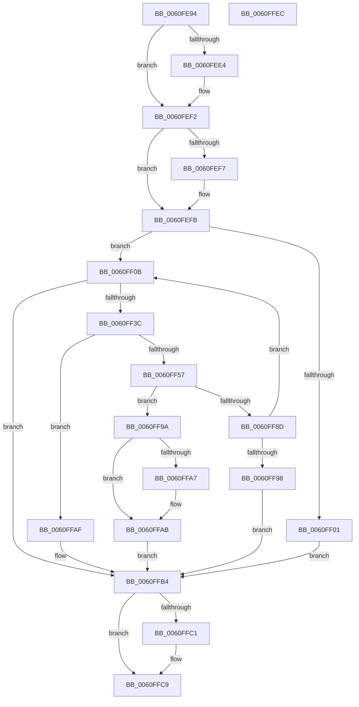

# SmKmVirtualLockContextIncreaseWsMin

- RVA: `0x0060FE94`–`0x0060FFED` (길이 `345` bytes)
- VA: `0x000000014060FE94`
- 실행 섹션: `.text`
- PDB 이름 있음: `예`; PDB Function 태그: `아니요`
- unwind 정보 RVA: `0x000D1E94`
- 디코드: `98`개 명령, `345/345` bytes 표시
- 미해석 바이트: `0` (있으면 어셈블리에 `.byte`로 보존)

> 이 문서는 커널 이미지의 기계어와 PDB 기호를 분석해 생성했습니다. 4번과 5번은 함수 원형과 자료형을 바이너리 사용 방식에서 추정한 C 해석이며 원본 소스 복구 결과는 아닙니다.

## 1. Dependencies

- 직접 호출 지점: **7**; 고유 호출 대상: **7**
- 직접 호출자로 확인된 함수: **1**
- RIP 상대 이미지 참조: **0**

### Outgoing calls
- `0x0060FED4` → [KeAbPreAcquire](../21/KeAbPreAcquire_function_00210230.md) (function, `0x00210230`)
- `0x0060FEED` → [ExfAcquirePushLockExclusiveEx](../20/ExfAcquirePushLockExclusiveEx_function_0020FC90.md) (function, `0x0020FC90`)
- `0x0060FF31` → [MmQueryWorkingSetInformation](../41/MmQueryWorkingSetInformation_function_0041CB20.md) (function, `0x0041CB20`)
- `0x0060FF82` → [MmAdjustWorkingSetSizeEx](../47/MmAdjustWorkingSetSizeEx_function_0047D8D4.md) (function, `0x0047D8D4`)
- `0x0060FFC4` → [ExfTryToWakePushLock](../26/ExfTryToWakePushLock_function_00265DD0.md) (function, `0x00265DD0`)
- `0x0060FFCC` → [KeAbPostRelease](../2E/KeAbPostRelease_function_002E1600.md) (function, `0x002E1600`)
- `0x0060FFD1` → [KeLeaveCriticalRegion](../25/KeLeaveCriticalRegion_function_0025D8B0.md) (function, `0x0025D8B0`)

### Direct callers
- [SmKmVirtualLockCtxLockMemory](../61/SmKmVirtualLockCtxLockMemory_function_0061000C.md) at `0x006100FB`

### Static image references
- 디코드된 RIP-relative 메모리 참조가 없습니다.

## 2. Other-region calls and transfers

- 다른 실행 섹션으로 향하는 call: **0**
- 별도 외부 분기/꼬리 이동을 확인하지 못했습니다.

## 3. Assembly (complete function range)

```asm
0060FE94  48 89 5C 24 10                  mov qword ptr [rsp + 0x10], rbx
0060FE99  55                              push rbp
0060FE9A  56                              push rsi
0060FE9B  57                              push rdi
0060FE9C  41 56                           push r14
0060FE9E  41 57                           push r15
0060FEA0  48 8B EC                        mov rbp, rsp
0060FEA3  48 83 EC 60                     sub rsp, 0x60
0060FEA7  65 48 8B 04 25 88 01 00 00      mov rax, qword ptr gs:[0x188]
0060FEB0  4D 8B F0                        mov r14, r8
0060FEB3  48 83 65 D0 00                  and qword ptr [rbp - 0x30], 0
0060FEB8  4C 8B FA                        mov r15, rdx
0060FEBB  48 83 65 D8 00                  and qword ptr [rbp - 0x28], 0
0060FEC0  48 83 CB FF                     or rbx, 0xffffffffffffffff
0060FEC4  45 33 C0                        xor r8d, r8d
0060FEC7  33 D2                           xor edx, edx
0060FEC9  66 01 98 E4 01 00 00            add word ptr [rax + 0x1e4], bx
0060FED0  48 8B F9                        mov rdi, rcx
0060FED3  90                              nop
0060FED4  E8 57 03 C0 FF                  call 0x140210230
0060FED9  F0 48 0F BA 2F 00               lock bts qword ptr [rdi], 0
0060FEDF  48 8B F0                        mov rsi, rax
0060FEE2  73 0E                           jae 0x14060fef2
0060FEE4  4C 8B C7                        mov r8, rdi
0060FEE7  48 8B D0                        mov rdx, rax
0060FEEA  48 8B CF                        mov rcx, rdi
0060FEED  E8 9E FD BF FF                  call 0x14020fc90
0060FEF2  48 85 F6                        test rsi, rsi
0060FEF5  74 04                           je 0x14060fefb
0060FEF7  C6 46 0A 01                     mov byte ptr [rsi + 0xa], 1
0060FEFB  4C 3B 77 10                     cmp r14, qword ptr [rdi + 0x10]
0060FEFF  73 0A                           jae 0x14060ff0b
0060FF01  BE 34 00 19 40                  mov esi, 0x40190034
0060FF06  E9 A9 00 00 00                  jmp 0x14060ffb4
0060FF0B  83 65 48 00                     and dword ptr [rbp + 0x48], 0
0060FF0F  48 8D 45 48                     lea rax, [rbp + 0x48]
0060FF13  48 89 44 24 28                  mov qword ptr [rsp + 0x28], rax
0060FF18  4C 8D 4D D0                     lea r9, [rbp - 0x30]
0060FF1C  48 8D 45 D8                     lea rax, [rbp - 0x28]
0060FF20  4C 8D 45 E0                     lea r8, [rbp - 0x20]
0060FF24  48 89 44 24 20                  mov qword ptr [rsp + 0x20], rax
0060FF29  48 8D 55 E8                     lea rdx, [rbp - 0x18]
0060FF2D  48 8D 4D F0                     lea rcx, [rbp - 0x10]
0060FF31  E8 EA CB E0 FF                  call 0x14041cb20
0060FF36  8B F0                           mov esi, eax
0060FF38  85 C0                           test eax, eax
0060FF3A  78 78                           js 0x14060ffb4
0060FF3C  48 8B 45 D0                     mov rax, qword ptr [rbp - 0x30]
0060FF40  4D 8D B7 FF FF 3F 00            lea r14, [r15 + 0x3fffff]
0060FF47  49 81 E6 00 00 C0 FF            and r14, 0xffffffffffc00000
0060FF4E  49 8D 0C 06                     lea rcx, [r14 + rax]
0060FF52  48 3B C8                        cmp rcx, rax
0060FF55  76 58                           jbe 0x14060ffaf
0060FF57  48 8B 55 D8                     mov rdx, qword ptr [rbp - 0x28]
0060FF5B  48 8D 45 30                     lea rax, [rbp + 0x30]
0060FF5F  48 3B CA                        cmp rcx, rdx
0060FF62  48 89 44 24 28                  mov qword ptr [rsp + 0x28], rax
0060FF67  41 B1 01                        mov r9b, 1
0060FF6A  48 89 4D D0                     mov qword ptr [rbp - 0x30], rcx
0060FF6E  48 0F 47 D1                     cmova rdx, rcx
0060FF72  C6 45 30 00                     mov byte ptr [rbp + 0x30], 0
0060FF76  83 64 24 20 00                  and dword ptr [rsp + 0x20], 0
0060FF7B  45 33 C0                        xor r8d, r8d
0060FF7E  48 89 55 D8                     mov qword ptr [rbp - 0x28], rdx
0060FF82  E8 4D D9 E6 FF                  call 0x14047d8d4
0060FF87  8B F0                           mov esi, eax
0060FF89  85 C0                           test eax, eax
0060FF8B  79 0D                           jns 0x14060ff9a
0060FF8D  3D 4C 00 00 C0                  cmp eax, 0xc000004c
0060FF92  0F 84 73 FF FF FF               je 0x14060ff0b
0060FF98  EB 1A                           jmp 0x14060ffb4
0060FF9A  48 8B 47 10                     mov rax, qword ptr [rdi + 0x10]
0060FF9E  4A 8D 0C 30                     lea rcx, [rax + r14]
0060FFA2  48 3B C8                        cmp rcx, rax
0060FFA5  76 04                           jbe 0x14060ffab
0060FFA7  48 89 4F 10                     mov qword ptr [rdi + 0x10], rcx
0060FFAB  33 F6                           xor esi, esi
0060FFAD  EB 05                           jmp 0x14060ffb4
0060FFAF  BE 95 00 00 C0                  mov esi, 0xc0000095
0060FFB4  F0 48 0F C1 1F                  lock xadd qword ptr [rdi], rbx
0060FFB9  80 E3 06                        and bl, 6
0060FFBC  80 FB 02                        cmp bl, 2
0060FFBF  75 08                           jne 0x14060ffc9
0060FFC1  48 8B CF                        mov rcx, rdi
0060FFC4  E8 07 5E C5 FF                  call 0x140265dd0
0060FFC9  48 8B CF                        mov rcx, rdi
0060FFCC  E8 2F 16 CD FF                  call 0x1402e1600
0060FFD1  E8 DA D8 C4 FF                  call 0x14025d8b0
0060FFD6  48 8B 9C 24 98 00 00 00         mov rbx, qword ptr [rsp + 0x98]
0060FFDE  8B C6                           mov eax, esi
0060FFE0  48 83 C4 60                     add rsp, 0x60
0060FFE4  41 5F                           pop r15
0060FFE6  41 5E                           pop r14
0060FFE8  5F                              pop rdi
0060FFE9  5E                              pop rsi
0060FFEA  5D                              pop rbp
0060FFEB  C3                              ret
0060FFEC  CC                              int3
```

## 4. C-style interpretation (structured pseudocode)

```c
__int64 __fastcall SmKmVirtualLockContextIncreaseWsMin(__int64 a1, __int64 a2, __int64 a3)
{
    __int64 result;
    __int64 v_r14;
    __int64 v_rbx;
    __int64 v_rsi;
    __int64 v_rsp;
    unsigned __int64 v_stack_m38;
    unsigned __int64 v_stack_m40;
    unsigned __int64 v_stack_m48;
    unsigned __int64 v_stack_m50;
    unsigned __int64 v_stack_m58;
    unsigned __int64 v_stack_m60;
    unsigned __int64 v_stack_m68;
    unsigned __int64 v_stack_p10;
    unsigned int v_stack_p20;
    unsigned __int64 v_stack_p8;

    v_stack_p10 = v_rbx;
    v_rsp = (v_rsp) - (96);
    v_rbx = (v_rbx) | (-1);
    a3 = 0;
    a2 = 0;
    result = KeAbPreAcquire(a1, a2, a3, a4);
    if (!(condition_is_above_or_equal)) {
        a3 = a1;
        a2 = result;
        a1 = a1;
        result = ExfAcquirePushLockExclusiveEx(a1, a2, a3, a4);
    }
    if (result != 0) {
        *(unsigned __int8 *)(result + 10) = 1;
    }
    if (a3 >= (*(unsigned __int64 *)(a1 + 16))) goto loc_0060FF0B;
    goto loc_0060FFB4;
loc_0060FF0B:
    v_stack_m60 = v_stack_p20;
    v_stack_m68 = v_stack_m50;
    result = MmQueryWorkingSetInformation(v_stack_m38, v_stack_m40, v_stack_m48, v_stack_m58);
    if (sign_flag) goto loc_0060FFB4;
    v_r14 = (a2 + 4194303) & (0xFFFFFFFFFFC00000ULL);
    if ((v_r14 + v_stack_m58 * 1) <= v_stack_m58) goto loc_0060FFAF;
    v_stack_m60 = v_stack_p8;
    v_stack_m58 = v_r14 + v_stack_m58 * 1;
    a2 = v_stack_m50;
    if ((v_r14 + v_stack_m58 * 1) > v_stack_m50) { a2 = v_r14 + v_stack_m58 * 1; }
    v_stack_p8 = 0;
    a3 = 0;
    v_stack_m50 = a2;
    result = MmAdjustWorkingSetSizeEx(v_r14 + v_stack_m58 * 1, a2, a3, 1);
    if (!sign_flag) goto loc_0060FF9A;
    if (((unsigned int)(result)) == 0xC000004CULL) goto loc_0060FF0B;
    goto loc_0060FFB4;
loc_0060FF9A:
    if ((*(unsigned __int64 *)(a1 + 16) + v_r14 * 1) >= = (*(unsigned __int64 *)(a1 + 16))) {
        *(unsigned __int64 *)(a1 + 16) = *(unsigned __int64 *)(a1 + 16) + v_r14 * 1;
    }
    v_rsi = 0;
    goto loc_0060FFB4;
loc_0060FFAF:
loc_0060FFB4:
    v_rbx = (unsigned __int8)((v_rbx) & (6));
    result = *(unsigned __int64 *)(a1 + 16);
    if (((unsigned __int8)(v_rbx)) == 2) {
        a1 = a1;
        result = ExfTryToWakePushLock(a1, a2, a3, 1);
    }
    result = KeAbPostRelease(a1, a2, a3, 1);
    result = KeLeaveCriticalRegion(a1, a2, a3, 1);
    v_rsp = (v_rsp) + (96);
    return (unsigned int)((unsigned int)((unsigned int)(0xC0000095ULL)));
}
```

## 5. (Beta) C Style

```c
int64_t SmKmVirtualLockContextIncreaseWsMin(void *Arg1, void *Arg2, int64_t Arg3)
{
    uint8_t *arg1 = (uint8_t *)Arg1;
    uint8_t *arg2 = (uint8_t *)Arg2;

    int64_t result;
    int64_t local_r14;
    int64_t local_rbx;
    int64_t local_rsi;
    int64_t local_rsp;
    uint64_t v_stack_m38;
    uint64_t v_stack_m40;
    uint64_t v_stack_m48;
    uint64_t v_stack_m50;
    uint64_t v_stack_m58;
    uint64_t v_stack_m60;
    uint64_t v_stack_m68;
    uint64_t v_stack_p10;
    uint32_t v_stack_p20;
    uint64_t v_stack_p8;

    v_stack_p10 = local_rbx;
    local_rsp = (local_rsp) - (96);
    local_rbx = (local_rbx) | (-1);
    Arg3 = 0;
    Arg2 = 0;
    result = KeAbPreAcquire(Arg1, Arg2, Arg3, a4);
    if (!(condition_is_above_or_equal)) {
        Arg3 = Arg1;
        Arg2 = result;
        Arg1 = Arg1;
        result = ExfAcquirePushLockExclusiveEx(Arg1, Arg2, Arg3, a4);
    }
    if (result != 0) {
        *(uint8_t *)(result + 0xA) = 1;
    }
    if (Arg3 >= (*(uint64_t *)(arg1 + 0x10))) goto loc_0060FF0B;
    goto loc_0060FFB4;
loc_0060FF0B:
    v_stack_m60 = v_stack_p20;
    v_stack_m68 = v_stack_m50;
    result = MmQueryWorkingSetInformation(v_stack_m38, v_stack_m40, v_stack_m48, v_stack_m58);
    if (sign_flag) goto loc_0060FFB4;
    local_r14 = (Arg2 + 4194303) & (0xFFFFFFFFFFC00000ULL);
    if ((local_r14 + v_stack_m58 * 1) <= v_stack_m58) goto loc_0060FFAF;
    v_stack_m60 = v_stack_p8;
    v_stack_m58 = local_r14 + v_stack_m58 * 1;
    Arg2 = v_stack_m50;
    if ((local_r14 + v_stack_m58 * 1) > v_stack_m50) { Arg2 = local_r14 + v_stack_m58 * 1; }
    v_stack_p8 = 0;
    Arg3 = 0;
    v_stack_m50 = Arg2;
    result = MmAdjustWorkingSetSizeEx(local_r14 + v_stack_m58 * 1, Arg2, Arg3, 1);
    if (!sign_flag) goto loc_0060FF9A;
    if (((uint32_t)(result)) == 0xC000004CULL) goto loc_0060FF0B;
    goto loc_0060FFB4;
loc_0060FF9A:
    if ((*(uint64_t *)(arg1 + 0x10) + local_r14 * 1) >= = (*(uint64_t *)(arg1 + 0x10))) {
        *(uint64_t *)(arg1 + 0x10) = *(uint64_t *)(arg1 + 0x10) + local_r14 * 1;
    }
    local_rsi = 0;
    goto loc_0060FFB4;
loc_0060FFAF:
loc_0060FFB4:
    local_rbx = (uint8_t)((local_rbx) & (6));
    result = *(uint64_t *)(arg1 + 0x10);
    if (((uint8_t)(local_rbx)) == 2) {
        Arg1 = Arg1;
        result = ExfTryToWakePushLock(Arg1, Arg2, Arg3, 1);
    }
    result = KeAbPostRelease(Arg1, Arg2, Arg3, 1);
    result = KeLeaveCriticalRegion(Arg1, Arg2, Arg3, 1);
    local_rsp = (local_rsp) + (96);
    return (uint32_t)((uint32_t)((uint32_t)(0xC0000095ULL)));
}
```

### 관측된 메모리 오프셋

구조체 형식이 확인되지 않은 접근은 인자 기준의 오프셋으로만 기록했습니다.

| 기준 인자 | 오프셋 표현 | 폭 (bit) | 접근 |
|---|---:|---:|---|
| `Arg1` | `+ 0x0` | `64` | `R/W` |
| `Arg1` | `+ 0x10` | `64` | `R` |
| `Arg1` | `+ 0x10` | `64` | `W` |
| `Arg2` | `+ 0x0 + rax*1` | `64` | `R` |
| `Arg2` | `+ 0x3FFFFF` | `64` | `R` |

## 6. Execution-region graph

[열기: 2D/3D 그래프와 함수 탐색 컨트롤 패널](../../../control-panel.html?section=text&rva=0x0060FE94&view=graph)

- 2D 그래프는 위에서 아래로 흐르고, 3D 그래프는 빈 공간을 드래그해 회전합니다. Shift+드래그는 이동, 휠은 확대·축소, 함수 노드 선택은 대상 보고서 이동입니다.

### Static fallback


