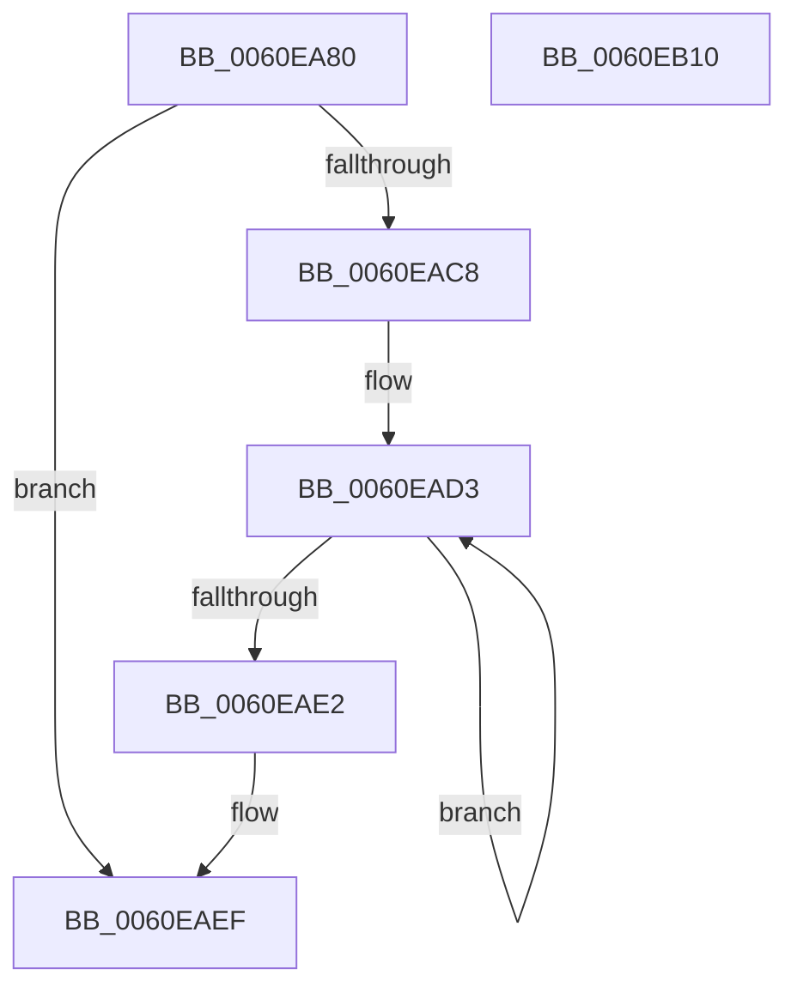

# SmQueryStoreCommitUsage

- RVA: `0x0060EA80`–`0x0060EB11` (길이 `145` bytes)
- VA: `0x000000014060EA80`
- 실행 섹션: `.text`
- PDB 이름 있음: `예`; PDB Function 태그: `아니요`
- unwind 정보 RVA: `0x000D1D68`
- 디코드: `37`개 명령, `145/145` bytes 표시
- 미해석 바이트: `0` (있으면 어셈블리에 `.byte`로 보존)

> 이 문서는 커널 이미지의 기계어와 PDB 기호를 분석해 생성했습니다. 4번과 5번은 함수 원형과 자료형을 바이너리 사용 방식에서 추정한 C 해석이며 원본 소스 복구 결과는 아닙니다.

## 1. Dependencies

- 직접 호출 지점: **3**; 고유 호출 대상: **3**
- 직접 호출자로 확인된 함수: **1**
- RIP 상대 이미지 참조: **1**

### Outgoing calls
- `0x0060EAB2` → [memset](../6C/memset_function_006C6C40.md) (function, `0x006C6C40`)
- `0x0060EABF` → [SmpProcessQueryStoreStats](../34/SmpProcessQueryStoreStats_function_00349D6C.md) (function, `0x00349D6C`)
- `0x0060EAFA` → [_security_check_cookie](../6A/_security_check_cookie_function_006AC640.md) (function, `0x006AC640`)

### Direct callers
- [MiReleaseOutSwappedProcessCommit](../3C/MiReleaseOutSwappedProcessCommit_function_003C8320.md) at `0x003C84E7`

### Static image references
- `0x0060EA8D` → RVA `0x00E0A740` (`.data`; read)

## 2. Other-region calls and transfers

- 다른 실행 섹션으로 향하는 call: **0**
- 별도 외부 분기/꼬리 이동을 확인하지 못했습니다.

## 3. Assembly (complete function range)

```asm
0060EA80  48 89 5C 24 18                  mov qword ptr [rsp + 0x18], rbx
0060EA85  57                              push rdi
0060EA86  48 81 EC 30 06 00 00            sub rsp, 0x630
0060EA8D  48 8B 05 AC BC 7F 00            mov rax, qword ptr [rip + 0x7fbcac]
0060EA94  48 33 C4                        xor rax, rsp
0060EA97  48 89 84 24 20 06 00 00         mov qword ptr [rsp + 0x620], rax
0060EA9F  48 8B FA                        mov rdi, rdx
0060EAA2  48 8B D9                        mov rbx, rcx
0060EAA5  33 D2                           xor edx, edx
0060EAA7  48 8D 4C 24 20                  lea rcx, [rsp + 0x20]
0060EAAC  41 B8 00 06 00 00               mov r8d, 0x600
0060EAB2  E8 89 81 0B 00                  call 0x1406c6c40
0060EAB7  48 8D 54 24 20                  lea rdx, [rsp + 0x20]
0060EABC  48 8B CB                        mov rcx, rbx
0060EABF  E8 A8 B2 D3 FF                  call 0x140349d6c
0060EAC4  85 C0                           test eax, eax
0060EAC6  78 27                           js 0x14060eaef
0060EAC8  33 C9                           xor ecx, ecx
0060EACA  48 8D 54 24 4C                  lea rdx, [rsp + 0x4c]
0060EACF  44 8D 41 08                     lea r8d, [rcx + 8]
0060EAD3  8B 02                           mov eax, dword ptr [rdx]
0060EAD5  48 8D 52 08                     lea rdx, [rdx + 8]
0060EAD9  48 03 C8                        add rcx, rax
0060EADC  49 83 E8 01                     sub r8, 1
0060EAE0  75 F1                           jne 0x14060ead3
0060EAE2  8B 44 24 2C                     mov eax, dword ptr [rsp + 0x2c]
0060EAE6  48 0F AF C1                     imul rax, rcx
0060EAEA  48 89 07                        mov qword ptr [rdi], rax
0060EAED  33 C0                           xor eax, eax
0060EAEF  48 8B 8C 24 20 06 00 00         mov rcx, qword ptr [rsp + 0x620]
0060EAF7  48 33 CC                        xor rcx, rsp
0060EAFA  E8 41 DB 09 00                  call 0x1406ac640
0060EAFF  48 8B 9C 24 50 06 00 00         mov rbx, qword ptr [rsp + 0x650]
0060EB07  48 81 C4 30 06 00 00            add rsp, 0x630
0060EB0E  5F                              pop rdi
0060EB0F  C3                              ret
0060EB10  CC                              int3
```

## 4. C-style interpretation (structured pseudocode)

```c
__int64 __fastcall SmQueryStoreCommitUsage(__int64 a1, __int64 a2)
{
    __int64 result;
    __int64 v_rsp;
    unsigned __int64 v_stack_m18;
    unsigned __int64 v_stack_m5EC;
    unsigned int v_stack_m60C;
    unsigned __int64 v_stack_m618;
    unsigned __int64 v_stack_p18;

    v_stack_p18 = v_rbx;
    v_rsp = (v_rsp) - (0x630ULL);
    result = (*(unsigned __int64 *)(v_rip + 8371372)) ^ (v_rsp);
    v_stack_m18 = result;
    a2 = 0;
    result = memset(v_stack_m618, a2, (unsigned int)(0x600ULL), a4);
    result = SmpProcessQueryStoreStats(a1, v_stack_m618, (unsigned int)(0x600ULL), a4);
    if (sign_flag) goto loc_0060EAEF;
    a1 = 0;
loc_0060EAD3:
    a1 = (a1) + ((unsigned int)(*(unsigned int *)(v_stack_m5EC)));
    a3 = (a1 + 8) - (1);
    if (condition_is_not_equal) goto loc_0060EAD3;
    result = ((unsigned int)(v_stack_m60C)) * (a1);
    *(unsigned __int64 *)(a2) = result;
    result = 0;
loc_0060EAEF:
    a1 = (v_stack_m18) ^ (v_rsp);
    result = _security_check_cookie(a1, v_stack_m5EC + 8, a3, a4);
    v_rsp = (v_rsp) + (0x630ULL);
    return result;
}
```

## 5. (Beta) C Style

```c
int64_t SmQueryStoreCommitUsage(int64_t Arg1, void *Arg2)
{
    uint8_t *arg2 = (uint8_t *)Arg2;

    int64_t result;
    int64_t local_rsp;
    uint64_t v_stack_m18;
    uint64_t v_stack_m5EC;
    uint32_t v_stack_m60C;
    uint64_t v_stack_m618;
    uint64_t v_stack_p18;

    v_stack_p18 = local_rbx;
    local_rsp = (local_rsp) - (0x630ULL);
    result = (*(uint64_t *)(v_rip + 0x7FBCAC)) ^ (local_rsp);
    v_stack_m18 = result;
    Arg2 = 0;
    result = memset(v_stack_m618, Arg2, (uint32_t)(0x600ULL), a4);
    result = SmpProcessQueryStoreStats(Arg1, v_stack_m618, (uint32_t)(0x600ULL), a4);
    if (sign_flag) goto loc_0060EAEF;
    Arg1 = 0;
loc_0060EAD3:
    Arg1 = (Arg1) + ((uint32_t)(*(uint32_t *)(v_stack_m5EC)));
    a3 = (Arg1 + 8) - (1);
    if (condition_is_not_equal) goto loc_0060EAD3;
    result = ((uint32_t)(v_stack_m60C)) * (Arg1);
    *(uint64_t *)(arg2) = result;
    result = 0;
loc_0060EAEF:
    Arg1 = (v_stack_m18) ^ (local_rsp);
    result = _security_check_cookie(Arg1, v_stack_m5EC + 8, a3, a4);
    local_rsp = (local_rsp) + (0x630ULL);
    return result;
}
```

### 관측된 메모리 오프셋

구조체 형식이 확인되지 않은 접근은 인자 기준의 오프셋으로만 기록했습니다.

| 기준 인자 | 오프셋 표현 | 폭 (bit) | 접근 |
|---|---:|---:|---|
| `Arg2` | `+ 0x0` | `64` | `W` |

## 6. Execution-region graph

[열기: 2D/3D 그래프와 함수 탐색 컨트롤 패널](../../../control-panel.html?section=text&rva=0x0060EA80&view=graph)

- 2D 그래프는 위에서 아래로 흐르고, 3D 그래프는 빈 공간을 드래그해 회전합니다. Shift+드래그는 이동, 휠은 확대·축소, 함수 노드 선택은 대상 보고서 이동입니다.

### Static fallback


