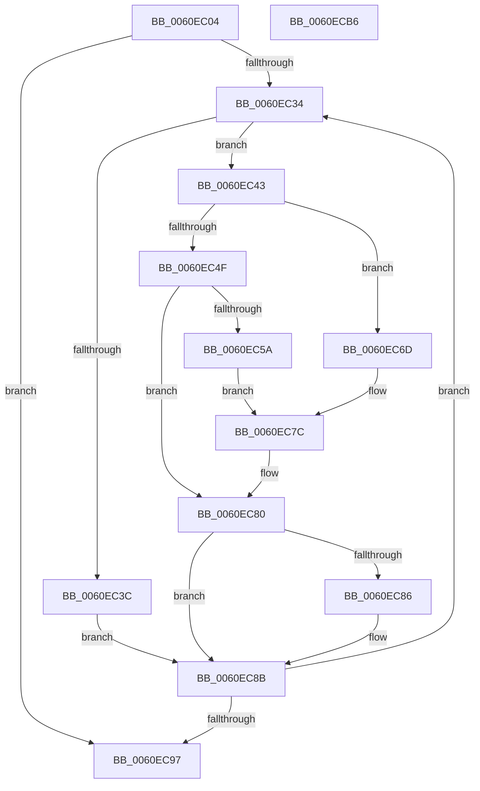

# SmSanitizeString

- RVA: `0x0060EC04`–`0x0060ECB7` (길이 `179` bytes)
- VA: `0x000000014060EC04`
- 실행 섹션: `.text`
- PDB 이름 있음: `예`; PDB Function 태그: `아니요`
- unwind 정보 RVA: `0x0005E6B4`
- 디코드: `57`개 명령, `179/179` bytes 표시
- 미해석 바이트: `0` (있으면 어셈블리에 `.byte`로 보존)

> 이 문서는 커널 이미지의 기계어와 PDB 기호를 분석해 생성했습니다. 4번과 5번은 함수 원형과 자료형을 바이너리 사용 방식에서 추정한 C 해석이며 원본 소스 복구 결과는 아닙니다.

## 1. Dependencies

- 직접 호출 지점: **1**; 고유 호출 대상: **1**
- 직접 호출자로 확인된 함수: **1**
- RIP 상대 이미지 참조: **0**

### Outgoing calls
- `0x0060EC51` → [isprint](../50/isprint_function_005006E0.md) (function, `0x005006E0`)

### Direct callers
- [SmKmVolumeQueryUniqueId](../../page/7A/SmKmVolumeQueryUniqueId_function_007A9FE8.md) at `0x007AA04D`

### Static image references
- 디코드된 RIP-relative 메모리 참조가 없습니다.

## 2. Other-region calls and transfers

- 다른 실행 섹션으로 향하는 call: **0**
- 별도 외부 분기/꼬리 이동을 확인하지 못했습니다.

## 3. Assembly (complete function range)

```asm
0060EC04  48 8B C4                        mov rax, rsp
0060EC07  48 89 58 08                     mov qword ptr [rax + 8], rbx
0060EC0B  48 89 68 10                     mov qword ptr [rax + 0x10], rbp
0060EC0F  48 89 70 18                     mov qword ptr [rax + 0x18], rsi
0060EC13  48 89 78 20                     mov qword ptr [rax + 0x20], rdi
0060EC17  41 56                           push r14
0060EC19  48 83 EC 20                     sub rsp, 0x20
0060EC1D  8B EA                           mov ebp, edx
0060EC1F  45 33 F6                        xor r14d, r14d
0060EC22  48 D1 ED                        shr rbp, 1
0060EC25  48 8B F9                        mov rdi, rcx
0060EC28  48 FF CD                        dec rbp
0060EC2B  48 8D 2C 69                     lea rbp, [rcx + rbp*2]
0060EC2F  48 3B CD                        cmp rcx, rbp
0060EC32  73 63                           jae 0x14060ec97
0060EC34  0F B7 1F                        movzx ebx, word ptr [rdi]
0060EC37  66 85 DB                        test bx, bx
0060EC3A  75 07                           jne 0x14060ec43
0060EC3C  BB 7E 00 00 00                  mov ebx, 0x7e
0060EC41  EB 48                           jmp 0x14060ec8b
0060EC43  B8 FF 00 00 00                  mov eax, 0xff
0060EC48  8B F3                           mov esi, ebx
0060EC4A  66 3B D8                        cmp bx, ax
0060EC4D  77 1E                           ja 0x14060ec6d
0060EC4F  8B CB                           mov ecx, ebx
0060EC51  E8 8A 1A EF FF                  call 0x1405006e0
0060EC56  85 C0                           test eax, eax
0060EC58  75 26                           jne 0x14060ec80
0060EC5A  B8 03 99 14 2F                  mov eax, 0x2f149903
0060EC5F  F7 E6                           mul esi
0060EC61  C1 EA 04                        shr edx, 4
0060EC64  6B C2 57                        imul eax, edx, 0x57
0060EC67  2B F0                           sub esi, eax
0060EC69  8B DE                           mov ebx, esi
0060EC6B  EB 0F                           jmp 0x14060ec7c
0060EC6D  B8 03 99 14 2F                  mov eax, 0x2f149903
0060EC72  F7 E6                           mul esi
0060EC74  C1 EA 04                        shr edx, 4
0060EC77  6B C2 57                        imul eax, edx, 0x57
0060EC7A  2B D8                           sub ebx, eax
0060EC7C  66 83 C3 24                     add bx, 0x24
0060EC80  66 83 FB 5C                     cmp bx, 0x5c
0060EC84  75 05                           jne 0x14060ec8b
0060EC86  BB 5F 00 00 00                  mov ebx, 0x5f
0060EC8B  66 89 1F                        mov word ptr [rdi], bx
0060EC8E  48 83 C7 02                     add rdi, 2
0060EC92  48 3B FD                        cmp rdi, rbp
0060EC95  72 9D                           jb 0x14060ec34
0060EC97  48 8B 5C 24 30                  mov rbx, qword ptr [rsp + 0x30]
0060EC9C  48 8B 6C 24 38                  mov rbp, qword ptr [rsp + 0x38]
0060ECA1  48 8B 74 24 40                  mov rsi, qword ptr [rsp + 0x40]
0060ECA6  66 44 89 37                     mov word ptr [rdi], r14w
0060ECAA  48 8B 7C 24 48                  mov rdi, qword ptr [rsp + 0x48]
0060ECAF  48 83 C4 20                     add rsp, 0x20
0060ECB3  41 5E                           pop r14
0060ECB5  C3                              ret
0060ECB6  CC                              int3
```

## 4. C-style interpretation (structured pseudocode)

```c
__int64 __fastcall SmSanitizeString(__int64 a1, int a2)
{
    __int64 result;
    __int64 v_r14;
    __int64 v_rbp;
    __int64 v_rbx;
    __int64 v_rdi;
    __int64 v_rsi;
    __int64 v_rsp;
    unsigned __int64 v_stack_p10;
    unsigned __int64 v_stack_p18;
    unsigned __int64 v_stack_p20;
    unsigned __int64 v_stack_p8;

    *(unsigned __int64 *)(v_rsp + 8) = v_rbx;
    *(unsigned __int64 *)(v_rsp + 16) = v_rbp;
    *(unsigned __int64 *)(v_rsp + 24) = v_rsi;
    *(unsigned __int64 *)(v_rsp + 32) = v_rdi;
    v_rsp = (v_rsp) - (32);
    v_r14 = 0;
    v_rbp = ((unsigned int)(a2)) >> (1);
    v_rbp = (v_rbp) - 1;
    if (a1 >= (a1 + v_rbp * 2)) goto loc_0060EC97;
loc_0060EC34:
    if ((unsigned __int16)(*(unsigned __int16 *)(a1)) != 0) goto loc_0060EC43;
    goto loc_0060EC8B;
loc_0060EC43:
    if (126 > 255) goto loc_0060EC6D;
    result = isprint(126, a2, a3, a4);
    if ((unsigned int)(result) != 0) goto loc_0060EC80;
    a2 = (unsigned int)((a2) >> (4));
    result = (unsigned int)(((unsigned int)(0x2F149903ULL)) * (a2));
    v_rsi = (unsigned int)((126) - ((unsigned int)(result)));
    goto loc_0060EC7C;
loc_0060EC6D:
    a2 = (unsigned int)((a2) >> (4));
    result = (unsigned int)(((unsigned int)(0x2F149903ULL)) * (a2));
    v_rbx = (unsigned int)(((unsigned int)((unsigned int)(v_rsi))) - ((unsigned int)(result)));
loc_0060EC7C:
    v_rbx = (unsigned __int16)((v_rbx) + (36));
loc_0060EC80:
    if (((unsigned __int16)(v_rbx)) == 92) {
        v_rbx = 95;
    }
    *(unsigned __int16 *)(a1) = (unsigned __int16)(v_rbx);
    v_rdi = (a1) + (2);
    if (v_rdi < (a1 + v_rbp * 2)) goto loc_0060EC34;
loc_0060EC97:
    *(unsigned __int16 *)(v_rdi) = 0;
    v_rsp = (v_rsp) + (32);
    return result;
}
```

## 5. (Beta) C Style

```c
int64_t SmSanitizeString(void *Arg1, int32_t Arg2)
{
    uint8_t *arg1 = (uint8_t *)Arg1;

    int64_t result;
    int64_t local_r14;
    int64_t local_rbp;
    int64_t local_rbx;
    int64_t local_rdi;
    int64_t local_rsi;
    int64_t local_rsp;
    uint64_t v_stack_p10;
    uint64_t v_stack_p18;
    uint64_t v_stack_p20;
    uint64_t v_stack_p8;

    *(uint64_t *)(local_rsp + 0x8) = local_rbx;
    *(uint64_t *)(local_rsp + 0x10) = local_rbp;
    *(uint64_t *)(local_rsp + 0x18) = local_rsi;
    *(uint64_t *)(local_rsp + 0x20) = local_rdi;
    local_rsp = (local_rsp) - (32);
    local_r14 = 0;
    local_rbp = ((uint32_t)(Arg2)) >> (1);
    local_rbp = (local_rbp) - 1;
    if (Arg1 >= (Arg1 + local_rbp * 2)) goto loc_0060EC97;
loc_0060EC34:
    if ((uint16_t)(*(uint16_t *)(arg1)) != 0) goto loc_0060EC43;
    goto loc_0060EC8B;
loc_0060EC43:
    if (126 > 255) goto loc_0060EC6D;
    result = isprint(126, Arg2, a3, a4);
    if ((uint32_t)(result) != 0) goto loc_0060EC80;
    Arg2 = (uint32_t)((Arg2) >> (4));
    result = (uint32_t)(((uint32_t)(0x2F149903ULL)) * (Arg2));
    local_rsi = (uint32_t)((126) - ((uint32_t)(result)));
    goto loc_0060EC7C;
loc_0060EC6D:
    Arg2 = (uint32_t)((Arg2) >> (4));
    result = (uint32_t)(((uint32_t)(0x2F149903ULL)) * (Arg2));
    local_rbx = (uint32_t)(((uint32_t)((uint32_t)(local_rsi))) - ((uint32_t)(result)));
loc_0060EC7C:
    local_rbx = (uint16_t)((local_rbx) + (36));
loc_0060EC80:
    if (((uint16_t)(local_rbx)) == 92) {
        local_rbx = 95;
    }
    *(uint16_t *)(arg1) = (uint16_t)(local_rbx);
    local_rdi = (Arg1) + (2);
    if (local_rdi < (Arg1 + local_rbp * 2)) goto loc_0060EC34;
loc_0060EC97:
    *(uint16_t *)(local_rdi) = 0;
    local_rsp = (local_rsp) + (32);
    return result;
}
```

### 관측된 메모리 오프셋

구조체 형식이 확인되지 않은 접근은 인자 기준의 오프셋으로만 기록했습니다.

| 기준 인자 | 오프셋 표현 | 폭 (bit) | 접근 |
|---|---:|---:|---|
| `Arg1` | `+ 0x0 + rbp*2` | `64` | `R` |

## 6. Execution-region graph

[열기: 2D/3D 그래프와 함수 탐색 컨트롤 패널](../../../control-panel.html?section=text&rva=0x0060EC04&view=graph)

- 2D 그래프는 위에서 아래로 흐르고, 3D 그래프는 빈 공간을 드래그해 회전합니다. Shift+드래그는 이동, 휠은 확대·축소, 함수 노드 선택은 대상 보고서 이동입니다.

### Static fallback


