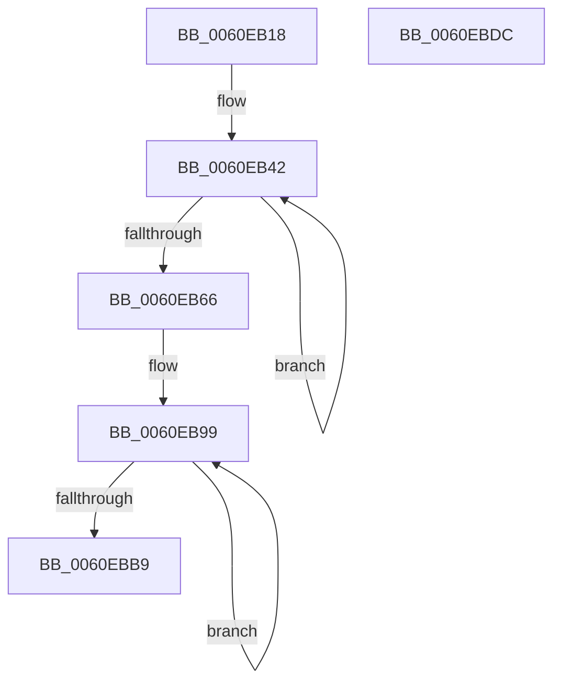

# SmTerminateStoreProcess

- RVA: `0x0060EB18`–`0x0060EBDD` (길이 `197` bytes)
- VA: `0x000000014060EB18`
- 실행 섹션: `.text`
- PDB 이름 있음: `예`; PDB Function 태그: `아니요`
- unwind 정보 RVA: `0x0008A658`
- 디코드: `44`개 명령, `197/197` bytes 표시
- 미해석 바이트: `0` (있으면 어셈블리에 `.byte`로 보존)

> 이 문서는 커널 이미지의 기계어와 PDB 기호를 분석해 생성했습니다. 4번과 5번은 함수 원형과 자료형을 바이너리 사용 방식에서 추정한 C 해석이며 원본 소스 복구 결과는 아닙니다.

## 1. Dependencies

- 직접 호출 지점: **6**; 고유 호출 대상: **5**
- 직접 호출자로 확인된 함수: **2**
- RIP 상대 이미지 참조: **0**

### Outgoing calls
- `0x0060EB2E` → [PsTerminateMinimalProcess](../../page/78/PsTerminateMinimalProcess_function_007861A8.md) (function, `0x007861A8`)
- `0x0060EB5D` → [KeWaitForSingleObject](../20/KeWaitForSingleObject_function_0020E6B0.md) (function, `0x0020E6B0`)
- `0x0060EB6D` → [ZwClose](../6A/ZwClose_function_006AD2B0.md) (function, `0x006AD2B0`)
- `0x0060EB7E` → [ObDereferenceObjectDeferDeleteWithTag](../26/ObDereferenceObjectDeferDeleteWithTag_function_00263EA0.md) (function, `0x00263EA0`)
- `0x0060EBB0` → [KeWaitForSingleObject](../20/KeWaitForSingleObject_function_0020E6B0.md) (function, `0x0020E6B0`)
- `0x0060EBBC` → [KeResetEvent](../24/KeResetEvent_function_00248350.md) (function, `0x00248350`)

### Direct callers
- [SmFirstTimeInit](../4E/SmFirstTimeInit_function_004EA944.md) at `0x004EAC67`
- [SmPartitionCleanup](../../page/7A/SmPartitionCleanup_function_007A5C14.md) at `0x007A5CD2`

### Static image references
- 디코드된 RIP-relative 메모리 참조가 없습니다.

## 2. Other-region calls and transfers

- 다른 실행 섹션으로 향하는 call: **1**
  - `0x0060EB2E` → [PsTerminateMinimalProcess](../../page/78/PsTerminateMinimalProcess_function_007861A8.md) (`.text` → `PAGE`)
- 별도 외부 분기/꼬리 이동을 확인하지 못했습니다.

## 3. Assembly (complete function range)

```asm
0060EB18  48 89 5C 24 10                  mov qword ptr [rsp + 0x10], rbx
0060EB1D  57                              push rdi
0060EB1E  48 83 EC 30                     sub rsp, 0x30
0060EB22  48 8B D9                        mov rbx, rcx
0060EB25  33 D2                           xor edx, edx
0060EB27  48 8B 89 78 08 00 00            mov rcx, qword ptr [rcx + 0x878]
0060EB2E  E8 75 76 17 00                  call 0x1407861a8
0060EB33  48 B8 00 A2 2F 4D FF FF FF FF   movabs rax, 0xffffffff4d2fa200
0060EB3D  48 89 44 24 40                  mov qword ptr [rsp + 0x40], rax
0060EB42  48 8B 8B 78 08 00 00            mov rcx, qword ptr [rbx + 0x878]
0060EB49  48 8D 44 24 40                  lea rax, [rsp + 0x40]
0060EB4E  45 33 C9                        xor r9d, r9d
0060EB51  48 89 44 24 20                  mov qword ptr [rsp + 0x20], rax
0060EB56  45 33 C0                        xor r8d, r8d
0060EB59  41 8D 51 1A                     lea edx, [r9 + 0x1a]
0060EB5D  E8 4E FB BF FF                  call 0x14020e6b0
0060EB62  85 C0                           test eax, eax
0060EB64  75 DC                           jne 0x14060eb42
0060EB66  48 8B 8B 70 08 00 00            mov rcx, qword ptr [rbx + 0x870]
0060EB6D  E8 3E E7 09 00                  call 0x1406ad2b0
0060EB72  48 8B 8B 78 08 00 00            mov rcx, qword ptr [rbx + 0x878]
0060EB79  BA 44 66 6C 74                  mov edx, 0x746c6644
0060EB7E  E8 1D 53 C5 FF                  call 0x140263ea0
0060EB83  48 B8 00 44 5F 9A FE FF FF FF   movabs rax, 0xfffffffe9a5f4400
0060EB8D  48 8D BB 80 08 00 00            lea rdi, [rbx + 0x880]
0060EB94  48 89 44 24 40                  mov qword ptr [rsp + 0x40], rax
0060EB99  45 33 C9                        xor r9d, r9d
0060EB9C  48 8D 44 24 40                  lea rax, [rsp + 0x40]
0060EBA1  45 33 C0                        xor r8d, r8d
0060EBA4  48 89 44 24 20                  mov qword ptr [rsp + 0x20], rax
0060EBA9  48 8B CF                        mov rcx, rdi
0060EBAC  41 8D 51 1A                     lea edx, [r9 + 0x1a]
0060EBB0  E8 FB FA BF FF                  call 0x14020e6b0
0060EBB5  85 C0                           test eax, eax
0060EBB7  75 E0                           jne 0x14060eb99
0060EBB9  48 8B CF                        mov rcx, rdi
0060EBBC  E8 8F 97 C3 FF                  call 0x140248350
0060EBC1  48 83 A3 78 08 00 00 00         and qword ptr [rbx + 0x878], 0
0060EBC9  48 83 A3 70 08 00 00 00         and qword ptr [rbx + 0x870], 0
0060EBD1  48 8B 5C 24 48                  mov rbx, qword ptr [rsp + 0x48]
0060EBD6  48 83 C4 30                     add rsp, 0x30
0060EBDA  5F                              pop rdi
0060EBDB  C3                              ret
0060EBDC  CC                              int3
```

## 4. C-style interpretation (structured pseudocode)

```c
__int64 __fastcall SmTerminateStoreProcess(__int64 a1, int a2, int a3, int a4)
{
    __int64 result;
    __int64 v_rsp;
    unsigned __int64 v_stack_m18;
    unsigned __int64 v_stack_p10;
    unsigned __int64 v_stack_p8;

    v_stack_p10 = v_rbx;
    v_rsp = (v_rsp) - (48);
    a2 = 0;
    result = PsTerminateMinimalProcess(*(unsigned __int64 *)(a1 + 2168), a2, a3, a4);
    v_stack_p8 = result;
loc_0060EB42:
    a4 = 0;
    v_stack_m18 = v_stack_p8;
    a3 = 0;
    result = KeWaitForSingleObject(*(unsigned __int64 *)(a1 + 2168), a4 + 26, a3, a4);
    if ((unsigned int)(result) != 0) goto loc_0060EB42;
    result = ZwClose(*(unsigned __int64 *)(a1 + 2160), a4 + 26, a3, a4);
    result = ObDereferenceObjectDeferDeleteWithTag(*(unsigned __int64 *)(a1 + 2168), (unsigned int)(0x746C6644ULL), a3, a4);
    v_stack_p8 = result;
loc_0060EB99:
    a4 = 0;
    a3 = 0;
    v_stack_m18 = v_stack_p8;
    result = KeWaitForSingleObject(a1 + 2176, a4 + 26, a3, a4);
    if ((unsigned int)(result) != 0) goto loc_0060EB99;
    result = KeResetEvent(a1 + 2176, a4 + 26, a3, a4);
    v_rsp = (v_rsp) + (48);
    return result;
}
```

## 5. (Beta) C Style

```c
int64_t SmTerminateStoreProcess(void *Arg1, int32_t Arg2, int32_t Arg3, int32_t Arg4)
{
    uint8_t *arg1 = (uint8_t *)Arg1;

    int64_t result;
    int64_t local_rsp;
    uint64_t v_stack_m18;
    uint64_t v_stack_p10;
    uint64_t v_stack_p8;

    v_stack_p10 = local_rbx;
    local_rsp = (local_rsp) - (48);
    Arg2 = 0;
    result = PsTerminateMinimalProcess(*(uint64_t *)(arg1 + 0x878), Arg2, Arg3, Arg4);
    v_stack_p8 = result;
loc_0060EB42:
    Arg4 = 0;
    v_stack_m18 = v_stack_p8;
    Arg3 = 0;
    result = KeWaitForSingleObject(*(uint64_t *)(arg1 + 0x878), Arg4 + 26, Arg3, Arg4);
    if ((uint32_t)(result) != 0) goto loc_0060EB42;
    result = ZwClose(*(uint64_t *)(arg1 + 0x870), Arg4 + 26, Arg3, Arg4);
    result = ObDereferenceObjectDeferDeleteWithTag(*(uint64_t *)(arg1 + 0x878), (uint32_t)(0x746C6644ULL), Arg3, Arg4);
    v_stack_p8 = result;
loc_0060EB99:
    Arg4 = 0;
    Arg3 = 0;
    v_stack_m18 = v_stack_p8;
    result = KeWaitForSingleObject(Arg1 + 2176, Arg4 + 26, Arg3, Arg4);
    if ((uint32_t)(result) != 0) goto loc_0060EB99;
    result = KeResetEvent(Arg1 + 2176, Arg4 + 26, Arg3, Arg4);
    local_rsp = (local_rsp) + (48);
    return result;
}
```

### 관측된 메모리 오프셋

구조체 형식이 확인되지 않은 접근은 인자 기준의 오프셋으로만 기록했습니다.

| 기준 인자 | 오프셋 표현 | 폭 (bit) | 접근 |
|---|---:|---:|---|
| `Arg1` | `+ 0x870` | `64` | `R` |
| `Arg1` | `+ 0x870` | `64` | `R/W` |
| `Arg1` | `+ 0x878` | `64` | `R` |
| `Arg1` | `+ 0x878` | `64` | `R/W` |
| `Arg1` | `+ 0x880` | `64` | `R` |

## 6. Execution-region graph

[열기: 2D/3D 그래프와 함수 탐색 컨트롤 패널](../../../control-panel.html?section=text&rva=0x0060EB18&view=graph)

- 2D 그래프는 위에서 아래로 흐르고, 3D 그래프는 빈 공간을 드래그해 회전합니다. Shift+드래그는 이동, 휠은 확대·축소, 함수 노드 선택은 대상 보고서 이동입니다.

### Static fallback


