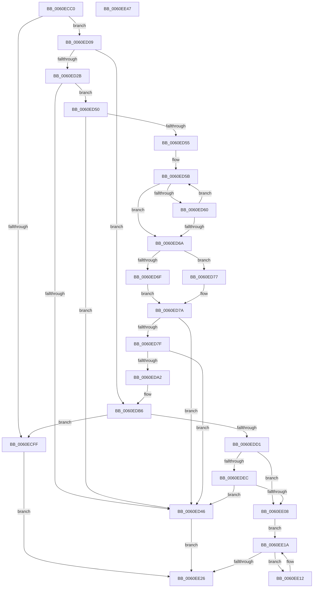

# SmUniqueIdParseProductName

- RVA: `0x0060ECC0`–`0x0060EE48` (길이 `392` bytes)
- VA: `0x000000014060ECC0`
- 실행 섹션: `.text`
- PDB 이름 있음: `예`; PDB Function 태그: `아니요`
- unwind 정보 RVA: `0x000847EC`
- 디코드: `114`개 명령, `392/392` bytes 표시
- 미해석 바이트: `0` (있으면 어셈블리에 `.byte`로 보존)

> 이 문서는 커널 이미지의 기계어와 PDB 기호를 분석해 생성했습니다. 4번과 5번은 함수 원형과 자료형을 바이너리 사용 방식에서 추정한 C 해석이며 원본 소스 복구 결과는 아닙니다.

## 1. Dependencies

- 직접 호출 지점: **8**; 고유 호출 대상: **4**
- 직접 호출자로 확인된 함수: **1**
- RIP 상대 이미지 참조: **3**

### Outgoing calls
- `0x0060ECF0` → [wcsstr](../50/wcsstr_function_00501F80.md) (function, `0x00501F80`)
- `0x0060ED15` → [wcschr](../50/wcschr_function_00501A60.md) (function, `0x00501A60`)
- `0x0060ED3D` → [StringCbCopyNW](StringCbCopyNW_function_0060F1A4.md) (function, `0x0060F1A4`)
- `0x0060ED99` → [StringCopyWorkerW](StringCopyWorkerW_function_0060F1F0.md) (function, `0x0060F1F0`)
- `0x0060EDC0` → [wcsstr](../50/wcsstr_function_00501F80.md) (function, `0x00501F80`)
- `0x0060EDDD` → [wcschr](../50/wcschr_function_00501A60.md) (function, `0x00501A60`)
- `0x0060EDFB` → [StringCbCopyNW](StringCbCopyNW_function_0060F1A4.md) (function, `0x0060F1A4`)
- `0x0060EE1C` → [wcschr](../50/wcschr_function_00501A60.md) (function, `0x00501A60`)

### Direct callers
- [SmKmEtwAppendProductName](SmKmEtwAppendProductName_function_0060F854.md) at `0x0060F90A`

### Static image references
- `0x0060ECE9` → RVA `0x006CD910` (` ?? ::FNODOBFM::`string'`; read)
- `0x0060ED92` → RVA `0x006CB4E0` (` ?? ::FNODOBFM::`string'`; read)
- `0x0060EDB6` → RVA `0x006CD920` (` ?? ::FNODOBFM::`string'`; read)

## 2. Other-region calls and transfers

- 다른 실행 섹션으로 향하는 call: **0**
- 별도 외부 분기/꼬리 이동을 확인하지 못했습니다.

## 3. Assembly (complete function range)

```asm
0060ECC0  48 8B C4                        mov rax, rsp
0060ECC3  48 89 58 08                     mov qword ptr [rax + 8], rbx
0060ECC7  48 89 68 10                     mov qword ptr [rax + 0x10], rbp
0060ECCB  48 89 70 18                     mov qword ptr [rax + 0x18], rsi
0060ECCF  48 89 78 20                     mov qword ptr [rax + 0x20], rdi
0060ECD3  41 54                           push r12
0060ECD5  41 56                           push r14
0060ECD7  41 57                           push r15
0060ECD9  48 83 EC 30                     sub rsp, 0x30
0060ECDD  4C 8B F2                        mov r14, rdx
0060ECE0  45 8B F8                        mov r15d, r8d
0060ECE3  48 8B EA                        mov rbp, rdx
0060ECE6  4C 8B E1                        mov r12, rcx
0060ECE9  48 8D 15 20 EC 0B 00            lea rdx, [rip + 0xbec20]
0060ECF0  E8 8B 32 EF FF                  call 0x140501f80
0060ECF5  33 DB                           xor ebx, ebx
0060ECF7  48 8B F0                        mov rsi, rax
0060ECFA  48 85 C0                        test rax, rax
0060ECFD  75 0A                           jne 0x14060ed09
0060ECFF  BB 00 A0 00 C0                  mov ebx, 0xc000a000
0060ED04  E9 1D 01 00 00                  jmp 0x14060ee26
0060ED09  48 83 C6 0A                     add rsi, 0xa
0060ED0D  BA 26 00 00 00                  mov edx, 0x26
0060ED12  48 8B CE                        mov rcx, rsi
0060ED15  E8 46 2D EF FF                  call 0x140501a60
0060ED1A  48 8B F8                        mov rdi, rax
0060ED1D  48 2B FE                        sub rdi, rsi
0060ED20  48 D1 FF                        sar rdi, 1
0060ED23  85 FF                           test edi, edi
0060ED25  0F 84 8B 00 00 00               je 0x14060edb6
0060ED2B  44 8B CF                        mov r9d, edi
0060ED2E  4C 8B C6                        mov r8, rsi
0060ED31  4D 03 C9                        add r9, r9
0060ED34  49 8B D7                        mov rdx, r15
0060ED37  49 8B CE                        mov rcx, r14
0060ED3A  4D 8B DF                        mov r11, r15
0060ED3D  E8 62 04 00 00                  call 0x14060f1a4
0060ED42  85 C0                           test eax, eax
0060ED44  79 0A                           jns 0x14060ed50
0060ED46  BB 23 00 00 C0                  mov ebx, 0xc0000023
0060ED4B  E9 D6 00 00 00                  jmp 0x14060ee26
0060ED50  49 D1 EB                        shr r11, 1
0060ED53  74 F1                           je 0x14060ed46
0060ED55  49 8B C3                        mov rax, r11
0060ED58  49 8B CE                        mov rcx, r14
0060ED5B  66 39 19                        cmp word ptr [rcx], bx
0060ED5E  74 0A                           je 0x14060ed6a
0060ED60  48 83 C1 02                     add rcx, 2
0060ED64  48 83 E8 01                     sub rax, 1
0060ED68  75 F1                           jne 0x14060ed5b
0060ED6A  48 85 C0                        test rax, rax
0060ED6D  74 08                           je 0x14060ed77
0060ED6F  49 8B CB                        mov rcx, r11
0060ED72  48 2B C8                        sub rcx, rax
0060ED75  EB 03                           jmp 0x14060ed7a
0060ED77  48 8B CB                        mov rcx, rbx
0060ED7A  48 85 C0                        test rax, rax
0060ED7D  74 C7                           je 0x14060ed46
0060ED7F  4C 2B D9                        sub r11, rcx
0060ED82  48 C7 44 24 20 FE FF FF 7F      mov qword ptr [rsp + 0x20], 0x7ffffffe
0060ED8B  49 8B D3                        mov rdx, r11
0060ED8E  49 8D 0C 4E                     lea rcx, [r14 + rcx*2]
0060ED92  4C 8D 0D 47 C7 0B 00            lea r9, [rip + 0xbc747]
0060ED99  E8 52 04 00 00                  call 0x14060f1f0
0060ED9E  85 C0                           test eax, eax
0060EDA0  78 A4                           js 0x14060ed46
0060EDA2  8D 47 01                        lea eax, [rdi + 1]
0060EDA5  B9 FE FF FF FF                  mov ecx, 0xfffffffe
0060EDAA  49 8D 2C 46                     lea rbp, [r14 + rax*2]
0060EDAE  8D 04 3F                        lea eax, [rdi + rdi]
0060EDB1  2B C8                           sub ecx, eax
0060EDB3  44 03 F9                        add r15d, ecx
0060EDB6  48 8D 15 63 EB 0B 00            lea rdx, [rip + 0xbeb63]
0060EDBD  49 8B CC                        mov rcx, r12
0060EDC0  E8 BB 31 EF FF                  call 0x140501f80
0060EDC5  48 8B F8                        mov rdi, rax
0060EDC8  48 85 C0                        test rax, rax
0060EDCB  0F 84 2E FF FF FF               je 0x14060ecff
0060EDD1  48 83 C7 0C                     add rdi, 0xc
0060EDD5  BA 26 00 00 00                  mov edx, 0x26
0060EDDA  48 8B CF                        mov rcx, rdi
0060EDDD  E8 7E 2C EF FF                  call 0x140501a60
0060EDE2  48 2B C7                        sub rax, rdi
0060EDE5  48 D1 F8                        sar rax, 1
0060EDE8  85 C0                           test eax, eax
0060EDEA  74 1C                           je 0x14060ee08
0060EDEC  44 8B C8                        mov r9d, eax
0060EDEF  4C 8B C7                        mov r8, rdi
0060EDF2  4D 03 C9                        add r9, r9
0060EDF5  41 8B D7                        mov edx, r15d
0060EDF8  48 8B CD                        mov rcx, rbp
0060EDFB  E8 A4 03 00 00                  call 0x14060f1a4
0060EE00  85 C0                           test eax, eax
0060EE02  0F 88 3E FF FF FF               js 0x14060ed46
0060EE08  BF 5F 00 00 00                  mov edi, 0x5f
0060EE0D  49 8B CE                        mov rcx, r14
0060EE10  EB 08                           jmp 0x14060ee1a
0060EE12  66 C7 00 20 00                  mov word ptr [rax], 0x20
0060EE17  48 8B C8                        mov rcx, rax
0060EE1A  8B D7                           mov edx, edi
0060EE1C  E8 3F 2C EF FF                  call 0x140501a60
0060EE21  48 85 C0                        test rax, rax
0060EE24  75 EC                           jne 0x14060ee12
0060EE26  48 8B 6C 24 58                  mov rbp, qword ptr [rsp + 0x58]
0060EE2B  8B C3                           mov eax, ebx
0060EE2D  48 8B 5C 24 50                  mov rbx, qword ptr [rsp + 0x50]
0060EE32  48 8B 74 24 60                  mov rsi, qword ptr [rsp + 0x60]
0060EE37  48 8B 7C 24 68                  mov rdi, qword ptr [rsp + 0x68]
0060EE3C  48 83 C4 30                     add rsp, 0x30
0060EE40  41 5F                           pop r15
0060EE42  41 5E                           pop r14
0060EE44  41 5C                           pop r12
0060EE46  C3                              ret
0060EE47  CC                              int3
```

## 4. C-style interpretation (structured pseudocode)

```c
__int64 __fastcall SmUniqueIdParseProductName(__int64 a1, __int64 a2, int a3)
{
    __int64 result;
    __int64 v_r11;
    __int64 v_r15;
    __int64 v_rbx;
    __int64 v_rdi;
    __int64 v_rsi;
    __int64 v_rsp;
    unsigned __int64 v_stack_m28;
    unsigned __int64 v_stack_p10;
    unsigned __int64 v_stack_p18;
    unsigned __int64 v_stack_p20;
    unsigned __int64 v_stack_p8;

    *(unsigned __int64 *)(v_rsp + 8) = v_rbx;
    *(unsigned __int64 *)(v_rsp + 16) = v_rbp;
    *(unsigned __int64 *)(v_rsp + 24) = v_rsi;
    *(unsigned __int64 *)(v_rsp + 32) = v_rdi;
    v_rsp = (v_rsp) - (48);
    result = wcsstr(a1, v_rip + 781344, a3, a4);
    v_rbx = 0;
    if (result != 0) goto loc_0060ED09;
loc_0060ECFF:
    goto loc_0060EE26;
loc_0060ED09:
    v_rsi = (result) + (10);
    result = wcschr(v_rsi, 38, a3, a4);
    v_rdi = (result) - (v_rsi);
    v_rdi = (v_rdi) >> (1);
    if ((unsigned int)(v_rdi) == 0) goto loc_0060EDB6;
    a4 = ((unsigned int)((unsigned int)(v_rdi))) + ((unsigned int)((unsigned int)(v_rdi)));
    result = StringCbCopyNW(a2, (unsigned int)(a3), v_rsi, a4);
    if (!sign_flag) goto loc_0060ED50;
loc_0060ED46:
    goto loc_0060EE26;
loc_0060ED50:
    v_r11 = ((unsigned int)(a3)) >> (1);
    if (condition_is_equal) goto loc_0060ED46;
loc_0060ED5B:
    if ((*(unsigned __int16 *)(a2)) == ((unsigned __int16)((unsigned int)(0xC0000023ULL)))) goto loc_0060ED6A;
    a1 = (a2) + (2);
    result = (v_r11) - (1);
    if (condition_is_not_equal) goto loc_0060ED5B;
loc_0060ED6A:
    if (result == 0) goto loc_0060ED77;
    a1 = (v_r11) - (result);
    goto loc_0060ED7A;
loc_0060ED77:
loc_0060ED7A:
    if (result == 0) goto loc_0060ED46;
    v_r11 = (v_r11) - ((unsigned int)(0xC0000023ULL));
    v_stack_m28 = 0x7FFFFFFEULL;
    result = StringCopyWorkerW(a2 + (unsigned int)(0xC0000023ULL) * 2, v_r11, v_rsi, v_rip + 771911);
    if (sign_flag) goto loc_0060ED46;
    a1 = (unsigned int)(((unsigned int)(0xFFFFFFFEULL)) - ((unsigned int)(v_rdi + v_rdi * 1)));
    v_r15 = (unsigned int)(((unsigned int)(a3)) + ((unsigned int)(a1)));
loc_0060EDB6:
    result = wcsstr(a1, v_rip + 781155, v_rsi, v_rip + 771911);
    if (result == 0) goto loc_0060ECFF;
    v_rdi = (result) + (12);
    result = wcschr(v_rdi, 38, v_rsi, v_rip + 771911);
    result = (result) - (v_rdi);
    result = (result) >> (1);
    if ((unsigned int)(result) == 0) goto loc_0060EE08;
    a4 = ((unsigned int)((unsigned int)(result))) + ((unsigned int)((unsigned int)(result)));
    result = StringCbCopyNW(a2 + v_rdi + 1 * 2, (unsigned int)((unsigned int)(v_r15)), v_rdi, a4);
    if (sign_flag) goto loc_0060ED46;
loc_0060EE08:
    goto loc_0060EE1A;
loc_0060EE12:
    *(unsigned __int16 *)(result) = 32;
loc_0060EE1A:
    result = wcschr(result, 95, v_rdi, a4);
    if (result != 0) goto loc_0060EE12;
loc_0060EE26:
    v_rsp = (v_rsp) + (48);
    return (unsigned int)((unsigned int)((unsigned int)(0xC0000023ULL)));
}
```

## 5. (Beta) C Style

```c
int64_t SmUniqueIdParseProductName(int64_t Arg1, void *Arg2, int32_t Arg3)
{
    uint8_t *arg2 = (uint8_t *)Arg2;

    int64_t result;
    int64_t local_r11;
    int64_t local_r15;
    int64_t local_rbx;
    int64_t local_rdi;
    int64_t local_rsi;
    int64_t local_rsp;
    uint64_t v_stack_m28;
    uint64_t v_stack_p10;
    uint64_t v_stack_p18;
    uint64_t v_stack_p20;
    uint64_t v_stack_p8;

    *(uint64_t *)(local_rsp + 0x8) = local_rbx;
    *(uint64_t *)(local_rsp + 0x10) = local_rbp;
    *(uint64_t *)(local_rsp + 0x18) = local_rsi;
    *(uint64_t *)(local_rsp + 0x20) = local_rdi;
    local_rsp = (local_rsp) - (48);
    result = wcsstr(Arg1, v_rip + 781344, Arg3, a4);
    local_rbx = 0;
    if (result != 0) goto loc_0060ED09;
loc_0060ECFF:
    goto loc_0060EE26;
loc_0060ED09:
    local_rsi = (result) + (10);
    result = wcschr(local_rsi, 38, Arg3, a4);
    local_rdi = (result) - (local_rsi);
    local_rdi = (local_rdi) >> (1);
    if ((uint32_t)(local_rdi) == 0) goto loc_0060EDB6;
    a4 = ((uint32_t)((uint32_t)(local_rdi))) + ((uint32_t)((uint32_t)(local_rdi)));
    result = StringCbCopyNW(Arg2, (uint32_t)(Arg3), local_rsi, a4);
    if (!sign_flag) goto loc_0060ED50;
loc_0060ED46:
    goto loc_0060EE26;
loc_0060ED50:
    local_r11 = ((uint32_t)(Arg3)) >> (1);
    if (condition_is_equal) goto loc_0060ED46;
loc_0060ED5B:
    if ((*(uint16_t *)(arg2)) == ((uint16_t)((uint32_t)(0xC0000023ULL)))) goto loc_0060ED6A;
    Arg1 = (Arg2) + (2);
    result = (local_r11) - (1);
    if (condition_is_not_equal) goto loc_0060ED5B;
loc_0060ED6A:
    if (result == 0) goto loc_0060ED77;
    Arg1 = (local_r11) - (result);
    goto loc_0060ED7A;
loc_0060ED77:
loc_0060ED7A:
    if (result == 0) goto loc_0060ED46;
    local_r11 = (local_r11) - ((uint32_t)(0xC0000023ULL));
    v_stack_m28 = 0x7FFFFFFEULL;
    result = StringCopyWorkerW(Arg2 + (uint32_t)(0xC0000023ULL) * 2, local_r11, local_rsi, v_rip + 771911);
    if (sign_flag) goto loc_0060ED46;
    Arg1 = (uint32_t)(((uint32_t)(0xFFFFFFFEULL)) - ((uint32_t)(local_rdi + local_rdi * 1)));
    local_r15 = (uint32_t)(((uint32_t)(Arg3)) + ((uint32_t)(Arg1)));
loc_0060EDB6:
    result = wcsstr(Arg1, v_rip + 781155, local_rsi, v_rip + 771911);
    if (result == 0) goto loc_0060ECFF;
    local_rdi = (result) + (12);
    result = wcschr(local_rdi, 38, local_rsi, v_rip + 771911);
    result = (result) - (local_rdi);
    result = (result) >> (1);
    if ((uint32_t)(result) == 0) goto loc_0060EE08;
    a4 = ((uint32_t)((uint32_t)(result))) + ((uint32_t)((uint32_t)(result)));
    result = StringCbCopyNW(Arg2 + local_rdi + 1 * 2, (uint32_t)((uint32_t)(local_r15)), local_rdi, a4);
    if (sign_flag) goto loc_0060ED46;
loc_0060EE08:
    goto loc_0060EE1A;
loc_0060EE12:
    *(uint16_t *)(result) = 32;
loc_0060EE1A:
    result = wcschr(result, 95, local_rdi, a4);
    if (result != 0) goto loc_0060EE12;
loc_0060EE26:
    local_rsp = (local_rsp) + (48);
    return (uint32_t)((uint32_t)((uint32_t)(0xC0000023ULL)));
}
```

### 관측된 메모리 오프셋

구조체 형식이 확인되지 않은 접근은 인자 기준의 오프셋으로만 기록했습니다.

| 기준 인자 | 오프셋 표현 | 폭 (bit) | 접근 |
|---|---:|---:|---|
| `Arg2` | `+ 0x0` | `16` | `R` |
| `Arg2` | `+ 0x0 + rax*2` | `64` | `R` |
| `Arg2` | `+ 0x0 + rcx*2` | `64` | `R` |

## 6. Execution-region graph

[열기: 2D/3D 그래프와 함수 탐색 컨트롤 패널](../../../control-panel.html?section=text&rva=0x0060ECC0&view=graph)

- 2D 그래프는 위에서 아래로 흐르고, 3D 그래프는 빈 공간을 드래그해 회전합니다. Shift+드래그는 이동, 휠은 확대·축소, 함수 노드 선택은 대상 보고서 이동입니다.

### Static fallback


