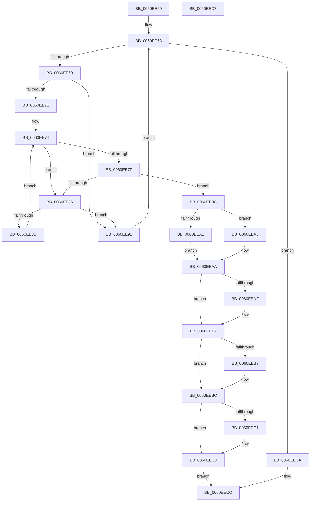

# StEtaCheckForRefresh

- RVA: `0x0060EE50`–`0x0060EED8` (길이 `136` bytes)
- VA: `0x000000014060EE50`
- 실행 섹션: `.text`
- PDB 이름 있음: `예`; PDB Function 태그: `아니요`
- unwind 정보 RVA: `0x000950EC`
- 디코드: `47`개 명령, `136/136` bytes 표시
- 미해석 바이트: `0` (있으면 어셈블리에 `.byte`로 보존)

> 이 문서는 커널 이미지의 기계어와 PDB 기호를 분석해 생성했습니다. 4번과 5번은 함수 원형과 자료형을 바이너리 사용 방식에서 추정한 C 해석이며 원본 소스 복구 결과는 아닙니다.

## 1. Dependencies

- 직접 호출 지점: **0**; 고유 호출 대상: **0**
- 직접 호출자로 확인된 함수: **1**
- RIP 상대 이미지 참조: **0**

### Outgoing calls
- 직접 디코드된 call 명령이 없습니다.

### Direct callers
- [ST_STORE&lt;SM_TRAITS&gt;::StDmEtaRefresh](../4D/ST_STORE_SM_TRAITS_StDmEtaRefresh_function_004D71BC.md) at `0x004D720D`

### Static image references
- 디코드된 RIP-relative 메모리 참조가 없습니다.

## 2. Other-region calls and transfers

- 다른 실행 섹션으로 향하는 call: **0**
- 별도 외부 분기/꼬리 이동을 확인하지 못했습니다.

## 3. Assembly (complete function range)

```asm
0060EE50  48 89 5C 24 08                  mov qword ptr [rsp + 8], rbx
0060EE55  48 89 7C 24 10                  mov qword ptr [rsp + 0x10], rdi
0060EE5A  33 DB                           xor ebx, ebx
0060EE5C  4C 8D 59 10                     lea r11, [rcx + 0x10]
0060EE60  45 33 D2                        xor r10d, r10d
0060EE63  49 83 FA 02                     cmp r10, 2
0060EE67  7D 61                           jge 0x14060eeca
0060EE69  49 8B 03                        mov rax, qword ptr [r11]
0060EE6C  48 85 C0                        test rax, rax
0060EE6F  74 20                           je 0x14060ee91
0060EE71  48 8B C8                        mov rcx, rax
0060EE74  BF 80 00 00 00                  mov edi, 0x80
0060EE79  66 39 79 04                     cmp word ptr [rcx + 4], di
0060EE7D  76 07                           jbe 0x14060ee86
0060EE7F  48 83 79 08 00                  cmp qword ptr [rcx + 8], 0
0060EE84  77 16                           ja 0x14060ee9c
0060EE86  83 39 FF                        cmp dword ptr [rcx], -1
0060EE89  73 06                           jae 0x14060ee91
0060EE8B  48 83 C1 20                     add rcx, 0x20
0060EE8F  EB E3                           jmp 0x14060ee74
0060EE91  FF C3                           inc ebx
0060EE93  49 FF C2                        inc r10
0060EE96  49 83 C3 08                     add r11, 8
0060EE9A  EB C7                           jmp 0x14060ee63
0060EE9C  48 3B C8                        cmp rcx, rax
0060EE9F  76 07                           jbe 0x14060eea8
0060EEA1  8B 41 E0                        mov eax, dword ptr [rcx - 0x20]
0060EEA4  FF C0                           inc eax
0060EEA6  EB 02                           jmp 0x14060eeaa
0060EEA8  33 C0                           xor eax, eax
0060EEAA  4D 85 C0                        test r8, r8
0060EEAD  74 03                           je 0x14060eeb2
0060EEAF  41 89 00                        mov dword ptr [r8], eax
0060EEB2  4D 85 C9                        test r9, r9
0060EEB5  74 05                           je 0x14060eebc
0060EEB7  8B 09                           mov ecx, dword ptr [rcx]
0060EEB9  41 89 09                        mov dword ptr [r9], ecx
0060EEBC  48 85 D2                        test rdx, rdx
0060EEBF  74 02                           je 0x14060eec3
0060EEC1  89 1A                           mov dword ptr [rdx], ebx
0060EEC3  B8 01 00 00 00                  mov eax, 1
0060EEC8  EB 02                           jmp 0x14060eecc
0060EECA  33 C0                           xor eax, eax
0060EECC  48 8B 5C 24 08                  mov rbx, qword ptr [rsp + 8]
0060EED1  48 8B 7C 24 10                  mov rdi, qword ptr [rsp + 0x10]
0060EED6  C3                              ret
0060EED7  CC                              int3
```

## 4. C-style interpretation (structured pseudocode)

```c
__int64 __fastcall StEtaCheckForRefresh(__int64 a1, __int64 a2, __int64 a3, __int64 a4)
{
    __int64 result;
    __int64 v_r10;
    __int64 v_r11;
    __int64 v_rbx;
    unsigned __int64 v_stack_p10;
    unsigned __int64 v_stack_p8;

    v_stack_p8 = v_rbx;
    v_stack_p10 = v_rdi;
    v_rbx = 0;
    v_r10 = 0;
loc_0060EE63:
    if (0 >= 2) goto loc_0060EECA;
    if (*(unsigned __int64 *)(a1 + 16) == 0) goto loc_0060EE91;
loc_0060EE74:
    if ((*(unsigned __int16 *)(*(unsigned __int64 *)(a1 + 16) + 4)) <= 128) goto loc_0060EE86;
    if ((*(unsigned __int64 *)(*(unsigned __int64 *)(a1 + 16) + 8)) > 0) goto loc_0060EE9C;
loc_0060EE86:
    if ((*(unsigned int *)(*(unsigned __int64 *)(a1 + 16))) >= -1) goto loc_0060EE91;
    a1 = (*(unsigned __int64 *)(a1 + 16)) + (32);
    goto loc_0060EE74;
loc_0060EE91:
    v_rbx = (unsigned int)((v_rbx) + 1);
    v_r10 = (v_r10) + 1;
    v_r11 = (a1 + 16) + (8);
    goto loc_0060EE63;
loc_0060EE9C:
    if (a1 <= (*(unsigned __int64 *)(a1 + 16))) goto loc_0060EEA8;
    result = (unsigned int)(((unsigned int)(*(unsigned int *)(a1 - 32))) + 1);
    goto loc_0060EEAA;
loc_0060EEA8:
    result = 0;
loc_0060EEAA:
    if (a3 != 0) {
        *(unsigned int *)(a3) = 0;
    }
    if (a4 != 0) {
        a1 = *(unsigned int *)(a1);
        *(unsigned int *)(a4) = (unsigned int)(a1);
    }
    if (a2 != 0) {
        *(unsigned int *)(a2) = (unsigned int)(v_rbx);
    }
    goto loc_0060EECC;
loc_0060EECA:
    result = 0;
loc_0060EECC:
    return result;
}
```

## 5. (Beta) C Style

```c
int64_t StEtaCheckForRefresh(void *Arg1, int64_t Arg2, int64_t Arg3, int64_t Arg4)
{
    uint8_t *arg1 = (uint8_t *)Arg1;

    int64_t result;
    int64_t local_r10;
    int64_t local_r11;
    int64_t local_rbx;
    uint64_t v_stack_p10;
    uint64_t v_stack_p8;

    v_stack_p8 = local_rbx;
    v_stack_p10 = local_rdi;
    local_rbx = 0;
    local_r10 = 0;
loc_0060EE63:
    if (0 >= 2) goto loc_0060EECA;
    if (*(uint64_t *)(arg1 + 0x10) == 0) goto loc_0060EE91;
loc_0060EE74:
    if ((*(uint16_t *)(*(uint64_t *)(arg1 + 0x10) + 0x4)) <= 128) goto loc_0060EE86;
    if ((*(uint64_t *)(*(uint64_t *)(arg1 + 0x10) + 0x8)) > 0) goto loc_0060EE9C;
loc_0060EE86:
    if ((*(uint32_t *)(*(uint64_t *)(arg1 + 0x10))) >= -1) goto loc_0060EE91;
    Arg1 = (*(uint64_t *)(arg1 + 0x10)) + (32);
    goto loc_0060EE74;
loc_0060EE91:
    local_rbx = (uint32_t)((local_rbx) + 1);
    local_r10 = (local_r10) + 1;
    local_r11 = (Arg1 + 16) + (8);
    goto loc_0060EE63;
loc_0060EE9C:
    if (Arg1 <= (*(uint64_t *)(arg1 + 0x10))) goto loc_0060EEA8;
    result = (uint32_t)(((uint32_t)(*(uint32_t *)(arg1 - 0x20))) + 1);
    goto loc_0060EEAA;
loc_0060EEA8:
    result = 0;
loc_0060EEAA:
    if (Arg3 != 0) {
        *(uint32_t *)(Arg3) = 0;
    }
    if (Arg4 != 0) {
        Arg1 = *(uint32_t *)(arg1);
        *(uint32_t *)(Arg4) = (uint32_t)(Arg1);
    }
    if (Arg2 != 0) {
        *(uint32_t *)(Arg2) = (uint32_t)(local_rbx);
    }
    goto loc_0060EECC;
loc_0060EECA:
    result = 0;
loc_0060EECC:
    return result;
}
```

### 관측된 메모리 오프셋

구조체 형식이 확인되지 않은 접근은 인자 기준의 오프셋으로만 기록했습니다.

| 기준 인자 | 오프셋 표현 | 폭 (bit) | 접근 |
|---|---:|---:|---|
| `Arg1` | `+ 0x0` | `64` | `R` |
| `Arg1` | `+ 0x10` | `64` | `R` |

## 6. Execution-region graph

[열기: 2D/3D 그래프와 함수 탐색 컨트롤 패널](../../../control-panel.html?section=text&rva=0x0060EE50&view=graph)

- 2D 그래프는 위에서 아래로 흐르고, 3D 그래프는 빈 공간을 드래그해 회전합니다. Shift+드래그는 이동, 휠은 확대·축소, 함수 노드 선택은 대상 보고서 이동입니다.

### Static fallback


