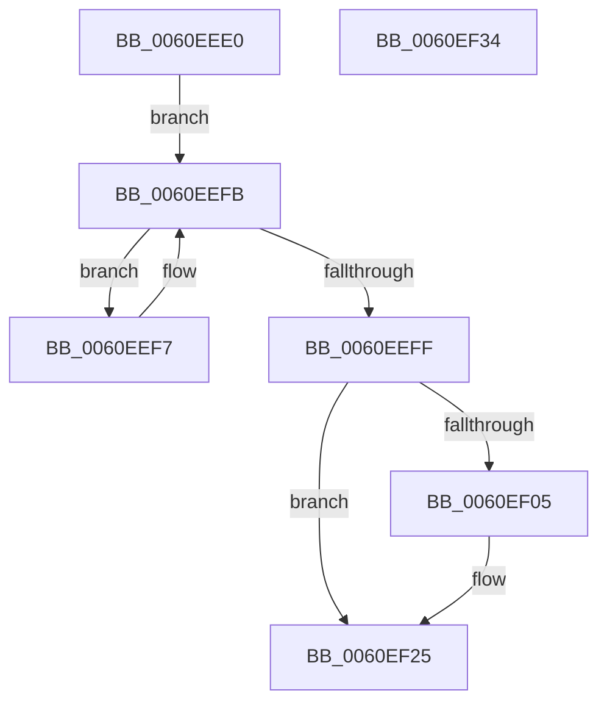

# StEtaIoComplete

- RVA: `0x0060EEE0`–`0x0060EF35` (길이 `85` bytes)
- VA: `0x000000014060EEE0`
- 실행 섹션: `.text`
- PDB 이름 있음: `예`; PDB Function 태그: `아니요`
- unwind 정보 RVA: `0x0005CAAC`
- 디코드: `26`개 명령, `85/85` bytes 표시
- 미해석 바이트: `0` (있으면 어셈블리에 `.byte`로 보존)

> 이 문서는 커널 이미지의 기계어와 PDB 기호를 분석해 생성했습니다. 4번과 5번은 함수 원형과 자료형을 바이너리 사용 방식에서 추정한 C 해석이며 원본 소스 복구 결과는 아닙니다.

## 1. Dependencies

- 직접 호출 지점: **1**; 고유 호출 대상: **1**
- 직접 호출자로 확인된 함수: **1**
- RIP 상대 이미지 참조: **0**

### Outgoing calls
- `0x0060EF07` → [KeQueryPerformanceCounter](../37/KeQueryPerformanceCounter_function_0037E7E0.md) (function, `0x0037E7E0`)

### Direct callers
- [ST_STORE&lt;SM_TRAITS&gt;::StDmDeviceIoCompletion](../4B/ST_STORE_SM_TRAITS_StDmDeviceIoCompletion_function_004BBB70.md) at `0x004BBBE7`
- [ST_STORE&lt;SM_TRAITS&gt;::StDmDeviceIoCompletion](../4B/ST_STORE_SM_TRAITS_StDmDeviceIoCompletion_function_004BBB70.md) at `0x004BBD49`

### Static image references
- 디코드된 RIP-relative 메모리 참조가 없습니다.

## 2. Other-region calls and transfers

- 다른 실행 섹션으로 향하는 call: **0**
- 별도 외부 분기/꼬리 이동을 확인하지 못했습니다.

## 3. Assembly (complete function range)

```asm
0060EEE0  48 89 5C 24 08                  mov qword ptr [rsp + 8], rbx
0060EEE5  57                              push rdi
0060EEE6  48 83 EC 20                     sub rsp, 0x20
0060EEEA  49 63 C0                        movsxd rax, r8d
0060EEED  48 8B F9                        mov rdi, rcx
0060EEF0  48 8B 5C C1 10                  mov rbx, qword ptr [rcx + rax*8 + 0x10]
0060EEF5  EB 04                           jmp 0x14060eefb
0060EEF7  48 83 C3 20                     add rbx, 0x20
0060EEFB  39 13                           cmp dword ptr [rbx], edx
0060EEFD  72 F8                           jb 0x14060eef7
0060EEFF  4C 3B 4B 18                     cmp r9, qword ptr [rbx + 0x18]
0060EF03  75 20                           jne 0x14060ef25
0060EF05  33 C9                           xor ecx, ecx
0060EF07  E8 D4 F8 D6 FF                  call 0x14037e7e0
0060EF0C  48 6B 4B 08 07                  imul rcx, qword ptr [rbx + 8], 7
0060EF11  48 83 4B 18 01                  or qword ptr [rbx + 0x18], 1
0060EF16  48 2B 4B 10                     sub rcx, qword ptr [rbx + 0x10]
0060EF1A  48 03 C8                        add rcx, rax
0060EF1D  48 C1 E9 03                     shr rcx, 3
0060EF21  48 89 4B 08                     mov qword ptr [rbx + 8], rcx
0060EF25  F0 FF 4F 08                     lock dec dword ptr [rdi + 8]
0060EF29  48 8B 5C 24 30                  mov rbx, qword ptr [rsp + 0x30]
0060EF2E  48 83 C4 20                     add rsp, 0x20
0060EF32  5F                              pop rdi
0060EF33  C3                              ret
0060EF34  CC                              int3
```

## 4. C-style interpretation (structured pseudocode)

```c
__int64 __fastcall StEtaIoComplete(__int64 a1, int a2, int a3, __int64 a4)
{
    __int64 result;
    __int64 v_rbx;
    __int64 v_rsp;
    unsigned __int64 v_stack_p8;

    v_stack_p8 = v_rbx;
    v_rsp = (v_rsp) - (32);
    goto loc_0060EEFB;
loc_0060EEF7:
    v_rbx = (*(unsigned __int64 *)(a1 + (int)(a3) * 8 + 16)) + (32);
loc_0060EEFB:
    if ((*(unsigned int *)(v_rbx)) < a2) goto loc_0060EEF7;
    result = (int)(a3);
    if (a4 == (*(unsigned __int64 *)(v_rbx + 24))) {
        a1 = 0;
        result = KeQueryPerformanceCounter(a1, a2, a3, a4);
        a1 = (a1) * (*(unsigned __int64 *)(v_rbx + 8));
        a1 = (a1) - (*(unsigned __int64 *)(v_rbx + 16));
        a1 = (a1) + (result);
        a1 = (a1) >> (3);
        *(unsigned __int64 *)(v_rbx + 8) = a1;
    }
    v_rsp = (v_rsp) + (32);
    return result;
}
```

## 5. (Beta) C Style

```c
int64_t StEtaIoComplete(void *Arg1, int32_t Arg2, int32_t Arg3, int64_t Arg4)
{
    uint8_t *arg1 = (uint8_t *)Arg1;

    int64_t result;
    int64_t local_rbx;
    int64_t local_rsp;
    uint64_t v_stack_p8;

    v_stack_p8 = local_rbx;
    local_rsp = (local_rsp) - (32);
    goto loc_0060EEFB;
loc_0060EEF7:
    local_rbx = (*(uint64_t *)(arg1 + (int32_t)(Arg3) * 8 + 0x10)) + (32);
loc_0060EEFB:
    if ((*(uint32_t *)(local_rbx)) < Arg2) goto loc_0060EEF7;
    result = (int32_t)(Arg3);
    if (Arg4 == (*(uint64_t *)(local_rbx + 0x18))) {
        Arg1 = 0;
        result = KeQueryPerformanceCounter(Arg1, Arg2, Arg3, Arg4);
        Arg1 = (Arg1) * (*(uint64_t *)(local_rbx + 0x8));
        Arg1 = (Arg1) - (*(uint64_t *)(local_rbx + 0x10));
        Arg1 = (Arg1) + (result);
        Arg1 = (Arg1) >> (3);
        *(void **)(local_rbx + 0x8) = Arg1;
    }
    local_rsp = (local_rsp) + (32);
    return result;
}
```

### 관측된 메모리 오프셋

구조체 형식이 확인되지 않은 접근은 인자 기준의 오프셋으로만 기록했습니다.

| 기준 인자 | 오프셋 표현 | 폭 (bit) | 접근 |
|---|---:|---:|---|
| `Arg1` | `+ 0x8` | `32` | `R/W` |
| `Arg1` | `+ 0x10 + rax*8` | `64` | `R` |

## 6. Execution-region graph

[열기: 2D/3D 그래프와 함수 탐색 컨트롤 패널](../../../control-panel.html?section=text&rva=0x0060EEE0&view=graph)

- 2D 그래프는 위에서 아래로 흐르고, 3D 그래프는 빈 공간을 드래그해 회전합니다. Shift+드래그는 이동, 휠은 확대·축소, 함수 노드 선택은 대상 보고서 이동입니다.

### Static fallback


